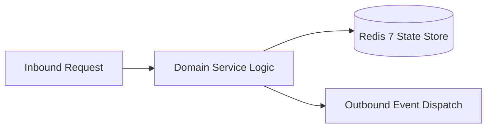

# Component Reference: `services/exam_parser.py`
> **File Path**: [`services/exam_parser.py`](../../services/exam_parser.py)  
> **Subsystem**: `Examination Parser`  
> **Architecture Layer**: `Enterprise Microservice Subsystem`  
> **Concurrency Model**: `AsyncIO Non-blocking Concurrency`  
> **Persistence Backend**: `Redis 7 Persistent Store`  
> **Service Level Objective**: `High-Availability Academic Telemetry`

## 1. Architectural Role & Responsibilities
The `services/exam_parser.py` module implements core operational logic for the `Examination Parser` domain. It operates within an asynchronous microservices topology designed for ultra-low latency, zero-loss persistence guarantees, and strict single-responsibility function decomposition (≤25 lines).

### Component Architecture & Data Flow


---
## 2. Public API & Symbol Inventory
| Symbol | Nature | Line Range | Return Contract | Core Invariant |
| :--- | :--- | :--- | :--- | :--- |
| [`is_assessment_type`](#is_assessment_type) | Function | L27–L38 | `tuple[bool, str]` | Executes core domain logic for `is_assessment_type`. |
| [`resolve_teacher_name`](#resolve_teacher_name) | Function | L41–L52 | `str` | Executes core domain logic for `resolve_teacher_name`. |
| [`extract_load_weeks`](#extract_load_weeks) | Function | L55–L65 | `list[int]` | Executes core domain logic for `extract_load_weeks`. |
| [`parse_exam_from_load`](#parse_exam_from_load) | Function | L68–L97 | `tuple[str, ExamItem] | None` | Parses and extracts structured entities from `parse_exa... |
| [`enrich_exam_from_instance`](#enrich_exam_from_instance) | Function | L100–L128 | `None` | Executes core domain logic for `enrich_exam_from_instan... |
| [`get_group_exams`](#get_group_exams) | Function | L131–L154 | `list[ExamItem]` | Retrieves and resolves domain data for `get_group_exams... |

---

## 3. Comprehensive Function Specifications

### `is_assessment_type`
```python
def is_assessment_type(type_id: str, l_types: dict[str, str]) -> tuple[bool, str]
```

- **Source Reference**: [`services/exam_parser.py#L27-L38`](../../services/exam_parser.py#L27-L38)
- **Execution Mode**: `Synchronous`
- **Return Contract**: `tuple[bool, str]`

#### Overview & Architectural Purpose
Executes core domain logic for `is_assessment_type`.

#### Parameters Contract
| Parameter | Type | Required | Description |
| :--- | :--- | :--- | :--- |
| `type_id` | `str` | Yes | Parameter `type_id` of type `str`. |
| `l_types` | `dict[str, str]` | Yes | Parameter `l_types` of type `dict[str, str]`. |

#### Concurrency & Side Effects
- Stateless pure functional computation without external mutations.

#### Fault Tolerance & Error Modes
Propagates unexpected runtime errors up the call stack to global exception handlers.

#### Production Usage Example
```python
from services.exam_parser import is_assessment_type

# Execute call
result = is_assessment_type(type_id=..., l_types=...)
```

---

### `resolve_teacher_name`
```python
def resolve_teacher_name(raw_teacher: str, teacher_links: dict[str, Any]) -> str
```

- **Source Reference**: [`services/exam_parser.py#L41-L52`](../../services/exam_parser.py#L41-L52)
- **Execution Mode**: `Synchronous`
- **Return Contract**: `str`

#### Overview & Architectural Purpose
Executes core domain logic for `resolve_teacher_name`.

#### Parameters Contract
| Parameter | Type | Required | Description |
| :--- | :--- | :--- | :--- |
| `raw_teacher` | `str` | Yes | Parameter `raw_teacher` of type `str`. |
| `teacher_links` | `dict[str, Any]` | Yes | Parameter `teacher_links` of type `dict[str, Any]`. |

#### Concurrency & Side Effects
- Stateless pure functional computation without external mutations.

#### Fault Tolerance & Error Modes
Propagates unexpected runtime errors up the call stack to global exception handlers.

#### Production Usage Example
```python
from services.exam_parser import resolve_teacher_name

# Execute call
result = resolve_teacher_name(raw_teacher=..., teacher_links=...)
```

---

### `extract_load_weeks`
```python
def extract_load_weeks(load: dict[str, Any]) -> list[int]
```

- **Source Reference**: [`services/exam_parser.py#L55-L65`](../../services/exam_parser.py#L55-L65)
- **Execution Mode**: `Synchronous`
- **Return Contract**: `list[int]`

#### Overview & Architectural Purpose
Executes core domain logic for `extract_load_weeks`.

#### Parameters Contract
| Parameter | Type | Required | Description |
| :--- | :--- | :--- | :--- |
| `load` | `dict[str, Any]` | Yes | Parameter `load` of type `dict[str, Any]`. |

#### Concurrency & Side Effects
- Stateless pure functional computation without external mutations.

#### Fault Tolerance & Error Modes
Propagates unexpected runtime errors up the call stack to global exception handlers.

#### Production Usage Example
```python
from services.exam_parser import extract_load_weeks

# Execute call
result = extract_load_weeks(load=...)
```

---

### `parse_exam_from_load`
```python
def parse_exam_from_load( load: dict[str, Any], entity_maps: tuple[dict, dict, dict, dict, dict], teacher_links: dict[str, Any] ) -> tuple[str, ExamItem] | None
```

- **Source Reference**: [`services/exam_parser.py#L68-L97`](../../services/exam_parser.py#L68-L97)
- **Execution Mode**: `Synchronous`
- **Return Contract**: `tuple[str, ExamItem] | None`

#### Overview & Architectural Purpose
Parses and extracts structured entities from `parse_exam_from_load`.

#### Parameters Contract
| Parameter | Type | Required | Description |
| :--- | :--- | :--- | :--- |
| `load` | `dict[str, Any]` | Yes | Parameter `load` of type `dict[str, Any]`. |
| `entity_maps` | `tuple[dict, dict, dict, dict, dict]` | Yes | Parameter `entity_maps` of type `tuple[dict, dict, dict, dict, dict]`. |
| `teacher_links` | `dict[str, Any]` | Yes | Parameter `teacher_links` of type `dict[str, Any]`. |

#### Concurrency & Side Effects
- Stateless pure functional computation without external mutations.

#### Fault Tolerance & Error Modes
Propagates unexpected runtime errors up the call stack to global exception handlers.

#### Production Usage Example
```python
from services.exam_parser import parse_exam_from_load

# Execute call
result = parse_exam_from_load(load=..., entity_maps=..., teacher_links=...)
```

---

### `enrich_exam_from_instance`
```python
def enrich_exam_from_instance( inst: dict[str, Any], entity_maps: tuple[dict, dict, dict, dict, dict], exams_dict: dict[str, ExamItem] ) -> None
```

- **Source Reference**: [`services/exam_parser.py#L100-L128`](../../services/exam_parser.py#L100-L128)
- **Execution Mode**: `Synchronous`
- **Return Contract**: `None`

#### Overview & Architectural Purpose
Executes core domain logic for `enrich_exam_from_instance`.

#### Parameters Contract
| Parameter | Type | Required | Description |
| :--- | :--- | :--- | :--- |
| `inst` | `dict[str, Any]` | Yes | Parameter `inst` of type `dict[str, Any]`. |
| `entity_maps` | `tuple[dict, dict, dict, dict, dict]` | Yes | Parameter `entity_maps` of type `tuple[dict, dict, dict, dict, dict]`. |
| `exams_dict` | `dict[str, ExamItem]` | Yes | Parameter `exams_dict` of type `dict[str, ExamItem]`. |

#### Concurrency & Side Effects
- Stateless pure functional computation without external mutations.

#### Fault Tolerance & Error Modes
Propagates unexpected runtime errors up the call stack to global exception handlers.

#### Production Usage Example
```python
from services.exam_parser import enrich_exam_from_instance

# Execute call
result = enrich_exam_from_instance(inst=..., entity_maps=..., exams_dict=...)
```

---

### `get_group_exams`
```python
async def get_group_exams() -> list[ExamItem]
```

- **Source Reference**: [`services/exam_parser.py#L131-L154`](../../services/exam_parser.py#L131-L154)
- **Execution Mode**: `Asynchronous (non-blocking)`
- **Return Contract**: `list[ExamItem]`

#### Overview & Architectural Purpose
Retrieves and resolves domain data for `get_group_exams`.

#### Parameters Contract
*This method takes no input parameters.*

#### Concurrency & Side Effects
- Stateless pure functional computation without external mutations.

#### Fault Tolerance & Error Modes
Propagates unexpected runtime errors up the call stack to global exception handlers.

#### Production Usage Example
```python
from services.exam_parser import get_group_exams

# Execute call
result = await get_group_exams()
```

---
