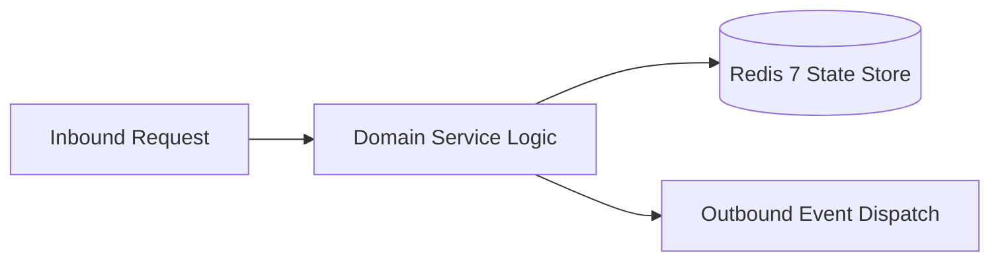

# Component Reference: `services/exam_parser.py`
> **File Path**: [`services/exam_parser.py`](../../services/exam_parser.py)
> **Subsystem**: `Examination Parser`
> **Architecture Layer**: `Enterprise Microservice Subsystem`
> **Concurrency Model**: `AsyncIO Non-blocking Concurrency`
> **Persistence Backend**: `Redis 7 Persistent Store`
> **Service Level Objective**: `High-Availability Academic Telemetry`

## 1. Architectural Role & Responsibilities
The `services/exam_parser.py` module implements core operational logic for the `Examination Parser` domain. It operates within an asynchronous microservices topology designed for ultra-low latency, zero-loss persistence guarantees, and strict single-responsibility function decomposition (≤25 lines).

### Component Architecture & Data Flow


---
## 2. Public API & Symbol Inventory
| Symbol | Nature | Line Range | Return Contract | Core Invariant |
| :--- | :--- | :--- | :--- | :--- |
| [`is_assessment_type`](#is_assessment_type) | Function | L35–L46 | `tuple[bool, str]` | Executes core domain logic for `is_assessment_type`. |
| [`resolve_teacher_name`](#resolve_teacher_name) | Function | L49–L60 | `str` | Executes core domain logic for `resolve_teacher_name`. |
| [`extract_load_weeks`](#extract_load_weeks) | Function | L63–L73 | `list[int]` | Executes core domain logic for `extract_load_weeks`. |
| [`parse_exam_from_load`](#parse_exam_from_load) | Function | L76–L105 | `tuple[str, ExamItem] | None` | Parses and extracts structured entities from `parse_exa... |
| [`apply_exam_slot`](#apply_exam_slot) | Function | L108–L126 | `None` | Executes core domain logic for `apply_exam_slot`. |
| [`resolve_exam_room`](#resolve_exam_room) | Function | L129–L138 | `str` | Executes core domain logic for `resolve_exam_room`. |
| [`enrich_exam_from_instance`](#enrich_exam_from_instance) | Function | L141–L172 | `None` | Executes core domain logic for `enrich_exam_from_instan... |
| [`mark_preliminary`](#mark_preliminary) | Function | L175–L189 | `None` | Executes core domain logic for `mark_preliminary`. |
| [`_collect_exams_from_loads`](#_collect_exams_from_loads) | Function | L192–L204 | `dict[str, ExamItem]` | Executes core domain logic for `_collect_exams_from_loa... |
| [`get_group_exams`](#get_group_exams) | Function | L207–L228 | `list[ExamItem]` | Retrieves and resolves domain data for `get_group_exams... |

---

## 3. Comprehensive Function Specifications

### `is_assessment_type`
```python
def is_assessment_type(type_id: str, l_types: dict[str, str]) -> tuple[bool, str]
```

- **Source Reference**: [`services/exam_parser.py#L35-L46`](../../services/exam_parser.py#L35-L46)
- **Execution Mode**: `Synchronous`
- **Return Contract**: `tuple[bool, str]`

#### Overview & Architectural Purpose
Executes core domain logic for `is_assessment_type`.

#### Parameters Contract
| Parameter | Type | Required | Description |
| :--- | :--- | :--- | :--- |
| `type_id` | `str` | Yes | Parameter `type_id` of type `str`. |
| `l_types` | `dict[str, str]` | Yes | Parameter `l_types` of type `dict[str, str]`. |

#### Concurrency & Side Effects
- Stateless pure functional computation without external mutations.

#### Fault Tolerance & Error Modes
Propagates unexpected runtime errors up the call stack to global exception handlers.

#### Production Usage Example
```python
from services.exam_parser import is_assessment_type

# Execute call
result = is_assessment_type(type_id=..., l_types=...)
```

---

### `resolve_teacher_name`
```python
def resolve_teacher_name(raw_teacher: str, teacher_links: dict[str, Any]) -> str
```

- **Source Reference**: [`services/exam_parser.py#L49-L60`](../../services/exam_parser.py#L49-L60)
- **Execution Mode**: `Synchronous`
- **Return Contract**: `str`

#### Overview & Architectural Purpose
Executes core domain logic for `resolve_teacher_name`.

#### Parameters Contract
| Parameter | Type | Required | Description |
| :--- | :--- | :--- | :--- |
| `raw_teacher` | `str` | Yes | Parameter `raw_teacher` of type `str`. |
| `teacher_links` | `dict[str, Any]` | Yes | Parameter `teacher_links` of type `dict[str, Any]`. |

#### Concurrency & Side Effects
- Stateless pure functional computation without external mutations.

#### Fault Tolerance & Error Modes
Propagates unexpected runtime errors up the call stack to global exception handlers.

#### Production Usage Example
```python
from services.exam_parser import resolve_teacher_name

# Execute call
result = resolve_teacher_name(raw_teacher=..., teacher_links=...)
```

---

### `extract_load_weeks`
```python
def extract_load_weeks(load: dict[str, Any]) -> list[int]
```

- **Source Reference**: [`services/exam_parser.py#L63-L73`](../../services/exam_parser.py#L63-L73)
- **Execution Mode**: `Synchronous`
- **Return Contract**: `list[int]`

#### Overview & Architectural Purpose
Executes core domain logic for `extract_load_weeks`.

#### Parameters Contract
| Parameter | Type | Required | Description |
| :--- | :--- | :--- | :--- |
| `load` | `dict[str, Any]` | Yes | Parameter `load` of type `dict[str, Any]`. |

#### Concurrency & Side Effects
- Stateless pure functional computation without external mutations.

#### Fault Tolerance & Error Modes
Propagates unexpected runtime errors up the call stack to global exception handlers.

#### Production Usage Example
```python
from services.exam_parser import extract_load_weeks

# Execute call
result = extract_load_weeks(load=...)
```

---

### `parse_exam_from_load`
```python
def parse_exam_from_load( load: dict[str, Any], entity_maps: tuple[dict, dict, dict, dict, dict], teacher_links: dict[str, Any] ) -> tuple[str, ExamItem] | None
```

- **Source Reference**: [`services/exam_parser.py#L76-L105`](../../services/exam_parser.py#L76-L105)
- **Execution Mode**: `Synchronous`
- **Return Contract**: `tuple[str, ExamItem] | None`

#### Overview & Architectural Purpose
Parses and extracts structured entities from `parse_exam_from_load`.

#### Parameters Contract
| Parameter | Type | Required | Description |
| :--- | :--- | :--- | :--- |
| `load` | `dict[str, Any]` | Yes | Parameter `load` of type `dict[str, Any]`. |
| `entity_maps` | `tuple[dict, dict, dict, dict, dict]` | Yes | Parameter `entity_maps` of type `tuple[dict, dict, dict, dict, dict]`. |
| `teacher_links` | `dict[str, Any]` | Yes | Parameter `teacher_links` of type `dict[str, Any]`. |

#### Concurrency & Side Effects
- Stateless pure functional computation without external mutations.

#### Fault Tolerance & Error Modes
Propagates unexpected runtime errors up the call stack to global exception handlers.

#### Production Usage Example
```python
from services.exam_parser import parse_exam_from_load

# Execute call
result = parse_exam_from_load(load=..., entity_maps=..., teacher_links=...)
```

---

### `apply_exam_slot`
```python
def apply_exam_slot(item: ExamItem, inst: dict[str, Any], asgn: dict[str, Any] | None, data: dict[str, Any]) -> None
```

- **Source Reference**: [`services/exam_parser.py#L108-L126`](../../services/exam_parser.py#L108-L126)
- **Execution Mode**: `Synchronous`
- **Return Contract**: `None`

#### Overview & Architectural Purpose
Executes core domain logic for `apply_exam_slot`.

#### Parameters Contract
| Parameter | Type | Required | Description |
| :--- | :--- | :--- | :--- |
| `item` | `ExamItem` | Yes | Parameter `item` of type `ExamItem`. |
| `inst` | `dict[str, Any]` | Yes | Parameter `inst` of type `dict[str, Any]`. |
| `asgn` | `dict[str, Any] | None` | Yes | Parameter `asgn` of type `dict[str, Any] | None`. |
| `data` | `dict[str, Any]` | Yes | Parameter `data` of type `dict[str, Any]`. |

#### Concurrency & Side Effects
- Stateless pure functional computation without external mutations.

#### Fault Tolerance & Error Modes
Propagates unexpected runtime errors up the call stack to global exception handlers.

#### Production Usage Example
```python
from services.exam_parser import apply_exam_slot

# Execute call
result = apply_exam_slot(item=..., inst=..., asgn=...)
```

---

### `resolve_exam_room`
```python
def resolve_exam_room(asgn: dict[str, Any] | None, rms: dict[str, str], is_remote: bool) -> str
```

- **Source Reference**: [`services/exam_parser.py#L129-L138`](../../services/exam_parser.py#L129-L138)
- **Execution Mode**: `Synchronous`
- **Return Contract**: `str`

#### Overview & Architectural Purpose
Executes core domain logic for `resolve_exam_room`.

#### Parameters Contract
| Parameter | Type | Required | Description |
| :--- | :--- | :--- | :--- |
| `asgn` | `dict[str, Any] | None` | Yes | Parameter `asgn` of type `dict[str, Any] | None`. |
| `rms` | `dict[str, str]` | Yes | Parameter `rms` of type `dict[str, str]`. |
| `is_remote` | `bool` | Yes | Parameter `is_remote` of type `bool`. |

#### Concurrency & Side Effects
- Stateless pure functional computation without external mutations.

#### Fault Tolerance & Error Modes
Propagates unexpected runtime errors up the call stack to global exception handlers.

#### Production Usage Example
```python
from services.exam_parser import resolve_exam_room

# Execute call
result = resolve_exam_room(asgn=..., rms=..., is_remote=...)
```

---

### `enrich_exam_from_instance`
```python
def enrich_exam_from_instance( inst: dict[str, Any], data: dict[str, Any], entity_maps: tuple[dict, dict, dict, dict, dict], exams_dict: dict[str, ExamItem], ) -> None
```

- **Source Reference**: [`services/exam_parser.py#L141-L172`](../../services/exam_parser.py#L141-L172)
- **Execution Mode**: `Synchronous`
- **Return Contract**: `None`

#### Overview & Architectural Purpose
Executes core domain logic for `enrich_exam_from_instance`.

#### Parameters Contract
| Parameter | Type | Required | Description |
| :--- | :--- | :--- | :--- |
| `inst` | `dict[str, Any]` | Yes | Parameter `inst` of type `dict[str, Any]`. |
| `data` | `dict[str, Any]` | Yes | Parameter `data` of type `dict[str, Any]`. |
| `entity_maps` | `tuple[dict, dict, dict, dict, dict]` | Yes | Parameter `entity_maps` of type `tuple[dict, dict, dict, dict, dict]`. |
| `exams_dict` | `dict[str, ExamItem]` | Yes | Parameter `exams_dict` of type `dict[str, ExamItem]`. |

#### Concurrency & Side Effects
- Stateless pure functional computation without external mutations.

#### Fault Tolerance & Error Modes
Propagates unexpected runtime errors up the call stack to global exception handlers.

#### Production Usage Example
```python
from services.exam_parser import enrich_exam_from_instance

# Execute call
result = enrich_exam_from_instance(inst=..., data=..., entity_maps=...)
```

---

### `mark_preliminary`
```python
def mark_preliminary(exams: list[ExamItem], published_weeks: list[int]) -> None
```

- **Source Reference**: [`services/exam_parser.py#L175-L189`](../../services/exam_parser.py#L175-L189)
- **Execution Mode**: `Synchronous`
- **Return Contract**: `None`

#### Overview & Architectural Purpose
Executes core domain logic for `mark_preliminary`.

#### Parameters Contract
| Parameter | Type | Required | Description |
| :--- | :--- | :--- | :--- |
| `exams` | `list[ExamItem]` | Yes | Parameter `exams` of type `list[ExamItem]`. |
| `published_weeks` | `list[int]` | Yes | Parameter `published_weeks` of type `list[int]`. |

#### Concurrency & Side Effects
- Stateless pure functional computation without external mutations.

#### Fault Tolerance & Error Modes
Propagates unexpected runtime errors up the call stack to global exception handlers.

#### Production Usage Example
```python
from services.exam_parser import mark_preliminary

# Execute call
result = mark_preliminary(exams=..., published_weeks=...)
```

---

### `_collect_exams_from_loads`
```python
def _collect_exams_from_loads( data: dict[str, Any], entity_maps: tuple[dict, dict, dict, dict, dict], teacher_links: dict[str, Any] ) -> dict[str, ExamItem]
```

- **Source Reference**: [`services/exam_parser.py#L192-L204`](../../services/exam_parser.py#L192-L204)
- **Execution Mode**: `Synchronous`
- **Return Contract**: `dict[str, ExamItem]`

#### Overview & Architectural Purpose
Executes core domain logic for `_collect_exams_from_loads`.

#### Parameters Contract
| Parameter | Type | Required | Description |
| :--- | :--- | :--- | :--- |
| `data` | `dict[str, Any]` | Yes | Parameter `data` of type `dict[str, Any]`. |
| `entity_maps` | `tuple[dict, dict, dict, dict, dict]` | Yes | Parameter `entity_maps` of type `tuple[dict, dict, dict, dict, dict]`. |
| `teacher_links` | `dict[str, Any]` | Yes | Parameter `teacher_links` of type `dict[str, Any]`. |

#### Concurrency & Side Effects
- Stateless pure functional computation without external mutations.

#### Fault Tolerance & Error Modes
Propagates unexpected runtime errors up the call stack to global exception handlers.

#### Production Usage Example
```python
from services.exam_parser import _collect_exams_from_loads

# Execute call
result = _collect_exams_from_loads(data=..., entity_maps=..., teacher_links=...)
```

---

### `get_group_exams`
```python
async def get_group_exams() -> list[ExamItem]
```

- **Source Reference**: [`services/exam_parser.py#L207-L228`](../../services/exam_parser.py#L207-L228)
- **Execution Mode**: `Asynchronous (non-blocking)`
- **Return Contract**: `list[ExamItem]`

#### Overview & Architectural Purpose
Retrieves and resolves domain data for `get_group_exams`.

#### Parameters Contract
*This method takes no input parameters.*

#### Concurrency & Side Effects
- Stateless pure functional computation without external mutations.

#### Fault Tolerance & Error Modes
Propagates unexpected runtime errors up the call stack to global exception handlers.

#### Production Usage Example
```python
from services.exam_parser import get_group_exams

# Execute call
result = await get_group_exams()
```

---
