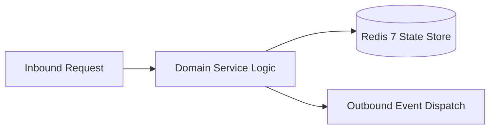

# Component Reference: `services/exam_topic_updater.py`
> **File Path**: [`services/exam_topic_updater.py`](../../services/exam_topic_updater.py)
> **Subsystem**: `Examination Topic`
> **Architecture Layer**: `Enterprise Microservice Subsystem`
> **Concurrency Model**: `AsyncIO Non-blocking Concurrency`
> **Persistence Backend**: `Redis 7 Persistent Store`
> **Service Level Objective**: `High-Availability Academic Telemetry`

## 1. Architectural Role & Responsibilities
The `services/exam_topic_updater.py` module implements core operational logic for the `Examination Topic` domain. It operates within an asynchronous microservices topology designed for ultra-low latency, zero-loss persistence guarantees, and strict single-responsibility function decomposition (≤25 lines).

### Component Architecture & Data Flow


---
## 2. Public API & Symbol Inventory
| Symbol | Nature | Line Range | Return Contract | Core Invariant |
| :--- | :--- | :--- | :--- | :--- |
| [`get_default_semester_start`](#get_default_semester_start) | Function | L32–L43 | `date` | Retrieves and resolves domain data for `get_default_sem... |
| [`get_effective_semester_start`](#get_effective_semester_start) | Function | L46–L65 | `date` | Retrieves and resolves domain data for `get_effective_s... |
| [`load_exam_topic_state`](#load_exam_topic_state) | Function | L68–L78 | `int | None` | Executes core domain logic for `load_exam_topic_state`. |
| [`save_exam_topic_state`](#save_exam_topic_state) | Function | L81–L89 | `None` | Saves serialized entity data to storage for `save_exam_... |
| [`get_week_date_range_str`](#get_week_date_range_str) | Function | L92–L109 | `str` | Retrieves and resolves domain data for `get_week_date_r... |
| [`_format_exam_weeks_label`](#_format_exam_weeks_label) | Function | L112–L122 | `str` | Executes core domain logic for `_format_exam_weeks_labe... |
| [`_format_exam_when`](#_format_exam_when) | Function | L125–L136 | `str` | Executes core domain logic for `_format_exam_when`. |
| [`format_exam_card`](#format_exam_card) | Function | L139–L162 | `str` | Formats message payload and presentation markup for `fo... |
| [`format_exams_schedule_message`](#format_exams_schedule_message) | Function | L165–L178 | `str` | Formats message payload and presentation markup for `fo... |
| [`_pin_exam_silently`](#_pin_exam_silently) | Function | L181–L196 | `None` | Executes core domain logic for `_pin_exam_silently`. |
| [`create_exam_message`](#create_exam_message) | Function | L199–L216 | `int` | Initializes and constructs a new instance of `create_ex... |
| [`handle_exam_edit_error`](#handle_exam_edit_error) | Function | L219–L241 | `bool` | Executes core domain logic for `handle_exam_edit_error`... |
| [`_edit_exam_msg`](#_edit_exam_msg) | Function | L244–L256 | `bool` | Executes core domain logic for `_edit_exam_msg`. |
| [`send_or_edit_exam_msg`](#send_or_edit_exam_msg) | Function | L259–L279 | `bool` | Dispatches notification message via Telegram API for `s... |
| [`_delete_old_exam_msg`](#_delete_old_exam_msg) | Function | L282–L295 | `None` | Executes core domain logic for `_delete_old_exam_msg`. |
| [`recreate_exam_topic_message`](#recreate_exam_topic_message) | Function | L298–L314 | `bool` | Executes core domain logic for `recreate_exam_topic_mes... |
| [`sync_exam_topic_message`](#sync_exam_topic_message) | Function | L317–L338 | `bool` | Executes core domain logic for `sync_exam_topic_message... |
| [`exam_topic_sync_loop`](#exam_topic_sync_loop) | Function | L341–L357 | `None` | Executes core domain logic for `exam_topic_sync_loop`. |

---

## 3. Comprehensive Function Specifications

### `get_default_semester_start`
```python
def get_default_semester_start() -> date
```

- **Source Reference**: [`services/exam_topic_updater.py#L32-L43`](../../services/exam_topic_updater.py#L32-L43)
- **Execution Mode**: `Synchronous`
- **Return Contract**: `date`

#### Overview & Architectural Purpose
Retrieves and resolves domain data for `get_default_semester_start`.

#### Parameters Contract
*This method takes no input parameters.*

#### Concurrency & Side Effects
- Stateless pure functional computation without external mutations.

#### Fault Tolerance & Error Modes
Propagates unexpected runtime errors up the call stack to global exception handlers.

#### Production Usage Example
```python
from services.exam_topic_updater import get_default_semester_start

# Execute call
result = get_default_semester_start()
```

---

### `get_effective_semester_start`
```python
async def get_effective_semester_start() -> date
```

- **Source Reference**: [`services/exam_topic_updater.py#L46-L65`](../../services/exam_topic_updater.py#L46-L65)
- **Execution Mode**: `Asynchronous (non-blocking)`
- **Return Contract**: `date`

#### Overview & Architectural Purpose
Retrieves and resolves domain data for `get_effective_semester_start`.

#### Parameters Contract
*This method takes no input parameters.*

#### Concurrency & Side Effects
- Emits structured telemetry events to system logging subsystem.

#### Fault Tolerance & Error Modes
Encapsulates faults within `try/except` blocks, logging errors and returning safe fallback defaults.

#### Production Usage Example
```python
from services.exam_topic_updater import get_effective_semester_start

# Execute call
result = await get_effective_semester_start()
```

---

### `load_exam_topic_state`
```python
def load_exam_topic_state() -> int | None
```

- **Source Reference**: [`services/exam_topic_updater.py#L68-L78`](../../services/exam_topic_updater.py#L68-L78)
- **Execution Mode**: `Synchronous`
- **Return Contract**: `int | None`

#### Overview & Architectural Purpose
Executes core domain logic for `load_exam_topic_state`.

#### Parameters Contract
*This method takes no input parameters.*

#### Concurrency & Side Effects
- Stateless pure functional computation without external mutations.

#### Fault Tolerance & Error Modes
Propagates unexpected runtime errors up the call stack to global exception handlers.

#### Production Usage Example
```python
from services.exam_topic_updater import load_exam_topic_state

# Execute call
result = load_exam_topic_state()
```

---

### `save_exam_topic_state`
```python
def save_exam_topic_state(msg_id: int | None) -> None
```

- **Source Reference**: [`services/exam_topic_updater.py#L81-L89`](../../services/exam_topic_updater.py#L81-L89)
- **Execution Mode**: `Synchronous`
- **Return Contract**: `None`

#### Overview & Architectural Purpose
Saves serialized entity data to storage for `save_exam_topic_state`.

#### Parameters Contract
| Parameter | Type | Required | Description |
| :--- | :--- | :--- | :--- |
| `msg_id` | `int | None` | Yes | Parameter `msg_id` of type `int | None`. |

#### Concurrency & Side Effects
- Stateless pure functional computation without external mutations.

#### Fault Tolerance & Error Modes
Propagates unexpected runtime errors up the call stack to global exception handlers.

#### Production Usage Example
```python
from services.exam_topic_updater import save_exam_topic_state

# Execute call
result = save_exam_topic_state(msg_id=...)
```

---

### `get_week_date_range_str`
```python
def get_week_date_range_str(week_num: int, semester_start: date | None = None) -> str
```

- **Source Reference**: [`services/exam_topic_updater.py#L92-L109`](../../services/exam_topic_updater.py#L92-L109)
- **Execution Mode**: `Synchronous`
- **Return Contract**: `str`

#### Overview & Architectural Purpose
Retrieves and resolves domain data for `get_week_date_range_str`.

#### Parameters Contract
| Parameter | Type | Required | Description |
| :--- | :--- | :--- | :--- |
| `week_num` | `int` | Yes | Parameter `week_num` of type `int`. |
| `semester_start` | `date | None` | Yes | Parameter `semester_start` of type `date | None`. |

#### Concurrency & Side Effects
- Stateless pure functional computation without external mutations.

#### Fault Tolerance & Error Modes
Propagates unexpected runtime errors up the call stack to global exception handlers.

#### Production Usage Example
```python
from services.exam_topic_updater import get_week_date_range_str

# Execute call
result = get_week_date_range_str(week_num=..., semester_start=...)
```

---

### `_format_exam_weeks_label`
```python
def _format_exam_weeks_label(weeks: list[int], semester_start: date | None) -> str
```

- **Source Reference**: [`services/exam_topic_updater.py#L112-L122`](../../services/exam_topic_updater.py#L112-L122)
- **Execution Mode**: `Synchronous`
- **Return Contract**: `str`

#### Overview & Architectural Purpose
Executes core domain logic for `_format_exam_weeks_label`.

#### Parameters Contract
| Parameter | Type | Required | Description |
| :--- | :--- | :--- | :--- |
| `weeks` | `list[int]` | Yes | Parameter `weeks` of type `list[int]`. |
| `semester_start` | `date | None` | Yes | Parameter `semester_start` of type `date | None`. |

#### Concurrency & Side Effects
- Stateless pure functional computation without external mutations.

#### Fault Tolerance & Error Modes
Propagates unexpected runtime errors up the call stack to global exception handlers.

#### Production Usage Example
```python
from services.exam_topic_updater import _format_exam_weeks_label

# Execute call
result = _format_exam_weeks_label(weeks=..., semester_start=...)
```

---

### `_format_exam_when`
```python
def _format_exam_when(ex: ExamItem, semester_start: date | None) -> str
```

- **Source Reference**: [`services/exam_topic_updater.py#L125-L136`](../../services/exam_topic_updater.py#L125-L136)
- **Execution Mode**: `Synchronous`
- **Return Contract**: `str`

#### Overview & Architectural Purpose
Executes core domain logic for `_format_exam_when`.

#### Parameters Contract
| Parameter | Type | Required | Description |
| :--- | :--- | :--- | :--- |
| `ex` | `ExamItem` | Yes | Parameter `ex` of type `ExamItem`. |
| `semester_start` | `date | None` | Yes | Parameter `semester_start` of type `date | None`. |

#### Concurrency & Side Effects
- Stateless pure functional computation without external mutations.

#### Fault Tolerance & Error Modes
Propagates unexpected runtime errors up the call stack to global exception handlers.

#### Production Usage Example
```python
from services.exam_topic_updater import _format_exam_when

# Execute call
result = _format_exam_when(ex=..., semester_start=...)
```

---

### `format_exam_card`
```python
def format_exam_card(ex: ExamItem, semester_start: date | None = None) -> str
```

- **Source Reference**: [`services/exam_topic_updater.py#L139-L162`](../../services/exam_topic_updater.py#L139-L162)
- **Execution Mode**: `Synchronous`
- **Return Contract**: `str`

#### Overview & Architectural Purpose
Formats message payload and presentation markup for `format_exam_card`.

#### Parameters Contract
| Parameter | Type | Required | Description |
| :--- | :--- | :--- | :--- |
| `ex` | `ExamItem` | Yes | Parameter `ex` of type `ExamItem`. |
| `semester_start` | `date | None` | Yes | Parameter `semester_start` of type `date | None`. |

#### Concurrency & Side Effects
- Stateless pure functional computation without external mutations.

#### Fault Tolerance & Error Modes
Propagates unexpected runtime errors up the call stack to global exception handlers.

#### Production Usage Example
```python
from services.exam_topic_updater import format_exam_card

# Execute call
result = format_exam_card(ex=..., semester_start=...)
```

---

### `format_exams_schedule_message`
```python
def format_exams_schedule_message(exams: list[ExamItem], semester_start: date | None = None) -> str
```

- **Source Reference**: [`services/exam_topic_updater.py#L165-L178`](../../services/exam_topic_updater.py#L165-L178)
- **Execution Mode**: `Synchronous`
- **Return Contract**: `str`

#### Overview & Architectural Purpose
Formats message payload and presentation markup for `format_exams_schedule_message`.

#### Parameters Contract
| Parameter | Type | Required | Description |
| :--- | :--- | :--- | :--- |
| `exams` | `list[ExamItem]` | Yes | Parameter `exams` of type `list[ExamItem]`. |
| `semester_start` | `date | None` | Yes | Parameter `semester_start` of type `date | None`. |

#### Concurrency & Side Effects
- Stateless pure functional computation without external mutations.

#### Fault Tolerance & Error Modes
Propagates unexpected runtime errors up the call stack to global exception handlers.

#### Production Usage Example
```python
from services.exam_topic_updater import format_exams_schedule_message

# Execute call
result = format_exams_schedule_message(exams=..., semester_start=...)
```

---

### `_pin_exam_silently`
```python
async def _pin_exam_silently(message_id: int) -> None
```

- **Source Reference**: [`services/exam_topic_updater.py#L181-L196`](../../services/exam_topic_updater.py#L181-L196)
- **Execution Mode**: `Asynchronous (non-blocking)`
- **Return Contract**: `None`

#### Overview & Architectural Purpose
Executes core domain logic for `_pin_exam_silently`.

#### Parameters Contract
| Parameter | Type | Required | Description |
| :--- | :--- | :--- | :--- |
| `message_id` | `int` | Yes | Parameter `message_id` of type `int`. |

#### Concurrency & Side Effects
- Emits structured telemetry events to system logging subsystem.

#### Fault Tolerance & Error Modes
Encapsulates faults within `try/except` blocks, logging errors and returning safe fallback defaults.

#### Production Usage Example
```python
from services.exam_topic_updater import _pin_exam_silently

# Execute call
result = await _pin_exam_silently(message_id=...)
```

---

### `create_exam_message`
```python
async def create_exam_message(text: str) -> int
```

- **Source Reference**: [`services/exam_topic_updater.py#L199-L216`](../../services/exam_topic_updater.py#L199-L216)
- **Execution Mode**: `Asynchronous (non-blocking)`
- **Return Contract**: `int`

#### Overview & Architectural Purpose
Initializes and constructs a new instance of `create_exam_message`.

#### Parameters Contract
| Parameter | Type | Required | Description |
| :--- | :--- | :--- | :--- |
| `text` | `str` | Yes | Parameter `text` of type `str`. |

#### Concurrency & Side Effects
- Emits structured telemetry events to system logging subsystem.

#### Fault Tolerance & Error Modes
Propagates unexpected runtime errors up the call stack to global exception handlers.

#### Production Usage Example
```python
from services.exam_topic_updater import create_exam_message

# Execute call
result = await create_exam_message(text=...)
```

---

### `handle_exam_edit_error`
```python
async def handle_exam_edit_error(text: str, err_str: str, retry: bool) -> bool
```

- **Source Reference**: [`services/exam_topic_updater.py#L219-L241`](../../services/exam_topic_updater.py#L219-L241)
- **Execution Mode**: `Asynchronous (non-blocking)`
- **Return Contract**: `bool`

#### Overview & Architectural Purpose
Executes core domain logic for `handle_exam_edit_error`.

#### Parameters Contract
| Parameter | Type | Required | Description |
| :--- | :--- | :--- | :--- |
| `text` | `str` | Yes | Parameter `text` of type `str`. |
| `err_str` | `str` | Yes | Parameter `err_str` of type `str`. |
| `retry` | `bool` | Yes | Parameter `retry` of type `bool`. |

#### Concurrency & Side Effects
- Emits structured telemetry events to system logging subsystem.

#### Fault Tolerance & Error Modes
Propagates unexpected runtime errors up the call stack to global exception handlers.

#### Production Usage Example
```python
from services.exam_topic_updater import handle_exam_edit_error

# Execute call
result = await handle_exam_edit_error(text=..., err_str=..., retry=...)
```

---

### `_edit_exam_msg`
```python
async def _edit_exam_msg(text: str) -> bool
```

- **Source Reference**: [`services/exam_topic_updater.py#L244-L256`](../../services/exam_topic_updater.py#L244-L256)
- **Execution Mode**: `Asynchronous (non-blocking)`
- **Return Contract**: `bool`

#### Overview & Architectural Purpose
Executes core domain logic for `_edit_exam_msg`.

#### Parameters Contract
| Parameter | Type | Required | Description |
| :--- | :--- | :--- | :--- |
| `text` | `str` | Yes | Parameter `text` of type `str`. |

#### Concurrency & Side Effects
- Emits structured telemetry events to system logging subsystem.

#### Fault Tolerance & Error Modes
Propagates unexpected runtime errors up the call stack to global exception handlers.

#### Production Usage Example
```python
from services.exam_topic_updater import _edit_exam_msg

# Execute call
result = await _edit_exam_msg(text=...)
```

---

### `send_or_edit_exam_msg`
```python
async def send_or_edit_exam_msg(text: str, _retry: bool = False) -> bool
```

- **Source Reference**: [`services/exam_topic_updater.py#L259-L279`](../../services/exam_topic_updater.py#L259-L279)
- **Execution Mode**: `Asynchronous (non-blocking)`
- **Return Contract**: `bool`

#### Overview & Architectural Purpose
Dispatches notification message via Telegram API for `send_or_edit_exam_msg`.

#### Parameters Contract
| Parameter | Type | Required | Description |
| :--- | :--- | :--- | :--- |
| `text` | `str` | Yes | Parameter `text` of type `str`. |
| `_retry` | `bool` | Yes | Parameter `_retry` of type `bool`. |

#### Concurrency & Side Effects
- Emits structured telemetry events to system logging subsystem.

#### Fault Tolerance & Error Modes
Encapsulates faults within `try/except` blocks, logging errors and returning safe fallback defaults.

#### Production Usage Example
```python
from services.exam_topic_updater import send_or_edit_exam_msg

# Execute call
result = await send_or_edit_exam_msg(text=..., _retry=...)
```

---

### `_delete_old_exam_msg`
```python
async def _delete_old_exam_msg(old_id: int | None) -> None
```

- **Source Reference**: [`services/exam_topic_updater.py#L282-L295`](../../services/exam_topic_updater.py#L282-L295)
- **Execution Mode**: `Asynchronous (non-blocking)`
- **Return Contract**: `None`

#### Overview & Architectural Purpose
Executes core domain logic for `_delete_old_exam_msg`.

#### Parameters Contract
| Parameter | Type | Required | Description |
| :--- | :--- | :--- | :--- |
| `old_id` | `int | None` | Yes | Parameter `old_id` of type `int | None`. |

#### Concurrency & Side Effects
- Emits structured telemetry events to system logging subsystem.

#### Fault Tolerance & Error Modes
Encapsulates faults within `try/except` blocks, logging errors and returning safe fallback defaults.

#### Production Usage Example
```python
from services.exam_topic_updater import _delete_old_exam_msg

# Execute call
result = await _delete_old_exam_msg(old_id=...)
```

---

### `recreate_exam_topic_message`
```python
async def recreate_exam_topic_message() -> bool
```

- **Source Reference**: [`services/exam_topic_updater.py#L298-L314`](../../services/exam_topic_updater.py#L298-L314)
- **Execution Mode**: `Asynchronous (non-blocking)`
- **Return Contract**: `bool`

#### Overview & Architectural Purpose
Executes core domain logic for `recreate_exam_topic_message`.

#### Parameters Contract
*This method takes no input parameters.*

#### Concurrency & Side Effects
- Stateless pure functional computation without external mutations.

#### Fault Tolerance & Error Modes
Propagates unexpected runtime errors up the call stack to global exception handlers.

#### Production Usage Example
```python
from services.exam_topic_updater import recreate_exam_topic_message

# Execute call
result = await recreate_exam_topic_message()
```

---

### `sync_exam_topic_message`
```python
async def sync_exam_topic_message() -> bool
```

- **Source Reference**: [`services/exam_topic_updater.py#L317-L338`](../../services/exam_topic_updater.py#L317-L338)
- **Execution Mode**: `Asynchronous (non-blocking)`
- **Return Contract**: `bool`

#### Overview & Architectural Purpose
Executes core domain logic for `sync_exam_topic_message`.

#### Parameters Contract
*This method takes no input parameters.*

#### Concurrency & Side Effects
- Emits structured telemetry events to system logging subsystem.

#### Fault Tolerance & Error Modes
Encapsulates faults within `try/except` blocks, logging errors and returning safe fallback defaults.

#### Production Usage Example
```python
from services.exam_topic_updater import sync_exam_topic_message

# Execute call
result = await sync_exam_topic_message()
```

---

### `exam_topic_sync_loop`
```python
async def exam_topic_sync_loop() -> None
```

- **Source Reference**: [`services/exam_topic_updater.py#L341-L357`](../../services/exam_topic_updater.py#L341-L357)
- **Execution Mode**: `Asynchronous (non-blocking)`
- **Return Contract**: `None`

#### Overview & Architectural Purpose
Executes core domain logic for `exam_topic_sync_loop`.

#### Parameters Contract
*This method takes no input parameters.*

#### Concurrency & Side Effects
- Emits structured telemetry events to system logging subsystem.

#### Fault Tolerance & Error Modes
Encapsulates faults within `try/except` blocks, logging errors and returning safe fallback defaults.

#### Production Usage Example
```python
from services.exam_topic_updater import exam_topic_sync_loop

# Execute call
result = await exam_topic_sync_loop()
```

---
