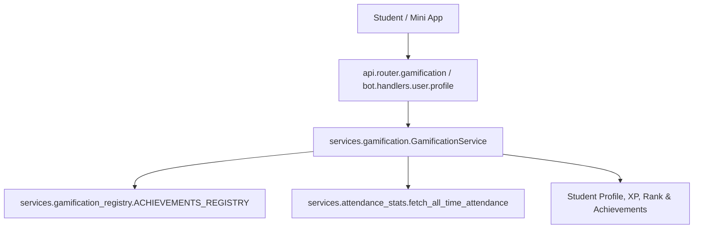

# Component Reference: `services/gamification.py`
> **File Path**: [`services/gamification.py`](../../services/gamification.py)
> **Subsystem**: `Academic Gamification Engine`
> **Architecture Layer**: `Domain Business Service`
> **Concurrency Model**: `AsyncIO Event Loop + In-Memory Ranks`
> **Persistence Backend**: `Redis L2 + SQLite Attendance Stats`
> **Service Level Objective**: `Sub-5ms Profile Calculation`

## 1. Architectural Role & Responsibilities
The `services/gamification.py` module implements core operational logic for the `Academic Gamification Engine` domain. It operates within an asynchronous microservices topology designed for ultra-low latency, zero-loss persistence guarantees, and strict single-responsibility function decomposition (≤25 lines).

### Component Architecture & Data Flow


---
## 2. Public API & Symbol Inventory
| Symbol | Nature | Line Range | Return Contract | Core Invariant |
| :--- | :--- | :--- | :--- | :--- |
| [`resolve_student_rank`](#resolve_student_rank) | Function | L48–L64 | `RankDefinition` | Executes core domain logic for `resolve_student_rank`. |
| [`calculate_student_xp`](#calculate_student_xp) | Function | L67–L69 | `int` | Executes core domain logic for `calculate_student_xp`. |
| [`_extract_student_metrics`](#_extract_student_metrics) | Function | L72–L79 | `dict[str, Any]` | Executes core domain logic for `_extract_student_metric... |
| [`is_starosta`](#is_starosta) | Function | L82–L84 | `bool` | Executes core domain logic for `is_starosta`. |
| [`calculate_guild_points`](#calculate_guild_points) | Function | L87–L95 | `int` | Executes core domain logic for `calculate_guild_points`... |
| [`build_student_profile`](#build_student_profile) | Function | L98–L123 | `StudentProfile` | Executes core domain logic for `build_student_profile`. |
| [`_load_cached_leaderboard`](#_load_cached_leaderboard) | Function | L126–L136 | `list[StudentProfile] | None` | Executes core domain logic for `_load_cached_leaderboar... |
| [`_save_cached_leaderboard`](#_save_cached_leaderboard) | Function | L139–L146 | `None` | Executes core domain logic for `_save_cached_leaderboar... |
| [`_apply_xp_bonus`](#_apply_xp_bonus) | Function | L149–L162 | `StudentProfile` | Executes core domain logic for `_apply_xp_bonus`. |
| [`_match_student_achievements`](#_match_student_achievements) | Function | L165–L172 | `set[str]` | Executes core domain logic for `_match_student_achievem... |
| [`get_group_leaderboard`](#get_group_leaderboard) | Function | L175–L199 | `list[StudentProfile]` | Retrieves and resolves domain data for `get_group_leade... |
| [`get_student_profile_by_fio`](#get_student_profile_by_fio) | Function | L202–L213 | `StudentProfile | None` | Retrieves and resolves domain data for `get_student_pro... |
| [`hide_secret_achievements`](#hide_secret_achievements) | Function | L216–L230 | `StudentProfile` | Executes core domain logic for `hide_secret_achievement... |
| [`_same_student`](#_same_student) | Function | L233–L236 | `bool` | Executes core domain logic for `_same_student`. |

---

## 3. Comprehensive Function Specifications

### `resolve_student_rank`
```python
def resolve_student_rank(pct: float, n_count: int, o_count: int) -> RankDefinition
```

- **Source Reference**: [`services/gamification.py#L48-L64`](../../services/gamification.py#L48-L64)
- **Execution Mode**: `Synchronous`
- **Return Contract**: `RankDefinition`

#### Overview & Architectural Purpose
Executes core domain logic for `resolve_student_rank`.

#### Parameters Contract
| Parameter | Type | Required | Description |
| :--- | :--- | :--- | :--- |
| `pct` | `float` | Yes | Parameter `pct` of type `float`. |
| `n_count` | `int` | Yes | Parameter `n_count` of type `int`. |
| `o_count` | `int` | Yes | Parameter `o_count` of type `int`. |

#### Concurrency & Side Effects
- Stateless pure functional computation without external mutations.

#### Fault Tolerance & Error Modes
Propagates unexpected runtime errors up the call stack to global exception handlers.

#### Production Usage Example
```python
from services.gamification import resolve_student_rank

# Execute call
result = resolve_student_rank(pct=..., n_count=..., o_count=...)
```

---

### `calculate_student_xp`
```python
def calculate_student_xp(stat: dict[str, Any], unlocked_ach_ids: list[str]) -> int
```

- **Source Reference**: [`services/gamification.py#L67-L69`](../../services/gamification.py#L67-L69)
- **Execution Mode**: `Synchronous`
- **Return Contract**: `int`

#### Overview & Architectural Purpose
Executes core domain logic for `calculate_student_xp`.

#### Parameters Contract
| Parameter | Type | Required | Description |
| :--- | :--- | :--- | :--- |
| `stat` | `dict[str, Any]` | Yes | Parameter `stat` of type `dict[str, Any]`. |
| `unlocked_ach_ids` | `list[str]` | Yes | Parameter `unlocked_ach_ids` of type `list[str]`. |

#### Concurrency & Side Effects
- Stateless pure functional computation without external mutations.

#### Fault Tolerance & Error Modes
Propagates unexpected runtime errors up the call stack to global exception handlers.

#### Production Usage Example
```python
from services.gamification import calculate_student_xp

# Execute call
result = calculate_student_xp(stat=..., unlocked_ach_ids=...)
```

---

### `_extract_student_metrics`
```python
def _extract_student_metrics(fio: str, raw_data: dict[str, Any]) -> dict[str, Any]
```

- **Source Reference**: [`services/gamification.py#L72-L79`](../../services/gamification.py#L72-L79)
- **Execution Mode**: `Synchronous`
- **Return Contract**: `dict[str, Any]`

#### Overview & Architectural Purpose
Executes core domain logic for `_extract_student_metrics`.

#### Parameters Contract
| Parameter | Type | Required | Description |
| :--- | :--- | :--- | :--- |
| `fio` | `str` | Yes | Full canonical name of the student in Cyrillic nominative format. |
| `raw_data` | `dict[str, Any]` | Yes | Parameter `raw_data` of type `dict[str, Any]`. |

#### Concurrency & Side Effects
- Stateless pure functional computation without external mutations.

#### Fault Tolerance & Error Modes
Propagates unexpected runtime errors up the call stack to global exception handlers.

#### Production Usage Example
```python
from services.gamification import _extract_student_metrics

# Execute call
result = _extract_student_metrics(fio=..., raw_data=...)
```

---

### `is_starosta`
```python
def is_starosta(fio: str) -> bool
```

- **Source Reference**: [`services/gamification.py#L82-L84`](../../services/gamification.py#L82-L84)
- **Execution Mode**: `Synchronous`
- **Return Contract**: `bool`

#### Overview & Architectural Purpose
Executes core domain logic for `is_starosta`.

#### Parameters Contract
| Parameter | Type | Required | Description |
| :--- | :--- | :--- | :--- |
| `fio` | `str` | Yes | Full canonical name of the student in Cyrillic nominative format. |

#### Concurrency & Side Effects
- Stateless pure functional computation without external mutations.

#### Fault Tolerance & Error Modes
Propagates unexpected runtime errors up the call stack to global exception handlers.

#### Production Usage Example
```python
from services.gamification import is_starosta

# Execute call
result = is_starosta(fio=...)
```

---

### `calculate_guild_points`
```python
def calculate_guild_points(xp: int, raw_data: dict[str, Any], baseline: dict[str, Any] | None) -> int
```

- **Source Reference**: [`services/gamification.py#L87-L95`](../../services/gamification.py#L87-L95)
- **Execution Mode**: `Synchronous`
- **Return Contract**: `int`

#### Overview & Architectural Purpose
Executes core domain logic for `calculate_guild_points`.

#### Parameters Contract
| Parameter | Type | Required | Description |
| :--- | :--- | :--- | :--- |
| `xp` | `int` | Yes | Experience points accrued through academic activities and attendance. |
| `raw_data` | `dict[str, Any]` | Yes | Parameter `raw_data` of type `dict[str, Any]`. |
| `baseline` | `dict[str, Any] | None` | Yes | Parameter `baseline` of type `dict[str, Any] | None`. |

#### Concurrency & Side Effects
- Stateless pure functional computation without external mutations.

#### Fault Tolerance & Error Modes
Propagates unexpected runtime errors up the call stack to global exception handlers.

#### Production Usage Example
```python
from services.gamification import calculate_guild_points

# Execute call
result = calculate_guild_points(xp=..., raw_data=..., baseline=...)
```

---

### `build_student_profile`
```python
def build_student_profile( fio: str, raw_data: dict[str, Any], extra: set[str] | None = None, baseline: dict[str, Any] | None = None ) -> StudentProfile
```

- **Source Reference**: [`services/gamification.py#L98-L123`](../../services/gamification.py#L98-L123)
- **Execution Mode**: `Synchronous`
- **Return Contract**: `StudentProfile`

#### Overview & Architectural Purpose
Executes core domain logic for `build_student_profile`.

#### Parameters Contract
| Parameter | Type | Required | Description |
| :--- | :--- | :--- | :--- |
| `fio` | `str` | Yes | Full canonical name of the student in Cyrillic nominative format. |
| `raw_data` | `dict[str, Any]` | Yes | Parameter `raw_data` of type `dict[str, Any]`. |
| `extra` | `set[str] | None` | Yes | Parameter `extra` of type `set[str] | None`. |
| `baseline` | `dict[str, Any] | None` | Yes | Parameter `baseline` of type `dict[str, Any] | None`. |

#### Concurrency & Side Effects
- Stateless pure functional computation without external mutations.

#### Fault Tolerance & Error Modes
Propagates unexpected runtime errors up the call stack to global exception handlers.

#### Production Usage Example
```python
from services.gamification import build_student_profile

# Execute call
result = build_student_profile(fio=..., raw_data=..., extra=...)
```

---

### `_load_cached_leaderboard`
```python
async def _load_cached_leaderboard() -> list[StudentProfile] | None
```

- **Source Reference**: [`services/gamification.py#L126-L136`](../../services/gamification.py#L126-L136)
- **Execution Mode**: `Asynchronous (non-blocking)`
- **Return Contract**: `list[StudentProfile] | None`

#### Overview & Architectural Purpose
Executes core domain logic for `_load_cached_leaderboard`.

#### Parameters Contract
*This method takes no input parameters.*

#### Concurrency & Side Effects
- Emits structured telemetry events to system logging subsystem.

#### Fault Tolerance & Error Modes
Encapsulates faults within `try/except` blocks, logging errors and returning safe fallback defaults.

#### Production Usage Example
```python
from services.gamification import _load_cached_leaderboard

# Execute call
result = await _load_cached_leaderboard()
```

---

### `_save_cached_leaderboard`
```python
async def _save_cached_leaderboard(profiles: list[StudentProfile]) -> None
```

- **Source Reference**: [`services/gamification.py#L139-L146`](../../services/gamification.py#L139-L146)
- **Execution Mode**: `Asynchronous (non-blocking)`
- **Return Contract**: `None`

#### Overview & Architectural Purpose
Executes core domain logic for `_save_cached_leaderboard`.

#### Parameters Contract
| Parameter | Type | Required | Description |
| :--- | :--- | :--- | :--- |
| `profiles` | `list[StudentProfile]` | Yes | Parameter `profiles` of type `list[StudentProfile]`. |

#### Concurrency & Side Effects
- Emits structured telemetry events to system logging subsystem.

#### Fault Tolerance & Error Modes
Encapsulates faults within `try/except` blocks, logging errors and returning safe fallback defaults.

#### Production Usage Example
```python
from services.gamification import _save_cached_leaderboard

# Execute call
result = await _save_cached_leaderboard(profiles=...)
```

---

### `_apply_xp_bonus`
```python
def _apply_xp_bonus(profile: StudentProfile, bonuses: dict[str, int]) -> StudentProfile
```

- **Source Reference**: [`services/gamification.py#L149-L162`](../../services/gamification.py#L149-L162)
- **Execution Mode**: `Synchronous`
- **Return Contract**: `StudentProfile`

#### Overview & Architectural Purpose
Executes core domain logic for `_apply_xp_bonus`.

#### Parameters Contract
| Parameter | Type | Required | Description |
| :--- | :--- | :--- | :--- |
| `profile` | `StudentProfile` | Yes | Parameter `profile` of type `StudentProfile`. |
| `bonuses` | `dict[str, int]` | Yes | Parameter `bonuses` of type `dict[str, int]`. |

#### Concurrency & Side Effects
- Stateless pure functional computation without external mutations.

#### Fault Tolerance & Error Modes
Propagates unexpected runtime errors up the call stack to global exception handlers.

#### Production Usage Example
```python
from services.gamification import _apply_xp_bonus

# Execute call
result = _apply_xp_bonus(profile=..., bonuses=...)
```

---

### `_match_student_achievements`
```python
def _match_student_achievements(fio: str, unlocked_map: dict[str, set[str]]) -> set[str]
```

- **Source Reference**: [`services/gamification.py#L165-L172`](../../services/gamification.py#L165-L172)
- **Execution Mode**: `Synchronous`
- **Return Contract**: `set[str]`

#### Overview & Architectural Purpose
Executes core domain logic for `_match_student_achievements`.

#### Parameters Contract
| Parameter | Type | Required | Description |
| :--- | :--- | :--- | :--- |
| `fio` | `str` | Yes | Full canonical name of the student in Cyrillic nominative format. |
| `unlocked_map` | `dict[str, set[str]]` | Yes | Parameter `unlocked_map` of type `dict[str, set[str]]`. |

#### Concurrency & Side Effects
- Stateless pure functional computation without external mutations.

#### Fault Tolerance & Error Modes
Propagates unexpected runtime errors up the call stack to global exception handlers.

#### Production Usage Example
```python
from services.gamification import _match_student_achievements

# Execute call
result = _match_student_achievements(fio=..., unlocked_map=...)
```

---

### `get_group_leaderboard`
```python
async def get_group_leaderboard( provided_stats: dict[str, Any] | None = None, force_refresh: bool = False, ) -> list[StudentProfile]
```

- **Source Reference**: [`services/gamification.py#L175-L199`](../../services/gamification.py#L175-L199)
- **Execution Mode**: `Asynchronous (non-blocking)`
- **Return Contract**: `list[StudentProfile]`

#### Overview & Architectural Purpose
Retrieves and resolves domain data for `get_group_leaderboard`.

#### Parameters Contract
| Parameter | Type | Required | Description |
| :--- | :--- | :--- | :--- |
| `provided_stats` | `dict[str, Any] | None` | Yes | Parameter `provided_stats` of type `dict[str, Any] | None`. |
| `force_refresh` | `bool` | Yes | Parameter `force_refresh` of type `bool`. |

#### Concurrency & Side Effects
- Stateless pure functional computation without external mutations.

#### Fault Tolerance & Error Modes
Propagates unexpected runtime errors up the call stack to global exception handlers.

#### Production Usage Example
```python
from services.gamification import get_group_leaderboard

# Execute call
result = await get_group_leaderboard(provided_stats=..., force_refresh=...)
```

---

### `get_student_profile_by_fio`
```python
async def get_student_profile_by_fio(fio: str) -> StudentProfile | None
```

- **Source Reference**: [`services/gamification.py#L202-L213`](../../services/gamification.py#L202-L213)
- **Execution Mode**: `Asynchronous (non-blocking)`
- **Return Contract**: `StudentProfile | None`

#### Overview & Architectural Purpose
Retrieves and resolves domain data for `get_student_profile_by_fio`.

#### Parameters Contract
| Parameter | Type | Required | Description |
| :--- | :--- | :--- | :--- |
| `fio` | `str` | Yes | Full canonical name of the student in Cyrillic nominative format. |

#### Concurrency & Side Effects
- Stateless pure functional computation without external mutations.

#### Fault Tolerance & Error Modes
Propagates unexpected runtime errors up the call stack to global exception handlers.

#### Production Usage Example
```python
from services.gamification import get_student_profile_by_fio

# Execute call
result = await get_student_profile_by_fio(fio=...)
```

---

### `hide_secret_achievements`
```python
def hide_secret_achievements(profile: StudentProfile, viewer_fio: str | None) -> StudentProfile
```

- **Source Reference**: [`services/gamification.py#L216-L230`](../../services/gamification.py#L216-L230)
- **Execution Mode**: `Synchronous`
- **Return Contract**: `StudentProfile`

#### Overview & Architectural Purpose
Executes core domain logic for `hide_secret_achievements`.

#### Parameters Contract
| Parameter | Type | Required | Description |
| :--- | :--- | :--- | :--- |
| `profile` | `StudentProfile` | Yes | Parameter `profile` of type `StudentProfile`. |
| `viewer_fio` | `str | None` | Yes | Parameter `viewer_fio` of type `str | None`. |

#### Concurrency & Side Effects
- Stateless pure functional computation without external mutations.

#### Fault Tolerance & Error Modes
Propagates unexpected runtime errors up the call stack to global exception handlers.

#### Production Usage Example
```python
from services.gamification import hide_secret_achievements

# Execute call
result = hide_secret_achievements(profile=..., viewer_fio=...)
```

---

### `_same_student`
```python
def _same_student(fio: str, other: str) -> bool
```

- **Source Reference**: [`services/gamification.py#L233-L236`](../../services/gamification.py#L233-L236)
- **Execution Mode**: `Synchronous`
- **Return Contract**: `bool`

#### Overview & Architectural Purpose
Executes core domain logic for `_same_student`.

#### Parameters Contract
| Parameter | Type | Required | Description |
| :--- | :--- | :--- | :--- |
| `fio` | `str` | Yes | Full canonical name of the student in Cyrillic nominative format. |
| `other` | `str` | Yes | Parameter `other` of type `str`. |

#### Concurrency & Side Effects
- Stateless pure functional computation without external mutations.

#### Fault Tolerance & Error Modes
Propagates unexpected runtime errors up the call stack to global exception handlers.

#### Production Usage Example
```python
from services.gamification import _same_student

# Execute call
result = _same_student(fio=..., other=...)
```

---
