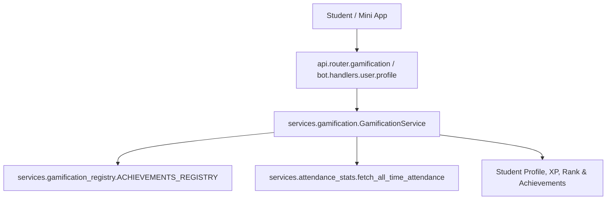

# Component Reference: `services/gamification.py`
> **File Path**: [`services/gamification.py`](../../services/gamification.py)
> **Subsystem**: `Academic Gamification Engine`
> **Architecture Layer**: `Domain Business Service`
> **Concurrency Model**: `AsyncIO Event Loop + In-Memory Ranks`
> **Persistence Backend**: `Redis L2 + SQLite Attendance Stats`
> **Service Level Objective**: `Sub-5ms Profile Calculation`

## 1. Purpose
Сервис академической геймификации, расчета уровней, рангов и достижений.

### Component Architecture & Data Flow


---
## 2. Public API & Symbol Inventory
| Symbol | Nature | Line Range | Return Contract | Summary |
| :--- | :--- | :--- | :--- | :--- |
| [`resolve_student_rank`](#resolve_student_rank) | Function | L50–L66 | `RankDefinition` | Определяет актуальный ранг студента по проценту посещае... |
| [`calculate_student_xp`](#calculate_student_xp) | Function | L69–L71 | `int` | Рассчитывает суммарные очки академического опыта (XP) с... |
| [`_extract_student_metrics`](#_extract_student_metrics) | Function | L74–L81 | `dict[str, Any]` | Преобразует сырые показатели посещаемости в нормализова... |
| [`is_starosta`](#is_starosta) | Function | L84–L86 | `bool` | Проверяет, является ли студент Старостой группы (Дмитри... |
| [`calculate_guild_points`](#calculate_guild_points) | Function | L89–L97 | `int` | Считает очки гильдии: XP + пары после точки отсчёта − п... |
| [`build_student_profile`](#build_student_profile) | Function | L100–L125 | `StudentProfile` | Создает профиль студента с открытыми достижениями и очк... |
| [`_load_cached_leaderboard`](#_load_cached_leaderboard) | Function | L128–L138 | `list[StudentProfile] \| None` | Загружает предварительно рассчитанный рейтинг студентов... |
| [`_save_cached_leaderboard`](#_save_cached_leaderboard) | Function | L141–L148 | `None` | Сохраняет рассчитанный рейтинг студентов в Redis на 300... |
| [`bonus_for`](#bonus_for) | Function | L151–L154 | `int` | Суммирует бонусы студента; ФИО сопоставляется как у ачи... |
| [`_apply_bonuses`](#_apply_bonuses) | Function | L157–L170 | `StudentProfile` | Добавляет бонусы админа: XP идёт и в опыт, и в очки гил... |
| [`_match_student_achievements`](#_match_student_achievements) | Function | L173–L180 | `set[str]` | Находит все открытые ачивки студента по точному или час... |
| [`get_group_leaderboard`](#get_group_leaderboard) | Function | L183–L209 | `list[StudentProfile]` | Формирует рейтинг группы 1-КПД-3 по очкам гильдии (стар... |
| [`get_student_profile_by_fio`](#get_student_profile_by_fio) | Function | L212–L223 | `StudentProfile \| None` | Находит профиль студента в рейтинге группы по ФИО (полн... |
| [`hide_secret_achievements`](#hide_secret_achievements) | Function | L226–L240 | `StudentProfile` | Убирает секретные ачивки из профиля, если его смотрит н... |
| [`_same_student`](#_same_student) | Function | L243–L246 | `bool` | Сравнивает ФИО так же, как поиск профиля: одно имя соде... |

---

## 3. Comprehensive Function Specifications

### `resolve_student_rank`
```python
def resolve_student_rank(pct: float, n_count: int, o_count: int) -> RankDefinition
```

- **Source Reference**: [`services/gamification.py#L50-L66`](../../services/gamification.py#L50-L66)
- **Execution Mode**: `Synchronous`
- **Return Contract**: `RankDefinition`

#### Overview & Architectural Purpose
Определяет актуальный ранг студента по проценту посещаемости и штрафам.

#### Parameters Contract
| Parameter | Type | Required | Description |
| :--- | :--- | :--- | :--- |
| `pct` | `float` | Yes | Parameter `pct` of type `float`. |
| `n_count` | `int` | Yes | Parameter `n_count` of type `int`. |
| `o_count` | `int` | Yes | Parameter `o_count` of type `int`. |

#### Concurrency & Side Effects
- Stateless pure functional computation without external mutations.

#### Fault Tolerance & Error Modes
Propagates unexpected runtime errors up the call stack to global exception handlers.

#### Production Usage Example
```python
from services.gamification import resolve_student_rank

# Execute call
result = resolve_student_rank(pct=..., n_count=..., o_count=...)
```

---

### `calculate_student_xp`
```python
def calculate_student_xp(stat: dict[str, Any], unlocked_ach_ids: list[str]) -> int
```

- **Source Reference**: [`services/gamification.py#L69-L71`](../../services/gamification.py#L69-L71)
- **Execution Mode**: `Synchronous`
- **Return Contract**: `int`

#### Overview & Architectural Purpose
Рассчитывает суммарные очки академического опыта (XP) строго по открытым ачивкам.

#### Parameters Contract
| Parameter | Type | Required | Description |
| :--- | :--- | :--- | :--- |
| `stat` | `dict[str, Any]` | Yes | Parameter `stat` of type `dict[str, Any]`. |
| `unlocked_ach_ids` | `list[str]` | Yes | Parameter `unlocked_ach_ids` of type `list[str]`. |

#### Concurrency & Side Effects
- Stateless pure functional computation without external mutations.

#### Fault Tolerance & Error Modes
Propagates unexpected runtime errors up the call stack to global exception handlers.

#### Production Usage Example
```python
from services.gamification import calculate_student_xp

# Execute call
result = calculate_student_xp(stat=..., unlocked_ach_ids=...)
```

---

### `_extract_student_metrics`
```python
def _extract_student_metrics(fio: str, raw_data: dict[str, Any]) -> dict[str, Any]
```

- **Source Reference**: [`services/gamification.py#L74-L81`](../../services/gamification.py#L74-L81)
- **Execution Mode**: `Synchronous`
- **Return Contract**: `dict[str, Any]`

#### Overview & Architectural Purpose
Преобразует сырые показатели посещаемости в нормализованную структуру.

#### Parameters Contract
| Parameter | Type | Required | Description |
| :--- | :--- | :--- | :--- |
| `fio` | `str` | Yes | Full canonical name of the student in Cyrillic nominative format. |
| `raw_data` | `dict[str, Any]` | Yes | Parameter `raw_data` of type `dict[str, Any]`. |

#### Concurrency & Side Effects
- Stateless pure functional computation without external mutations.

#### Fault Tolerance & Error Modes
Propagates unexpected runtime errors up the call stack to global exception handlers.

#### Production Usage Example
```python
from services.gamification import _extract_student_metrics

# Execute call
result = _extract_student_metrics(fio=..., raw_data=...)
```

---

### `is_starosta`
```python
def is_starosta(fio: str) -> bool
```

- **Source Reference**: [`services/gamification.py#L84-L86`](../../services/gamification.py#L84-L86)
- **Execution Mode**: `Synchronous`
- **Return Contract**: `bool`

#### Overview & Architectural Purpose
Проверяет, является ли студент Старостой группы (Дмитрий Стрыгин).

#### Parameters Contract
| Parameter | Type | Required | Description |
| :--- | :--- | :--- | :--- |
| `fio` | `str` | Yes | Full canonical name of the student in Cyrillic nominative format. |

#### Concurrency & Side Effects
- Stateless pure functional computation without external mutations.

#### Fault Tolerance & Error Modes
Propagates unexpected runtime errors up the call stack to global exception handlers.

#### Production Usage Example
```python
from services.gamification import is_starosta

# Execute call
result = is_starosta(fio=...)
```

---

### `calculate_guild_points`
```python
def calculate_guild_points(xp: int, raw_data: dict[str, Any], baseline: dict[str, Any] | None) -> int
```

- **Source Reference**: [`services/gamification.py#L89-L97`](../../services/gamification.py#L89-L97)
- **Execution Mode**: `Synchronous`
- **Return Contract**: `int`

#### Overview & Architectural Purpose
Считает очки гильдии: XP + пары после точки отсчёта − прогулы после неё.

#### Parameters Contract
| Parameter | Type | Required | Description |
| :--- | :--- | :--- | :--- |
| `xp` | `int` | Yes | Experience points accrued through academic activities and attendance. |
| `raw_data` | `dict[str, Any]` | Yes | Parameter `raw_data` of type `dict[str, Any]`. |
| `baseline` | `dict[str, Any] | None` | Yes | Parameter `baseline` of type `dict[str, Any] | None`. |

#### Concurrency & Side Effects
- Stateless pure functional computation without external mutations.

#### Fault Tolerance & Error Modes
Propagates unexpected runtime errors up the call stack to global exception handlers.

#### Production Usage Example
```python
from services.gamification import calculate_guild_points

# Execute call
result = calculate_guild_points(xp=..., raw_data=..., baseline=...)
```

---

### `build_student_profile`
```python
def build_student_profile( fio: str, raw_data: dict[str, Any], extra: set[str] | None = None, baseline: dict[str, Any] | None = None ) -> StudentProfile
```

- **Source Reference**: [`services/gamification.py#L100-L125`](../../services/gamification.py#L100-L125)
- **Execution Mode**: `Synchronous`
- **Return Contract**: `StudentProfile`

#### Overview & Architectural Purpose
Создает профиль студента с открытыми достижениями и очками гильдии.

#### Parameters Contract
| Parameter | Type | Required | Description |
| :--- | :--- | :--- | :--- |
| `fio` | `str` | Yes | Full canonical name of the student in Cyrillic nominative format. |
| `raw_data` | `dict[str, Any]` | Yes | Parameter `raw_data` of type `dict[str, Any]`. |
| `extra` | `set[str] | None` | Yes | Parameter `extra` of type `set[str] | None`. |
| `baseline` | `dict[str, Any] | None` | Yes | Parameter `baseline` of type `dict[str, Any] | None`. |

#### Concurrency & Side Effects
- Stateless pure functional computation without external mutations.

#### Fault Tolerance & Error Modes
Propagates unexpected runtime errors up the call stack to global exception handlers.

#### Production Usage Example
```python
from services.gamification import build_student_profile

# Execute call
result = build_student_profile(fio=..., raw_data=..., extra=...)
```

---

### `_load_cached_leaderboard`
```python
async def _load_cached_leaderboard() -> list[StudentProfile] | None
```

- **Source Reference**: [`services/gamification.py#L128-L138`](../../services/gamification.py#L128-L138)
- **Execution Mode**: `Asynchronous (non-blocking)`
- **Return Contract**: `list[StudentProfile] | None`

#### Overview & Architectural Purpose
Загружает предварительно рассчитанный рейтинг студентов из Redis.

#### Parameters Contract
*This method takes no input parameters.*

#### Concurrency & Side Effects
- Emits structured telemetry events to system logging subsystem.

#### Fault Tolerance & Error Modes
Encapsulates faults within `try/except` blocks, logging errors and returning safe fallback defaults.

#### Production Usage Example
```python
from services.gamification import _load_cached_leaderboard

# Execute call
result = await _load_cached_leaderboard()
```

---

### `_save_cached_leaderboard`
```python
async def _save_cached_leaderboard(profiles: list[StudentProfile]) -> None
```

- **Source Reference**: [`services/gamification.py#L141-L148`](../../services/gamification.py#L141-L148)
- **Execution Mode**: `Asynchronous (non-blocking)`
- **Return Contract**: `None`

#### Overview & Architectural Purpose
Сохраняет рассчитанный рейтинг студентов в Redis на 300 секунд.

#### Parameters Contract
| Parameter | Type | Required | Description |
| :--- | :--- | :--- | :--- |
| `profiles` | `list[StudentProfile]` | Yes | Parameter `profiles` of type `list[StudentProfile]`. |

#### Concurrency & Side Effects
- Emits structured telemetry events to system logging subsystem.

#### Fault Tolerance & Error Modes
Encapsulates faults within `try/except` blocks, logging errors and returning safe fallback defaults.

#### Production Usage Example
```python
from services.gamification import _save_cached_leaderboard

# Execute call
result = await _save_cached_leaderboard(profiles=...)
```

---

### `bonus_for`
```python
def bonus_for(fio: str, bonuses: dict[str, int]) -> int
```

- **Source Reference**: [`services/gamification.py#L151-L154`](../../services/gamification.py#L151-L154)
- **Execution Mode**: `Synchronous`
- **Return Contract**: `int`

#### Overview & Architectural Purpose
Суммирует бонусы студента; ФИО сопоставляется как у ачивок (одно содержит другое).

#### Parameters Contract
| Parameter | Type | Required | Description |
| :--- | :--- | :--- | :--- |
| `fio` | `str` | Yes | Full canonical name of the student in Cyrillic nominative format. |
| `bonuses` | `dict[str, int]` | Yes | Parameter `bonuses` of type `dict[str, int]`. |

#### Concurrency & Side Effects
- Stateless pure functional computation without external mutations.

#### Fault Tolerance & Error Modes
Propagates unexpected runtime errors up the call stack to global exception handlers.

#### Production Usage Example
```python
from services.gamification import bonus_for

# Execute call
result = bonus_for(fio=..., bonuses=...)
```

---

### `_apply_bonuses`
```python
def _apply_bonuses( profile: StudentProfile, xp_bonuses: dict[str, int], guild_bonuses: dict[str, int] ) -> StudentProfile
```

- **Source Reference**: [`services/gamification.py#L157-L170`](../../services/gamification.py#L157-L170)
- **Execution Mode**: `Synchronous`
- **Return Contract**: `StudentProfile`

#### Overview & Architectural Purpose
Добавляет бонусы админа: XP идёт и в опыт, и в очки гильдии, бонус очков — только в очки.

#### Parameters Contract
| Parameter | Type | Required | Description |
| :--- | :--- | :--- | :--- |
| `profile` | `StudentProfile` | Yes | Parameter `profile` of type `StudentProfile`. |
| `xp_bonuses` | `dict[str, int]` | Yes | Parameter `xp_bonuses` of type `dict[str, int]`. |
| `guild_bonuses` | `dict[str, int]` | Yes | Parameter `guild_bonuses` of type `dict[str, int]`. |

#### Concurrency & Side Effects
- Stateless pure functional computation without external mutations.

#### Fault Tolerance & Error Modes
Propagates unexpected runtime errors up the call stack to global exception handlers.

#### Production Usage Example
```python
from services.gamification import _apply_bonuses

# Execute call
result = _apply_bonuses(profile=..., xp_bonuses=..., guild_bonuses=...)
```

---

### `_match_student_achievements`
```python
def _match_student_achievements(fio: str, unlocked_map: dict[str, set[str]]) -> set[str]
```

- **Source Reference**: [`services/gamification.py#L173-L180`](../../services/gamification.py#L173-L180)
- **Execution Mode**: `Synchronous`
- **Return Contract**: `set[str]`

#### Overview & Architectural Purpose
Находит все открытые ачивки студента по точному или частичному совпадению ФИО.

#### Parameters Contract
| Parameter | Type | Required | Description |
| :--- | :--- | :--- | :--- |
| `fio` | `str` | Yes | Full canonical name of the student in Cyrillic nominative format. |
| `unlocked_map` | `dict[str, set[str]]` | Yes | Parameter `unlocked_map` of type `dict[str, set[str]]`. |

#### Concurrency & Side Effects
- Stateless pure functional computation without external mutations.

#### Fault Tolerance & Error Modes
Propagates unexpected runtime errors up the call stack to global exception handlers.

#### Production Usage Example
```python
from services.gamification import _match_student_achievements

# Execute call
result = _match_student_achievements(fio=..., unlocked_map=...)
```

---

### `get_group_leaderboard`
```python
async def get_group_leaderboard( provided_stats: dict[str, Any] | None = None, force_refresh: bool = False, ) -> list[StudentProfile]
```

- **Source Reference**: [`services/gamification.py#L183-L209`](../../services/gamification.py#L183-L209)
- **Execution Mode**: `Asynchronous (non-blocking)`
- **Return Contract**: `list[StudentProfile]`

#### Overview & Architectural Purpose
Формирует рейтинг группы 1-КПД-3 по очкам гильдии (староста — вне рейтинга, в конце).

#### Parameters Contract
| Parameter | Type | Required | Description |
| :--- | :--- | :--- | :--- |
| `provided_stats` | `dict[str, Any] | None` | Yes | Parameter `provided_stats` of type `dict[str, Any] | None`. |
| `force_refresh` | `bool` | Yes | Parameter `force_refresh` of type `bool`. |

#### Concurrency & Side Effects
- Stateless pure functional computation without external mutations.

#### Fault Tolerance & Error Modes
Propagates unexpected runtime errors up the call stack to global exception handlers.

#### Production Usage Example
```python
from services.gamification import get_group_leaderboard

# Execute call
result = await get_group_leaderboard(provided_stats=..., force_refresh=...)
```

---

### `get_student_profile_by_fio`
```python
async def get_student_profile_by_fio(fio: str) -> StudentProfile | None
```

- **Source Reference**: [`services/gamification.py#L212-L223`](../../services/gamification.py#L212-L223)
- **Execution Mode**: `Asynchronous (non-blocking)`
- **Return Contract**: `StudentProfile | None`

#### Overview & Architectural Purpose
Находит профиль студента в рейтинге группы по ФИО (полному или частичному).

#### Parameters Contract
| Parameter | Type | Required | Description |
| :--- | :--- | :--- | :--- |
| `fio` | `str` | Yes | Full canonical name of the student in Cyrillic nominative format. |

#### Concurrency & Side Effects
- Stateless pure functional computation without external mutations.

#### Fault Tolerance & Error Modes
Propagates unexpected runtime errors up the call stack to global exception handlers.

#### Production Usage Example
```python
from services.gamification import get_student_profile_by_fio

# Execute call
result = await get_student_profile_by_fio(fio=...)
```

---

### `hide_secret_achievements`
```python
def hide_secret_achievements(profile: StudentProfile, viewer_fio: str | None) -> StudentProfile
```

- **Source Reference**: [`services/gamification.py#L226-L240`](../../services/gamification.py#L226-L240)
- **Execution Mode**: `Synchronous`
- **Return Contract**: `StudentProfile`

#### Overview & Architectural Purpose
Убирает секретные ачивки из профиля, если его смотрит не владелец.

#### Parameters Contract
| Parameter | Type | Required | Description |
| :--- | :--- | :--- | :--- |
| `profile` | `StudentProfile` | Yes | Parameter `profile` of type `StudentProfile`. |
| `viewer_fio` | `str | None` | Yes | Parameter `viewer_fio` of type `str | None`. |

#### Concurrency & Side Effects
- Stateless pure functional computation without external mutations.

#### Fault Tolerance & Error Modes
Propagates unexpected runtime errors up the call stack to global exception handlers.

#### Production Usage Example
```python
from services.gamification import hide_secret_achievements

# Execute call
result = hide_secret_achievements(profile=..., viewer_fio=...)
```

---

### `_same_student`
```python
def _same_student(fio: str, other: str) -> bool
```

- **Source Reference**: [`services/gamification.py#L243-L246`](../../services/gamification.py#L243-L246)
- **Execution Mode**: `Synchronous`
- **Return Contract**: `bool`

#### Overview & Architectural Purpose
Сравнивает ФИО так же, как поиск профиля: одно имя содержит другое.

#### Parameters Contract
| Parameter | Type | Required | Description |
| :--- | :--- | :--- | :--- |
| `fio` | `str` | Yes | Full canonical name of the student in Cyrillic nominative format. |
| `other` | `str` | Yes | Parameter `other` of type `str`. |

#### Concurrency & Side Effects
- Stateless pure functional computation without external mutations.

#### Fault Tolerance & Error Modes
Propagates unexpected runtime errors up the call stack to global exception handlers.

#### Production Usage Example
```python
from services.gamification import _same_student

# Execute call
result = _same_student(fio=..., other=...)
```

---
