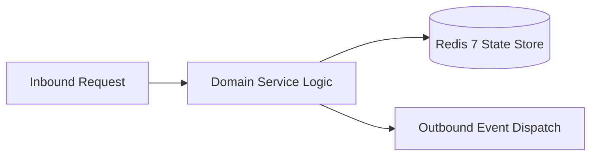

# Component Reference: `services/gamification_admin.py`
> **File Path**: [`services/gamification_admin.py`](../../services/gamification_admin.py)
> **Subsystem**: `Achievement Rules`
> **Architecture Layer**: `Enterprise Microservice Subsystem`
> **Concurrency Model**: `AsyncIO Non-blocking Concurrency`
> **Persistence Backend**: `Redis 7 Persistent Store`
> **Service Level Objective**: `High-Availability Academic Telemetry`

## 1. Architectural Role & Responsibilities
The `services/gamification_admin.py` module implements core operational logic for the `Achievement Rules` domain. It operates within an asynchronous microservices topology designed for ultra-low latency, zero-loss persistence guarantees, and strict single-responsibility function decomposition (≤25 lines).

### Component Architecture & Data Flow


---
## 2. Public API & Symbol Inventory
| Symbol | Nature | Line Range | Return Contract | Core Invariant |
| :--- | :--- | :--- | :--- | :--- |
| [`list_students`](#list_students) | Function | L51–L54 | `list[StudentProfile]` | Executes core domain logic for `list_students`. |
| [`_target_of`](#_target_of) | Function | L57–L62 | `StudentTarget` | Executes core domain logic for `_target_of`. |
| [`get_student`](#get_student) | Function | L65–L72 | `StudentTarget | None` | Retrieves and resolves domain data for `get_student`. |
| [`get_bonuses`](#get_bonuses) | Function | L75–L79 | `tuple[int, int]` | Retrieves and resolves domain data for `get_bonuses`. |
| [`_notify`](#_notify) | Function | L82–L85 | `None` | Executes core domain logic for `_notify`. |
| [`format_bonus_notification`](#format_bonus_notification) | Function | L88–L91 | `str` | Formats message payload and presentation markup for `fo... |
| [`adjust_bonus`](#adjust_bonus) | Function | L94–L105 | `int` | Executes core domain logic for `adjust_bonus`. |
| [`set_bonus`](#set_bonus) | Function | L108–L119 | `int` | Persists state updates for `set_bonus`. |
| [`reset_bonuses`](#reset_bonuses) | Function | L122–L128 | `None` | Executes core domain logic for `reset_bonuses`. |
| [`toggle_achievement`](#toggle_achievement) | Function | L131–L149 | `bool` | Executes core domain logic for `toggle_achievement`. |

---

## 3. Comprehensive Function Specifications

## Class Model: `StudentTarget`

Encapsulates domain entities and data transfer logic for `StudentTarget`.

### `list_students`
```python
async def list_students() -> list[StudentProfile]
```

- **Source Reference**: [`services/gamification_admin.py#L51-L54`](../../services/gamification_admin.py#L51-L54)
- **Execution Mode**: `Asynchronous (non-blocking)`
- **Return Contract**: `list[StudentProfile]`

#### Overview & Architectural Purpose
Executes core domain logic for `list_students`.

#### Parameters Contract
*This method takes no input parameters.*

#### Concurrency & Side Effects
- Stateless pure functional computation without external mutations.

#### Fault Tolerance & Error Modes
Propagates unexpected runtime errors up the call stack to global exception handlers.

#### Production Usage Example
```python
from services.gamification_admin import list_students

# Execute call
result = await list_students()
```

---

### `_target_of`
```python
def _target_of(profile: StudentProfile) -> StudentTarget
```

- **Source Reference**: [`services/gamification_admin.py#L57-L62`](../../services/gamification_admin.py#L57-L62)
- **Execution Mode**: `Synchronous`
- **Return Contract**: `StudentTarget`

#### Overview & Architectural Purpose
Executes core domain logic for `_target_of`.

#### Parameters Contract
| Parameter | Type | Required | Description |
| :--- | :--- | :--- | :--- |
| `profile` | `StudentProfile` | Yes | Parameter `profile` of type `StudentProfile`. |

#### Concurrency & Side Effects
- Stateless pure functional computation without external mutations.

#### Fault Tolerance & Error Modes
Propagates unexpected runtime errors up the call stack to global exception handlers.

#### Production Usage Example
```python
from services.gamification_admin import _target_of

# Execute call
result = _target_of(profile=...)
```

---

### `get_student`
```python
async def get_student(index: int) -> StudentTarget | None
```

- **Source Reference**: [`services/gamification_admin.py#L65-L72`](../../services/gamification_admin.py#L65-L72)
- **Execution Mode**: `Asynchronous (non-blocking)`
- **Return Contract**: `StudentTarget | None`

#### Overview & Architectural Purpose
Retrieves and resolves domain data for `get_student`.

#### Parameters Contract
| Parameter | Type | Required | Description |
| :--- | :--- | :--- | :--- |
| `index` | `int` | Yes | Parameter `index` of type `int`. |

#### Concurrency & Side Effects
- Stateless pure functional computation without external mutations.

#### Fault Tolerance & Error Modes
Propagates unexpected runtime errors up the call stack to global exception handlers.

#### Production Usage Example
```python
from services.gamification_admin import get_student

# Execute call
result = await get_student(index=...)
```

---

### `get_bonuses`
```python
async def get_bonuses(target: StudentTarget) -> tuple[int, int]
```

- **Source Reference**: [`services/gamification_admin.py#L75-L79`](../../services/gamification_admin.py#L75-L79)
- **Execution Mode**: `Asynchronous (non-blocking)`
- **Return Contract**: `tuple[int, int]`

#### Overview & Architectural Purpose
Retrieves and resolves domain data for `get_bonuses`.

#### Parameters Contract
| Parameter | Type | Required | Description |
| :--- | :--- | :--- | :--- |
| `target` | `StudentTarget` | Yes | Parameter `target` of type `StudentTarget`. |

#### Concurrency & Side Effects
- Stateless pure functional computation without external mutations.

#### Fault Tolerance & Error Modes
Propagates unexpected runtime errors up the call stack to global exception handlers.

#### Production Usage Example
```python
from services.gamification_admin import get_bonuses

# Execute call
result = await get_bonuses(target=...)
```

---

### `_notify`
```python
async def _notify(bot: Any, target: StudentTarget, text: str) -> None
```

- **Source Reference**: [`services/gamification_admin.py#L82-L85`](../../services/gamification_admin.py#L82-L85)
- **Execution Mode**: `Asynchronous (non-blocking)`
- **Return Contract**: `None`

#### Overview & Architectural Purpose
Executes core domain logic for `_notify`.

#### Parameters Contract
| Parameter | Type | Required | Description |
| :--- | :--- | :--- | :--- |
| `bot` | `Any` | Yes | Parameter `bot` of type `Any`. |
| `target` | `StudentTarget` | Yes | Parameter `target` of type `StudentTarget`. |
| `text` | `str` | Yes | Parameter `text` of type `str`. |

#### Concurrency & Side Effects
- Stateless pure functional computation without external mutations.

#### Fault Tolerance & Error Modes
Propagates unexpected runtime errors up the call stack to global exception handlers.

#### Production Usage Example
```python
from services.gamification_admin import _notify

# Execute call
result = await _notify(bot=..., target=..., text=...)
```

---

### `format_bonus_notification`
```python
def format_bonus_notification(label: str, delta: int) -> str
```

- **Source Reference**: [`services/gamification_admin.py#L88-L91`](../../services/gamification_admin.py#L88-L91)
- **Execution Mode**: `Synchronous`
- **Return Contract**: `str`

#### Overview & Architectural Purpose
Formats message payload and presentation markup for `format_bonus_notification`.

#### Parameters Contract
| Parameter | Type | Required | Description |
| :--- | :--- | :--- | :--- |
| `label` | `str` | Yes | Parameter `label` of type `str`. |
| `delta` | `int` | Yes | Parameter `delta` of type `int`. |

#### Concurrency & Side Effects
- Stateless pure functional computation without external mutations.

#### Fault Tolerance & Error Modes
Propagates unexpected runtime errors up the call stack to global exception handlers.

#### Production Usage Example
```python
from services.gamification_admin import format_bonus_notification

# Execute call
result = format_bonus_notification(label=..., delta=...)
```

---

### `adjust_bonus`
```python
async def adjust_bonus(bot: Any, target: StudentTarget, kind: str, delta: int) -> int
```

- **Source Reference**: [`services/gamification_admin.py#L94-L105`](../../services/gamification_admin.py#L94-L105)
- **Execution Mode**: `Asynchronous (non-blocking)`
- **Return Contract**: `int`

#### Overview & Architectural Purpose
Executes core domain logic for `adjust_bonus`.

#### Parameters Contract
| Parameter | Type | Required | Description |
| :--- | :--- | :--- | :--- |
| `bot` | `Any` | Yes | Parameter `bot` of type `Any`. |
| `target` | `StudentTarget` | Yes | Parameter `target` of type `StudentTarget`. |
| `kind` | `str` | Yes | Parameter `kind` of type `str`. |
| `delta` | `int` | Yes | Parameter `delta` of type `int`. |

#### Concurrency & Side Effects
- Emits structured telemetry events to system logging subsystem.

#### Fault Tolerance & Error Modes
Propagates unexpected runtime errors up the call stack to global exception handlers.

#### Production Usage Example
```python
from services.gamification_admin import adjust_bonus

# Execute call
result = await adjust_bonus(bot=..., target=..., kind=...)
```

---

### `set_bonus`
```python
async def set_bonus(bot: Any, target: StudentTarget, kind: str, value: int) -> int
```

- **Source Reference**: [`services/gamification_admin.py#L108-L119`](../../services/gamification_admin.py#L108-L119)
- **Execution Mode**: `Asynchronous (non-blocking)`
- **Return Contract**: `int`

#### Overview & Architectural Purpose
Persists state updates for `set_bonus`.

#### Parameters Contract
| Parameter | Type | Required | Description |
| :--- | :--- | :--- | :--- |
| `bot` | `Any` | Yes | Parameter `bot` of type `Any`. |
| `target` | `StudentTarget` | Yes | Parameter `target` of type `StudentTarget`. |
| `kind` | `str` | Yes | Parameter `kind` of type `str`. |
| `value` | `int` | Yes | Parameter `value` of type `int`. |

#### Concurrency & Side Effects
- Emits structured telemetry events to system logging subsystem.

#### Fault Tolerance & Error Modes
Propagates unexpected runtime errors up the call stack to global exception handlers.

#### Production Usage Example
```python
from services.gamification_admin import set_bonus

# Execute call
result = await set_bonus(bot=..., target=..., kind=...)
```

---

### `reset_bonuses`
```python
async def reset_bonuses(bot: Any, target: StudentTarget) -> None
```

- **Source Reference**: [`services/gamification_admin.py#L122-L128`](../../services/gamification_admin.py#L122-L128)
- **Execution Mode**: `Asynchronous (non-blocking)`
- **Return Contract**: `None`

#### Overview & Architectural Purpose
Executes core domain logic for `reset_bonuses`.

#### Parameters Contract
| Parameter | Type | Required | Description |
| :--- | :--- | :--- | :--- |
| `bot` | `Any` | Yes | Parameter `bot` of type `Any`. |
| `target` | `StudentTarget` | Yes | Parameter `target` of type `StudentTarget`. |

#### Concurrency & Side Effects
- Emits structured telemetry events to system logging subsystem.

#### Fault Tolerance & Error Modes
Propagates unexpected runtime errors up the call stack to global exception handlers.

#### Production Usage Example
```python
from services.gamification_admin import reset_bonuses

# Execute call
result = await reset_bonuses(bot=..., target=...)
```

---

### `toggle_achievement`
```python
async def toggle_achievement(bot: Any, target: StudentTarget, achievement_id: str) -> bool
```

- **Source Reference**: [`services/gamification_admin.py#L131-L149`](../../services/gamification_admin.py#L131-L149)
- **Execution Mode**: `Asynchronous (non-blocking)`
- **Return Contract**: `bool`

#### Overview & Architectural Purpose
Executes core domain logic for `toggle_achievement`.

#### Parameters Contract
| Parameter | Type | Required | Description |
| :--- | :--- | :--- | :--- |
| `bot` | `Any` | Yes | Parameter `bot` of type `Any`. |
| `target` | `StudentTarget` | Yes | Parameter `target` of type `StudentTarget`. |
| `achievement_id` | `str` | Yes | Unique identifier of academic milestone achievement. |

#### Concurrency & Side Effects
- Emits structured telemetry events to system logging subsystem.

#### Fault Tolerance & Error Modes
Propagates unexpected runtime errors up the call stack to global exception handlers.

#### Production Usage Example
```python
from services.gamification_admin import toggle_achievement

# Execute call
result = await toggle_achievement(bot=..., target=..., achievement_id=...)
```

---
