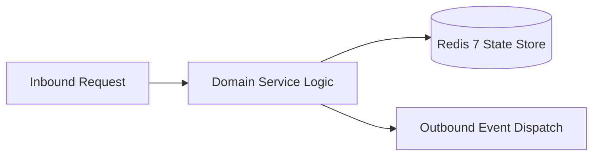

# Component Reference: `services/gamification_models.py`
> **File Path**: [`services/gamification_models.py`](../../services/gamification_models.py)
> **Subsystem**: `Gamification Domain Models`
> **Architecture Layer**: `Enterprise Microservice Subsystem`
> **Concurrency Model**: `AsyncIO Non-blocking Concurrency`
> **Persistence Backend**: `Redis 7 Persistent Store`
> **Service Level Objective**: `High-Availability Academic Telemetry`

## 1. Architectural Role & Responsibilities
The `services/gamification_models.py` module implements core operational logic for the `Gamification Domain Models` domain. It operates within an asynchronous microservices topology designed for ultra-low latency, zero-loss persistence guarantees, and strict single-responsibility function decomposition (≤25 lines).

### Component Architecture & Data Flow

---
## 2. Public API & Symbol Inventory
| Symbol | Nature | Line Range | Return Contract | Core Invariant |
| :--- | :--- | :--- | :--- | :--- |

---

## 3. Comprehensive Function Specifications

## Class Model: `AchievementCategory`

Encapsulates domain entities and data transfer logic for `AchievementCategory`.

## Class Model: `AchievementRarity`

Encapsulates domain entities and data transfer logic for `AchievementRarity`.

## Class Model: `RankDefinition`

Encapsulates domain entities and data transfer logic for `RankDefinition`.

## Class Model: `AchievementDefinition`

Encapsulates domain entities and data transfer logic for `AchievementDefinition`.

## Class Model: `StudentProfile`

Encapsulates domain entities and data transfer logic for `StudentProfile`.
