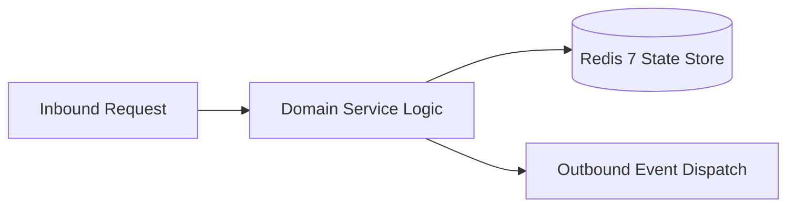

# Component Reference: `services/gamification_registry.py`
> **File Path**: [`services/gamification_registry.py`](../../services/gamification_registry.py)
> **Subsystem**: `Gamification Registry`
> **Architecture Layer**: `Enterprise Microservice Subsystem`
> **Concurrency Model**: `AsyncIO Non-blocking Concurrency`
> **Persistence Backend**: `Redis 7 Persistent Store`
> **Service Level Objective**: `High-Availability Academic Telemetry`

## 1. Architectural Role & Responsibilities
The `services/gamification_registry.py` module implements core operational logic for the `Gamification Registry` domain. It operates within an asynchronous microservices topology designed for ultra-low latency, zero-loss persistence guarantees, and strict single-responsibility function decomposition (≤25 lines).

### Component Architecture & Data Flow


---
## 2. Public API & Symbol Inventory
| Symbol | Nature | Line Range | Return Contract | Core Invariant |
| :--- | :--- | :--- | :--- | :--- |
| [`get_all_achievements`](#get_all_achievements) | Function | L251–L261 | `list[AchievementDefinition]` | Retrieves and resolves domain data for `get_all_achieve... |

---

## 3. Comprehensive Function Specifications

### `get_all_achievements`
```python
def get_all_achievements() -> list[AchievementDefinition]
```

- **Source Reference**: [`services/gamification_registry.py#L251-L261`](../../services/gamification_registry.py#L251-L261)
- **Execution Mode**: `Synchronous`
- **Return Contract**: `list[AchievementDefinition]`

#### Overview & Architectural Purpose
Retrieves and resolves domain data for `get_all_achievements`.

#### Parameters Contract
*This method takes no input parameters.*

#### Concurrency & Side Effects
- Stateless pure functional computation without external mutations.

#### Fault Tolerance & Error Modes
Propagates unexpected runtime errors up the call stack to global exception handlers.

#### Production Usage Example
```python
from services.gamification_registry import get_all_achievements

# Execute call
result = get_all_achievements()
```

---
