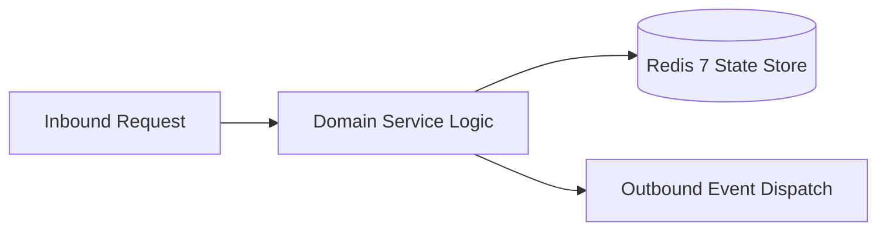

# Component Reference: `services/gamification_registry.py`
> **File Path**: [`services/gamification_registry.py`](../../services/gamification_registry.py)
> **Subsystem**: `Gamification Registry`
> **Architecture Layer**: `Enterprise Microservice Subsystem`
> **Concurrency Model**: `AsyncIO Non-blocking Concurrency`
> **Persistence Backend**: `Redis 7 Persistent Store`
> **Service Level Objective**: `High-Availability Academic Telemetry`

## 1. Architectural Role & Responsibilities
The `services/gamification_registry.py` module implements core operational logic for the `Gamification Registry` domain. It operates within an asynchronous microservices topology designed for ultra-low latency, zero-loss persistence guarantees, and strict single-responsibility function decomposition (≤25 lines).

### Component Architecture & Data Flow


---
## 2. Public API & Symbol Inventory
| Symbol | Nature | Line Range | Return Contract | Core Invariant |
| :--- | :--- | :--- | :--- | :--- |
| [`_get_attendance_achievements`](#_get_attendance_achievements) | Function | L113–L127 | `list[AchievementDefinition]` | Executes core domain logic for `_get_attendance_achieve... |
| [`_get_punctuality_achievements`](#_get_punctuality_achievements) | Function | L130–L144 | `list[AchievementDefinition]` | Executes core domain logic for `_get_punctuality_achiev... |
| [`_get_bot_achievements`](#_get_bot_achievements) | Function | L147–L161 | `list[AchievementDefinition]` | Executes core domain logic for `_get_bot_achievements`. |
| [`_get_ai_achievements`](#_get_ai_achievements) | Function | L164–L178 | `list[AchievementDefinition]` | Executes core domain logic for `_get_ai_achievements`. |
| [`_get_student_life_achievements`](#_get_student_life_achievements) | Function | L181–L195 | `list[AchievementDefinition]` | Executes core domain logic for `_get_student_life_achie... |
| [`_get_social_achievements`](#_get_social_achievements) | Function | L198–L212 | `list[AchievementDefinition]` | Executes core domain logic for `_get_social_achievement... |
| [`_get_easter_egg_achievements`](#_get_easter_egg_achievements) | Function | L215–L229 | `list[AchievementDefinition]` | Executes core domain logic for `_get_easter_egg_achieve... |
| [`_get_mastery_achievements`](#_get_mastery_achievements) | Function | L232–L246 | `list[AchievementDefinition]` | Executes core domain logic for `_get_mastery_achievemen... |
| [`get_all_achievements`](#get_all_achievements) | Function | L249–L264 | `list[AchievementDefinition]` | Retrieves and resolves domain data for `get_all_achieve... |

---

## 3. Comprehensive Function Specifications

### `_get_attendance_achievements`
```python
def _get_attendance_achievements() -> list[AchievementDefinition]
```

- **Source Reference**: [`services/gamification_registry.py#L113-L127`](../../services/gamification_registry.py#L113-L127)
- **Execution Mode**: `Synchronous`
- **Return Contract**: `list[AchievementDefinition]`

#### Overview & Architectural Purpose
Executes core domain logic for `_get_attendance_achievements`.

#### Parameters Contract
*This method takes no input parameters.*

#### Concurrency & Side Effects
- Stateless pure functional computation without external mutations.

#### Fault Tolerance & Error Modes
Propagates unexpected runtime errors up the call stack to global exception handlers.

#### Production Usage Example
```python
from services.gamification_registry import _get_attendance_achievements

# Execute call
result = _get_attendance_achievements()
```

---

### `_get_punctuality_achievements`
```python
def _get_punctuality_achievements() -> list[AchievementDefinition]
```

- **Source Reference**: [`services/gamification_registry.py#L130-L144`](../../services/gamification_registry.py#L130-L144)
- **Execution Mode**: `Synchronous`
- **Return Contract**: `list[AchievementDefinition]`

#### Overview & Architectural Purpose
Executes core domain logic for `_get_punctuality_achievements`.

#### Parameters Contract
*This method takes no input parameters.*

#### Concurrency & Side Effects
- Stateless pure functional computation without external mutations.

#### Fault Tolerance & Error Modes
Propagates unexpected runtime errors up the call stack to global exception handlers.

#### Production Usage Example
```python
from services.gamification_registry import _get_punctuality_achievements

# Execute call
result = _get_punctuality_achievements()
```

---

### `_get_bot_achievements`
```python
def _get_bot_achievements() -> list[AchievementDefinition]
```

- **Source Reference**: [`services/gamification_registry.py#L147-L161`](../../services/gamification_registry.py#L147-L161)
- **Execution Mode**: `Synchronous`
- **Return Contract**: `list[AchievementDefinition]`

#### Overview & Architectural Purpose
Executes core domain logic for `_get_bot_achievements`.

#### Parameters Contract
*This method takes no input parameters.*

#### Concurrency & Side Effects
- Stateless pure functional computation without external mutations.

#### Fault Tolerance & Error Modes
Propagates unexpected runtime errors up the call stack to global exception handlers.

#### Production Usage Example
```python
from services.gamification_registry import _get_bot_achievements

# Execute call
result = _get_bot_achievements()
```

---

### `_get_ai_achievements`
```python
def _get_ai_achievements() -> list[AchievementDefinition]
```

- **Source Reference**: [`services/gamification_registry.py#L164-L178`](../../services/gamification_registry.py#L164-L178)
- **Execution Mode**: `Synchronous`
- **Return Contract**: `list[AchievementDefinition]`

#### Overview & Architectural Purpose
Executes core domain logic for `_get_ai_achievements`.

#### Parameters Contract
*This method takes no input parameters.*

#### Concurrency & Side Effects
- Stateless pure functional computation without external mutations.

#### Fault Tolerance & Error Modes
Propagates unexpected runtime errors up the call stack to global exception handlers.

#### Production Usage Example
```python
from services.gamification_registry import _get_ai_achievements

# Execute call
result = _get_ai_achievements()
```

---

### `_get_student_life_achievements`
```python
def _get_student_life_achievements() -> list[AchievementDefinition]
```

- **Source Reference**: [`services/gamification_registry.py#L181-L195`](../../services/gamification_registry.py#L181-L195)
- **Execution Mode**: `Synchronous`
- **Return Contract**: `list[AchievementDefinition]`

#### Overview & Architectural Purpose
Executes core domain logic for `_get_student_life_achievements`.

#### Parameters Contract
*This method takes no input parameters.*

#### Concurrency & Side Effects
- Stateless pure functional computation without external mutations.

#### Fault Tolerance & Error Modes
Propagates unexpected runtime errors up the call stack to global exception handlers.

#### Production Usage Example
```python
from services.gamification_registry import _get_student_life_achievements

# Execute call
result = _get_student_life_achievements()
```

---

### `_get_social_achievements`
```python
def _get_social_achievements() -> list[AchievementDefinition]
```

- **Source Reference**: [`services/gamification_registry.py#L198-L212`](../../services/gamification_registry.py#L198-L212)
- **Execution Mode**: `Synchronous`
- **Return Contract**: `list[AchievementDefinition]`

#### Overview & Architectural Purpose
Executes core domain logic for `_get_social_achievements`.

#### Parameters Contract
*This method takes no input parameters.*

#### Concurrency & Side Effects
- Stateless pure functional computation without external mutations.

#### Fault Tolerance & Error Modes
Propagates unexpected runtime errors up the call stack to global exception handlers.

#### Production Usage Example
```python
from services.gamification_registry import _get_social_achievements

# Execute call
result = _get_social_achievements()
```

---

### `_get_easter_egg_achievements`
```python
def _get_easter_egg_achievements() -> list[AchievementDefinition]
```

- **Source Reference**: [`services/gamification_registry.py#L215-L229`](../../services/gamification_registry.py#L215-L229)
- **Execution Mode**: `Synchronous`
- **Return Contract**: `list[AchievementDefinition]`

#### Overview & Architectural Purpose
Executes core domain logic for `_get_easter_egg_achievements`.

#### Parameters Contract
*This method takes no input parameters.*

#### Concurrency & Side Effects
- Stateless pure functional computation without external mutations.

#### Fault Tolerance & Error Modes
Propagates unexpected runtime errors up the call stack to global exception handlers.

#### Production Usage Example
```python
from services.gamification_registry import _get_easter_egg_achievements

# Execute call
result = _get_easter_egg_achievements()
```

---

### `_get_mastery_achievements`
```python
def _get_mastery_achievements() -> list[AchievementDefinition]
```

- **Source Reference**: [`services/gamification_registry.py#L232-L246`](../../services/gamification_registry.py#L232-L246)
- **Execution Mode**: `Synchronous`
- **Return Contract**: `list[AchievementDefinition]`

#### Overview & Architectural Purpose
Executes core domain logic for `_get_mastery_achievements`.

#### Parameters Contract
*This method takes no input parameters.*

#### Concurrency & Side Effects
- Stateless pure functional computation without external mutations.

#### Fault Tolerance & Error Modes
Propagates unexpected runtime errors up the call stack to global exception handlers.

#### Production Usage Example
```python
from services.gamification_registry import _get_mastery_achievements

# Execute call
result = _get_mastery_achievements()
```

---

### `get_all_achievements`
```python
def get_all_achievements() -> list[AchievementDefinition]
```

- **Source Reference**: [`services/gamification_registry.py#L249-L264`](../../services/gamification_registry.py#L249-L264)
- **Execution Mode**: `Synchronous`
- **Return Contract**: `list[AchievementDefinition]`

#### Overview & Architectural Purpose
Retrieves and resolves domain data for `get_all_achievements`.

#### Parameters Contract
*This method takes no input parameters.*

#### Concurrency & Side Effects
- Stateless pure functional computation without external mutations.

#### Fault Tolerance & Error Modes
Propagates unexpected runtime errors up the call stack to global exception handlers.

#### Production Usage Example
```python
from services.gamification_registry import get_all_achievements

# Execute call
result = get_all_achievements()
```

---
