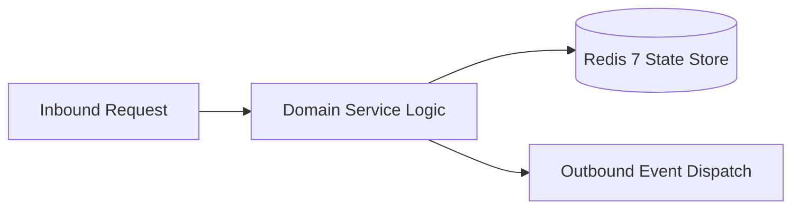

# Component Reference: `services/login_tokens.py`
> **File Path**: [`services/login_tokens.py`](../../services/login_tokens.py)
> **Subsystem**: `RBAC Security`
> **Architecture Layer**: `Enterprise Microservice Subsystem`
> **Concurrency Model**: `AsyncIO Non-blocking Concurrency`
> **Persistence Backend**: `Redis 7 Persistent Store`
> **Service Level Objective**: `High-Availability Academic Telemetry`

## 1. Architectural Role & Responsibilities
The `services/login_tokens.py` module implements core operational logic for the `RBAC Security` domain. It operates within an asynchronous microservices topology designed for ultra-low latency, zero-loss persistence guarantees, and strict single-responsibility function decomposition (≤25 lines).

### Component Architecture & Data Flow


---
## 2. Public API & Symbol Inventory
| Symbol | Nature | Line Range | Return Contract | Core Invariant |
| :--- | :--- | :--- | :--- | :--- |
| [`issue_login_token`](#issue_login_token) | Function | L24–L37 | `str | None` | Executes core domain logic for `issue_login_token`. |
| [`consume_login_token`](#consume_login_token) | Function | L40–L57 | `int | None` | Executes core domain logic for `consume_login_token`. |
| [`build_login_url`](#build_login_url) | Function | L60–L69 | `str | None` | Executes core domain logic for `build_login_url`. |

---

## 3. Comprehensive Function Specifications

### `issue_login_token`
```python
async def issue_login_token(user_id: int) -> str | None
```

- **Source Reference**: [`services/login_tokens.py#L24-L37`](../../services/login_tokens.py#L24-L37)
- **Execution Mode**: `Asynchronous (non-blocking)`
- **Return Contract**: `str | None`

#### Overview & Architectural Purpose
Executes core domain logic for `issue_login_token`.

#### Parameters Contract
| Parameter | Type | Required | Description |
| :--- | :--- | :--- | :--- |
| `user_id` | `int` | Yes | Unique 64-bit Telegram user identifier. |

#### Concurrency & Side Effects
- Mutates or reads Redis L2 key space via asynchronous connection pool.
- Emits structured telemetry events to system logging subsystem.

#### Fault Tolerance & Error Modes
Propagates unexpected runtime errors up the call stack to global exception handlers.

#### Production Usage Example
```python
from services.login_tokens import issue_login_token

# Execute call
result = await issue_login_token(user_id=...)
```

---

### `consume_login_token`
```python
async def consume_login_token(token: str) -> int | None
```

- **Source Reference**: [`services/login_tokens.py#L40-L57`](../../services/login_tokens.py#L40-L57)
- **Execution Mode**: `Asynchronous (non-blocking)`
- **Return Contract**: `int | None`

#### Overview & Architectural Purpose
Executes core domain logic for `consume_login_token`.

#### Parameters Contract
| Parameter | Type | Required | Description |
| :--- | :--- | :--- | :--- |
| `token` | `str` | Yes | Parameter `token` of type `str`. |

#### Concurrency & Side Effects
- Mutates or reads Redis L2 key space via asynchronous connection pool.
- Emits structured telemetry events to system logging subsystem.

#### Fault Tolerance & Error Modes
Propagates unexpected runtime errors up the call stack to global exception handlers.

#### Production Usage Example
```python
from services.login_tokens import consume_login_token

# Execute call
result = await consume_login_token(token=...)
```

---

### `build_login_url`
```python
async def build_login_url(user_id: int, target: str = "miniapp") -> str | None
```

- **Source Reference**: [`services/login_tokens.py#L60-L69`](../../services/login_tokens.py#L60-L69)
- **Execution Mode**: `Asynchronous (non-blocking)`
- **Return Contract**: `str | None`

#### Overview & Architectural Purpose
Executes core domain logic for `build_login_url`.

#### Parameters Contract
| Parameter | Type | Required | Description |
| :--- | :--- | :--- | :--- |
| `user_id` | `int` | Yes | Unique 64-bit Telegram user identifier. |
| `target` | `str` | Yes | Parameter `target` of type `str`. |

#### Concurrency & Side Effects
- Stateless pure functional computation without external mutations.

#### Fault Tolerance & Error Modes
Propagates unexpected runtime errors up the call stack to global exception handlers.

#### Production Usage Example
```python
from services.login_tokens import build_login_url

# Execute call
result = await build_login_url(user_id=..., target=...)
```

---
