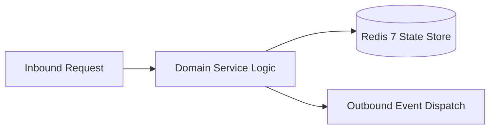

# Component Reference: `services/models.py`
> **File Path**: [`services/models.py`](../../services/models.py)  
> **Subsystem**: `Domain Models`  
> **Architecture Layer**: `Enterprise Microservice Subsystem`  
> **Concurrency Model**: `AsyncIO Non-blocking Concurrency`  
> **Persistence Backend**: `Redis 7 Persistent Store`  
> **Service Level Objective**: `High-Availability Academic Telemetry`

## 1. Architectural Role & Responsibilities
The `services/models.py` module implements core operational logic for the `Domain Models` domain. It operates within an asynchronous microservices topology designed for ultra-low latency, zero-loss persistence guarantees, and strict single-responsibility function decomposition (≤25 lines).

### Component Architecture & Data Flow


---
## 2. Public API & Symbol Inventory
| Symbol | Nature | Line Range | Return Contract | Core Invariant |
| :--- | :--- | :--- | :--- | :--- |
| [`Lesson.number`](#lessonnumber) | Method | L42–L51 | `int` | Executes core domain logic for `number`. |

---

## 3. Comprehensive Function Specifications

## Class Model: `Lesson`

Encapsulates domain entities and data transfer logic for `Lesson`.

### `Lesson.number`
```python
def number(self) -> int
```

- **Source Reference**: [`services/models.py#L42-L51`](../../services/models.py#L42-L51)
- **Execution Mode**: `Synchronous`
- **Return Contract**: `int`

#### Overview & Architectural Purpose
Executes core domain logic for `number`.

#### Parameters Contract
*This method takes no input parameters.*

#### Concurrency & Side Effects
- Stateless pure functional computation without external mutations.

#### Fault Tolerance & Error Modes
Propagates unexpected runtime errors up the call stack to global exception handlers.

#### Production Usage Example
```python
from services.models import number

# Execute call
result = number()
```

---

## Class Model: `ExamItem`

Encapsulates domain entities and data transfer logic for `ExamItem`.
