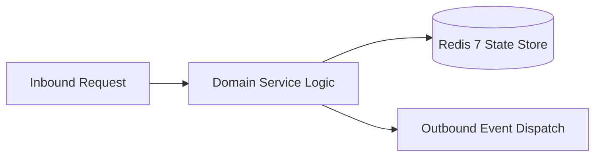

# Component Reference: `services/notifier.py`
> **File Path**: [`services/notifier.py`](../../services/notifier.py)  
> **Subsystem**: `Notification Dispatcher`  
> **Architecture Layer**: `Enterprise Microservice Subsystem`  
> **Concurrency Model**: `AsyncIO Non-blocking Concurrency`  
> **Persistence Backend**: `Redis 7 Persistent Store`  
> **Service Level Objective**: `High-Availability Academic Telemetry`

## 1. Architectural Role & Responsibilities
The `services/notifier.py` module implements core operational logic for the `Notification Dispatcher` domain. It operates within an asynchronous microservices topology designed for ultra-low latency, zero-loss persistence guarantees, and strict single-responsibility function decomposition (≤25 lines).

### Component Architecture & Data Flow


---
## 2. Public API & Symbol Inventory
| Symbol | Nature | Line Range | Return Contract | Core Invariant |
| :--- | :--- | :--- | :--- | :--- |
| [`build_missing_teacher_alert`](#build_missing_teacher_alert) | Function | L40–L55 | `tuple[str, InlineKeyboardMarkup]` | Executes core domain logic for `build_missing_teacher_a... |
| [`notify_missing_teacher`](#notify_missing_teacher) | Function | L58–L68 | `None` | Executes core domain logic for `notify_missing_teacher`... |
| [`send_to_user`](#send_to_user) | Function | L71–L82 | `None` | Dispatches notification message via Telegram API for `s... |
| [`parse_lesson_start_time`](#parse_lesson_start_time) | Function | L85–L100 | `dtime | None` | Parses and extracts structured entities from `parse_les... |
| [`parse_lesson_end_time`](#parse_lesson_end_time) | Function | L103–L118 | `dtime | None` | Parses and extracts structured entities from `parse_les... |
| [`_send_reminder_to_chat`](#_send_reminder_to_chat) | Function | L121–L130 | `None` | Executes core domain logic for `_send_reminder_to_chat`... |
| [`send_single_reminder`](#send_single_reminder) | Function | L133–L143 | `None` | Dispatches notification message via Telegram API for `s... |
| [`schedule_lesson_reminder`](#schedule_lesson_reminder) | Function | L146–L165 | `None` | Executes core domain logic for `schedule_lesson_reminde... |
| [`_send_attendance_to_admin`](#_send_attendance_to_admin) | Function | L168–L177 | `None` | Executes core domain logic for `_send_attendance_to_adm... |
| [`send_attendance_prompt`](#send_attendance_prompt) | Function | L180–L186 | `None` | Dispatches notification message via Telegram API for `s... |
| [`auto_close_attendance_session`](#auto_close_attendance_session) | Function | L189–L198 | `None` | Executes core domain logic for `auto_close_attendance_s... |
| [`schedule_attendance_poll`](#schedule_attendance_poll) | Function | L201–L215 | `None` | Executes core domain logic for `schedule_attendance_pol... |
| [`daily_schedule_dispatch`](#daily_schedule_dispatch) | Function | L218–L231 | `None` | Executes core domain logic for `daily_schedule_dispatch... |
| [`setup_scheduler`](#setup_scheduler) | Function | L234–L247 | `AsyncIOScheduler` | Executes core domain logic for `setup_scheduler`. |

---

## 3. Comprehensive Function Specifications

### `build_missing_teacher_alert`
```python
def build_missing_teacher_alert(raw_teacher: str, subj_name: str) -> tuple[str, InlineKeyboardMarkup]
```

- **Source Reference**: [`services/notifier.py#L40-L55`](../../services/notifier.py#L40-L55)
- **Execution Mode**: `Synchronous`
- **Return Contract**: `tuple[str, InlineKeyboardMarkup]`

#### Overview & Architectural Purpose
Executes core domain logic for `build_missing_teacher_alert`.

#### Parameters Contract
| Parameter | Type | Required | Description |
| :--- | :--- | :--- | :--- |
| `raw_teacher` | `str` | Yes | Parameter `raw_teacher` of type `str`. |
| `subj_name` | `str` | Yes | Parameter `subj_name` of type `str`. |

#### Concurrency & Side Effects
- Stateless pure functional computation without external mutations.

#### Fault Tolerance & Error Modes
Propagates unexpected runtime errors up the call stack to global exception handlers.

#### Production Usage Example
```python
from services.notifier import build_missing_teacher_alert

# Execute call
result = build_missing_teacher_alert(raw_teacher=..., subj_name=...)
```

---

### `notify_missing_teacher`
```python
async def notify_missing_teacher(raw_teacher: str, subj_name: str) -> None
```

- **Source Reference**: [`services/notifier.py#L58-L68`](../../services/notifier.py#L58-L68)
- **Execution Mode**: `Asynchronous (non-blocking)`
- **Return Contract**: `None`

#### Overview & Architectural Purpose
Executes core domain logic for `notify_missing_teacher`.

#### Parameters Contract
| Parameter | Type | Required | Description |
| :--- | :--- | :--- | :--- |
| `raw_teacher` | `str` | Yes | Parameter `raw_teacher` of type `str`. |
| `subj_name` | `str` | Yes | Parameter `subj_name` of type `str`. |

#### Concurrency & Side Effects
- Emits structured telemetry events to system logging subsystem.

#### Fault Tolerance & Error Modes
Propagates unexpected runtime errors up the call stack to global exception handlers.

#### Production Usage Example
```python
from services.notifier import notify_missing_teacher

# Execute call
result = await notify_missing_teacher(raw_teacher=..., subj_name=...)
```

---

### `send_to_user`
```python
async def send_to_user(text: str, reply_markup=None) -> None
```

- **Source Reference**: [`services/notifier.py#L71-L82`](../../services/notifier.py#L71-L82)
- **Execution Mode**: `Asynchronous (non-blocking)`
- **Return Contract**: `None`

#### Overview & Architectural Purpose
Dispatches notification message via Telegram API for `send_to_user`.

#### Parameters Contract
| Parameter | Type | Required | Description |
| :--- | :--- | :--- | :--- |
| `text` | `str` | Yes | Parameter `text` of type `str`. |
| `reply_markup` | `Any` | Yes | Parameter `reply_markup` of type `Any`. |

#### Concurrency & Side Effects
- Emits structured telemetry events to system logging subsystem.

#### Fault Tolerance & Error Modes
Encapsulates faults within `try/except` blocks, logging errors and returning safe fallback defaults.

#### Production Usage Example
```python
from services.notifier import send_to_user

# Execute call
result = await send_to_user(text=..., reply_markup=...)
```

---

### `parse_lesson_start_time`
```python
def parse_lesson_start_time(time_str: str) -> dtime | None
```

- **Source Reference**: [`services/notifier.py#L85-L100`](../../services/notifier.py#L85-L100)
- **Execution Mode**: `Synchronous`
- **Return Contract**: `dtime | None`

#### Overview & Architectural Purpose
Parses and extracts structured entities from `parse_lesson_start_time`.

#### Parameters Contract
| Parameter | Type | Required | Description |
| :--- | :--- | :--- | :--- |
| `time_str` | `str` | Yes | Parameter `time_str` of type `str`. |

#### Concurrency & Side Effects
- Emits structured telemetry events to system logging subsystem.

#### Fault Tolerance & Error Modes
Encapsulates faults within `try/except` blocks, logging errors and returning safe fallback defaults.

#### Production Usage Example
```python
from services.notifier import parse_lesson_start_time

# Execute call
result = parse_lesson_start_time(time_str=...)
```

---

### `parse_lesson_end_time`
```python
def parse_lesson_end_time(time_str: str) -> dtime | None
```

- **Source Reference**: [`services/notifier.py#L103-L118`](../../services/notifier.py#L103-L118)
- **Execution Mode**: `Synchronous`
- **Return Contract**: `dtime | None`

#### Overview & Architectural Purpose
Parses and extracts structured entities from `parse_lesson_end_time`.

#### Parameters Contract
| Parameter | Type | Required | Description |
| :--- | :--- | :--- | :--- |
| `time_str` | `str` | Yes | Parameter `time_str` of type `str`. |

#### Concurrency & Side Effects
- Emits structured telemetry events to system logging subsystem.

#### Fault Tolerance & Error Modes
Encapsulates faults within `try/except` blocks, logging errors and returning safe fallback defaults.

#### Production Usage Example
```python
from services.notifier import parse_lesson_end_time

# Execute call
result = parse_lesson_end_time(time_str=...)
```

---

### `_send_reminder_to_chat`
```python
async def _send_reminder_to_chat( chat_id: int, text: str, lesson: Lesson, sem: asyncio.Semaphore ) -> None
```

- **Source Reference**: [`services/notifier.py#L121-L130`](../../services/notifier.py#L121-L130)
- **Execution Mode**: `Asynchronous (non-blocking)`
- **Return Contract**: `None`

#### Overview & Architectural Purpose
Executes core domain logic for `_send_reminder_to_chat`.

#### Parameters Contract
| Parameter | Type | Required | Description |
| :--- | :--- | :--- | :--- |
| `chat_id` | `int` | Yes | Unique 64-bit Telegram chat or supergroup identifier. |
| `text` | `str` | Yes | Parameter `text` of type `str`. |
| `lesson` | `Lesson` | Yes | Parameter `lesson` of type `Lesson`. |
| `sem` | `asyncio.Semaphore` | Yes | Parameter `sem` of type `asyncio.Semaphore`. |

#### Concurrency & Side Effects
- Emits structured telemetry events to system logging subsystem.

#### Fault Tolerance & Error Modes
Encapsulates faults within `try/except` blocks, logging errors and returning safe fallback defaults.

#### Production Usage Example
```python
from services.notifier import _send_reminder_to_chat

# Execute call
result = await _send_reminder_to_chat(chat_id=..., text=..., lesson=...)
```

---

### `send_single_reminder`
```python
async def send_single_reminder(lesson: Lesson) -> None
```

- **Source Reference**: [`services/notifier.py#L133-L143`](../../services/notifier.py#L133-L143)
- **Execution Mode**: `Asynchronous (non-blocking)`
- **Return Contract**: `None`

#### Overview & Architectural Purpose
Dispatches notification message via Telegram API for `send_single_reminder`.

#### Parameters Contract
| Parameter | Type | Required | Description |
| :--- | :--- | :--- | :--- |
| `lesson` | `Lesson` | Yes | Parameter `lesson` of type `Lesson`. |

#### Concurrency & Side Effects
- Emits structured telemetry events to system logging subsystem.

#### Fault Tolerance & Error Modes
Propagates unexpected runtime errors up the call stack to global exception handlers.

#### Production Usage Example
```python
from services.notifier import send_single_reminder

# Execute call
result = await send_single_reminder(lesson=...)
```

---

### `schedule_lesson_reminder`
```python
def schedule_lesson_reminder(today: date, lesson: Lesson, now_dt: datetime) -> None
```

- **Source Reference**: [`services/notifier.py#L146-L165`](../../services/notifier.py#L146-L165)
- **Execution Mode**: `Synchronous`
- **Return Contract**: `None`

#### Overview & Architectural Purpose
Executes core domain logic for `schedule_lesson_reminder`.

#### Parameters Contract
| Parameter | Type | Required | Description |
| :--- | :--- | :--- | :--- |
| `today` | `date` | Yes | Parameter `today` of type `date`. |
| `lesson` | `Lesson` | Yes | Parameter `lesson` of type `Lesson`. |
| `now_dt` | `datetime` | Yes | Current reference datetime anchored to Europe/Moscow timezone. |

#### Concurrency & Side Effects
- Emits structured telemetry events to system logging subsystem.

#### Fault Tolerance & Error Modes
Propagates unexpected runtime errors up the call stack to global exception handlers.

#### Production Usage Example
```python
from services.notifier import schedule_lesson_reminder

# Execute call
result = schedule_lesson_reminder(today=..., lesson=..., now_dt=...)
```

---

### `_send_attendance_to_admin`
```python
async def _send_attendance_to_admin( user_id: int, text: str, kb: Any, sem: asyncio.Semaphore ) -> None
```

- **Source Reference**: [`services/notifier.py#L168-L177`](../../services/notifier.py#L168-L177)
- **Execution Mode**: `Asynchronous (non-blocking)`
- **Return Contract**: `None`

#### Overview & Architectural Purpose
Executes core domain logic for `_send_attendance_to_admin`.

#### Parameters Contract
| Parameter | Type | Required | Description |
| :--- | :--- | :--- | :--- |
| `user_id` | `int` | Yes | Unique 64-bit Telegram user identifier. |
| `text` | `str` | Yes | Parameter `text` of type `str`. |
| `kb` | `Any` | Yes | Parameter `kb` of type `Any`. |
| `sem` | `asyncio.Semaphore` | Yes | Parameter `sem` of type `asyncio.Semaphore`. |

#### Concurrency & Side Effects
- Emits structured telemetry events to system logging subsystem.

#### Fault Tolerance & Error Modes
Encapsulates faults within `try/except` blocks, logging errors and returning safe fallback defaults.

#### Production Usage Example
```python
from services.notifier import _send_attendance_to_admin

# Execute call
result = await _send_attendance_to_admin(user_id=..., text=..., kb=...)
```

---

### `send_attendance_prompt`
```python
async def send_attendance_prompt(lesson: Lesson) -> None
```

- **Source Reference**: [`services/notifier.py#L180-L186`](../../services/notifier.py#L180-L186)
- **Execution Mode**: `Asynchronous (non-blocking)`
- **Return Contract**: `None`

#### Overview & Architectural Purpose
Dispatches notification message via Telegram API for `send_attendance_prompt`.

#### Parameters Contract
| Parameter | Type | Required | Description |
| :--- | :--- | :--- | :--- |
| `lesson` | `Lesson` | Yes | Parameter `lesson` of type `Lesson`. |

#### Concurrency & Side Effects
- Stateless pure functional computation without external mutations.

#### Fault Tolerance & Error Modes
Propagates unexpected runtime errors up the call stack to global exception handlers.

#### Production Usage Example
```python
from services.notifier import send_attendance_prompt

# Execute call
result = await send_attendance_prompt(lesson=...)
```

---

### `auto_close_attendance_session`
```python
async def auto_close_attendance_session(lesson_num: int) -> None
```

- **Source Reference**: [`services/notifier.py#L189-L198`](../../services/notifier.py#L189-L198)
- **Execution Mode**: `Asynchronous (non-blocking)`
- **Return Contract**: `None`

#### Overview & Architectural Purpose
Executes core domain logic for `auto_close_attendance_session`.

#### Parameters Contract
| Parameter | Type | Required | Description |
| :--- | :--- | :--- | :--- |
| `lesson_num` | `int` | Yes | Academic class sequence index (1-based, 1 to 6). |

#### Concurrency & Side Effects
- Emits structured telemetry events to system logging subsystem.

#### Fault Tolerance & Error Modes
Propagates unexpected runtime errors up the call stack to global exception handlers.

#### Production Usage Example
```python
from services.notifier import auto_close_attendance_session

# Execute call
result = await auto_close_attendance_session(lesson_num=...)
```

---

### `schedule_attendance_poll`
```python
def schedule_attendance_poll(today: date, lesson: Lesson, now_dt: datetime) -> None
```

- **Source Reference**: [`services/notifier.py#L201-L215`](../../services/notifier.py#L201-L215)
- **Execution Mode**: `Synchronous`
- **Return Contract**: `None`

#### Overview & Architectural Purpose
Executes core domain logic for `schedule_attendance_poll`.

#### Parameters Contract
| Parameter | Type | Required | Description |
| :--- | :--- | :--- | :--- |
| `today` | `date` | Yes | Parameter `today` of type `date`. |
| `lesson` | `Lesson` | Yes | Parameter `lesson` of type `Lesson`. |
| `now_dt` | `datetime` | Yes | Current reference datetime anchored to Europe/Moscow timezone. |

#### Concurrency & Side Effects
- Emits structured telemetry events to system logging subsystem.

#### Fault Tolerance & Error Modes
Propagates unexpected runtime errors up the call stack to global exception handlers.

#### Production Usage Example
```python
from services.notifier import schedule_attendance_poll

# Execute call
result = schedule_attendance_poll(today=..., lesson=..., now_dt=...)
```

---

### `daily_schedule_dispatch`
```python
async def daily_schedule_dispatch() -> None
```

- **Source Reference**: [`services/notifier.py#L218-L231`](../../services/notifier.py#L218-L231)
- **Execution Mode**: `Asynchronous (non-blocking)`
- **Return Contract**: `None`

#### Overview & Architectural Purpose
Executes core domain logic for `daily_schedule_dispatch`.

#### Parameters Contract
*This method takes no input parameters.*

#### Concurrency & Side Effects
- Emits structured telemetry events to system logging subsystem.

#### Fault Tolerance & Error Modes
Propagates unexpected runtime errors up the call stack to global exception handlers.

#### Production Usage Example
```python
from services.notifier import daily_schedule_dispatch

# Execute call
result = await daily_schedule_dispatch()
```

---

### `setup_scheduler`
```python
def setup_scheduler() -> AsyncIOScheduler
```

- **Source Reference**: [`services/notifier.py#L234-L247`](../../services/notifier.py#L234-L247)
- **Execution Mode**: `Synchronous`
- **Return Contract**: `AsyncIOScheduler`

#### Overview & Architectural Purpose
Executes core domain logic for `setup_scheduler`.

#### Parameters Contract
*This method takes no input parameters.*

#### Concurrency & Side Effects
- Emits structured telemetry events to system logging subsystem.

#### Fault Tolerance & Error Modes
Propagates unexpected runtime errors up the call stack to global exception handlers.

#### Production Usage Example
```python
from services.notifier import setup_scheduler

# Execute call
result = setup_scheduler()
```

---
