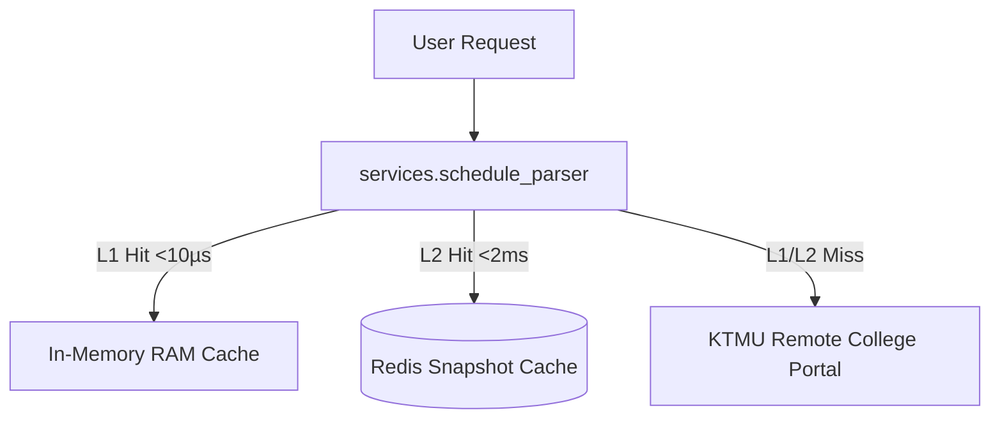

# Component Reference: `services/schedule_parser.py`
> **File Path**: [`services/schedule_parser.py`](../../services/schedule_parser.py)
> **Subsystem**: `KTMU Timetable Engine`
> **Architecture Layer**: `Upstream Ingress & Harvester`
> **Concurrency Model**: `AsyncIO Non-blocking Scraper`
> **Persistence Backend**: `L1 RAM In-Memory (<10µs) + L2 Redis Snapshots`
> **Service Level Objective**: `< 5ms Cached Response / 500ms Upstream Harvest`

## 1. Architectural Role & Responsibilities
The `services/schedule_parser.py` module implements core operational logic for the `KTMU Timetable Engine` domain. It operates within an asynchronous microservices topology designed for ultra-low latency, zero-loss persistence guarantees, and strict single-responsibility function decomposition (≤25 lines).

### Component Architecture & Data Flow


---
## 2. Public API & Symbol Inventory
| Symbol | Nature | Line Range | Return Contract | Core Invariant |
| :--- | :--- | :--- | :--- | :--- |
| [`enable_schedule_fetch_ownership`](#enable_schedule_fetch_ownership) | Function | L67–L76 | `None` | Executes core domain logic for `enable_schedule_fetch_o... |
| [`clear_resolved_day_cache`](#clear_resolved_day_cache) | Function | L79–L88 | `None` | Flushes and resets state for `clear_resolved_day_cache`... |
| [`resolve_room_address`](#resolve_room_address) | Function | L91–L106 | `str` | Executes core domain logic for `resolve_room_address`. |
| [`extract_zoom_creds`](#extract_zoom_creds) | Function | L109–L130 | `tuple[str | None, str | None, str | None]` | Executes core domain logic for `extract_zoom_creds`. |
| [`clean_subject_title`](#clean_subject_title) | Function | L133–L147 | `str` | Executes core domain logic for `clean_subject_title`. |
| [`calculate_week_number`](#calculate_week_number) | Function | L150–L166 | `int` | Executes core domain logic for `calculate_week_number`. |
| [`is_instance_active_for_week`](#is_instance_active_for_week) | Function | L169–L189 | `bool` | Executes core domain logic for `is_instance_active_for_... |
| [`is_item_for_group`](#is_item_for_group) | Function | L192–L211 | `bool` | Executes core domain logic for `is_item_for_group`. |
| [`is_stream_lesson`](#is_stream_lesson) | Function | L214–L232 | `bool` | Executes core domain logic for `is_stream_lesson`. |
| [`extract_subgroup`](#extract_subgroup) | Function | L235–L254 | `int` | Executes core domain logic for `extract_subgroup`. |
| [`_lookup_period_time`](#_lookup_period_time) | Function | L257–L268 | `str | None` | Executes core domain logic for `_lookup_period_time`. |
| [`_find_group_period_time`](#_find_group_period_time) | Function | L271–L280 | `str | None` | Executes core domain logic for `_find_group_period_time... |
| [`get_period_time_str`](#get_period_time_str) | Function | L283–L306 | `str` | Retrieves and resolves domain data for `get_period_time... |
| [`_create_http_client`](#_create_http_client) | Function | L316–L338 | `httpx.AsyncClient` | Executes core domain logic for `_create_http_client`. |
| [`get_http_client`](#get_http_client) | Function | L341–L354 | `httpx.AsyncClient` | Retrieves and resolves domain data for `get_http_client... |
| [`update_cache_headers`](#update_cache_headers) | Function | L357–L372 | `None` | Synchronizes and updates domain state for `update_cache... |
| [`_filter_group_schedule`](#_filter_group_schedule) | Function | L375–L385 | `tuple[list, dict]` | Executes core domain logic for `_filter_group_schedule`... |
| [`filter_snapshot_for_target_group`](#filter_snapshot_for_target_group) | Function | L388–L411 | `dict[str, Any]` | Executes core domain logic for `filter_snapshot_for_tar... |
| [`_parse_and_clean_payload`](#_parse_and_clean_payload) | Function | L414–L428 | `tuple[str | None, dict[str, Any]]` | Executes core domain logic for `_parse_and_clean_payloa... |
| [`_persist_snapshot_to_redis`](#_persist_snapshot_to_redis) | Function | L431–L446 | `None` | Executes core domain logic for `_persist_snapshot_to_re... |
| [`_handle_non_200_status`](#_handle_non_200_status) | Function | L449–L462 | `tuple[float, dict[str, Any] | None]` | Executes core domain logic for `_handle_non_200_status`... |
| [`_apply_new_snapshot`](#_apply_new_snapshot) | Function | L465–L479 | `None` | Executes core domain logic for `_apply_new_snapshot`. |
| [`process_api_response`](#process_api_response) | Function | L482–L502 | `dict[str, Any] | None` | Executes core domain logic for `process_api_response`. |
| [`_build_cache_headers`](#_build_cache_headers) | Function | L508–L524 | `dict[str, str]` | Executes core domain logic for `_build_cache_headers`. |
| [`_fetch_single_endpoint`](#_fetch_single_endpoint) | Function | L527–L540 | `httpx.Response` | Executes core domain logic for `_fetch_single_endpoint`... |
| [`_try_fetch_endpoint`](#_try_fetch_endpoint) | Function | L543–L559 | `httpx.Response | None` | Executes core domain logic for `_try_fetch_endpoint`. |
| [`_get_schedule_endpoints`](#_get_schedule_endpoints) | Function | L562–L570 | `list[str]` | Executes core domain logic for `_get_schedule_endpoints... |
| [`_fetch_remote_schedule`](#_fetch_remote_schedule) | Function | L573–L597 | `httpx.Response` | Executes core domain logic for `_fetch_remote_schedule`... |
| [`_dispatch_schedule_alert`](#_dispatch_schedule_alert) | Function | L600–L614 | `None` | Executes core domain logic for `_dispatch_schedule_aler... |
| [`refresh_schedule_in_background`](#refresh_schedule_in_background) | Function | L617–L635 | `None` | Executes core domain logic for `refresh_schedule_in_bac... |
| [`_restorable_cache_headers`](#_restorable_cache_headers) | Function | L638–L652 | `tuple[str | None, str | None]` | Executes core domain logic for `_restorable_cache_heade... |
| [`init_schedule_cache_from_redis`](#init_schedule_cache_from_redis) | Function | L655–L678 | `bool` | Executes core domain logic for `init_schedule_cache_fro... |
| [`_trigger_stale_refresh`](#_trigger_stale_refresh) | Function | L681–L690 | `None` | Executes core domain logic for `_trigger_stale_refresh`... |
| [`_get_cached_or_revalidate`](#_get_cached_or_revalidate) | Function | L693–L709 | `dict[str, Any] | None` | Executes core domain logic for `_get_cached_or_revalida... |
| [`_is_shared_snapshot_fresh`](#_is_shared_snapshot_fresh) | Function | L712–L714 | `bool` | Executes core domain logic for `_is_shared_snapshot_fre... |
| [`_sync_from_shared_snapshot`](#_sync_from_shared_snapshot) | Function | L717–L741 | `bool` | Executes core domain logic for `_sync_from_shared_snaps... |
| [`_read_shared_schedule`](#_read_shared_schedule) | Function | L744–L754 | `bool` | Executes core domain logic for `_read_shared_schedule`. |
| [`fetch_schedule_data`](#fetch_schedule_data) | Function | L757–L782 | `dict[str, Any] | None` | Executes core domain logic for `fetch_schedule_data`. |
| [`extract_entity_maps`](#extract_entity_maps) | Function | L785–L804 | `tuple[dict, dict, dict, dict, dict]` | Executes core domain logic for `extract_entity_maps`. |
| [`_handle_missing_remote_teacher`](#_handle_missing_remote_teacher) | Function | L807–L815 | `None` | Executes core domain logic for `_handle_missing_remote_... |
| [`_extract_existing_teacher_creds`](#_extract_existing_teacher_creds) | Function | L818–L828 | `tuple[str, str | None, str | None, str | None]` | Executes core domain logic for `_extract_existing_teach... |
| [`resolve_teacher_contact_info`](#resolve_teacher_contact_info) | Function | L831–L855 | `tuple[str, str | None, str | None, str | None]` | Executes core domain logic for `resolve_teacher_contact... |
| [`resolve_room_name`](#resolve_room_name) | Function | L858–L870 | `str` | Executes core domain logic for `resolve_room_name`. |
| [`_resolve_lesson_meta`](#_resolve_lesson_meta) | Function | L873–L891 | `Any` | Executes core domain logic for `_resolve_lesson_meta`. |
| [`_build_lesson_payload`](#_build_lesson_payload) | Function | L894–L927 | `dict[str, Any]` | Executes core domain logic for `_build_lesson_payload`. |
| [`build_lesson_object`](#build_lesson_object) | Function | L930–L945 | `Lesson` | Executes core domain logic for `build_lesson_object`. |
| [`is_placed_lesson_active`](#is_placed_lesson_active) | Function | L948–L959 | `bool` | Executes core domain logic for `is_placed_lesson_active... |
| [`_resolve_day_entry`](#_resolve_day_entry) | Function | L962–L981 | `tuple[dict[str, Any], dict[str, Any]] | None` | Executes core domain logic for `_resolve_day_entry`. |
| [`_collect_day_instances`](#_collect_day_instances) | Function | L984–L1007 | `list[tuple[dict[str, Any], dict[str, Any]]]` | Executes core domain logic for `_collect_day_instances`... |
| [`_collect_moved_in`](#_collect_moved_in) | Function | L1010–L1035 | `list[tuple[dict[str, Any], dict[str, Any]]]` | Executes core domain logic for `_collect_moved_in`. |
| [`_extract_lessons_for_day`](#_extract_lessons_for_day) | Function | L1038–L1064 | `list[Lesson]` | Executes core domain logic for `_extract_lessons_for_da... |
| [`get_schedule_for_date`](#get_schedule_for_date) | Function | L1067–L1090 | `list[Lesson]` | Retrieves and resolves domain data for `get_schedule_fo... |
| [`get_week_schedule`](#get_week_schedule) | Function | L1093–L1112 | `list[tuple[date, list[Lesson]]]` | Retrieves and resolves domain data for `get_week_schedu... |

---

## 3. Comprehensive Function Specifications

### `enable_schedule_fetch_ownership`
```python
def enable_schedule_fetch_ownership() -> None
```

- **Source Reference**: [`services/schedule_parser.py#L67-L76`](../../services/schedule_parser.py#L67-L76)
- **Execution Mode**: `Synchronous`
- **Return Contract**: `None`

#### Overview & Architectural Purpose
Executes core domain logic for `enable_schedule_fetch_ownership`.

#### Parameters Contract
*This method takes no input parameters.*

#### Concurrency & Side Effects
- Stateless pure functional computation without external mutations.

#### Fault Tolerance & Error Modes
Propagates unexpected runtime errors up the call stack to global exception handlers.

#### Production Usage Example
```python
from services.schedule_parser import enable_schedule_fetch_ownership

# Execute call
result = enable_schedule_fetch_ownership()
```

---

### `clear_resolved_day_cache`
```python
def clear_resolved_day_cache() -> None
```

- **Source Reference**: [`services/schedule_parser.py#L79-L88`](../../services/schedule_parser.py#L79-L88)
- **Execution Mode**: `Synchronous`
- **Return Contract**: `None`

#### Overview & Architectural Purpose
Flushes and resets state for `clear_resolved_day_cache`.

#### Parameters Contract
*This method takes no input parameters.*

#### Concurrency & Side Effects
- Stateless pure functional computation without external mutations.

#### Fault Tolerance & Error Modes
Propagates unexpected runtime errors up the call stack to global exception handlers.

#### Production Usage Example
```python
from services.schedule_parser import clear_resolved_day_cache

# Execute call
result = clear_resolved_day_cache()
```

---

### `resolve_room_address`
```python
def resolve_room_address(room_name: str, is_remote: bool) -> str
```

- **Source Reference**: [`services/schedule_parser.py#L91-L106`](../../services/schedule_parser.py#L91-L106)
- **Execution Mode**: `Synchronous`
- **Return Contract**: `str`

#### Overview & Architectural Purpose
Executes core domain logic for `resolve_room_address`.

#### Parameters Contract
| Parameter | Type | Required | Description |
| :--- | :--- | :--- | :--- |
| `room_name` | `str` | Yes | Parameter `room_name` of type `str`. |
| `is_remote` | `bool` | Yes | Parameter `is_remote` of type `bool`. |

#### Concurrency & Side Effects
- Stateless pure functional computation without external mutations.

#### Fault Tolerance & Error Modes
Propagates unexpected runtime errors up the call stack to global exception handlers.

#### Production Usage Example
```python
from services.schedule_parser import resolve_room_address

# Execute call
result = resolve_room_address(room_name=..., is_remote=...)
```

---

### `extract_zoom_creds`
```python
def extract_zoom_creds(text: str) -> tuple[str | None, str | None, str | None]
```

- **Source Reference**: [`services/schedule_parser.py#L109-L130`](../../services/schedule_parser.py#L109-L130)
- **Execution Mode**: `Synchronous`
- **Return Contract**: `tuple[str | None, str | None, str | None]`

#### Overview & Architectural Purpose
Executes core domain logic for `extract_zoom_creds`.

#### Parameters Contract
| Parameter | Type | Required | Description |
| :--- | :--- | :--- | :--- |
| `text` | `str` | Yes | Parameter `text` of type `str`. |

#### Concurrency & Side Effects
- Stateless pure functional computation without external mutations.

#### Fault Tolerance & Error Modes
Propagates unexpected runtime errors up the call stack to global exception handlers.

#### Production Usage Example
```python
from services.schedule_parser import extract_zoom_creds

# Execute call
result = extract_zoom_creds(text=...)
```

---

### `clean_subject_title`
```python
def clean_subject_title(subject: str) -> str
```

- **Source Reference**: [`services/schedule_parser.py#L133-L147`](../../services/schedule_parser.py#L133-L147)
- **Execution Mode**: `Synchronous`
- **Return Contract**: `str`

#### Overview & Architectural Purpose
Executes core domain logic for `clean_subject_title`.

#### Parameters Contract
| Parameter | Type | Required | Description |
| :--- | :--- | :--- | :--- |
| `subject` | `str` | Yes | Name of the academic discipline or scheduled class. |

#### Concurrency & Side Effects
- Stateless pure functional computation without external mutations.

#### Fault Tolerance & Error Modes
Propagates unexpected runtime errors up the call stack to global exception handlers.

#### Production Usage Example
```python
from services.schedule_parser import clean_subject_title

# Execute call
result = clean_subject_title(subject=...)
```

---

### `calculate_week_number`
```python
def calculate_week_number(target_date: date, semester_start_str: str) -> int
```

- **Source Reference**: [`services/schedule_parser.py#L150-L166`](../../services/schedule_parser.py#L150-L166)
- **Execution Mode**: `Synchronous`
- **Return Contract**: `int`

#### Overview & Architectural Purpose
Executes core domain logic for `calculate_week_number`.

#### Parameters Contract
| Parameter | Type | Required | Description |
| :--- | :--- | :--- | :--- |
| `target_date` | `date` | Yes | Target calendar date for schedule or attendance resolution (ISO-8601). |
| `semester_start_str` | `str` | Yes | Parameter `semester_start_str` of type `str`. |

#### Concurrency & Side Effects
- Stateless pure functional computation without external mutations.

#### Fault Tolerance & Error Modes
Propagates unexpected runtime errors up the call stack to global exception handlers.

#### Production Usage Example
```python
from services.schedule_parser import calculate_week_number

# Execute call
result = calculate_week_number(target_date=..., semester_start_str=...)
```

---

### `is_instance_active_for_week`
```python
def is_instance_active_for_week(inst: dict[str, Any], week_num: int) -> bool
```

- **Source Reference**: [`services/schedule_parser.py#L169-L189`](../../services/schedule_parser.py#L169-L189)
- **Execution Mode**: `Synchronous`
- **Return Contract**: `bool`

#### Overview & Architectural Purpose
Executes core domain logic for `is_instance_active_for_week`.

#### Parameters Contract
| Parameter | Type | Required | Description |
| :--- | :--- | :--- | :--- |
| `inst` | `dict[str, Any]` | Yes | Parameter `inst` of type `dict[str, Any]`. |
| `week_num` | `int` | Yes | Parameter `week_num` of type `int`. |

#### Concurrency & Side Effects
- Stateless pure functional computation without external mutations.

#### Fault Tolerance & Error Modes
Propagates unexpected runtime errors up the call stack to global exception handlers.

#### Production Usage Example
```python
from services.schedule_parser import is_instance_active_for_week

# Execute call
result = is_instance_active_for_week(inst=..., week_num=...)
```

---

### `is_item_for_group`
```python
def is_item_for_group(item: dict[str, Any], group_id: str) -> bool
```

- **Source Reference**: [`services/schedule_parser.py#L192-L211`](../../services/schedule_parser.py#L192-L211)
- **Execution Mode**: `Synchronous`
- **Return Contract**: `bool`

#### Overview & Architectural Purpose
Executes core domain logic for `is_item_for_group`.

#### Parameters Contract
| Parameter | Type | Required | Description |
| :--- | :--- | :--- | :--- |
| `item` | `dict[str, Any]` | Yes | Parameter `item` of type `dict[str, Any]`. |
| `group_id` | `str` | Yes | Parameter `group_id` of type `str`. |

#### Concurrency & Side Effects
- Stateless pure functional computation without external mutations.

#### Fault Tolerance & Error Modes
Propagates unexpected runtime errors up the call stack to global exception handlers.

#### Production Usage Example
```python
from services.schedule_parser import is_item_for_group

# Execute call
result = is_item_for_group(item=..., group_id=...)
```

---

### `is_stream_lesson`
```python
def is_stream_lesson(inst: dict[str, Any]) -> bool
```

- **Source Reference**: [`services/schedule_parser.py#L214-L232`](../../services/schedule_parser.py#L214-L232)
- **Execution Mode**: `Synchronous`
- **Return Contract**: `bool`

#### Overview & Architectural Purpose
Executes core domain logic for `is_stream_lesson`.

#### Parameters Contract
| Parameter | Type | Required | Description |
| :--- | :--- | :--- | :--- |
| `inst` | `dict[str, Any]` | Yes | Parameter `inst` of type `dict[str, Any]`. |

#### Concurrency & Side Effects
- Stateless pure functional computation without external mutations.

#### Fault Tolerance & Error Modes
Propagates unexpected runtime errors up the call stack to global exception handlers.

#### Production Usage Example
```python
from services.schedule_parser import is_stream_lesson

# Execute call
result = is_stream_lesson(inst=...)
```

---

### `extract_subgroup`
```python
def extract_subgroup(inst: dict[str, Any], group_id: str) -> int
```

- **Source Reference**: [`services/schedule_parser.py#L235-L254`](../../services/schedule_parser.py#L235-L254)
- **Execution Mode**: `Synchronous`
- **Return Contract**: `int`

#### Overview & Architectural Purpose
Executes core domain logic for `extract_subgroup`.

#### Parameters Contract
| Parameter | Type | Required | Description |
| :--- | :--- | :--- | :--- |
| `inst` | `dict[str, Any]` | Yes | Parameter `inst` of type `dict[str, Any]`. |
| `group_id` | `str` | Yes | Parameter `group_id` of type `str`. |

#### Concurrency & Side Effects
- Stateless pure functional computation without external mutations.

#### Fault Tolerance & Error Modes
Propagates unexpected runtime errors up the call stack to global exception handlers.

#### Production Usage Example
```python
from services.schedule_parser import extract_subgroup

# Execute call
result = extract_subgroup(inst=..., group_id=...)
```

---

### `_lookup_period_time`
```python
def _lookup_period_time(times_list: list[str], period_idx: int) -> str | None
```

- **Source Reference**: [`services/schedule_parser.py#L257-L268`](../../services/schedule_parser.py#L257-L268)
- **Execution Mode**: `Synchronous`
- **Return Contract**: `str | None`

#### Overview & Architectural Purpose
Executes core domain logic for `_lookup_period_time`.

#### Parameters Contract
| Parameter | Type | Required | Description |
| :--- | :--- | :--- | :--- |
| `times_list` | `list[str]` | Yes | Parameter `times_list` of type `list[str]`. |
| `period_idx` | `int` | Yes | Parameter `period_idx` of type `int`. |

#### Concurrency & Side Effects
- Stateless pure functional computation without external mutations.

#### Fault Tolerance & Error Modes
Propagates unexpected runtime errors up the call stack to global exception handlers.

#### Production Usage Example
```python
from services.schedule_parser import _lookup_period_time

# Execute call
result = _lookup_period_time(times_list=..., period_idx=...)
```

---

### `_find_group_period_time`
```python
def _find_group_period_time(group_data: dict[str, Any], day_idx: int, period_idx: int, parity: str) -> str | None
```

- **Source Reference**: [`services/schedule_parser.py#L271-L280`](../../services/schedule_parser.py#L271-L280)
- **Execution Mode**: `Synchronous`
- **Return Contract**: `str | None`

#### Overview & Architectural Purpose
Executes core domain logic for `_find_group_period_time`.

#### Parameters Contract
| Parameter | Type | Required | Description |
| :--- | :--- | :--- | :--- |
| `group_data` | `dict[str, Any]` | Yes | Parameter `group_data` of type `dict[str, Any]`. |
| `day_idx` | `int` | Yes | Parameter `day_idx` of type `int`. |
| `period_idx` | `int` | Yes | Parameter `period_idx` of type `int`. |
| `parity` | `str` | Yes | Parameter `parity` of type `str`. |

#### Concurrency & Side Effects
- Stateless pure functional computation without external mutations.

#### Fault Tolerance & Error Modes
Propagates unexpected runtime errors up the call stack to global exception handlers.

#### Production Usage Example
```python
from services.schedule_parser import _find_group_period_time

# Execute call
result = _find_group_period_time(group_data=..., day_idx=..., period_idx=...)
```

---

### `get_period_time_str`
```python
def get_period_time_str( group_data: dict[str, Any], day_idx: int, period_idx: int, week_num: int, global_config: dict[str, Any] | None = None, ) -> str
```

- **Source Reference**: [`services/schedule_parser.py#L283-L306`](../../services/schedule_parser.py#L283-L306)
- **Execution Mode**: `Synchronous`
- **Return Contract**: `str`

#### Overview & Architectural Purpose
Retrieves and resolves domain data for `get_period_time_str`.

#### Parameters Contract
| Parameter | Type | Required | Description |
| :--- | :--- | :--- | :--- |
| `group_data` | `dict[str, Any]` | Yes | Parameter `group_data` of type `dict[str, Any]`. |
| `day_idx` | `int` | Yes | Parameter `day_idx` of type `int`. |
| `period_idx` | `int` | Yes | Parameter `period_idx` of type `int`. |
| `week_num` | `int` | Yes | Parameter `week_num` of type `int`. |
| `global_config` | `dict[str, Any] | None` | Yes | Parameter `global_config` of type `dict[str, Any] | None`. |

#### Concurrency & Side Effects
- Stateless pure functional computation without external mutations.

#### Fault Tolerance & Error Modes
Propagates unexpected runtime errors up the call stack to global exception handlers.

#### Production Usage Example
```python
from services.schedule_parser import get_period_time_str

# Execute call
result = get_period_time_str(group_data=..., day_idx=..., period_idx=...)
```

---

### `_create_http_client`
```python
def _create_http_client() -> httpx.AsyncClient
```

- **Source Reference**: [`services/schedule_parser.py#L316-L338`](../../services/schedule_parser.py#L316-L338)
- **Execution Mode**: `Synchronous`
- **Return Contract**: `httpx.AsyncClient`

#### Overview & Architectural Purpose
Executes core domain logic for `_create_http_client`.

#### Parameters Contract
*This method takes no input parameters.*

#### Concurrency & Side Effects
- Performs non-blocking network I/O over HTTP or gRPC.

#### Fault Tolerance & Error Modes
Propagates unexpected runtime errors up the call stack to global exception handlers.

#### Production Usage Example
```python
from services.schedule_parser import _create_http_client

# Execute call
result = _create_http_client()
```

---

### `get_http_client`
```python
def get_http_client() -> httpx.AsyncClient
```

- **Source Reference**: [`services/schedule_parser.py#L341-L354`](../../services/schedule_parser.py#L341-L354)
- **Execution Mode**: `Synchronous`
- **Return Contract**: `httpx.AsyncClient`

#### Overview & Architectural Purpose
Retrieves and resolves domain data for `get_http_client`.

#### Parameters Contract
*This method takes no input parameters.*

#### Concurrency & Side Effects
- Performs non-blocking network I/O over HTTP or gRPC.

#### Fault Tolerance & Error Modes
Propagates unexpected runtime errors up the call stack to global exception handlers.

#### Production Usage Example
```python
from services.schedule_parser import get_http_client

# Execute call
result = get_http_client()
```

---

### `update_cache_headers`
```python
def update_cache_headers(headers: httpx.Headers) -> None
```

- **Source Reference**: [`services/schedule_parser.py#L357-L372`](../../services/schedule_parser.py#L357-L372)
- **Execution Mode**: `Synchronous`
- **Return Contract**: `None`

#### Overview & Architectural Purpose
Synchronizes and updates domain state for `update_cache_headers`.

#### Parameters Contract
| Parameter | Type | Required | Description |
| :--- | :--- | :--- | :--- |
| `headers` | `httpx.Headers` | Yes | Parameter `headers` of type `httpx.Headers`. |

#### Concurrency & Side Effects
- Stateless pure functional computation without external mutations.

#### Fault Tolerance & Error Modes
Propagates unexpected runtime errors up the call stack to global exception handlers.

#### Production Usage Example
```python
from services.schedule_parser import update_cache_headers

# Execute call
result = update_cache_headers(headers=...)
```

---

### `_filter_group_schedule`
```python
def _filter_group_schedule(sched: dict[str, Any]) -> tuple[list, dict]
```

- **Source Reference**: [`services/schedule_parser.py#L375-L385`](../../services/schedule_parser.py#L375-L385)
- **Execution Mode**: `Synchronous`
- **Return Contract**: `tuple[list, dict]`

#### Overview & Architectural Purpose
Executes core domain logic for `_filter_group_schedule`.

#### Parameters Contract
| Parameter | Type | Required | Description |
| :--- | :--- | :--- | :--- |
| `sched` | `dict[str, Any]` | Yes | Parameter `sched` of type `dict[str, Any]`. |

#### Concurrency & Side Effects
- Stateless pure functional computation without external mutations.

#### Fault Tolerance & Error Modes
Propagates unexpected runtime errors up the call stack to global exception handlers.

#### Production Usage Example
```python
from services.schedule_parser import _filter_group_schedule

# Execute call
result = _filter_group_schedule(sched=...)
```

---

### `filter_snapshot_for_target_group`
```python
def filter_snapshot_for_target_group(snapshot: dict[str, Any]) -> dict[str, Any]
```

- **Source Reference**: [`services/schedule_parser.py#L388-L411`](../../services/schedule_parser.py#L388-L411)
- **Execution Mode**: `Synchronous`
- **Return Contract**: `dict[str, Any]`

#### Overview & Architectural Purpose
Executes core domain logic for `filter_snapshot_for_target_group`.

#### Parameters Contract
| Parameter | Type | Required | Description |
| :--- | :--- | :--- | :--- |
| `snapshot` | `dict[str, Any]` | Yes | Parameter `snapshot` of type `dict[str, Any]`. |

#### Concurrency & Side Effects
- Stateless pure functional computation without external mutations.

#### Fault Tolerance & Error Modes
Propagates unexpected runtime errors up the call stack to global exception handlers.

#### Production Usage Example
```python
from services.schedule_parser import filter_snapshot_for_target_group

# Execute call
result = filter_snapshot_for_target_group(snapshot=...)
```

---

### `_parse_and_clean_payload`
```python
def _parse_and_clean_payload(content: bytes) -> tuple[str | None, dict[str, Any]]
```

- **Source Reference**: [`services/schedule_parser.py#L414-L428`](../../services/schedule_parser.py#L414-L428)
- **Execution Mode**: `Synchronous`
- **Return Contract**: `tuple[str | None, dict[str, Any]]`

#### Overview & Architectural Purpose
Executes core domain logic for `_parse_and_clean_payload`.

#### Parameters Contract
| Parameter | Type | Required | Description |
| :--- | :--- | :--- | :--- |
| `content` | `bytes` | Yes | Parameter `content` of type `bytes`. |

#### Concurrency & Side Effects
- Stateless pure functional computation without external mutations.

#### Fault Tolerance & Error Modes
Propagates unexpected runtime errors up the call stack to global exception handlers.

#### Production Usage Example
```python
from services.schedule_parser import _parse_and_clean_payload

# Execute call
result = _parse_and_clean_payload(content=...)
```

---

### `_persist_snapshot_to_redis`
```python
def _persist_snapshot_to_redis(snapshot: dict[str, Any]) -> None
```

- **Source Reference**: [`services/schedule_parser.py#L431-L446`](../../services/schedule_parser.py#L431-L446)
- **Execution Mode**: `Synchronous`
- **Return Contract**: `None`

#### Overview & Architectural Purpose
Executes core domain logic for `_persist_snapshot_to_redis`.

#### Parameters Contract
| Parameter | Type | Required | Description |
| :--- | :--- | :--- | :--- |
| `snapshot` | `dict[str, Any]` | Yes | Parameter `snapshot` of type `dict[str, Any]`. |

#### Concurrency & Side Effects
- Stateless pure functional computation without external mutations.

#### Fault Tolerance & Error Modes
Propagates unexpected runtime errors up the call stack to global exception handlers.

#### Production Usage Example
```python
from services.schedule_parser import _persist_snapshot_to_redis

# Execute call
result = _persist_snapshot_to_redis(snapshot=...)
```

---

### `_handle_non_200_status`
```python
def _handle_non_200_status(status_code: int, now: float) -> tuple[float, dict[str, Any] | None]
```

- **Source Reference**: [`services/schedule_parser.py#L449-L462`](../../services/schedule_parser.py#L449-L462)
- **Execution Mode**: `Synchronous`
- **Return Contract**: `tuple[float, dict[str, Any] | None]`

#### Overview & Architectural Purpose
Executes core domain logic for `_handle_non_200_status`.

#### Parameters Contract
| Parameter | Type | Required | Description |
| :--- | :--- | :--- | :--- |
| `status_code` | `int` | Yes | Parameter `status_code` of type `int`. |
| `now` | `float` | Yes | Parameter `now` of type `float`. |

#### Concurrency & Side Effects
- Emits structured telemetry events to system logging subsystem.

#### Fault Tolerance & Error Modes
Propagates unexpected runtime errors up the call stack to global exception handlers.

#### Production Usage Example
```python
from services.schedule_parser import _handle_non_200_status

# Execute call
result = _handle_non_200_status(status_code=..., now=...)
```

---

### `_apply_new_snapshot`
```python
def _apply_new_snapshot(pub_at: str | None, cleaned: dict[str, Any], now: float) -> None
```

- **Source Reference**: [`services/schedule_parser.py#L465-L479`](../../services/schedule_parser.py#L465-L479)
- **Execution Mode**: `Synchronous`
- **Return Contract**: `None`

#### Overview & Architectural Purpose
Executes core domain logic for `_apply_new_snapshot`.

#### Parameters Contract
| Parameter | Type | Required | Description |
| :--- | :--- | :--- | :--- |
| `pub_at` | `str | None` | Yes | Parameter `pub_at` of type `str | None`. |
| `cleaned` | `dict[str, Any]` | Yes | Parameter `cleaned` of type `dict[str, Any]`. |
| `now` | `float` | Yes | Parameter `now` of type `float`. |

#### Concurrency & Side Effects
- Emits structured telemetry events to system logging subsystem.

#### Fault Tolerance & Error Modes
Propagates unexpected runtime errors up the call stack to global exception handlers.

#### Production Usage Example
```python
from services.schedule_parser import _apply_new_snapshot

# Execute call
result = _apply_new_snapshot(pub_at=..., cleaned=..., now=...)
```

---

### `process_api_response`
```python
async def process_api_response(res: httpx.Response, now: float) -> dict[str, Any] | None
```

- **Source Reference**: [`services/schedule_parser.py#L482-L502`](../../services/schedule_parser.py#L482-L502)
- **Execution Mode**: `Asynchronous (non-blocking)`
- **Return Contract**: `dict[str, Any] | None`

#### Overview & Architectural Purpose
Executes core domain logic for `process_api_response`.

#### Parameters Contract
| Parameter | Type | Required | Description |
| :--- | :--- | :--- | :--- |
| `res` | `httpx.Response` | Yes | Parameter `res` of type `httpx.Response`. |
| `now` | `float` | Yes | Parameter `now` of type `float`. |

#### Concurrency & Side Effects
- Stateless pure functional computation without external mutations.

#### Fault Tolerance & Error Modes
Propagates unexpected runtime errors up the call stack to global exception handlers.

#### Production Usage Example
```python
from services.schedule_parser import process_api_response

# Execute call
result = await process_api_response(res=..., now=...)
```

---

### `_build_cache_headers`
```python
def _build_cache_headers() -> dict[str, str]
```

- **Source Reference**: [`services/schedule_parser.py#L508-L524`](../../services/schedule_parser.py#L508-L524)
- **Execution Mode**: `Synchronous`
- **Return Contract**: `dict[str, str]`

#### Overview & Architectural Purpose
Executes core domain logic for `_build_cache_headers`.

#### Parameters Contract
*This method takes no input parameters.*

#### Concurrency & Side Effects
- Stateless pure functional computation without external mutations.

#### Fault Tolerance & Error Modes
Propagates unexpected runtime errors up the call stack to global exception handlers.

#### Production Usage Example
```python
from services.schedule_parser import _build_cache_headers

# Execute call
result = _build_cache_headers()
```

---

### `_fetch_single_endpoint`
```python
async def _fetch_single_endpoint(url: str, headers: dict[str, str]) -> httpx.Response
```

- **Source Reference**: [`services/schedule_parser.py#L527-L540`](../../services/schedule_parser.py#L527-L540)
- **Execution Mode**: `Asynchronous (non-blocking)`
- **Return Contract**: `httpx.Response`

#### Overview & Architectural Purpose
Executes core domain logic for `_fetch_single_endpoint`.

#### Parameters Contract
| Parameter | Type | Required | Description |
| :--- | :--- | :--- | :--- |
| `url` | `str` | Yes | Parameter `url` of type `str`. |
| `headers` | `dict[str, str]` | Yes | Parameter `headers` of type `dict[str, str]`. |

#### Concurrency & Side Effects
- Performs non-blocking network I/O over HTTP or gRPC.

#### Fault Tolerance & Error Modes
Propagates unexpected runtime errors up the call stack to global exception handlers.

#### Production Usage Example
```python
from services.schedule_parser import _fetch_single_endpoint

# Execute call
result = await _fetch_single_endpoint(url=..., headers=...)
```

---

### `_try_fetch_endpoint`
```python
async def _try_fetch_endpoint(url: str, idx: int, headers: dict[str, str]) -> httpx.Response | None
```

- **Source Reference**: [`services/schedule_parser.py#L543-L559`](../../services/schedule_parser.py#L543-L559)
- **Execution Mode**: `Asynchronous (non-blocking)`
- **Return Contract**: `httpx.Response | None`

#### Overview & Architectural Purpose
Executes core domain logic for `_try_fetch_endpoint`.

#### Parameters Contract
| Parameter | Type | Required | Description |
| :--- | :--- | :--- | :--- |
| `url` | `str` | Yes | Parameter `url` of type `str`. |
| `idx` | `int` | Yes | Parameter `idx` of type `int`. |
| `headers` | `dict[str, str]` | Yes | Parameter `headers` of type `dict[str, str]`. |

#### Concurrency & Side Effects
- Emits structured telemetry events to system logging subsystem.

#### Fault Tolerance & Error Modes
Propagates unexpected runtime errors up the call stack to global exception handlers.

#### Production Usage Example
```python
from services.schedule_parser import _try_fetch_endpoint

# Execute call
result = await _try_fetch_endpoint(url=..., idx=..., headers=...)
```

---

### `_get_schedule_endpoints`
```python
def _get_schedule_endpoints() -> list[str]
```

- **Source Reference**: [`services/schedule_parser.py#L562-L570`](../../services/schedule_parser.py#L562-L570)
- **Execution Mode**: `Synchronous`
- **Return Contract**: `list[str]`

#### Overview & Architectural Purpose
Executes core domain logic for `_get_schedule_endpoints`.

#### Parameters Contract
*This method takes no input parameters.*

#### Concurrency & Side Effects
- Stateless pure functional computation without external mutations.

#### Fault Tolerance & Error Modes
Propagates unexpected runtime errors up the call stack to global exception handlers.

#### Production Usage Example
```python
from services.schedule_parser import _get_schedule_endpoints

# Execute call
result = _get_schedule_endpoints()
```

---

### `_fetch_remote_schedule`
```python
async def _fetch_remote_schedule() -> httpx.Response
```

- **Source Reference**: [`services/schedule_parser.py#L573-L597`](../../services/schedule_parser.py#L573-L597)
- **Execution Mode**: `Asynchronous (non-blocking)`
- **Return Contract**: `httpx.Response`

#### Overview & Architectural Purpose
Executes core domain logic for `_fetch_remote_schedule`.

#### Parameters Contract
*This method takes no input parameters.*

#### Concurrency & Side Effects
- Emits structured telemetry events to system logging subsystem.

#### Fault Tolerance & Error Modes
Explicitly raises domain exceptions (e.g., `PermissionError`, `ValueError`) upon invariant violation.

#### Production Usage Example
```python
from services.schedule_parser import _fetch_remote_schedule

# Execute call
result = await _fetch_remote_schedule()
```

---

### `_dispatch_schedule_alert`
```python
def _dispatch_schedule_alert(err_msg: str) -> None
```

- **Source Reference**: [`services/schedule_parser.py#L600-L614`](../../services/schedule_parser.py#L600-L614)
- **Execution Mode**: `Synchronous`
- **Return Contract**: `None`

#### Overview & Architectural Purpose
Executes core domain logic for `_dispatch_schedule_alert`.

#### Parameters Contract
| Parameter | Type | Required | Description |
| :--- | :--- | :--- | :--- |
| `err_msg` | `str` | Yes | Parameter `err_msg` of type `str`. |

#### Concurrency & Side Effects
- Emits structured telemetry events to system logging subsystem.

#### Fault Tolerance & Error Modes
Encapsulates faults within `try/except` blocks, logging errors and returning safe fallback defaults.

#### Production Usage Example
```python
from services.schedule_parser import _dispatch_schedule_alert

# Execute call
result = _dispatch_schedule_alert(err_msg=...)
```

---

### `refresh_schedule_in_background`
```python
async def refresh_schedule_in_background(force: bool = False) -> None
```

- **Source Reference**: [`services/schedule_parser.py#L617-L635`](../../services/schedule_parser.py#L617-L635)
- **Execution Mode**: `Asynchronous (non-blocking)`
- **Return Contract**: `None`

#### Overview & Architectural Purpose
Executes core domain logic for `refresh_schedule_in_background`.

#### Parameters Contract
| Parameter | Type | Required | Description |
| :--- | :--- | :--- | :--- |
| `force` | `bool` | Yes | Parameter `force` of type `bool`. |

#### Concurrency & Side Effects
- Emits structured telemetry events to system logging subsystem.

#### Fault Tolerance & Error Modes
Encapsulates faults within `try/except` blocks, logging errors and returning safe fallback defaults.

#### Production Usage Example
```python
from services.schedule_parser import refresh_schedule_in_background

# Execute call
result = await refresh_schedule_in_background(force=...)
```

---

### `_restorable_cache_headers`
```python
def _restorable_cache_headers(snap: dict[str, Any], meta: dict[str, Any]) -> tuple[str | None, str | None]
```

- **Source Reference**: [`services/schedule_parser.py#L638-L652`](../../services/schedule_parser.py#L638-L652)
- **Execution Mode**: `Synchronous`
- **Return Contract**: `tuple[str | None, str | None]`

#### Overview & Architectural Purpose
Executes core domain logic for `_restorable_cache_headers`.

#### Parameters Contract
| Parameter | Type | Required | Description |
| :--- | :--- | :--- | :--- |
| `snap` | `dict[str, Any]` | Yes | Parameter `snap` of type `dict[str, Any]`. |
| `meta` | `dict[str, Any]` | Yes | Parameter `meta` of type `dict[str, Any]`. |

#### Concurrency & Side Effects
- Emits structured telemetry events to system logging subsystem.

#### Fault Tolerance & Error Modes
Propagates unexpected runtime errors up the call stack to global exception handlers.

#### Production Usage Example
```python
from services.schedule_parser import _restorable_cache_headers

# Execute call
result = _restorable_cache_headers(snap=..., meta=...)
```

---

### `init_schedule_cache_from_redis`
```python
async def init_schedule_cache_from_redis(now: float) -> bool
```

- **Source Reference**: [`services/schedule_parser.py#L655-L678`](../../services/schedule_parser.py#L655-L678)
- **Execution Mode**: `Asynchronous (non-blocking)`
- **Return Contract**: `bool`

#### Overview & Architectural Purpose
Executes core domain logic for `init_schedule_cache_from_redis`.

#### Parameters Contract
| Parameter | Type | Required | Description |
| :--- | :--- | :--- | :--- |
| `now` | `float` | Yes | Parameter `now` of type `float`. |

#### Concurrency & Side Effects
- Emits structured telemetry events to system logging subsystem.

#### Fault Tolerance & Error Modes
Propagates unexpected runtime errors up the call stack to global exception handlers.

#### Production Usage Example
```python
from services.schedule_parser import init_schedule_cache_from_redis

# Execute call
result = await init_schedule_cache_from_redis(now=...)
```

---

### `_trigger_stale_refresh`
```python
async def _trigger_stale_refresh(now: float) -> None
```

- **Source Reference**: [`services/schedule_parser.py#L681-L690`](../../services/schedule_parser.py#L681-L690)
- **Execution Mode**: `Asynchronous (non-blocking)`
- **Return Contract**: `None`

#### Overview & Architectural Purpose
Executes core domain logic for `_trigger_stale_refresh`.

#### Parameters Contract
| Parameter | Type | Required | Description |
| :--- | :--- | :--- | :--- |
| `now` | `float` | Yes | Parameter `now` of type `float`. |

#### Concurrency & Side Effects
- Stateless pure functional computation without external mutations.

#### Fault Tolerance & Error Modes
Propagates unexpected runtime errors up the call stack to global exception handlers.

#### Production Usage Example
```python
from services.schedule_parser import _trigger_stale_refresh

# Execute call
result = await _trigger_stale_refresh(now=...)
```

---

### `_get_cached_or_revalidate`
```python
async def _get_cached_or_revalidate(now: float) -> dict[str, Any] | None
```

- **Source Reference**: [`services/schedule_parser.py#L693-L709`](../../services/schedule_parser.py#L693-L709)
- **Execution Mode**: `Asynchronous (non-blocking)`
- **Return Contract**: `dict[str, Any] | None`

#### Overview & Architectural Purpose
Executes core domain logic for `_get_cached_or_revalidate`.

#### Parameters Contract
| Parameter | Type | Required | Description |
| :--- | :--- | :--- | :--- |
| `now` | `float` | Yes | Parameter `now` of type `float`. |

#### Concurrency & Side Effects
- Stateless pure functional computation without external mutations.

#### Fault Tolerance & Error Modes
Propagates unexpected runtime errors up the call stack to global exception handlers.

#### Production Usage Example
```python
from services.schedule_parser import _get_cached_or_revalidate

# Execute call
result = await _get_cached_or_revalidate(now=...)
```

---

### `_is_shared_snapshot_fresh`
```python
def _is_shared_snapshot_fresh(meta: dict[str, Any] | None, now: float) -> bool
```

- **Source Reference**: [`services/schedule_parser.py#L712-L714`](../../services/schedule_parser.py#L712-L714)
- **Execution Mode**: `Synchronous`
- **Return Contract**: `bool`

#### Overview & Architectural Purpose
Executes core domain logic for `_is_shared_snapshot_fresh`.

#### Parameters Contract
| Parameter | Type | Required | Description |
| :--- | :--- | :--- | :--- |
| `meta` | `dict[str, Any] | None` | Yes | Parameter `meta` of type `dict[str, Any] | None`. |
| `now` | `float` | Yes | Parameter `now` of type `float`. |

#### Concurrency & Side Effects
- Stateless pure functional computation without external mutations.

#### Fault Tolerance & Error Modes
Propagates unexpected runtime errors up the call stack to global exception handlers.

#### Production Usage Example
```python
from services.schedule_parser import _is_shared_snapshot_fresh

# Execute call
result = _is_shared_snapshot_fresh(meta=..., now=...)
```

---

### `_sync_from_shared_snapshot`
```python
async def _sync_from_shared_snapshot(now: float) -> bool
```

- **Source Reference**: [`services/schedule_parser.py#L717-L741`](../../services/schedule_parser.py#L717-L741)
- **Execution Mode**: `Asynchronous (non-blocking)`
- **Return Contract**: `bool`

#### Overview & Architectural Purpose
Executes core domain logic for `_sync_from_shared_snapshot`.

#### Parameters Contract
| Parameter | Type | Required | Description |
| :--- | :--- | :--- | :--- |
| `now` | `float` | Yes | Parameter `now` of type `float`. |

#### Concurrency & Side Effects
- Emits structured telemetry events to system logging subsystem.

#### Fault Tolerance & Error Modes
Propagates unexpected runtime errors up the call stack to global exception handlers.

#### Production Usage Example
```python
from services.schedule_parser import _sync_from_shared_snapshot

# Execute call
result = await _sync_from_shared_snapshot(now=...)
```

---

### `_read_shared_schedule`
```python
async def _read_shared_schedule(now: float, force_refresh: bool) -> bool
```

- **Source Reference**: [`services/schedule_parser.py#L744-L754`](../../services/schedule_parser.py#L744-L754)
- **Execution Mode**: `Asynchronous (non-blocking)`
- **Return Contract**: `bool`

#### Overview & Architectural Purpose
Executes core domain logic for `_read_shared_schedule`.

#### Parameters Contract
| Parameter | Type | Required | Description |
| :--- | :--- | :--- | :--- |
| `now` | `float` | Yes | Parameter `now` of type `float`. |
| `force_refresh` | `bool` | Yes | Parameter `force_refresh` of type `bool`. |

#### Concurrency & Side Effects
- Stateless pure functional computation without external mutations.

#### Fault Tolerance & Error Modes
Propagates unexpected runtime errors up the call stack to global exception handlers.

#### Production Usage Example
```python
from services.schedule_parser import _read_shared_schedule

# Execute call
result = await _read_shared_schedule(now=..., force_refresh=...)
```

---

### `fetch_schedule_data`
```python
async def fetch_schedule_data(force_refresh: bool = False) -> dict[str, Any] | None
```

- **Source Reference**: [`services/schedule_parser.py#L757-L782`](../../services/schedule_parser.py#L757-L782)
- **Execution Mode**: `Asynchronous (non-blocking)`
- **Return Contract**: `dict[str, Any] | None`

#### Overview & Architectural Purpose
Executes core domain logic for `fetch_schedule_data`.

#### Parameters Contract
| Parameter | Type | Required | Description |
| :--- | :--- | :--- | :--- |
| `force_refresh` | `bool` | Yes | Parameter `force_refresh` of type `bool`. |

#### Concurrency & Side Effects
- Stateless pure functional computation without external mutations.

#### Fault Tolerance & Error Modes
Propagates unexpected runtime errors up the call stack to global exception handlers.

#### Production Usage Example
```python
from services.schedule_parser import fetch_schedule_data

# Execute call
result = await fetch_schedule_data(force_refresh=...)
```

---

### `extract_entity_maps`
```python
def extract_entity_maps(data: dict[str, Any]) -> tuple[dict, dict, dict, dict, dict]
```

- **Source Reference**: [`services/schedule_parser.py#L785-L804`](../../services/schedule_parser.py#L785-L804)
- **Execution Mode**: `Synchronous`
- **Return Contract**: `tuple[dict, dict, dict, dict, dict]`

#### Overview & Architectural Purpose
Executes core domain logic for `extract_entity_maps`.

#### Parameters Contract
| Parameter | Type | Required | Description |
| :--- | :--- | :--- | :--- |
| `data` | `dict[str, Any]` | Yes | Parameter `data` of type `dict[str, Any]`. |

#### Concurrency & Side Effects
- Stateless pure functional computation without external mutations.

#### Fault Tolerance & Error Modes
Propagates unexpected runtime errors up the call stack to global exception handlers.

#### Production Usage Example
```python
from services.schedule_parser import extract_entity_maps

# Execute call
result = extract_entity_maps(data=...)
```

---

### `_handle_missing_remote_teacher`
```python
def _handle_missing_remote_teacher(raw_teacher: str, subj_name: str) -> None
```

- **Source Reference**: [`services/schedule_parser.py#L807-L815`](../../services/schedule_parser.py#L807-L815)
- **Execution Mode**: `Synchronous`
- **Return Contract**: `None`

#### Overview & Architectural Purpose
Executes core domain logic for `_handle_missing_remote_teacher`.

#### Parameters Contract
| Parameter | Type | Required | Description |
| :--- | :--- | :--- | :--- |
| `raw_teacher` | `str` | Yes | Parameter `raw_teacher` of type `str`. |
| `subj_name` | `str` | Yes | Parameter `subj_name` of type `str`. |

#### Concurrency & Side Effects
- Stateless pure functional computation without external mutations.

#### Fault Tolerance & Error Modes
Propagates unexpected runtime errors up the call stack to global exception handlers.

#### Production Usage Example
```python
from services.schedule_parser import _handle_missing_remote_teacher

# Execute call
result = _handle_missing_remote_teacher(raw_teacher=..., subj_name=...)
```

---

### `_extract_existing_teacher_creds`
```python
def _extract_existing_teacher_creds( t_info: TeacherData, raw_teacher: str, is_remote: bool ) -> tuple[str, str | None, str | None, str | None]
```

- **Source Reference**: [`services/schedule_parser.py#L818-L828`](../../services/schedule_parser.py#L818-L828)
- **Execution Mode**: `Synchronous`
- **Return Contract**: `tuple[str, str | None, str | None, str | None]`

#### Overview & Architectural Purpose
Executes core domain logic for `_extract_existing_teacher_creds`.

#### Parameters Contract
| Parameter | Type | Required | Description |
| :--- | :--- | :--- | :--- |
| `t_info` | `TeacherData` | Yes | Parameter `t_info` of type `TeacherData`. |
| `raw_teacher` | `str` | Yes | Parameter `raw_teacher` of type `str`. |
| `is_remote` | `bool` | Yes | Parameter `is_remote` of type `bool`. |

#### Concurrency & Side Effects
- Stateless pure functional computation without external mutations.

#### Fault Tolerance & Error Modes
Propagates unexpected runtime errors up the call stack to global exception handlers.

#### Production Usage Example
```python
from services.schedule_parser import _extract_existing_teacher_creds

# Execute call
result = _extract_existing_teacher_creds(t_info=..., raw_teacher=..., is_remote=...)
```

---

### `resolve_teacher_contact_info`
```python
def resolve_teacher_contact_info( raw_teacher: str, teacher_data_map: dict[str, TeacherData], is_remote: bool, subj_name: str, ) -> tuple[str, str | None, str | None, str | None]
```

- **Source Reference**: [`services/schedule_parser.py#L831-L855`](../../services/schedule_parser.py#L831-L855)
- **Execution Mode**: `Synchronous`
- **Return Contract**: `tuple[str, str | None, str | None, str | None]`

#### Overview & Architectural Purpose
Executes core domain logic for `resolve_teacher_contact_info`.

#### Parameters Contract
| Parameter | Type | Required | Description |
| :--- | :--- | :--- | :--- |
| `raw_teacher` | `str` | Yes | Parameter `raw_teacher` of type `str`. |
| `teacher_data_map` | `dict[str, TeacherData]` | Yes | Parameter `teacher_data_map` of type `dict[str, TeacherData]`. |
| `is_remote` | `bool` | Yes | Parameter `is_remote` of type `bool`. |
| `subj_name` | `str` | Yes | Parameter `subj_name` of type `str`. |

#### Concurrency & Side Effects
- Stateless pure functional computation without external mutations.

#### Fault Tolerance & Error Modes
Propagates unexpected runtime errors up the call stack to global exception handlers.

#### Production Usage Example
```python
from services.schedule_parser import resolve_teacher_contact_info

# Execute call
result = resolve_teacher_contact_info(raw_teacher=..., teacher_data_map=..., is_remote=...)
```

---

### `resolve_room_name`
```python
def resolve_room_name(asgn: dict[str, Any], inst: dict[str, Any], rms: dict[str, str], is_remote: bool) -> str
```

- **Source Reference**: [`services/schedule_parser.py#L858-L870`](../../services/schedule_parser.py#L858-L870)
- **Execution Mode**: `Synchronous`
- **Return Contract**: `str`

#### Overview & Architectural Purpose
Executes core domain logic for `resolve_room_name`.

#### Parameters Contract
| Parameter | Type | Required | Description |
| :--- | :--- | :--- | :--- |
| `asgn` | `dict[str, Any]` | Yes | Parameter `asgn` of type `dict[str, Any]`. |
| `inst` | `dict[str, Any]` | Yes | Parameter `inst` of type `dict[str, Any]`. |
| `rms` | `dict[str, str]` | Yes | Parameter `rms` of type `dict[str, str]`. |
| `is_remote` | `bool` | Yes | Parameter `is_remote` of type `bool`. |

#### Concurrency & Side Effects
- Stateless pure functional computation without external mutations.

#### Fault Tolerance & Error Modes
Propagates unexpected runtime errors up the call stack to global exception handlers.

#### Production Usage Example
```python
from services.schedule_parser import resolve_room_name

# Execute call
result = resolve_room_name(asgn=..., inst=..., rms=...)
```

---

### `_resolve_lesson_meta`
```python
def _resolve_lesson_meta( inst: dict[str, Any], asgn: dict[str, Any], maps: tuple[dict, dict, dict, dict, dict], teacher_map: dict[str, TeacherData], )
```

- **Source Reference**: [`services/schedule_parser.py#L873-L891`](../../services/schedule_parser.py#L873-L891)
- **Execution Mode**: `Synchronous`
- **Return Contract**: `Any`

#### Overview & Architectural Purpose
Executes core domain logic for `_resolve_lesson_meta`.

#### Parameters Contract
| Parameter | Type | Required | Description |
| :--- | :--- | :--- | :--- |
| `inst` | `dict[str, Any]` | Yes | Parameter `inst` of type `dict[str, Any]`. |
| `asgn` | `dict[str, Any]` | Yes | Parameter `asgn` of type `dict[str, Any]`. |
| `maps` | `tuple[dict, dict, dict, dict, dict]` | Yes | Parameter `maps` of type `tuple[dict, dict, dict, dict, dict]`. |
| `teacher_map` | `dict[str, TeacherData]` | Yes | Parameter `teacher_map` of type `dict[str, TeacherData]`. |

#### Concurrency & Side Effects
- Stateless pure functional computation without external mutations.

#### Fault Tolerance & Error Modes
Propagates unexpected runtime errors up the call stack to global exception handlers.

#### Production Usage Example
```python
from services.schedule_parser import _resolve_lesson_meta

# Execute call
result = _resolve_lesson_meta(inst=..., asgn=..., maps=...)
```

---

### `_build_lesson_payload`
```python
def _build_lesson_payload( inst: dict[str, Any], asgn: dict[str, Any], maps: tuple[dict, dict, dict, dict, dict], day_idx: int, week_num: int, teacher_map: dict[str, TeacherData], cfg: dict[str, Any] | None = None,
```

- **Source Reference**: [`services/schedule_parser.py#L894-L927`](../../services/schedule_parser.py#L894-L927)
- **Execution Mode**: `Synchronous`
- **Return Contract**: `dict[str, Any]`

#### Overview & Architectural Purpose
Executes core domain logic for `_build_lesson_payload`.

#### Parameters Contract
| Parameter | Type | Required | Description |
| :--- | :--- | :--- | :--- |
| `inst` | `dict[str, Any]` | Yes | Parameter `inst` of type `dict[str, Any]`. |
| `asgn` | `dict[str, Any]` | Yes | Parameter `asgn` of type `dict[str, Any]`. |
| `maps` | `tuple[dict, dict, dict, dict, dict]` | Yes | Parameter `maps` of type `tuple[dict, dict, dict, dict, dict]`. |
| `day_idx` | `int` | Yes | Parameter `day_idx` of type `int`. |
| `week_num` | `int` | Yes | Parameter `week_num` of type `int`. |
| `teacher_map` | `dict[str, TeacherData]` | Yes | Parameter `teacher_map` of type `dict[str, TeacherData]`. |
| `cfg` | `dict[str, Any] | None` | Yes | Parameter `cfg` of type `dict[str, Any] | None`. |

#### Concurrency & Side Effects
- Stateless pure functional computation without external mutations.

#### Fault Tolerance & Error Modes
Propagates unexpected runtime errors up the call stack to global exception handlers.

#### Production Usage Example
```python
from services.schedule_parser import _build_lesson_payload

# Execute call
result = _build_lesson_payload(inst=..., asgn=..., maps=...)
```

---

### `build_lesson_object`
```python
def build_lesson_object( inst: dict[str, Any], asgn: dict[str, Any], maps: tuple[dict, dict, dict, dict, dict], day_idx: int, week_num: int, teacher_map: dict[str, TeacherData], cfg: dict[str, Any] | None = None,
```

- **Source Reference**: [`services/schedule_parser.py#L930-L945`](../../services/schedule_parser.py#L930-L945)
- **Execution Mode**: `Synchronous`
- **Return Contract**: `Lesson`

#### Overview & Architectural Purpose
Executes core domain logic for `build_lesson_object`.

#### Parameters Contract
| Parameter | Type | Required | Description |
| :--- | :--- | :--- | :--- |
| `inst` | `dict[str, Any]` | Yes | Parameter `inst` of type `dict[str, Any]`. |
| `asgn` | `dict[str, Any]` | Yes | Parameter `asgn` of type `dict[str, Any]`. |
| `maps` | `tuple[dict, dict, dict, dict, dict]` | Yes | Parameter `maps` of type `tuple[dict, dict, dict, dict, dict]`. |
| `day_idx` | `int` | Yes | Parameter `day_idx` of type `int`. |
| `week_num` | `int` | Yes | Parameter `week_num` of type `int`. |
| `teacher_map` | `dict[str, TeacherData]` | Yes | Parameter `teacher_map` of type `dict[str, TeacherData]`. |
| `cfg` | `dict[str, Any] | None` | Yes | Parameter `cfg` of type `dict[str, Any] | None`. |

#### Concurrency & Side Effects
- Stateless pure functional computation without external mutations.

#### Fault Tolerance & Error Modes
Propagates unexpected runtime errors up the call stack to global exception handlers.

#### Production Usage Example
```python
from services.schedule_parser import build_lesson_object

# Execute call
result = build_lesson_object(inst=..., asgn=..., maps=...)
```

---

### `is_placed_lesson_active`
```python
def is_placed_lesson_active(inst: dict[str, Any], asgn: dict[str, Any] | None, day_idx: int, week_num: int) -> bool
```

- **Source Reference**: [`services/schedule_parser.py#L948-L959`](../../services/schedule_parser.py#L948-L959)
- **Execution Mode**: `Synchronous`
- **Return Contract**: `bool`

#### Overview & Architectural Purpose
Executes core domain logic for `is_placed_lesson_active`.

#### Parameters Contract
| Parameter | Type | Required | Description |
| :--- | :--- | :--- | :--- |
| `inst` | `dict[str, Any]` | Yes | Parameter `inst` of type `dict[str, Any]`. |
| `asgn` | `dict[str, Any] | None` | Yes | Parameter `asgn` of type `dict[str, Any] | None`. |
| `day_idx` | `int` | Yes | Parameter `day_idx` of type `int`. |
| `week_num` | `int` | Yes | Parameter `week_num` of type `int`. |

#### Concurrency & Side Effects
- Stateless pure functional computation without external mutations.

#### Fault Tolerance & Error Modes
Propagates unexpected runtime errors up the call stack to global exception handlers.

#### Production Usage Example
```python
from services.schedule_parser import is_placed_lesson_active

# Execute call
result = is_placed_lesson_active(inst=..., asgn=..., day_idx=...)
```

---

### `_resolve_day_entry`
```python
def _resolve_day_entry( inst: dict[str, Any], asgn: dict[str, Any], day_subs: dict[str, dict[str, Any]] ) -> tuple[dict[str, Any], dict[str, Any]] | None
```

- **Source Reference**: [`services/schedule_parser.py#L962-L981`](../../services/schedule_parser.py#L962-L981)
- **Execution Mode**: `Synchronous`
- **Return Contract**: `tuple[dict[str, Any], dict[str, Any]] | None`

#### Overview & Architectural Purpose
Executes core domain logic for `_resolve_day_entry`.

#### Parameters Contract
| Parameter | Type | Required | Description |
| :--- | :--- | :--- | :--- |
| `inst` | `dict[str, Any]` | Yes | Parameter `inst` of type `dict[str, Any]`. |
| `asgn` | `dict[str, Any]` | Yes | Parameter `asgn` of type `dict[str, Any]`. |
| `day_subs` | `dict[str, dict[str, Any]]` | Yes | Parameter `day_subs` of type `dict[str, dict[str, Any]]`. |

#### Concurrency & Side Effects
- Emits structured telemetry events to system logging subsystem.

#### Fault Tolerance & Error Modes
Propagates unexpected runtime errors up the call stack to global exception handlers.

#### Production Usage Example
```python
from services.schedule_parser import _resolve_day_entry

# Execute call
result = _resolve_day_entry(inst=..., asgn=..., day_subs=...)
```

---

### `_collect_day_instances`
```python
def _collect_day_instances( insts: list[dict[str, Any]], asgns: dict[str, Any], day_subs: dict[str, dict[str, Any]], day_idx: int, week_num: int, ) -> list[tuple[dict[str, Any], dict[str, Any]]]
```

- **Source Reference**: [`services/schedule_parser.py#L984-L1007`](../../services/schedule_parser.py#L984-L1007)
- **Execution Mode**: `Synchronous`
- **Return Contract**: `list[tuple[dict[str, Any], dict[str, Any]]]`

#### Overview & Architectural Purpose
Executes core domain logic for `_collect_day_instances`.

#### Parameters Contract
| Parameter | Type | Required | Description |
| :--- | :--- | :--- | :--- |
| `insts` | `list[dict[str, Any]]` | Yes | Parameter `insts` of type `list[dict[str, Any]]`. |
| `asgns` | `dict[str, Any]` | Yes | Parameter `asgns` of type `dict[str, Any]`. |
| `day_subs` | `dict[str, dict[str, Any]]` | Yes | Parameter `day_subs` of type `dict[str, dict[str, Any]]`. |
| `day_idx` | `int` | Yes | Parameter `day_idx` of type `int`. |
| `week_num` | `int` | Yes | Parameter `week_num` of type `int`. |

#### Concurrency & Side Effects
- Stateless pure functional computation without external mutations.

#### Fault Tolerance & Error Modes
Propagates unexpected runtime errors up the call stack to global exception handlers.

#### Production Usage Example
```python
from services.schedule_parser import _collect_day_instances

# Execute call
result = _collect_day_instances(insts=..., asgns=..., day_subs=...)
```

---

### `_collect_moved_in`
```python
def _collect_moved_in( insts: list[dict[str, Any]], asgns: dict[str, Any], subs: list[dict[str, Any]], iso_date: str, ) -> list[tuple[dict[str, Any], dict[str, Any]]]
```

- **Source Reference**: [`services/schedule_parser.py#L1010-L1035`](../../services/schedule_parser.py#L1010-L1035)
- **Execution Mode**: `Synchronous`
- **Return Contract**: `list[tuple[dict[str, Any], dict[str, Any]]]`

#### Overview & Architectural Purpose
Executes core domain logic for `_collect_moved_in`.

#### Parameters Contract
| Parameter | Type | Required | Description |
| :--- | :--- | :--- | :--- |
| `insts` | `list[dict[str, Any]]` | Yes | Parameter `insts` of type `list[dict[str, Any]]`. |
| `asgns` | `dict[str, Any]` | Yes | Parameter `asgns` of type `dict[str, Any]`. |
| `subs` | `list[dict[str, Any]]` | Yes | Parameter `subs` of type `list[dict[str, Any]]`. |
| `iso_date` | `str` | Yes | Parameter `iso_date` of type `str`. |

#### Concurrency & Side Effects
- Emits structured telemetry events to system logging subsystem.

#### Fault Tolerance & Error Modes
Propagates unexpected runtime errors up the call stack to global exception handlers.

#### Production Usage Example
```python
from services.schedule_parser import _collect_moved_in

# Execute call
result = _collect_moved_in(insts=..., asgns=..., subs=...)
```

---

### `_extract_lessons_for_day`
```python
def _extract_lessons_for_day( data: dict[str, Any], target_date: date, week_num: int, links: dict[str, TeacherData], ) -> list[Lesson]
```

- **Source Reference**: [`services/schedule_parser.py#L1038-L1064`](../../services/schedule_parser.py#L1038-L1064)
- **Execution Mode**: `Synchronous`
- **Return Contract**: `list[Lesson]`

#### Overview & Architectural Purpose
Executes core domain logic for `_extract_lessons_for_day`.

#### Parameters Contract
| Parameter | Type | Required | Description |
| :--- | :--- | :--- | :--- |
| `data` | `dict[str, Any]` | Yes | Parameter `data` of type `dict[str, Any]`. |
| `target_date` | `date` | Yes | Target calendar date for schedule or attendance resolution (ISO-8601). |
| `week_num` | `int` | Yes | Parameter `week_num` of type `int`. |
| `links` | `dict[str, TeacherData]` | Yes | Parameter `links` of type `dict[str, TeacherData]`. |

#### Concurrency & Side Effects
- Stateless pure functional computation without external mutations.

#### Fault Tolerance & Error Modes
Propagates unexpected runtime errors up the call stack to global exception handlers.

#### Production Usage Example
```python
from services.schedule_parser import _extract_lessons_for_day

# Execute call
result = _extract_lessons_for_day(data=..., target_date=..., week_num=...)
```

---

### `get_schedule_for_date`
```python
async def get_schedule_for_date(target_date: date, force_refresh: bool = False) -> list[Lesson]
```

- **Source Reference**: [`services/schedule_parser.py#L1067-L1090`](../../services/schedule_parser.py#L1067-L1090)
- **Execution Mode**: `Asynchronous (non-blocking)`
- **Return Contract**: `list[Lesson]`

#### Overview & Architectural Purpose
Retrieves and resolves domain data for `get_schedule_for_date`.

#### Parameters Contract
| Parameter | Type | Required | Description |
| :--- | :--- | :--- | :--- |
| `target_date` | `date` | Yes | Target calendar date for schedule or attendance resolution (ISO-8601). |
| `force_refresh` | `bool` | Yes | Parameter `force_refresh` of type `bool`. |

#### Concurrency & Side Effects
- Stateless pure functional computation without external mutations.

#### Fault Tolerance & Error Modes
Propagates unexpected runtime errors up the call stack to global exception handlers.

#### Production Usage Example
```python
from services.schedule_parser import get_schedule_for_date

# Execute call
result = await get_schedule_for_date(target_date=..., force_refresh=...)
```

---

### `get_week_schedule`
```python
async def get_week_schedule(monday_date: date, force_refresh: bool = False) -> list[tuple[date, list[Lesson]]]
```

- **Source Reference**: [`services/schedule_parser.py#L1093-L1112`](../../services/schedule_parser.py#L1093-L1112)
- **Execution Mode**: `Asynchronous (non-blocking)`
- **Return Contract**: `list[tuple[date, list[Lesson]]]`

#### Overview & Architectural Purpose
Retrieves and resolves domain data for `get_week_schedule`.

#### Parameters Contract
| Parameter | Type | Required | Description |
| :--- | :--- | :--- | :--- |
| `monday_date` | `date` | Yes | Parameter `monday_date` of type `date`. |
| `force_refresh` | `bool` | Yes | Parameter `force_refresh` of type `bool`. |

#### Concurrency & Side Effects
- Stateless pure functional computation without external mutations.

#### Fault Tolerance & Error Modes
Propagates unexpected runtime errors up the call stack to global exception handlers.

#### Production Usage Example
```python
from services.schedule_parser import get_week_schedule

# Execute call
result = await get_week_schedule(monday_date=..., force_refresh=...)
```

---
