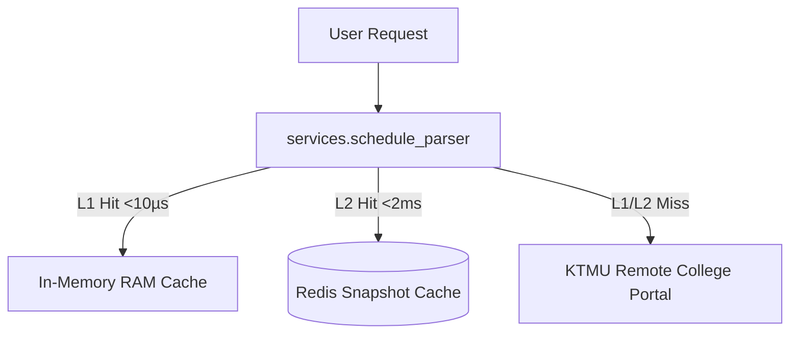

# Component Reference: `services/schedule_parser.py`
> **File Path**: [`services/schedule_parser.py`](../../services/schedule_parser.py)
> **Subsystem**: `KTMU Timetable Engine`
> **Architecture Layer**: `Upstream Ingress & Harvester`
> **Concurrency Model**: `AsyncIO Non-blocking Scraper`
> **Persistence Backend**: `L1 RAM In-Memory (<10µs) + L2 Redis Snapshots`
> **Service Level Objective**: `< 5ms Cached Response / 500ms Upstream Harvest`

## 1. Purpose
Модуль парсинга API расписания КТМУ с расчетом звонков по четности недели.

### Component Architecture & Data Flow


---
## 2. Public API & Symbol Inventory
| Symbol | Nature | Line Range | Return Contract | Summary |
| :--- | :--- | :--- | :--- | :--- |
| [`enable_schedule_fetch_ownership`](#enable_schedule_fetch_ownership) | Function | L72–L81 | `None` | Делает текущий процесс единственным загрузчиком API КТМ... |
| [`clear_resolved_day_cache`](#clear_resolved_day_cache) | Function | L84–L93 | `None` | Сбрасывает оперативный L1 in-memory кэш предрассчитанны... |
| [`resolve_room_address`](#resolve_room_address) | Function | L96–L111 | `str` | Определяет физический адрес учебного корпуса по номеру ... |
| [`extract_zoom_creds`](#extract_zoom_creds) | Function | L114–L135 | `tuple[str \| None, str \| None, str \| None]` | Извлекает URL подключения, Meeting ID и пароль конферен... |
| [`clean_subject_title`](#clean_subject_title) | Function | L138–L152 | `str` | Устраняет дублирование наименований учебных дисциплин. |
| [`calculate_week_number`](#calculate_week_number) | Function | L155–L171 | `int` | Рассчитывает порядковый номер учебной недели относитель... |
| [`week_day_to_date`](#week_day_to_date) | Function | L174–L186 | `date` | Переводит номер учебной недели и день недели в календар... |
| [`is_instance_active_for_week`](#is_instance_active_for_week) | Function | L189–L209 | `bool` | Проверяет актуальность занятия для конкретного номера у... |
| [`is_item_for_group`](#is_item_for_group) | Function | L212–L231 | `bool` | Проверяет принадлежность занятия или нагрузки к целевой... |
| [`is_stream_lesson`](#is_stream_lesson) | Function | L234–L252 | `bool` | Определяет, является ли занятие потоковой лекцией для н... |
| [`extract_subgroup`](#extract_subgroup) | Function | L255–L274 | `int` | Извлекает номер подгруппы целевой группы с учетом поток... |
| [`_lookup_period_time`](#_lookup_period_time) | Function | L277–L288 | `str \| None` | Безопасно извлекает временной интервал пары по индексу ... |
| [`_find_group_period_time`](#_find_group_period_time) | Function | L291–L300 | `str \| None` | Ищет звонки пары в расписании группы по четности или об... |
| [`get_period_time_str`](#get_period_time_str) | Function | L303–L326 | `str` | Определяет точный временной интервал пары с учетом четн... |
| [`_create_http_client`](#_create_http_client) | Function | L340–L362 | `httpx.AsyncClient` | Создает новый настроенный экземпляр HTTP-клиента с пуло... |
| [`get_http_client`](#get_http_client) | Function | L365–L378 | `httpx.AsyncClient` | Предоставляет общий синглтон HTTP-клиента с пулом посто... |
| [`update_cache_headers`](#update_cache_headers) | Function | L381–L396 | `None` | Сохраняет заголовки HTTP ETag и Last-Modified из ответа... |
| [`_filter_group_schedule`](#_filter_group_schedule) | Function | L399–L409 | `tuple[list, dict]` | Фильтрует инстансы и назначения для целевой академическ... |
| [`filter_snapshot_for_target_group`](#filter_snapshot_for_target_group) | Function | L412–L437 | `dict[str, Any]` | Очищает объемный 50 МБ снимок всего колледжа, оставляя ... |
| [`_parse_and_clean_payload`](#_parse_and_clean_payload) | Function | L440–L454 | `tuple[str \| None, dict[str, Any]]` | Синхронно парсит бинарный JSON API и возвращает срез дл... |
| [`_persist_snapshot_to_redis`](#_persist_snapshot_to_redis) | Function | L457–L472 | `None` | Сохраняет нормализованный снимок расписания и HTTP-заго... |
| [`_handle_non_200_status`](#_handle_non_200_status) | Function | L475–L488 | `tuple[float, dict[str, Any] \| None]` | Определяет статус кулдауна и кэша при кодах ответов API... |
| [`_apply_new_snapshot`](#_apply_new_snapshot) | Function | L491–L505 | `None` | Применяет обновленный снимок расписания, сбрасывая кэш ... |
| [`process_api_response`](#process_api_response) | Function | L508–L528 | `dict[str, Any] \| None` | Обрабатывает HTTP-ответ от сервера расписания КТМУ. |
| [`_build_cache_headers`](#_build_cache_headers) | Function | L534–L550 | `dict[str, str]` | Формирует заголовки условного HTTP-запроса If-None-Matc... |
| [`_extract_base_url`](#_extract_base_url) | Function | L553–L558 | `str` | Извлекает базовый origin из URL для формирования путей ... |
| [`_combine_public_payloads`](#_combine_public_payloads) | Function | L561–L577 | `dict[str, Any]` | Объединяет общеколледжный публичный индекс и срез распи... |
| [`_build_public_request_headers`](#_build_public_request_headers) | Function | L580–L593 | `tuple[dict[str, str], dict[str, str]]` | Формирует раздельные заголовки If-None-Match для публич... |
| [`_update_public_cache`](#_update_public_cache) | Function | L596–L608 | `None` | Обновляет локальный кэш и ETag для успешно полученных ч... |
| [`_assemble_public_bundle`](#_assemble_public_bundle) | Function | L611–L628 | `httpx.Response \| None` | Объединяет свежие и кэшированные части публичного API в... |
| [`_fetch_public_bundle`](#_fetch_public_bundle) | Function | L631–L655 | `httpx.Response \| None` | Параллельно запрашивает публичный индекс и шард группы ... |
| [`_fetch_single_endpoint`](#_fetch_single_endpoint) | Function | L658–L669 | `httpx.Response` | Выполняет запрос расписания: сначала через легковесный ... |
| [`_try_fetch_endpoint`](#_try_fetch_endpoint) | Function | L672–L688 | `httpx.Response \| None` | Пытается выполнить запрос к конкретному эндпоинту распи... |
| [`_get_schedule_endpoints`](#_get_schedule_endpoints) | Function | L691–L699 | `list[str]` | Формирует упорядоченный список уникальных URL эндпоинто... |
| [`_fetch_remote_schedule`](#_fetch_remote_schedule) | Function | L702–L726 | `httpx.Response` | Запрашивает расписание из основного API с авто-переходо... |
| [`_dispatch_schedule_alert`](#_dispatch_schedule_alert) | Function | L729–L743 | `None` | Асинхронно отправляет алерт при недоступности API распи... |
| [`refresh_schedule_in_background`](#refresh_schedule_in_background) | Function | L746–L764 | `None` | Асинхронно опрашивает API расписания в фоновом режиме с... |
| [`_restorable_cache_headers`](#_restorable_cache_headers) | Function | L767–L782 | `tuple[str \| None, str \| None]` | Отдаёт ETag/Last-Modified снапшота, если его формат акт... |
| [`init_schedule_cache_from_redis`](#init_schedule_cache_from_redis) | Function | L785–L808 | `bool` | Восстанавливает снимок расписания и ETag из Redis при х... |
| [`_trigger_stale_refresh`](#_trigger_stale_refresh) | Function | L811–L820 | `None` | Запускает фоновое обновление расписания при истечении к... |
| [`_get_cached_or_revalidate`](#_get_cached_or_revalidate) | Function | L823–L839 | `dict[str, Any] \| None` | Возвращает кэшированный снимок расписания, запуская фон... |
| [`_is_shared_snapshot_fresh`](#_is_shared_snapshot_fresh) | Function | L842–L844 | `bool` | Проверяет, что снапшот в Redis есть и worker обновлял е... |
| [`_sync_from_shared_snapshot`](#_sync_from_shared_snapshot) | Function | L847–L871 | `bool` | Синхронизирует кэш читателя со снапшотом, который подде... |
| [`_read_shared_schedule`](#_read_shared_schedule) | Function | L874–L884 | `bool` | Путь читателя: отдаёт снапшот worker'а, а force_refresh... |
| [`fetch_schedule_data`](#fetch_schedule_data) | Function | L887–L912 | `dict[str, Any] \| None` | Предоставляет актуальный снимок расписания из памяти, R... |
| [`extract_entity_maps`](#extract_entity_maps) | Function | L915–L934 | `tuple[dict, dict, dict, dict, dict]` | Формирует быстрые O(1) словари соответствия сущностей п... |
| [`_handle_missing_remote_teacher`](#_handle_missing_remote_teacher) | Function | L937–L945 | `None` | Инициирует фоновое оповещение старосты об отсутствующей... |
| [`_extract_existing_teacher_creds`](#_extract_existing_teacher_creds) | Function | L948–L958 | `tuple[str, str \| None, str \| None, str \| None]` | Извлекает ФИО и доступы к Zoom/Телемост для найденного ... |
| [`resolve_teacher_contact_info`](#resolve_teacher_contact_info) | Function | L961–L985 | `tuple[str, str \| None, str \| None, str \| None]` | Сопоставляет преподавателя с реестром ссылок и извлекае... |
| [`resolve_room_name`](#resolve_room_name) | Function | L988–L1000 | `str` | Определяет текстовый номер аудитории или маркер дистант... |
| [`_resolve_lesson_meta`](#_resolve_lesson_meta) | Function | L1003–L1021 | `Any` | Определяет формат, аудиторию, адрес и контакты преподав... |
| [`_build_lesson_payload`](#_build_lesson_payload) | Function | L1024–L1057 | `dict[str, Any]` | Формирует словарь полей для валидации и создания Pydant... |
| [`build_lesson_object`](#build_lesson_object) | Function | L1060–L1075 | `Lesson` | Конструирует объект Lesson с точным расписанием звонков... |
| [`is_placed_lesson_active`](#is_placed_lesson_active) | Function | L1078–L1089 | `bool` | Проверяет, размещено ли занятие в сетке расписания на у... |
| [`_resolve_day_entry`](#_resolve_day_entry) | Function | L1092–L1111 | `tuple[dict[str, Any], dict[str, Any]] \| None` | Накладывает на занятие замену, действующую в этот день. |
| [`_collect_day_instances`](#_collect_day_instances) | Function | L1114–L1137 | `list[tuple[dict[str, Any], dict[str, Any]]]` | Отбирает активные в этот день занятия группы с учётом з... |
| [`_collect_moved_in`](#_collect_moved_in) | Function | L1140–L1165 | `list[tuple[dict[str, Any], dict[str, Any]]]` | Достаёт занятия, перенесённые на эту дату с других дней... |
| [`_extract_lessons_for_day`](#_extract_lessons_for_day) | Function | L1168–L1194 | `list[Lesson]` | Извлекает и упорядочивает список занятий группы на дату... |
| [`get_schedule_for_date`](#get_schedule_for_date) | Function | L1197–L1220 | `list[Lesson]` | Формирует список занятий группы на целевую дату с двуху... |
| [`get_week_schedule`](#get_week_schedule) | Function | L1223–L1242 | `list[tuple[date, list[Lesson]]]` | Формирует структурированное расписание на всю учебную н... |

---

## 3. Comprehensive Function Specifications

### `enable_schedule_fetch_ownership`
```python
def enable_schedule_fetch_ownership() -> None
```

- **Source Reference**: [`services/schedule_parser.py#L72-L81`](../../services/schedule_parser.py#L72-L81)
- **Execution Mode**: `Synchronous`
- **Return Contract**: `None`

#### Overview & Architectural Purpose
Делает текущий процесс единственным загрузчиком API КТМУ.

#### Parameters Contract
*This method takes no input parameters.*

#### Concurrency & Side Effects
- Stateless pure functional computation without external mutations.

#### Fault Tolerance & Error Modes
Propagates unexpected runtime errors up the call stack to global exception handlers.

#### Production Usage Example
```python
from services.schedule_parser import enable_schedule_fetch_ownership

# Execute call
result = enable_schedule_fetch_ownership()
```

---

### `clear_resolved_day_cache`
```python
def clear_resolved_day_cache() -> None
```

- **Source Reference**: [`services/schedule_parser.py#L84-L93`](../../services/schedule_parser.py#L84-L93)
- **Execution Mode**: `Synchronous`
- **Return Contract**: `None`

#### Overview & Architectural Purpose
Сбрасывает оперативный L1 in-memory кэш предрассчитанных занятий.

#### Parameters Contract
*This method takes no input parameters.*

#### Concurrency & Side Effects
- Stateless pure functional computation without external mutations.

#### Fault Tolerance & Error Modes
Propagates unexpected runtime errors up the call stack to global exception handlers.

#### Production Usage Example
```python
from services.schedule_parser import clear_resolved_day_cache

# Execute call
result = clear_resolved_day_cache()
```

---

### `resolve_room_address`
```python
def resolve_room_address(room_name: str, is_remote: bool) -> str
```

- **Source Reference**: [`services/schedule_parser.py#L96-L111`](../../services/schedule_parser.py#L96-L111)
- **Execution Mode**: `Synchronous`
- **Return Contract**: `str`

#### Overview & Architectural Purpose
Определяет физический адрес учебного корпуса по номеру аудитории.

#### Parameters Contract
| Parameter | Type | Required | Description |
| :--- | :--- | :--- | :--- |
| `room_name` | `str` | Yes | Parameter `room_name` of type `str`. |
| `is_remote` | `bool` | Yes | Parameter `is_remote` of type `bool`. |

#### Concurrency & Side Effects
- Stateless pure functional computation without external mutations.

#### Fault Tolerance & Error Modes
Propagates unexpected runtime errors up the call stack to global exception handlers.

#### Production Usage Example
```python
from services.schedule_parser import resolve_room_address

# Execute call
result = resolve_room_address(room_name=..., is_remote=...)
```

---

### `extract_zoom_creds`
```python
def extract_zoom_creds(text: str) -> tuple[str | None, str | None, str | None]
```

- **Source Reference**: [`services/schedule_parser.py#L114-L135`](../../services/schedule_parser.py#L114-L135)
- **Execution Mode**: `Synchronous`
- **Return Contract**: `tuple[str | None, str | None, str | None]`

#### Overview & Architectural Purpose
Извлекает URL подключения, Meeting ID и пароль конференции из текста преподавателя.

#### Parameters Contract
| Parameter | Type | Required | Description |
| :--- | :--- | :--- | :--- |
| `text` | `str` | Yes | Parameter `text` of type `str`. |

#### Concurrency & Side Effects
- Stateless pure functional computation without external mutations.

#### Fault Tolerance & Error Modes
Propagates unexpected runtime errors up the call stack to global exception handlers.

#### Production Usage Example
```python
from services.schedule_parser import extract_zoom_creds

# Execute call
result = extract_zoom_creds(text=...)
```

---

### `clean_subject_title`
```python
def clean_subject_title(subject: str) -> str
```

- **Source Reference**: [`services/schedule_parser.py#L138-L152`](../../services/schedule_parser.py#L138-L152)
- **Execution Mode**: `Synchronous`
- **Return Contract**: `str`

#### Overview & Architectural Purpose
Устраняет дублирование наименований учебных дисциплин.

#### Parameters Contract
| Parameter | Type | Required | Description |
| :--- | :--- | :--- | :--- |
| `subject` | `str` | Yes | Name of the academic discipline or scheduled class. |

#### Concurrency & Side Effects
- Stateless pure functional computation without external mutations.

#### Fault Tolerance & Error Modes
Propagates unexpected runtime errors up the call stack to global exception handlers.

#### Production Usage Example
```python
from services.schedule_parser import clean_subject_title

# Execute call
result = clean_subject_title(subject=...)
```

---

### `calculate_week_number`
```python
def calculate_week_number(target_date: date, semester_start_str: str) -> int
```

- **Source Reference**: [`services/schedule_parser.py#L155-L171`](../../services/schedule_parser.py#L155-L171)
- **Execution Mode**: `Synchronous`
- **Return Contract**: `int`

#### Overview & Architectural Purpose
Рассчитывает порядковый номер учебной недели относительно даты старта семестра.

#### Parameters Contract
| Parameter | Type | Required | Description |
| :--- | :--- | :--- | :--- |
| `target_date` | `date` | Yes | Target calendar date for schedule or attendance resolution (ISO-8601). |
| `semester_start_str` | `str` | Yes | Parameter `semester_start_str` of type `str`. |

#### Concurrency & Side Effects
- Stateless pure functional computation without external mutations.

#### Fault Tolerance & Error Modes
Propagates unexpected runtime errors up the call stack to global exception handlers.

#### Production Usage Example
```python
from services.schedule_parser import calculate_week_number

# Execute call
result = calculate_week_number(target_date=..., semester_start_str=...)
```

---

### `week_day_to_date`
```python
def week_day_to_date(week_num: int, day_idx: int, semester_start_str: str) -> date
```

- **Source Reference**: [`services/schedule_parser.py#L174-L186`](../../services/schedule_parser.py#L174-L186)
- **Execution Mode**: `Synchronous`
- **Return Contract**: `date`

#### Overview & Architectural Purpose
Переводит номер учебной недели и день недели в календарную дату.

#### Parameters Contract
| Parameter | Type | Required | Description |
| :--- | :--- | :--- | :--- |
| `week_num` | `int` | Yes | Parameter `week_num` of type `int`. |
| `day_idx` | `int` | Yes | Parameter `day_idx` of type `int`. |
| `semester_start_str` | `str` | Yes | Parameter `semester_start_str` of type `str`. |

#### Concurrency & Side Effects
- Stateless pure functional computation without external mutations.

#### Fault Tolerance & Error Modes
Propagates unexpected runtime errors up the call stack to global exception handlers.

#### Production Usage Example
```python
from services.schedule_parser import week_day_to_date

# Execute call
result = week_day_to_date(week_num=..., day_idx=..., semester_start_str=...)
```

---

### `is_instance_active_for_week`
```python
def is_instance_active_for_week(inst: dict[str, Any], week_num: int) -> bool
```

- **Source Reference**: [`services/schedule_parser.py#L189-L209`](../../services/schedule_parser.py#L189-L209)
- **Execution Mode**: `Synchronous`
- **Return Contract**: `bool`

#### Overview & Architectural Purpose
Проверяет актуальность занятия для конкретного номера учебной недели.

#### Parameters Contract
| Parameter | Type | Required | Description |
| :--- | :--- | :--- | :--- |
| `inst` | `dict[str, Any]` | Yes | Parameter `inst` of type `dict[str, Any]`. |
| `week_num` | `int` | Yes | Parameter `week_num` of type `int`. |

#### Concurrency & Side Effects
- Stateless pure functional computation without external mutations.

#### Fault Tolerance & Error Modes
Propagates unexpected runtime errors up the call stack to global exception handlers.

#### Production Usage Example
```python
from services.schedule_parser import is_instance_active_for_week

# Execute call
result = is_instance_active_for_week(inst=..., week_num=...)
```

---

### `is_item_for_group`
```python
def is_item_for_group(item: dict[str, Any], group_id: str) -> bool
```

- **Source Reference**: [`services/schedule_parser.py#L212-L231`](../../services/schedule_parser.py#L212-L231)
- **Execution Mode**: `Synchronous`
- **Return Contract**: `bool`

#### Overview & Architectural Purpose
Проверяет принадлежность занятия или нагрузки к целевой академической группе.

#### Parameters Contract
| Parameter | Type | Required | Description |
| :--- | :--- | :--- | :--- |
| `item` | `dict[str, Any]` | Yes | Parameter `item` of type `dict[str, Any]`. |
| `group_id` | `str` | Yes | Parameter `group_id` of type `str`. |

#### Concurrency & Side Effects
- Stateless pure functional computation without external mutations.

#### Fault Tolerance & Error Modes
Propagates unexpected runtime errors up the call stack to global exception handlers.

#### Production Usage Example
```python
from services.schedule_parser import is_item_for_group

# Execute call
result = is_item_for_group(item=..., group_id=...)
```

---

### `is_stream_lesson`
```python
def is_stream_lesson(inst: dict[str, Any]) -> bool
```

- **Source Reference**: [`services/schedule_parser.py#L234-L252`](../../services/schedule_parser.py#L234-L252)
- **Execution Mode**: `Synchronous`
- **Return Contract**: `bool`

#### Overview & Architectural Purpose
Определяет, является ли занятие потоковой лекцией для нескольких групп.

#### Parameters Contract
| Parameter | Type | Required | Description |
| :--- | :--- | :--- | :--- |
| `inst` | `dict[str, Any]` | Yes | Parameter `inst` of type `dict[str, Any]`. |

#### Concurrency & Side Effects
- Stateless pure functional computation without external mutations.

#### Fault Tolerance & Error Modes
Propagates unexpected runtime errors up the call stack to global exception handlers.

#### Production Usage Example
```python
from services.schedule_parser import is_stream_lesson

# Execute call
result = is_stream_lesson(inst=...)
```

---

### `extract_subgroup`
```python
def extract_subgroup(inst: dict[str, Any], group_id: str) -> int
```

- **Source Reference**: [`services/schedule_parser.py#L255-L274`](../../services/schedule_parser.py#L255-L274)
- **Execution Mode**: `Synchronous`
- **Return Contract**: `int`

#### Overview & Architectural Purpose
Извлекает номер подгруппы целевой группы с учетом потокового участия.

#### Parameters Contract
| Parameter | Type | Required | Description |
| :--- | :--- | :--- | :--- |
| `inst` | `dict[str, Any]` | Yes | Parameter `inst` of type `dict[str, Any]`. |
| `group_id` | `str` | Yes | Parameter `group_id` of type `str`. |

#### Concurrency & Side Effects
- Stateless pure functional computation without external mutations.

#### Fault Tolerance & Error Modes
Propagates unexpected runtime errors up the call stack to global exception handlers.

#### Production Usage Example
```python
from services.schedule_parser import extract_subgroup

# Execute call
result = extract_subgroup(inst=..., group_id=...)
```

---

### `_lookup_period_time`
```python
def _lookup_period_time(times_list: list[str], period_idx: int) -> str | None
```

- **Source Reference**: [`services/schedule_parser.py#L277-L288`](../../services/schedule_parser.py#L277-L288)
- **Execution Mode**: `Synchronous`
- **Return Contract**: `str | None`

#### Overview & Architectural Purpose
Безопасно извлекает временной интервал пары по индексу периода.

#### Parameters Contract
| Parameter | Type | Required | Description |
| :--- | :--- | :--- | :--- |
| `times_list` | `list[str]` | Yes | Parameter `times_list` of type `list[str]`. |
| `period_idx` | `int` | Yes | Parameter `period_idx` of type `int`. |

#### Concurrency & Side Effects
- Stateless pure functional computation without external mutations.

#### Fault Tolerance & Error Modes
Propagates unexpected runtime errors up the call stack to global exception handlers.

#### Production Usage Example
```python
from services.schedule_parser import _lookup_period_time

# Execute call
result = _lookup_period_time(times_list=..., period_idx=...)
```

---

### `_find_group_period_time`
```python
def _find_group_period_time(group_data: dict[str, Any], day_idx: int, period_idx: int, parity: str) -> str | None
```

- **Source Reference**: [`services/schedule_parser.py#L291-L300`](../../services/schedule_parser.py#L291-L300)
- **Execution Mode**: `Synchronous`
- **Return Contract**: `str | None`

#### Overview & Architectural Purpose
Ищет звонки пары в расписании группы по четности или обычному дню.

#### Parameters Contract
| Parameter | Type | Required | Description |
| :--- | :--- | :--- | :--- |
| `group_data` | `dict[str, Any]` | Yes | Parameter `group_data` of type `dict[str, Any]`. |
| `day_idx` | `int` | Yes | Parameter `day_idx` of type `int`. |
| `period_idx` | `int` | Yes | Parameter `period_idx` of type `int`. |
| `parity` | `str` | Yes | Parameter `parity` of type `str`. |

#### Concurrency & Side Effects
- Stateless pure functional computation without external mutations.

#### Fault Tolerance & Error Modes
Propagates unexpected runtime errors up the call stack to global exception handlers.

#### Production Usage Example
```python
from services.schedule_parser import _find_group_period_time

# Execute call
result = _find_group_period_time(group_data=..., day_idx=..., period_idx=...)
```

---

### `get_period_time_str`
```python
def get_period_time_str( group_data: dict[str, Any], day_idx: int, period_idx: int, week_num: int, global_config: dict[str, Any] | None = None, ) -> str
```

- **Source Reference**: [`services/schedule_parser.py#L303-L326`](../../services/schedule_parser.py#L303-L326)
- **Execution Mode**: `Synchronous`
- **Return Contract**: `str`

#### Overview & Architectural Purpose
Определяет точный временной интервал пары с учетом четности недели и дня.

#### Parameters Contract
| Parameter | Type | Required | Description |
| :--- | :--- | :--- | :--- |
| `group_data` | `dict[str, Any]` | Yes | Parameter `group_data` of type `dict[str, Any]`. |
| `day_idx` | `int` | Yes | Parameter `day_idx` of type `int`. |
| `period_idx` | `int` | Yes | Parameter `period_idx` of type `int`. |
| `week_num` | `int` | Yes | Parameter `week_num` of type `int`. |
| `global_config` | `dict[str, Any] | None` | Yes | Parameter `global_config` of type `dict[str, Any] | None`. |

#### Concurrency & Side Effects
- Stateless pure functional computation without external mutations.

#### Fault Tolerance & Error Modes
Propagates unexpected runtime errors up the call stack to global exception handlers.

#### Production Usage Example
```python
from services.schedule_parser import get_period_time_str

# Execute call
result = get_period_time_str(group_data=..., day_idx=..., period_idx=...)
```

---

### `_create_http_client`
```python
def _create_http_client() -> httpx.AsyncClient
```

- **Source Reference**: [`services/schedule_parser.py#L340-L362`](../../services/schedule_parser.py#L340-L362)
- **Execution Mode**: `Synchronous`
- **Return Contract**: `httpx.AsyncClient`

#### Overview & Architectural Purpose
Создает новый настроенный экземпляр HTTP-клиента с пулом соединений.

#### Parameters Contract
*This method takes no input parameters.*

#### Concurrency & Side Effects
- Performs non-blocking network I/O over HTTP or gRPC.

#### Fault Tolerance & Error Modes
Propagates unexpected runtime errors up the call stack to global exception handlers.

#### Production Usage Example
```python
from services.schedule_parser import _create_http_client

# Execute call
result = _create_http_client()
```

---

### `get_http_client`
```python
def get_http_client() -> httpx.AsyncClient
```

- **Source Reference**: [`services/schedule_parser.py#L365-L378`](../../services/schedule_parser.py#L365-L378)
- **Execution Mode**: `Synchronous`
- **Return Contract**: `httpx.AsyncClient`

#### Overview & Architectural Purpose
Предоставляет общий синглтон HTTP-клиента с пулом постоянных соединений.

#### Parameters Contract
*This method takes no input parameters.*

#### Concurrency & Side Effects
- Performs non-blocking network I/O over HTTP or gRPC.

#### Fault Tolerance & Error Modes
Propagates unexpected runtime errors up the call stack to global exception handlers.

#### Production Usage Example
```python
from services.schedule_parser import get_http_client

# Execute call
result = get_http_client()
```

---

### `update_cache_headers`
```python
def update_cache_headers(headers: httpx.Headers) -> None
```

- **Source Reference**: [`services/schedule_parser.py#L381-L396`](../../services/schedule_parser.py#L381-L396)
- **Execution Mode**: `Synchronous`
- **Return Contract**: `None`

#### Overview & Architectural Purpose
Сохраняет заголовки HTTP ETag и Last-Modified из ответа сервера КТМУ.

#### Parameters Contract
| Parameter | Type | Required | Description |
| :--- | :--- | :--- | :--- |
| `headers` | `httpx.Headers` | Yes | Parameter `headers` of type `httpx.Headers`. |

#### Concurrency & Side Effects
- Stateless pure functional computation without external mutations.

#### Fault Tolerance & Error Modes
Propagates unexpected runtime errors up the call stack to global exception handlers.

#### Production Usage Example
```python
from services.schedule_parser import update_cache_headers

# Execute call
result = update_cache_headers(headers=...)
```

---

### `_filter_group_schedule`
```python
def _filter_group_schedule(sched: dict[str, Any]) -> tuple[list, dict]
```

- **Source Reference**: [`services/schedule_parser.py#L399-L409`](../../services/schedule_parser.py#L399-L409)
- **Execution Mode**: `Synchronous`
- **Return Contract**: `tuple[list, dict]`

#### Overview & Architectural Purpose
Фильтрует инстансы и назначения для целевой академической группы.

#### Parameters Contract
| Parameter | Type | Required | Description |
| :--- | :--- | :--- | :--- |
| `sched` | `dict[str, Any]` | Yes | Parameter `sched` of type `dict[str, Any]`. |

#### Concurrency & Side Effects
- Stateless pure functional computation without external mutations.

#### Fault Tolerance & Error Modes
Propagates unexpected runtime errors up the call stack to global exception handlers.

#### Production Usage Example
```python
from services.schedule_parser import _filter_group_schedule

# Execute call
result = _filter_group_schedule(sched=...)
```

---

### `filter_snapshot_for_target_group`
```python
def filter_snapshot_for_target_group(snapshot: dict[str, Any]) -> dict[str, Any]
```

- **Source Reference**: [`services/schedule_parser.py#L412-L437`](../../services/schedule_parser.py#L412-L437)
- **Execution Mode**: `Synchronous`
- **Return Contract**: `dict[str, Any]`

#### Overview & Architectural Purpose
Очищает объемный 50 МБ снимок всего колледжа, оставляя только данные 1-КПД-3.

#### Parameters Contract
| Parameter | Type | Required | Description |
| :--- | :--- | :--- | :--- |
| `snapshot` | `dict[str, Any]` | Yes | Parameter `snapshot` of type `dict[str, Any]`. |

#### Concurrency & Side Effects
- Stateless pure functional computation without external mutations.

#### Fault Tolerance & Error Modes
Propagates unexpected runtime errors up the call stack to global exception handlers.

#### Production Usage Example
```python
from services.schedule_parser import filter_snapshot_for_target_group

# Execute call
result = filter_snapshot_for_target_group(snapshot=...)
```

---

### `_parse_and_clean_payload`
```python
def _parse_and_clean_payload(content: bytes) -> tuple[str | None, dict[str, Any]]
```

- **Source Reference**: [`services/schedule_parser.py#L440-L454`](../../services/schedule_parser.py#L440-L454)
- **Execution Mode**: `Synchronous`
- **Return Contract**: `tuple[str | None, dict[str, Any]]`

#### Overview & Architectural Purpose
Синхронно парсит бинарный JSON API и возвращает срез для целевой группы.

#### Parameters Contract
| Parameter | Type | Required | Description |
| :--- | :--- | :--- | :--- |
| `content` | `bytes` | Yes | Parameter `content` of type `bytes`. |

#### Concurrency & Side Effects
- Stateless pure functional computation without external mutations.

#### Fault Tolerance & Error Modes
Propagates unexpected runtime errors up the call stack to global exception handlers.

#### Production Usage Example
```python
from services.schedule_parser import _parse_and_clean_payload

# Execute call
result = _parse_and_clean_payload(content=...)
```

---

### `_persist_snapshot_to_redis`
```python
def _persist_snapshot_to_redis(snapshot: dict[str, Any]) -> None
```

- **Source Reference**: [`services/schedule_parser.py#L457-L472`](../../services/schedule_parser.py#L457-L472)
- **Execution Mode**: `Synchronous`
- **Return Contract**: `None`

#### Overview & Architectural Purpose
Сохраняет нормализованный снимок расписания и HTTP-заголовки в Redis.

#### Parameters Contract
| Parameter | Type | Required | Description |
| :--- | :--- | :--- | :--- |
| `snapshot` | `dict[str, Any]` | Yes | Parameter `snapshot` of type `dict[str, Any]`. |

#### Concurrency & Side Effects
- Stateless pure functional computation without external mutations.

#### Fault Tolerance & Error Modes
Propagates unexpected runtime errors up the call stack to global exception handlers.

#### Production Usage Example
```python
from services.schedule_parser import _persist_snapshot_to_redis

# Execute call
result = _persist_snapshot_to_redis(snapshot=...)
```

---

### `_handle_non_200_status`
```python
def _handle_non_200_status(status_code: int, now: float) -> tuple[float, dict[str, Any] | None]
```

- **Source Reference**: [`services/schedule_parser.py#L475-L488`](../../services/schedule_parser.py#L475-L488)
- **Execution Mode**: `Synchronous`
- **Return Contract**: `tuple[float, dict[str, Any] | None]`

#### Overview & Architectural Purpose
Определяет статус кулдауна и кэша при кодах ответов API отличных от HTTP 200.

#### Parameters Contract
| Parameter | Type | Required | Description |
| :--- | :--- | :--- | :--- |
| `status_code` | `int` | Yes | Parameter `status_code` of type `int`. |
| `now` | `float` | Yes | Parameter `now` of type `float`. |

#### Concurrency & Side Effects
- Emits structured telemetry events to system logging subsystem.

#### Fault Tolerance & Error Modes
Propagates unexpected runtime errors up the call stack to global exception handlers.

#### Production Usage Example
```python
from services.schedule_parser import _handle_non_200_status

# Execute call
result = _handle_non_200_status(status_code=..., now=...)
```

---

### `_apply_new_snapshot`
```python
def _apply_new_snapshot(pub_at: str | None, cleaned: dict[str, Any], now: float) -> None
```

- **Source Reference**: [`services/schedule_parser.py#L491-L505`](../../services/schedule_parser.py#L491-L505)
- **Execution Mode**: `Synchronous`
- **Return Contract**: `None`

#### Overview & Architectural Purpose
Применяет обновленный снимок расписания, сбрасывая кэш и сохраняя в Redis.

#### Parameters Contract
| Parameter | Type | Required | Description |
| :--- | :--- | :--- | :--- |
| `pub_at` | `str | None` | Yes | Parameter `pub_at` of type `str | None`. |
| `cleaned` | `dict[str, Any]` | Yes | Parameter `cleaned` of type `dict[str, Any]`. |
| `now` | `float` | Yes | Parameter `now` of type `float`. |

#### Concurrency & Side Effects
- Emits structured telemetry events to system logging subsystem.

#### Fault Tolerance & Error Modes
Propagates unexpected runtime errors up the call stack to global exception handlers.

#### Production Usage Example
```python
from services.schedule_parser import _apply_new_snapshot

# Execute call
result = _apply_new_snapshot(pub_at=..., cleaned=..., now=...)
```

---

### `process_api_response`
```python
async def process_api_response(res: httpx.Response, now: float) -> dict[str, Any] | None
```

- **Source Reference**: [`services/schedule_parser.py#L508-L528`](../../services/schedule_parser.py#L508-L528)
- **Execution Mode**: `Asynchronous (non-blocking)`
- **Return Contract**: `dict[str, Any] | None`

#### Overview & Architectural Purpose
Обрабатывает HTTP-ответ от сервера расписания КТМУ.

#### Parameters Contract
| Parameter | Type | Required | Description |
| :--- | :--- | :--- | :--- |
| `res` | `httpx.Response` | Yes | Parameter `res` of type `httpx.Response`. |
| `now` | `float` | Yes | Parameter `now` of type `float`. |

#### Concurrency & Side Effects
- Stateless pure functional computation without external mutations.

#### Fault Tolerance & Error Modes
Propagates unexpected runtime errors up the call stack to global exception handlers.

#### Production Usage Example
```python
from services.schedule_parser import process_api_response

# Execute call
result = await process_api_response(res=..., now=...)
```

---

### `_build_cache_headers`
```python
def _build_cache_headers() -> dict[str, str]
```

- **Source Reference**: [`services/schedule_parser.py#L534-L550`](../../services/schedule_parser.py#L534-L550)
- **Execution Mode**: `Synchronous`
- **Return Contract**: `dict[str, str]`

#### Overview & Architectural Purpose
Формирует заголовки условного HTTP-запроса If-None-Match и If-Modified-Since.

#### Parameters Contract
*This method takes no input parameters.*

#### Concurrency & Side Effects
- Stateless pure functional computation without external mutations.

#### Fault Tolerance & Error Modes
Propagates unexpected runtime errors up the call stack to global exception handlers.

#### Production Usage Example
```python
from services.schedule_parser import _build_cache_headers

# Execute call
result = _build_cache_headers()
```

---

### `_extract_base_url`
```python
def _extract_base_url(url: str) -> str
```

- **Source Reference**: [`services/schedule_parser.py#L553-L558`](../../services/schedule_parser.py#L553-L558)
- **Execution Mode**: `Synchronous`
- **Return Contract**: `str`

#### Overview & Architectural Purpose
Извлекает базовый origin из URL для формирования путей к публичному API.

#### Parameters Contract
| Parameter | Type | Required | Description |
| :--- | :--- | :--- | :--- |
| `url` | `str` | Yes | Parameter `url` of type `str`. |

#### Concurrency & Side Effects
- Stateless pure functional computation without external mutations.

#### Fault Tolerance & Error Modes
Propagates unexpected runtime errors up the call stack to global exception handlers.

#### Production Usage Example
```python
from services.schedule_parser import _extract_base_url

# Execute call
result = _extract_base_url(url=...)
```

---

### `_combine_public_payloads`
```python
def _combine_public_payloads(idx_data: dict[str, Any], shard_data: dict[str, Any]) -> dict[str, Any]
```

- **Source Reference**: [`services/schedule_parser.py#L561-L577`](../../services/schedule_parser.py#L561-L577)
- **Execution Mode**: `Synchronous`
- **Return Contract**: `dict[str, Any]`

#### Overview & Architectural Purpose
Объединяет общеколледжный публичный индекс и срез расписания группы.

#### Parameters Contract
| Parameter | Type | Required | Description |
| :--- | :--- | :--- | :--- |
| `idx_data` | `dict[str, Any]` | Yes | Parameter `idx_data` of type `dict[str, Any]`. |
| `shard_data` | `dict[str, Any]` | Yes | Parameter `shard_data` of type `dict[str, Any]`. |

#### Concurrency & Side Effects
- Stateless pure functional computation without external mutations.

#### Fault Tolerance & Error Modes
Propagates unexpected runtime errors up the call stack to global exception handlers.

#### Production Usage Example
```python
from services.schedule_parser import _combine_public_payloads

# Execute call
result = _combine_public_payloads(idx_data=..., shard_data=...)
```

---

### `_build_public_request_headers`
```python
def _build_public_request_headers() -> tuple[dict[str, str], dict[str, str]]
```

- **Source Reference**: [`services/schedule_parser.py#L580-L593`](../../services/schedule_parser.py#L580-L593)
- **Execution Mode**: `Synchronous`
- **Return Contract**: `tuple[dict[str, str], dict[str, str]]`

#### Overview & Architectural Purpose
Формирует раздельные заголовки If-None-Match для публичного индекса и шарда.

#### Parameters Contract
*This method takes no input parameters.*

#### Concurrency & Side Effects
- Stateless pure functional computation without external mutations.

#### Fault Tolerance & Error Modes
Propagates unexpected runtime errors up the call stack to global exception handlers.

#### Production Usage Example
```python
from services.schedule_parser import _build_public_request_headers

# Execute call
result = _build_public_request_headers()
```

---

### `_update_public_cache`
```python
def _update_public_cache(idx_res: httpx.Response, shard_res: httpx.Response) -> None
```

- **Source Reference**: [`services/schedule_parser.py#L596-L608`](../../services/schedule_parser.py#L596-L608)
- **Execution Mode**: `Synchronous`
- **Return Contract**: `None`

#### Overview & Architectural Purpose
Обновляет локальный кэш и ETag для успешно полученных частей публичного API.

#### Parameters Contract
| Parameter | Type | Required | Description |
| :--- | :--- | :--- | :--- |
| `idx_res` | `httpx.Response` | Yes | Parameter `idx_res` of type `httpx.Response`. |
| `shard_res` | `httpx.Response` | Yes | Parameter `shard_res` of type `httpx.Response`. |

#### Concurrency & Side Effects
- Stateless pure functional computation without external mutations.

#### Fault Tolerance & Error Modes
Propagates unexpected runtime errors up the call stack to global exception handlers.

#### Production Usage Example
```python
from services.schedule_parser import _update_public_cache

# Execute call
result = _update_public_cache(idx_res=..., shard_res=...)
```

---

### `_assemble_public_bundle`
```python
def _assemble_public_bundle(idx_res: httpx.Response, shard_res: httpx.Response) -> httpx.Response | None
```

- **Source Reference**: [`services/schedule_parser.py#L611-L628`](../../services/schedule_parser.py#L611-L628)
- **Execution Mode**: `Synchronous`
- **Return Contract**: `httpx.Response | None`

#### Overview & Architectural Purpose
Объединяет свежие и кэшированные части публичного API в итоговый HTTP-ответ.

#### Parameters Contract
| Parameter | Type | Required | Description |
| :--- | :--- | :--- | :--- |
| `idx_res` | `httpx.Response` | Yes | Parameter `idx_res` of type `httpx.Response`. |
| `shard_res` | `httpx.Response` | Yes | Parameter `shard_res` of type `httpx.Response`. |

#### Concurrency & Side Effects
- Performs non-blocking network I/O over HTTP or gRPC.

#### Fault Tolerance & Error Modes
Propagates unexpected runtime errors up the call stack to global exception handlers.

#### Production Usage Example
```python
from services.schedule_parser import _assemble_public_bundle

# Execute call
result = _assemble_public_bundle(idx_res=..., shard_res=...)
```

---

### `_fetch_public_bundle`
```python
async def _fetch_public_bundle( base_url: str, headers: dict[str, str] | httpx.Timeout | None = None, timeout: httpx.Timeout | None = None, ) -> httpx.Response | None
```

- **Source Reference**: [`services/schedule_parser.py#L631-L655`](../../services/schedule_parser.py#L631-L655)
- **Execution Mode**: `Asynchronous (non-blocking)`
- **Return Contract**: `httpx.Response | None`

#### Overview & Architectural Purpose
Параллельно запрашивает публичный индекс и шард группы с раздельными ETag.

#### Parameters Contract
| Parameter | Type | Required | Description |
| :--- | :--- | :--- | :--- |
| `base_url` | `str` | Yes | Parameter `base_url` of type `str`. |
| `headers` | `dict[str, str] | httpx.Timeout | None` | Yes | Parameter `headers` of type `dict[str, str] | httpx.Timeout | None`. |
| `timeout` | `httpx.Timeout | None` | Yes | Parameter `timeout` of type `httpx.Timeout | None`. |

#### Concurrency & Side Effects
- Emits structured telemetry events to system logging subsystem.
- Performs non-blocking network I/O over HTTP or gRPC.

#### Fault Tolerance & Error Modes
Encapsulates faults within `try/except` blocks, logging errors and returning safe fallback defaults.

#### Production Usage Example
```python
from services.schedule_parser import _fetch_public_bundle

# Execute call
result = await _fetch_public_bundle(base_url=..., headers=..., timeout=...)
```

---

### `_fetch_single_endpoint`
```python
async def _fetch_single_endpoint(url: str, headers: dict[str, str]) -> httpx.Response
```

- **Source Reference**: [`services/schedule_parser.py#L658-L669`](../../services/schedule_parser.py#L658-L669)
- **Execution Mode**: `Asynchronous (non-blocking)`
- **Return Contract**: `httpx.Response`

#### Overview & Architectural Purpose
Выполняет запрос расписания: сначала через легковесный публичный API, затем fallback.

#### Parameters Contract
| Parameter | Type | Required | Description |
| :--- | :--- | :--- | :--- |
| `url` | `str` | Yes | Parameter `url` of type `str`. |
| `headers` | `dict[str, str]` | Yes | Parameter `headers` of type `dict[str, str]`. |

#### Concurrency & Side Effects
- Performs non-blocking network I/O over HTTP or gRPC.

#### Fault Tolerance & Error Modes
Propagates unexpected runtime errors up the call stack to global exception handlers.

#### Production Usage Example
```python
from services.schedule_parser import _fetch_single_endpoint

# Execute call
result = await _fetch_single_endpoint(url=..., headers=...)
```

---

### `_try_fetch_endpoint`
```python
async def _try_fetch_endpoint(url: str, idx: int, headers: dict[str, str]) -> httpx.Response | None
```

- **Source Reference**: [`services/schedule_parser.py#L672-L688`](../../services/schedule_parser.py#L672-L688)
- **Execution Mode**: `Asynchronous (non-blocking)`
- **Return Contract**: `httpx.Response | None`

#### Overview & Architectural Purpose
Пытается выполнить запрос к конкретному эндпоинту расписания.

#### Parameters Contract
| Parameter | Type | Required | Description |
| :--- | :--- | :--- | :--- |
| `url` | `str` | Yes | Parameter `url` of type `str`. |
| `idx` | `int` | Yes | Parameter `idx` of type `int`. |
| `headers` | `dict[str, str]` | Yes | Parameter `headers` of type `dict[str, str]`. |

#### Concurrency & Side Effects
- Emits structured telemetry events to system logging subsystem.

#### Fault Tolerance & Error Modes
Propagates unexpected runtime errors up the call stack to global exception handlers.

#### Production Usage Example
```python
from services.schedule_parser import _try_fetch_endpoint

# Execute call
result = await _try_fetch_endpoint(url=..., idx=..., headers=...)
```

---

### `_get_schedule_endpoints`
```python
def _get_schedule_endpoints() -> list[str]
```

- **Source Reference**: [`services/schedule_parser.py#L691-L699`](../../services/schedule_parser.py#L691-L699)
- **Execution Mode**: `Synchronous`
- **Return Contract**: `list[str]`

#### Overview & Architectural Purpose
Формирует упорядоченный список уникальных URL эндпоинтов расписания.

#### Parameters Contract
*This method takes no input parameters.*

#### Concurrency & Side Effects
- Stateless pure functional computation without external mutations.

#### Fault Tolerance & Error Modes
Propagates unexpected runtime errors up the call stack to global exception handlers.

#### Production Usage Example
```python
from services.schedule_parser import _get_schedule_endpoints

# Execute call
result = _get_schedule_endpoints()
```

---

### `_fetch_remote_schedule`
```python
async def _fetch_remote_schedule() -> httpx.Response
```

- **Source Reference**: [`services/schedule_parser.py#L702-L726`](../../services/schedule_parser.py#L702-L726)
- **Execution Mode**: `Asynchronous (non-blocking)`
- **Return Contract**: `httpx.Response`

#### Overview & Architectural Purpose
Запрашивает расписание из основного API с авто-переходом на резервный URL.

#### Parameters Contract
*This method takes no input parameters.*

#### Concurrency & Side Effects
- Emits structured telemetry events to system logging subsystem.

#### Fault Tolerance & Error Modes
Explicitly raises domain exceptions (e.g., `PermissionError`, `ValueError`) upon invariant violation.

#### Production Usage Example
```python
from services.schedule_parser import _fetch_remote_schedule

# Execute call
result = await _fetch_remote_schedule()
```

---

### `_dispatch_schedule_alert`
```python
def _dispatch_schedule_alert(err_msg: str) -> None
```

- **Source Reference**: [`services/schedule_parser.py#L729-L743`](../../services/schedule_parser.py#L729-L743)
- **Execution Mode**: `Synchronous`
- **Return Contract**: `None`

#### Overview & Architectural Purpose
Асинхронно отправляет алерт при недоступности API расписания.

#### Parameters Contract
| Parameter | Type | Required | Description |
| :--- | :--- | :--- | :--- |
| `err_msg` | `str` | Yes | Parameter `err_msg` of type `str`. |

#### Concurrency & Side Effects
- Emits structured telemetry events to system logging subsystem.

#### Fault Tolerance & Error Modes
Encapsulates faults within `try/except` blocks, logging errors and returning safe fallback defaults.

#### Production Usage Example
```python
from services.schedule_parser import _dispatch_schedule_alert

# Execute call
result = _dispatch_schedule_alert(err_msg=...)
```

---

### `refresh_schedule_in_background`
```python
async def refresh_schedule_in_background(force: bool = False) -> None
```

- **Source Reference**: [`services/schedule_parser.py#L746-L764`](../../services/schedule_parser.py#L746-L764)
- **Execution Mode**: `Asynchronous (non-blocking)`
- **Return Contract**: `None`

#### Overview & Architectural Purpose
Асинхронно опрашивает API расписания в фоновом режиме с защитой от спама.

#### Parameters Contract
| Parameter | Type | Required | Description |
| :--- | :--- | :--- | :--- |
| `force` | `bool` | Yes | Parameter `force` of type `bool`. |

#### Concurrency & Side Effects
- Emits structured telemetry events to system logging subsystem.

#### Fault Tolerance & Error Modes
Encapsulates faults within `try/except` blocks, logging errors and returning safe fallback defaults.

#### Production Usage Example
```python
from services.schedule_parser import refresh_schedule_in_background

# Execute call
result = await refresh_schedule_in_background(force=...)
```

---

### `_restorable_cache_headers`
```python
def _restorable_cache_headers(snap: dict[str, Any], meta: dict[str, Any]) -> tuple[str | None, str | None]
```

- **Source Reference**: [`services/schedule_parser.py#L767-L782`](../../services/schedule_parser.py#L767-L782)
- **Execution Mode**: `Synchronous`
- **Return Contract**: `tuple[str | None, str | None]`

#### Overview & Architectural Purpose
Отдаёт ETag/Last-Modified снапшота, если его формат актуален.

#### Parameters Contract
| Parameter | Type | Required | Description |
| :--- | :--- | :--- | :--- |
| `snap` | `dict[str, Any]` | Yes | Parameter `snap` of type `dict[str, Any]`. |
| `meta` | `dict[str, Any]` | Yes | Parameter `meta` of type `dict[str, Any]`. |

#### Concurrency & Side Effects
- Emits structured telemetry events to system logging subsystem.

#### Fault Tolerance & Error Modes
Propagates unexpected runtime errors up the call stack to global exception handlers.

#### Production Usage Example
```python
from services.schedule_parser import _restorable_cache_headers

# Execute call
result = _restorable_cache_headers(snap=..., meta=...)
```

---

### `init_schedule_cache_from_redis`
```python
async def init_schedule_cache_from_redis(now: float) -> bool
```

- **Source Reference**: [`services/schedule_parser.py#L785-L808`](../../services/schedule_parser.py#L785-L808)
- **Execution Mode**: `Asynchronous (non-blocking)`
- **Return Contract**: `bool`

#### Overview & Architectural Purpose
Восстанавливает снимок расписания и ETag из Redis при холодном старте сервиса.

#### Parameters Contract
| Parameter | Type | Required | Description |
| :--- | :--- | :--- | :--- |
| `now` | `float` | Yes | Parameter `now` of type `float`. |

#### Concurrency & Side Effects
- Emits structured telemetry events to system logging subsystem.

#### Fault Tolerance & Error Modes
Propagates unexpected runtime errors up the call stack to global exception handlers.

#### Production Usage Example
```python
from services.schedule_parser import init_schedule_cache_from_redis

# Execute call
result = await init_schedule_cache_from_redis(now=...)
```

---

### `_trigger_stale_refresh`
```python
async def _trigger_stale_refresh(now: float) -> None
```

- **Source Reference**: [`services/schedule_parser.py#L811-L820`](../../services/schedule_parser.py#L811-L820)
- **Execution Mode**: `Asynchronous (non-blocking)`
- **Return Contract**: `None`

#### Overview & Architectural Purpose
Запускает фоновое обновление расписания при истечении кулдауна.

#### Parameters Contract
| Parameter | Type | Required | Description |
| :--- | :--- | :--- | :--- |
| `now` | `float` | Yes | Parameter `now` of type `float`. |

#### Concurrency & Side Effects
- Stateless pure functional computation without external mutations.

#### Fault Tolerance & Error Modes
Propagates unexpected runtime errors up the call stack to global exception handlers.

#### Production Usage Example
```python
from services.schedule_parser import _trigger_stale_refresh

# Execute call
result = await _trigger_stale_refresh(now=...)
```

---

### `_get_cached_or_revalidate`
```python
async def _get_cached_or_revalidate(now: float) -> dict[str, Any] | None
```

- **Source Reference**: [`services/schedule_parser.py#L823-L839`](../../services/schedule_parser.py#L823-L839)
- **Execution Mode**: `Asynchronous (non-blocking)`
- **Return Contract**: `dict[str, Any] | None`

#### Overview & Architectural Purpose
Возвращает кэшированный снимок расписания, запуская фоновое обновление при устаревании.

#### Parameters Contract
| Parameter | Type | Required | Description |
| :--- | :--- | :--- | :--- |
| `now` | `float` | Yes | Parameter `now` of type `float`. |

#### Concurrency & Side Effects
- Stateless pure functional computation without external mutations.

#### Fault Tolerance & Error Modes
Propagates unexpected runtime errors up the call stack to global exception handlers.

#### Production Usage Example
```python
from services.schedule_parser import _get_cached_or_revalidate

# Execute call
result = await _get_cached_or_revalidate(now=...)
```

---

### `_is_shared_snapshot_fresh`
```python
def _is_shared_snapshot_fresh(meta: dict[str, Any] | None, now: float) -> bool
```

- **Source Reference**: [`services/schedule_parser.py#L842-L844`](../../services/schedule_parser.py#L842-L844)
- **Execution Mode**: `Synchronous`
- **Return Contract**: `bool`

#### Overview & Architectural Purpose
Проверяет, что снапшот в Redis есть и worker обновлял его не дольше SCHEDULE_STALE_LIMIT_SECONDS назад.

#### Parameters Contract
| Parameter | Type | Required | Description |
| :--- | :--- | :--- | :--- |
| `meta` | `dict[str, Any] | None` | Yes | Parameter `meta` of type `dict[str, Any] | None`. |
| `now` | `float` | Yes | Parameter `now` of type `float`. |

#### Concurrency & Side Effects
- Stateless pure functional computation without external mutations.

#### Fault Tolerance & Error Modes
Propagates unexpected runtime errors up the call stack to global exception handlers.

#### Production Usage Example
```python
from services.schedule_parser import _is_shared_snapshot_fresh

# Execute call
result = _is_shared_snapshot_fresh(meta=..., now=...)
```

---

### `_sync_from_shared_snapshot`
```python
async def _sync_from_shared_snapshot(now: float) -> bool
```

- **Source Reference**: [`services/schedule_parser.py#L847-L871`](../../services/schedule_parser.py#L847-L871)
- **Execution Mode**: `Asynchronous (non-blocking)`
- **Return Contract**: `bool`

#### Overview & Architectural Purpose
Синхронизирует кэш читателя со снапшотом, который поддерживает worker.

#### Parameters Contract
| Parameter | Type | Required | Description |
| :--- | :--- | :--- | :--- |
| `now` | `float` | Yes | Parameter `now` of type `float`. |

#### Concurrency & Side Effects
- Emits structured telemetry events to system logging subsystem.

#### Fault Tolerance & Error Modes
Propagates unexpected runtime errors up the call stack to global exception handlers.

#### Production Usage Example
```python
from services.schedule_parser import _sync_from_shared_snapshot

# Execute call
result = await _sync_from_shared_snapshot(now=...)
```

---

### `_read_shared_schedule`
```python
async def _read_shared_schedule(now: float, force_refresh: bool) -> bool
```

- **Source Reference**: [`services/schedule_parser.py#L874-L884`](../../services/schedule_parser.py#L874-L884)
- **Execution Mode**: `Asynchronous (non-blocking)`
- **Return Contract**: `bool`

#### Overview & Architectural Purpose
Путь читателя: отдаёт снапшот worker'а, а force_refresh превращает в запрос worker'у.

#### Parameters Contract
| Parameter | Type | Required | Description |
| :--- | :--- | :--- | :--- |
| `now` | `float` | Yes | Parameter `now` of type `float`. |
| `force_refresh` | `bool` | Yes | Parameter `force_refresh` of type `bool`. |

#### Concurrency & Side Effects
- Stateless pure functional computation without external mutations.

#### Fault Tolerance & Error Modes
Propagates unexpected runtime errors up the call stack to global exception handlers.

#### Production Usage Example
```python
from services.schedule_parser import _read_shared_schedule

# Execute call
result = await _read_shared_schedule(now=..., force_refresh=...)
```

---

### `fetch_schedule_data`
```python
async def fetch_schedule_data(force_refresh: bool = False) -> dict[str, Any] | None
```

- **Source Reference**: [`services/schedule_parser.py#L887-L912`](../../services/schedule_parser.py#L887-L912)
- **Execution Mode**: `Asynchronous (non-blocking)`
- **Return Contract**: `dict[str, Any] | None`

#### Overview & Architectural Purpose
Предоставляет актуальный снимок расписания из памяти, Redis или внешнего API.

#### Parameters Contract
| Parameter | Type | Required | Description |
| :--- | :--- | :--- | :--- |
| `force_refresh` | `bool` | Yes | Parameter `force_refresh` of type `bool`. |

#### Concurrency & Side Effects
- Stateless pure functional computation without external mutations.

#### Fault Tolerance & Error Modes
Propagates unexpected runtime errors up the call stack to global exception handlers.

#### Production Usage Example
```python
from services.schedule_parser import fetch_schedule_data

# Execute call
result = await fetch_schedule_data(force_refresh=...)
```

---

### `extract_entity_maps`
```python
def extract_entity_maps(data: dict[str, Any]) -> tuple[dict, dict, dict, dict, dict]
```

- **Source Reference**: [`services/schedule_parser.py#L915-L934`](../../services/schedule_parser.py#L915-L934)
- **Execution Mode**: `Synchronous`
- **Return Contract**: `tuple[dict, dict, dict, dict, dict]`

#### Overview & Architectural Purpose
Формирует быстрые O(1) словари соответствия сущностей по их ID.

#### Parameters Contract
| Parameter | Type | Required | Description |
| :--- | :--- | :--- | :--- |
| `data` | `dict[str, Any]` | Yes | Parameter `data` of type `dict[str, Any]`. |

#### Concurrency & Side Effects
- Stateless pure functional computation without external mutations.

#### Fault Tolerance & Error Modes
Propagates unexpected runtime errors up the call stack to global exception handlers.

#### Production Usage Example
```python
from services.schedule_parser import extract_entity_maps

# Execute call
result = extract_entity_maps(data=...)
```

---

### `_handle_missing_remote_teacher`
```python
def _handle_missing_remote_teacher(raw_teacher: str, subj_name: str) -> None
```

- **Source Reference**: [`services/schedule_parser.py#L937-L945`](../../services/schedule_parser.py#L937-L945)
- **Execution Mode**: `Synchronous`
- **Return Contract**: `None`

#### Overview & Architectural Purpose
Инициирует фоновое оповещение старосты об отсутствующей ссылке преподавателя.

#### Parameters Contract
| Parameter | Type | Required | Description |
| :--- | :--- | :--- | :--- |
| `raw_teacher` | `str` | Yes | Parameter `raw_teacher` of type `str`. |
| `subj_name` | `str` | Yes | Parameter `subj_name` of type `str`. |

#### Concurrency & Side Effects
- Stateless pure functional computation without external mutations.

#### Fault Tolerance & Error Modes
Propagates unexpected runtime errors up the call stack to global exception handlers.

#### Production Usage Example
```python
from services.schedule_parser import _handle_missing_remote_teacher

# Execute call
result = _handle_missing_remote_teacher(raw_teacher=..., subj_name=...)
```

---

### `_extract_existing_teacher_creds`
```python
def _extract_existing_teacher_creds( t_info: TeacherData, raw_teacher: str, is_remote: bool ) -> tuple[str, str | None, str | None, str | None]
```

- **Source Reference**: [`services/schedule_parser.py#L948-L958`](../../services/schedule_parser.py#L948-L958)
- **Execution Mode**: `Synchronous`
- **Return Contract**: `tuple[str, str | None, str | None, str | None]`

#### Overview & Architectural Purpose
Извлекает ФИО и доступы к Zoom/Телемост для найденного в реестре преподавателя.

#### Parameters Contract
| Parameter | Type | Required | Description |
| :--- | :--- | :--- | :--- |
| `t_info` | `TeacherData` | Yes | Parameter `t_info` of type `TeacherData`. |
| `raw_teacher` | `str` | Yes | Parameter `raw_teacher` of type `str`. |
| `is_remote` | `bool` | Yes | Parameter `is_remote` of type `bool`. |

#### Concurrency & Side Effects
- Stateless pure functional computation without external mutations.

#### Fault Tolerance & Error Modes
Propagates unexpected runtime errors up the call stack to global exception handlers.

#### Production Usage Example
```python
from services.schedule_parser import _extract_existing_teacher_creds

# Execute call
result = _extract_existing_teacher_creds(t_info=..., raw_teacher=..., is_remote=...)
```

---

### `resolve_teacher_contact_info`
```python
def resolve_teacher_contact_info( raw_teacher: str, teacher_data_map: dict[str, TeacherData], is_remote: bool, subj_name: str, ) -> tuple[str, str | None, str | None, str | None]
```

- **Source Reference**: [`services/schedule_parser.py#L961-L985`](../../services/schedule_parser.py#L961-L985)
- **Execution Mode**: `Synchronous`
- **Return Contract**: `tuple[str, str | None, str | None, str | None]`

#### Overview & Architectural Purpose
Сопоставляет преподавателя с реестром ссылок и извлекает Zoom/Телемост доступы.

#### Parameters Contract
| Parameter | Type | Required | Description |
| :--- | :--- | :--- | :--- |
| `raw_teacher` | `str` | Yes | Parameter `raw_teacher` of type `str`. |
| `teacher_data_map` | `dict[str, TeacherData]` | Yes | Parameter `teacher_data_map` of type `dict[str, TeacherData]`. |
| `is_remote` | `bool` | Yes | Parameter `is_remote` of type `bool`. |
| `subj_name` | `str` | Yes | Parameter `subj_name` of type `str`. |

#### Concurrency & Side Effects
- Stateless pure functional computation without external mutations.

#### Fault Tolerance & Error Modes
Propagates unexpected runtime errors up the call stack to global exception handlers.

#### Production Usage Example
```python
from services.schedule_parser import resolve_teacher_contact_info

# Execute call
result = resolve_teacher_contact_info(raw_teacher=..., teacher_data_map=..., is_remote=...)
```

---

### `resolve_room_name`
```python
def resolve_room_name(asgn: dict[str, Any], inst: dict[str, Any], rms: dict[str, str], is_remote: bool) -> str
```

- **Source Reference**: [`services/schedule_parser.py#L988-L1000`](../../services/schedule_parser.py#L988-L1000)
- **Execution Mode**: `Synchronous`
- **Return Contract**: `str`

#### Overview & Architectural Purpose
Определяет текстовый номер аудитории или маркер дистанта.

#### Parameters Contract
| Parameter | Type | Required | Description |
| :--- | :--- | :--- | :--- |
| `asgn` | `dict[str, Any]` | Yes | Parameter `asgn` of type `dict[str, Any]`. |
| `inst` | `dict[str, Any]` | Yes | Parameter `inst` of type `dict[str, Any]`. |
| `rms` | `dict[str, str]` | Yes | Parameter `rms` of type `dict[str, str]`. |
| `is_remote` | `bool` | Yes | Parameter `is_remote` of type `bool`. |

#### Concurrency & Side Effects
- Stateless pure functional computation without external mutations.

#### Fault Tolerance & Error Modes
Propagates unexpected runtime errors up the call stack to global exception handlers.

#### Production Usage Example
```python
from services.schedule_parser import resolve_room_name

# Execute call
result = resolve_room_name(asgn=..., inst=..., rms=...)
```

---

### `_resolve_lesson_meta`
```python
def _resolve_lesson_meta( inst: dict[str, Any], asgn: dict[str, Any], maps: tuple[dict, dict, dict, dict, dict], teacher_map: dict[str, TeacherData], )
```

- **Source Reference**: [`services/schedule_parser.py#L1003-L1021`](../../services/schedule_parser.py#L1003-L1021)
- **Execution Mode**: `Synchronous`
- **Return Contract**: `Any`

#### Overview & Architectural Purpose
Определяет формат, аудиторию, адрес и контакты преподавателя для занятия.

#### Parameters Contract
| Parameter | Type | Required | Description |
| :--- | :--- | :--- | :--- |
| `inst` | `dict[str, Any]` | Yes | Parameter `inst` of type `dict[str, Any]`. |
| `asgn` | `dict[str, Any]` | Yes | Parameter `asgn` of type `dict[str, Any]`. |
| `maps` | `tuple[dict, dict, dict, dict, dict]` | Yes | Parameter `maps` of type `tuple[dict, dict, dict, dict, dict]`. |
| `teacher_map` | `dict[str, TeacherData]` | Yes | Parameter `teacher_map` of type `dict[str, TeacherData]`. |

#### Concurrency & Side Effects
- Stateless pure functional computation without external mutations.

#### Fault Tolerance & Error Modes
Propagates unexpected runtime errors up the call stack to global exception handlers.

#### Production Usage Example
```python
from services.schedule_parser import _resolve_lesson_meta

# Execute call
result = _resolve_lesson_meta(inst=..., asgn=..., maps=...)
```

---

### `_build_lesson_payload`
```python
def _build_lesson_payload( inst: dict[str, Any], asgn: dict[str, Any], maps: tuple[dict, dict, dict, dict, dict], day_idx: int, week_num: int, teacher_map: dict[str, TeacherData], cfg: dict[str, Any] | None = None,
```

- **Source Reference**: [`services/schedule_parser.py#L1024-L1057`](../../services/schedule_parser.py#L1024-L1057)
- **Execution Mode**: `Synchronous`
- **Return Contract**: `dict[str, Any]`

#### Overview & Architectural Purpose
Формирует словарь полей для валидации и создания Pydantic-модели Lesson.

#### Parameters Contract
| Parameter | Type | Required | Description |
| :--- | :--- | :--- | :--- |
| `inst` | `dict[str, Any]` | Yes | Parameter `inst` of type `dict[str, Any]`. |
| `asgn` | `dict[str, Any]` | Yes | Parameter `asgn` of type `dict[str, Any]`. |
| `maps` | `tuple[dict, dict, dict, dict, dict]` | Yes | Parameter `maps` of type `tuple[dict, dict, dict, dict, dict]`. |
| `day_idx` | `int` | Yes | Parameter `day_idx` of type `int`. |
| `week_num` | `int` | Yes | Parameter `week_num` of type `int`. |
| `teacher_map` | `dict[str, TeacherData]` | Yes | Parameter `teacher_map` of type `dict[str, TeacherData]`. |
| `cfg` | `dict[str, Any] | None` | Yes | Parameter `cfg` of type `dict[str, Any] | None`. |

#### Concurrency & Side Effects
- Stateless pure functional computation without external mutations.

#### Fault Tolerance & Error Modes
Propagates unexpected runtime errors up the call stack to global exception handlers.

#### Production Usage Example
```python
from services.schedule_parser import _build_lesson_payload

# Execute call
result = _build_lesson_payload(inst=..., asgn=..., maps=...)
```

---

### `build_lesson_object`
```python
def build_lesson_object( inst: dict[str, Any], asgn: dict[str, Any], maps: tuple[dict, dict, dict, dict, dict], day_idx: int, week_num: int, teacher_map: dict[str, TeacherData], cfg: dict[str, Any] | None = None,
```

- **Source Reference**: [`services/schedule_parser.py#L1060-L1075`](../../services/schedule_parser.py#L1060-L1075)
- **Execution Mode**: `Synchronous`
- **Return Contract**: `Lesson`

#### Overview & Architectural Purpose
Конструирует объект Lesson с точным расписанием звонков, адресом и ссылками.

#### Parameters Contract
| Parameter | Type | Required | Description |
| :--- | :--- | :--- | :--- |
| `inst` | `dict[str, Any]` | Yes | Parameter `inst` of type `dict[str, Any]`. |
| `asgn` | `dict[str, Any]` | Yes | Parameter `asgn` of type `dict[str, Any]`. |
| `maps` | `tuple[dict, dict, dict, dict, dict]` | Yes | Parameter `maps` of type `tuple[dict, dict, dict, dict, dict]`. |
| `day_idx` | `int` | Yes | Parameter `day_idx` of type `int`. |
| `week_num` | `int` | Yes | Parameter `week_num` of type `int`. |
| `teacher_map` | `dict[str, TeacherData]` | Yes | Parameter `teacher_map` of type `dict[str, TeacherData]`. |
| `cfg` | `dict[str, Any] | None` | Yes | Parameter `cfg` of type `dict[str, Any] | None`. |

#### Concurrency & Side Effects
- Stateless pure functional computation without external mutations.

#### Fault Tolerance & Error Modes
Propagates unexpected runtime errors up the call stack to global exception handlers.

#### Production Usage Example
```python
from services.schedule_parser import build_lesson_object

# Execute call
result = build_lesson_object(inst=..., asgn=..., maps=...)
```

---

### `is_placed_lesson_active`
```python
def is_placed_lesson_active(inst: dict[str, Any], asgn: dict[str, Any] | None, day_idx: int, week_num: int) -> bool
```

- **Source Reference**: [`services/schedule_parser.py#L1078-L1089`](../../services/schedule_parser.py#L1078-L1089)
- **Execution Mode**: `Synchronous`
- **Return Contract**: `bool`

#### Overview & Architectural Purpose
Проверяет, размещено ли занятие в сетке расписания на указанный день и неделю.

#### Parameters Contract
| Parameter | Type | Required | Description |
| :--- | :--- | :--- | :--- |
| `inst` | `dict[str, Any]` | Yes | Parameter `inst` of type `dict[str, Any]`. |
| `asgn` | `dict[str, Any] | None` | Yes | Parameter `asgn` of type `dict[str, Any] | None`. |
| `day_idx` | `int` | Yes | Parameter `day_idx` of type `int`. |
| `week_num` | `int` | Yes | Parameter `week_num` of type `int`. |

#### Concurrency & Side Effects
- Stateless pure functional computation without external mutations.

#### Fault Tolerance & Error Modes
Propagates unexpected runtime errors up the call stack to global exception handlers.

#### Production Usage Example
```python
from services.schedule_parser import is_placed_lesson_active

# Execute call
result = is_placed_lesson_active(inst=..., asgn=..., day_idx=...)
```

---

### `_resolve_day_entry`
```python
def _resolve_day_entry( inst: dict[str, Any], asgn: dict[str, Any], day_subs: dict[str, dict[str, Any]] ) -> tuple[dict[str, Any], dict[str, Any]] | None
```

- **Source Reference**: [`services/schedule_parser.py#L1092-L1111`](../../services/schedule_parser.py#L1092-L1111)
- **Execution Mode**: `Synchronous`
- **Return Contract**: `tuple[dict[str, Any], dict[str, Any]] | None`

#### Overview & Architectural Purpose
Накладывает на занятие замену, действующую в этот день.

#### Parameters Contract
| Parameter | Type | Required | Description |
| :--- | :--- | :--- | :--- |
| `inst` | `dict[str, Any]` | Yes | Parameter `inst` of type `dict[str, Any]`. |
| `asgn` | `dict[str, Any]` | Yes | Parameter `asgn` of type `dict[str, Any]`. |
| `day_subs` | `dict[str, dict[str, Any]]` | Yes | Parameter `day_subs` of type `dict[str, dict[str, Any]]`. |

#### Concurrency & Side Effects
- Emits structured telemetry events to system logging subsystem.

#### Fault Tolerance & Error Modes
Propagates unexpected runtime errors up the call stack to global exception handlers.

#### Production Usage Example
```python
from services.schedule_parser import _resolve_day_entry

# Execute call
result = _resolve_day_entry(inst=..., asgn=..., day_subs=...)
```

---

### `_collect_day_instances`
```python
def _collect_day_instances( insts: list[dict[str, Any]], asgns: dict[str, Any], day_subs: dict[str, dict[str, Any]], day_idx: int, week_num: int, ) -> list[tuple[dict[str, Any], dict[str, Any]]]
```

- **Source Reference**: [`services/schedule_parser.py#L1114-L1137`](../../services/schedule_parser.py#L1114-L1137)
- **Execution Mode**: `Synchronous`
- **Return Contract**: `list[tuple[dict[str, Any], dict[str, Any]]]`

#### Overview & Architectural Purpose
Отбирает активные в этот день занятия группы с учётом замен на дату.

#### Parameters Contract
| Parameter | Type | Required | Description |
| :--- | :--- | :--- | :--- |
| `insts` | `list[dict[str, Any]]` | Yes | Parameter `insts` of type `list[dict[str, Any]]`. |
| `asgns` | `dict[str, Any]` | Yes | Parameter `asgns` of type `dict[str, Any]`. |
| `day_subs` | `dict[str, dict[str, Any]]` | Yes | Parameter `day_subs` of type `dict[str, dict[str, Any]]`. |
| `day_idx` | `int` | Yes | Parameter `day_idx` of type `int`. |
| `week_num` | `int` | Yes | Parameter `week_num` of type `int`. |

#### Concurrency & Side Effects
- Stateless pure functional computation without external mutations.

#### Fault Tolerance & Error Modes
Propagates unexpected runtime errors up the call stack to global exception handlers.

#### Production Usage Example
```python
from services.schedule_parser import _collect_day_instances

# Execute call
result = _collect_day_instances(insts=..., asgns=..., day_subs=...)
```

---

### `_collect_moved_in`
```python
def _collect_moved_in( insts: list[dict[str, Any]], asgns: dict[str, Any], subs: list[dict[str, Any]], iso_date: str, ) -> list[tuple[dict[str, Any], dict[str, Any]]]
```

- **Source Reference**: [`services/schedule_parser.py#L1140-L1165`](../../services/schedule_parser.py#L1140-L1165)
- **Execution Mode**: `Synchronous`
- **Return Contract**: `list[tuple[dict[str, Any], dict[str, Any]]]`

#### Overview & Architectural Purpose
Достаёт занятия, перенесённые на эту дату с других дней.

#### Parameters Contract
| Parameter | Type | Required | Description |
| :--- | :--- | :--- | :--- |
| `insts` | `list[dict[str, Any]]` | Yes | Parameter `insts` of type `list[dict[str, Any]]`. |
| `asgns` | `dict[str, Any]` | Yes | Parameter `asgns` of type `dict[str, Any]`. |
| `subs` | `list[dict[str, Any]]` | Yes | Parameter `subs` of type `list[dict[str, Any]]`. |
| `iso_date` | `str` | Yes | Parameter `iso_date` of type `str`. |

#### Concurrency & Side Effects
- Emits structured telemetry events to system logging subsystem.

#### Fault Tolerance & Error Modes
Propagates unexpected runtime errors up the call stack to global exception handlers.

#### Production Usage Example
```python
from services.schedule_parser import _collect_moved_in

# Execute call
result = _collect_moved_in(insts=..., asgns=..., subs=...)
```

---

### `_extract_lessons_for_day`
```python
def _extract_lessons_for_day( data: dict[str, Any], target_date: date, week_num: int, links: dict[str, TeacherData], ) -> list[Lesson]
```

- **Source Reference**: [`services/schedule_parser.py#L1168-L1194`](../../services/schedule_parser.py#L1168-L1194)
- **Execution Mode**: `Synchronous`
- **Return Contract**: `list[Lesson]`

#### Overview & Architectural Purpose
Извлекает и упорядочивает список занятий группы на дату с учётом замен.

#### Parameters Contract
| Parameter | Type | Required | Description |
| :--- | :--- | :--- | :--- |
| `data` | `dict[str, Any]` | Yes | Parameter `data` of type `dict[str, Any]`. |
| `target_date` | `date` | Yes | Target calendar date for schedule or attendance resolution (ISO-8601). |
| `week_num` | `int` | Yes | Parameter `week_num` of type `int`. |
| `links` | `dict[str, TeacherData]` | Yes | Parameter `links` of type `dict[str, TeacherData]`. |

#### Concurrency & Side Effects
- Stateless pure functional computation without external mutations.

#### Fault Tolerance & Error Modes
Propagates unexpected runtime errors up the call stack to global exception handlers.

#### Production Usage Example
```python
from services.schedule_parser import _extract_lessons_for_day

# Execute call
result = _extract_lessons_for_day(data=..., target_date=..., week_num=...)
```

---

### `get_schedule_for_date`
```python
async def get_schedule_for_date(target_date: date, force_refresh: bool = False) -> list[Lesson]
```

- **Source Reference**: [`services/schedule_parser.py#L1197-L1220`](../../services/schedule_parser.py#L1197-L1220)
- **Execution Mode**: `Asynchronous (non-blocking)`
- **Return Contract**: `list[Lesson]`

#### Overview & Architectural Purpose
Формирует список занятий группы на целевую дату с двухуровневым кэшированием L1/L2.

#### Parameters Contract
| Parameter | Type | Required | Description |
| :--- | :--- | :--- | :--- |
| `target_date` | `date` | Yes | Target calendar date for schedule or attendance resolution (ISO-8601). |
| `force_refresh` | `bool` | Yes | Parameter `force_refresh` of type `bool`. |

#### Concurrency & Side Effects
- Stateless pure functional computation without external mutations.

#### Fault Tolerance & Error Modes
Propagates unexpected runtime errors up the call stack to global exception handlers.

#### Production Usage Example
```python
from services.schedule_parser import get_schedule_for_date

# Execute call
result = await get_schedule_for_date(target_date=..., force_refresh=...)
```

---

### `get_week_schedule`
```python
async def get_week_schedule(monday_date: date, force_refresh: bool = False) -> list[tuple[date, list[Lesson]]]
```

- **Source Reference**: [`services/schedule_parser.py#L1223-L1242`](../../services/schedule_parser.py#L1223-L1242)
- **Execution Mode**: `Asynchronous (non-blocking)`
- **Return Contract**: `list[tuple[date, list[Lesson]]]`

#### Overview & Architectural Purpose
Формирует структурированное расписание на всю учебную неделю (пн-сб).

#### Parameters Contract
| Parameter | Type | Required | Description |
| :--- | :--- | :--- | :--- |
| `monday_date` | `date` | Yes | Parameter `monday_date` of type `date`. |
| `force_refresh` | `bool` | Yes | Parameter `force_refresh` of type `bool`. |

#### Concurrency & Side Effects
- Stateless pure functional computation without external mutations.

#### Fault Tolerance & Error Modes
Propagates unexpected runtime errors up the call stack to global exception handlers.

#### Production Usage Example
```python
from services.schedule_parser import get_week_schedule

# Execute call
result = await get_week_schedule(monday_date=..., force_refresh=...)
```

---
