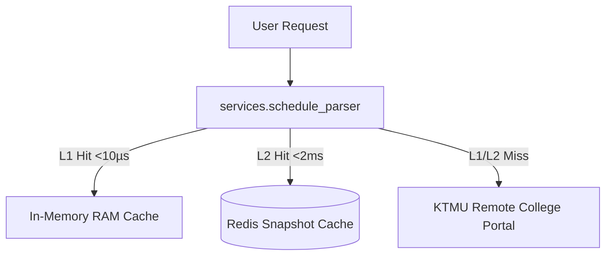

# Component Reference: `services/schedule_parser.py`
> **File Path**: [`services/schedule_parser.py`](../../services/schedule_parser.py)  
> **Subsystem**: `KTMU Timetable Engine`  
> **Architecture Layer**: `Upstream Ingress & Harvester`  
> **Concurrency Model**: `AsyncIO Non-blocking Scraper`  
> **Persistence Backend**: `L1 RAM In-Memory (<10µs) + L2 Redis Snapshots`  
> **Service Level Objective**: `< 5ms Cached Response / 500ms Upstream Harvest`

## 1. Architectural Role & Responsibilities
The `services/schedule_parser.py` module implements core operational logic for the `KTMU Timetable Engine` domain. It operates within an asynchronous microservices topology designed for ultra-low latency, zero-loss persistence guarantees, and strict single-responsibility function decomposition (≤25 lines).

### Component Architecture & Data Flow


---
## 2. Public API & Symbol Inventory
| Symbol | Nature | Line Range | Return Contract | Core Invariant |
| :--- | :--- | :--- | :--- | :--- |
| [`clear_resolved_day_cache`](#clear_resolved_day_cache) | Function | L41–L43 | `None` | Flushes and resets state for `clear_resolved_day_cache`... |
| [`resolve_room_address`](#resolve_room_address) | Function | L47–L53 | `str` | Executes core domain logic for `resolve_room_address`. |
| [`extract_zoom_creds`](#extract_zoom_creds) | Function | L56–L72 | `tuple[str | None, str | None, str | None]` | Executes core domain logic for `extract_zoom_creds`. |
| [`clean_subject_title`](#clean_subject_title) | Function | L75–L85 | `str` | Executes core domain logic for `clean_subject_title`. |
| [`calculate_week_number`](#calculate_week_number) | Function | L88–L101 | `int` | Executes core domain logic for `calculate_week_number`. |
| [`is_instance_active_for_week`](#is_instance_active_for_week) | Function | L104–L119 | `bool` | Executes core domain logic for `is_instance_active_for_... |
| [`is_item_for_group`](#is_item_for_group) | Function | L122–L137 | `bool` | Executes core domain logic for `is_item_for_group`. |
| [`is_stream_lesson`](#is_stream_lesson) | Function | L140–L153 | `bool` | Executes core domain logic for `is_stream_lesson`. |
| [`extract_subgroup`](#extract_subgroup) | Function | L156–L171 | `int` | Executes core domain logic for `extract_subgroup`. |
| [`_lookup_period_time`](#_lookup_period_time) | Function | L174–L178 | `str | None` | Executes core domain logic for `_lookup_period_time`. |
| [`get_period_time_str`](#get_period_time_str) | Function | L181–L200 | `str` | Retrieves and resolves domain data for `get_period_time... |
| [`get_http_client`](#get_http_client) | Function | L210–L228 | `httpx.AsyncClient` | Retrieves and resolves domain data for `get_http_client... |
| [`update_cache_headers`](#update_cache_headers) | Function | L231–L239 | `None` | Synchronizes and updates domain state for `update_cache... |
| [`filter_snapshot_for_target_group`](#filter_snapshot_for_target_group) | Function | L242–L259 | `dict[str, Any]` | Executes core domain logic for `filter_snapshot_for_tar... |
| [`_parse_and_clean_payload`](#_parse_and_clean_payload) | Function | L262–L273 | `tuple[str | None, dict[str, Any]]` | Executes core domain logic for `_parse_and_clean_payloa... |
| [`_persist_snapshot_to_redis`](#_persist_snapshot_to_redis) | Function | L276–L280 | `None` | Executes core domain logic for `_persist_snapshot_to_re... |
| [`process_api_response`](#process_api_response) | Function | L283–L307 | `dict[str, Any] | None` | Executes core domain logic for `process_api_response`. |
| [`_build_cache_headers`](#_build_cache_headers) | Function | L313–L320 | `dict[str, str]` | Executes core domain logic for `_build_cache_headers`. |
| [`_fetch_single_endpoint`](#_fetch_single_endpoint) | Function | L323–L327 | `httpx.Response` | Executes core domain logic for `_fetch_single_endpoint`... |
| [`_fetch_remote_schedule`](#_fetch_remote_schedule) | Function | L330–L352 | `httpx.Response` | Executes core domain logic for `_fetch_remote_schedule`... |
| [`refresh_schedule_in_background`](#refresh_schedule_in_background) | Function | L355–L374 | `None` | Executes core domain logic for `refresh_schedule_in_bac... |
| [`init_schedule_cache_from_redis`](#init_schedule_cache_from_redis) | Function | L377–L390 | `bool` | Executes core domain logic for `init_schedule_cache_fro... |
| [`fetch_schedule_data`](#fetch_schedule_data) | Function | L393–L415 | `dict[str, Any] | None` | Executes core domain logic for `fetch_schedule_data`. |
| [`extract_entity_maps`](#extract_entity_maps) | Function | L418–L430 | `tuple[dict, dict, dict, dict, dict]` | Executes core domain logic for `extract_entity_maps`. |
| [`resolve_teacher_contact_info`](#resolve_teacher_contact_info) | Function | L433–L455 | `tuple[str, str | None, str | None, str | None]` | Executes core domain logic for `resolve_teacher_contact... |
| [`resolve_room_name`](#resolve_room_name) | Function | L458–L463 | `str` | Executes core domain logic for `resolve_room_name`. |
| [`build_lesson_object`](#build_lesson_object) | Function | L466–L483 | `Lesson` | Executes core domain logic for `build_lesson_object`. |
| [`is_placed_lesson_active`](#is_placed_lesson_active) | Function | L486–L490 | `bool` | Executes core domain logic for `is_placed_lesson_active... |
| [`_extract_lessons_for_day`](#_extract_lessons_for_day) | Function | L493–L508 | `list[Lesson]` | Executes core domain logic for `_extract_lessons_for_da... |
| [`get_schedule_for_date`](#get_schedule_for_date) | Function | L511–L527 | `list[Lesson]` | Retrieves and resolves domain data for `get_schedule_fo... |
| [`get_week_schedule`](#get_week_schedule) | Function | L530–L542 | `list[tuple[date, list[Lesson]]]` | Retrieves and resolves domain data for `get_week_schedu... |

---

## 3. Comprehensive Function Specifications

### `clear_resolved_day_cache`
```python
def clear_resolved_day_cache() -> None
```

- **Source Reference**: [`services/schedule_parser.py#L41-L43`](../../services/schedule_parser.py#L41-L43)
- **Execution Mode**: `Synchronous`
- **Return Contract**: `None`

#### Overview & Architectural Purpose
Flushes and resets state for `clear_resolved_day_cache`.

#### Parameters Contract
*This method takes no input parameters.*

#### Concurrency & Side Effects
- Stateless pure functional computation without external mutations.

#### Fault Tolerance & Error Modes
Propagates unexpected runtime errors up the call stack to global exception handlers.

#### Production Usage Example
```python
from services.schedule_parser import clear_resolved_day_cache

# Execute call
result = clear_resolved_day_cache()
```

---

### `resolve_room_address`
```python
def resolve_room_address(room_name: str, is_remote: bool) -> str
```

- **Source Reference**: [`services/schedule_parser.py#L47-L53`](../../services/schedule_parser.py#L47-L53)
- **Execution Mode**: `Synchronous`
- **Return Contract**: `str`

#### Overview & Architectural Purpose
Executes core domain logic for `resolve_room_address`.

#### Parameters Contract
| Parameter | Type | Required | Description |
| :--- | :--- | :--- | :--- |
| `room_name` | `str` | Yes | Parameter `room_name` of type `str`. |
| `is_remote` | `bool` | Yes | Parameter `is_remote` of type `bool`. |

#### Concurrency & Side Effects
- Stateless pure functional computation without external mutations.

#### Fault Tolerance & Error Modes
Propagates unexpected runtime errors up the call stack to global exception handlers.

#### Production Usage Example
```python
from services.schedule_parser import resolve_room_address

# Execute call
result = resolve_room_address(room_name=..., is_remote=...)
```

---

### `extract_zoom_creds`
```python
def extract_zoom_creds(text: str) -> tuple[str | None, str | None, str | None]
```

- **Source Reference**: [`services/schedule_parser.py#L56-L72`](../../services/schedule_parser.py#L56-L72)
- **Execution Mode**: `Synchronous`
- **Return Contract**: `tuple[str | None, str | None, str | None]`

#### Overview & Architectural Purpose
Executes core domain logic for `extract_zoom_creds`.

#### Parameters Contract
| Parameter | Type | Required | Description |
| :--- | :--- | :--- | :--- |
| `text` | `str` | Yes | Parameter `text` of type `str`. |

#### Concurrency & Side Effects
- Stateless pure functional computation without external mutations.

#### Fault Tolerance & Error Modes
Propagates unexpected runtime errors up the call stack to global exception handlers.

#### Production Usage Example
```python
from services.schedule_parser import extract_zoom_creds

# Execute call
result = extract_zoom_creds(text=...)
```

---

### `clean_subject_title`
```python
def clean_subject_title(subject: str) -> str
```

- **Source Reference**: [`services/schedule_parser.py#L75-L85`](../../services/schedule_parser.py#L75-L85)
- **Execution Mode**: `Synchronous`
- **Return Contract**: `str`

#### Overview & Architectural Purpose
Executes core domain logic for `clean_subject_title`.

#### Parameters Contract
| Parameter | Type | Required | Description |
| :--- | :--- | :--- | :--- |
| `subject` | `str` | Yes | Name of the academic discipline or scheduled class. |

#### Concurrency & Side Effects
- Stateless pure functional computation without external mutations.

#### Fault Tolerance & Error Modes
Propagates unexpected runtime errors up the call stack to global exception handlers.

#### Production Usage Example
```python
from services.schedule_parser import clean_subject_title

# Execute call
result = clean_subject_title(subject=...)
```

---

### `calculate_week_number`
```python
def calculate_week_number(target_date: date, semester_start_str: str) -> int
```

- **Source Reference**: [`services/schedule_parser.py#L88-L101`](../../services/schedule_parser.py#L88-L101)
- **Execution Mode**: `Synchronous`
- **Return Contract**: `int`

#### Overview & Architectural Purpose
Executes core domain logic for `calculate_week_number`.

#### Parameters Contract
| Parameter | Type | Required | Description |
| :--- | :--- | :--- | :--- |
| `target_date` | `date` | Yes | Target calendar date for schedule or attendance resolution (ISO-8601). |
| `semester_start_str` | `str` | Yes | Parameter `semester_start_str` of type `str`. |

#### Concurrency & Side Effects
- Stateless pure functional computation without external mutations.

#### Fault Tolerance & Error Modes
Propagates unexpected runtime errors up the call stack to global exception handlers.

#### Production Usage Example
```python
from services.schedule_parser import calculate_week_number

# Execute call
result = calculate_week_number(target_date=..., semester_start_str=...)
```

---

### `is_instance_active_for_week`
```python
def is_instance_active_for_week(inst: dict[str, Any], week_num: int) -> bool
```

- **Source Reference**: [`services/schedule_parser.py#L104-L119`](../../services/schedule_parser.py#L104-L119)
- **Execution Mode**: `Synchronous`
- **Return Contract**: `bool`

#### Overview & Architectural Purpose
Executes core domain logic for `is_instance_active_for_week`.

#### Parameters Contract
| Parameter | Type | Required | Description |
| :--- | :--- | :--- | :--- |
| `inst` | `dict[str, Any]` | Yes | Parameter `inst` of type `dict[str, Any]`. |
| `week_num` | `int` | Yes | Parameter `week_num` of type `int`. |

#### Concurrency & Side Effects
- Stateless pure functional computation without external mutations.

#### Fault Tolerance & Error Modes
Propagates unexpected runtime errors up the call stack to global exception handlers.

#### Production Usage Example
```python
from services.schedule_parser import is_instance_active_for_week

# Execute call
result = is_instance_active_for_week(inst=..., week_num=...)
```

---

### `is_item_for_group`
```python
def is_item_for_group(item: dict[str, Any], group_id: str) -> bool
```

- **Source Reference**: [`services/schedule_parser.py#L122-L137`](../../services/schedule_parser.py#L122-L137)
- **Execution Mode**: `Synchronous`
- **Return Contract**: `bool`

#### Overview & Architectural Purpose
Executes core domain logic for `is_item_for_group`.

#### Parameters Contract
| Parameter | Type | Required | Description |
| :--- | :--- | :--- | :--- |
| `item` | `dict[str, Any]` | Yes | Parameter `item` of type `dict[str, Any]`. |
| `group_id` | `str` | Yes | Parameter `group_id` of type `str`. |

#### Concurrency & Side Effects
- Stateless pure functional computation without external mutations.

#### Fault Tolerance & Error Modes
Propagates unexpected runtime errors up the call stack to global exception handlers.

#### Production Usage Example
```python
from services.schedule_parser import is_item_for_group

# Execute call
result = is_item_for_group(item=..., group_id=...)
```

---

### `is_stream_lesson`
```python
def is_stream_lesson(inst: dict[str, Any]) -> bool
```

- **Source Reference**: [`services/schedule_parser.py#L140-L153`](../../services/schedule_parser.py#L140-L153)
- **Execution Mode**: `Synchronous`
- **Return Contract**: `bool`

#### Overview & Architectural Purpose
Executes core domain logic for `is_stream_lesson`.

#### Parameters Contract
| Parameter | Type | Required | Description |
| :--- | :--- | :--- | :--- |
| `inst` | `dict[str, Any]` | Yes | Parameter `inst` of type `dict[str, Any]`. |

#### Concurrency & Side Effects
- Stateless pure functional computation without external mutations.

#### Fault Tolerance & Error Modes
Propagates unexpected runtime errors up the call stack to global exception handlers.

#### Production Usage Example
```python
from services.schedule_parser import is_stream_lesson

# Execute call
result = is_stream_lesson(inst=...)
```

---

### `extract_subgroup`
```python
def extract_subgroup(inst: dict[str, Any], group_id: str) -> int
```

- **Source Reference**: [`services/schedule_parser.py#L156-L171`](../../services/schedule_parser.py#L156-L171)
- **Execution Mode**: `Synchronous`
- **Return Contract**: `int`

#### Overview & Architectural Purpose
Executes core domain logic for `extract_subgroup`.

#### Parameters Contract
| Parameter | Type | Required | Description |
| :--- | :--- | :--- | :--- |
| `inst` | `dict[str, Any]` | Yes | Parameter `inst` of type `dict[str, Any]`. |
| `group_id` | `str` | Yes | Parameter `group_id` of type `str`. |

#### Concurrency & Side Effects
- Stateless pure functional computation without external mutations.

#### Fault Tolerance & Error Modes
Propagates unexpected runtime errors up the call stack to global exception handlers.

#### Production Usage Example
```python
from services.schedule_parser import extract_subgroup

# Execute call
result = extract_subgroup(inst=..., group_id=...)
```

---

### `_lookup_period_time`
```python
def _lookup_period_time(times_list: list[str], period_idx: int) -> str | None
```

- **Source Reference**: [`services/schedule_parser.py#L174-L178`](../../services/schedule_parser.py#L174-L178)
- **Execution Mode**: `Synchronous`
- **Return Contract**: `str | None`

#### Overview & Architectural Purpose
Executes core domain logic for `_lookup_period_time`.

#### Parameters Contract
| Parameter | Type | Required | Description |
| :--- | :--- | :--- | :--- |
| `times_list` | `list[str]` | Yes | Parameter `times_list` of type `list[str]`. |
| `period_idx` | `int` | Yes | Parameter `period_idx` of type `int`. |

#### Concurrency & Side Effects
- Stateless pure functional computation without external mutations.

#### Fault Tolerance & Error Modes
Propagates unexpected runtime errors up the call stack to global exception handlers.

#### Production Usage Example
```python
from services.schedule_parser import _lookup_period_time

# Execute call
result = _lookup_period_time(times_list=..., period_idx=...)
```

---

### `get_period_time_str`
```python
def get_period_time_str( group_data: dict[str, Any], day_idx: int, period_idx: int, week_num: int, global_config: dict[str, Any] | None = None ) -> str
```

- **Source Reference**: [`services/schedule_parser.py#L181-L200`](../../services/schedule_parser.py#L181-L200)
- **Execution Mode**: `Synchronous`
- **Return Contract**: `str`

#### Overview & Architectural Purpose
Retrieves and resolves domain data for `get_period_time_str`.

#### Parameters Contract
| Parameter | Type | Required | Description |
| :--- | :--- | :--- | :--- |
| `group_data` | `dict[str, Any]` | Yes | Parameter `group_data` of type `dict[str, Any]`. |
| `day_idx` | `int` | Yes | Parameter `day_idx` of type `int`. |
| `period_idx` | `int` | Yes | Parameter `period_idx` of type `int`. |
| `week_num` | `int` | Yes | Parameter `week_num` of type `int`. |
| `global_config` | `dict[str, Any] | None` | Yes | Parameter `global_config` of type `dict[str, Any] | None`. |

#### Concurrency & Side Effects
- Stateless pure functional computation without external mutations.

#### Fault Tolerance & Error Modes
Propagates unexpected runtime errors up the call stack to global exception handlers.

#### Production Usage Example
```python
from services.schedule_parser import get_period_time_str

# Execute call
result = get_period_time_str(group_data=..., day_idx=..., period_idx=...)
```

---

### `get_http_client`
```python
def get_http_client() -> httpx.AsyncClient
```

- **Source Reference**: [`services/schedule_parser.py#L210-L228`](../../services/schedule_parser.py#L210-L228)
- **Execution Mode**: `Synchronous`
- **Return Contract**: `httpx.AsyncClient`

#### Overview & Architectural Purpose
Retrieves and resolves domain data for `get_http_client`.

#### Parameters Contract
*This method takes no input parameters.*

#### Concurrency & Side Effects
- Performs non-blocking network I/O over HTTP or gRPC.

#### Fault Tolerance & Error Modes
Propagates unexpected runtime errors up the call stack to global exception handlers.

#### Production Usage Example
```python
from services.schedule_parser import get_http_client

# Execute call
result = get_http_client()
```

---

### `update_cache_headers`
```python
def update_cache_headers(headers: httpx.Headers) -> None
```

- **Source Reference**: [`services/schedule_parser.py#L231-L239`](../../services/schedule_parser.py#L231-L239)
- **Execution Mode**: `Synchronous`
- **Return Contract**: `None`

#### Overview & Architectural Purpose
Synchronizes and updates domain state for `update_cache_headers`.

#### Parameters Contract
| Parameter | Type | Required | Description |
| :--- | :--- | :--- | :--- |
| `headers` | `httpx.Headers` | Yes | Parameter `headers` of type `httpx.Headers`. |

#### Concurrency & Side Effects
- Stateless pure functional computation without external mutations.

#### Fault Tolerance & Error Modes
Propagates unexpected runtime errors up the call stack to global exception handlers.

#### Production Usage Example
```python
from services.schedule_parser import update_cache_headers

# Execute call
result = update_cache_headers(headers=...)
```

---

### `filter_snapshot_for_target_group`
```python
def filter_snapshot_for_target_group(snapshot: dict[str, Any]) -> dict[str, Any]
```

- **Source Reference**: [`services/schedule_parser.py#L242-L259`](../../services/schedule_parser.py#L242-L259)
- **Execution Mode**: `Synchronous`
- **Return Contract**: `dict[str, Any]`

#### Overview & Architectural Purpose
Executes core domain logic for `filter_snapshot_for_target_group`.

#### Parameters Contract
| Parameter | Type | Required | Description |
| :--- | :--- | :--- | :--- |
| `snapshot` | `dict[str, Any]` | Yes | Parameter `snapshot` of type `dict[str, Any]`. |

#### Concurrency & Side Effects
- Stateless pure functional computation without external mutations.

#### Fault Tolerance & Error Modes
Propagates unexpected runtime errors up the call stack to global exception handlers.

#### Production Usage Example
```python
from services.schedule_parser import filter_snapshot_for_target_group

# Execute call
result = filter_snapshot_for_target_group(snapshot=...)
```

---

### `_parse_and_clean_payload`
```python
def _parse_and_clean_payload(content: bytes) -> tuple[str | None, dict[str, Any]]
```

- **Source Reference**: [`services/schedule_parser.py#L262-L273`](../../services/schedule_parser.py#L262-L273)
- **Execution Mode**: `Synchronous`
- **Return Contract**: `tuple[str | None, dict[str, Any]]`

#### Overview & Architectural Purpose
Executes core domain logic for `_parse_and_clean_payload`.

#### Parameters Contract
| Parameter | Type | Required | Description |
| :--- | :--- | :--- | :--- |
| `content` | `bytes` | Yes | Parameter `content` of type `bytes`. |

#### Concurrency & Side Effects
- Stateless pure functional computation without external mutations.

#### Fault Tolerance & Error Modes
Propagates unexpected runtime errors up the call stack to global exception handlers.

#### Production Usage Example
```python
from services.schedule_parser import _parse_and_clean_payload

# Execute call
result = _parse_and_clean_payload(content=...)
```

---

### `_persist_snapshot_to_redis`
```python
def _persist_snapshot_to_redis(snapshot: dict[str, Any]) -> None
```

- **Source Reference**: [`services/schedule_parser.py#L276-L280`](../../services/schedule_parser.py#L276-L280)
- **Execution Mode**: `Synchronous`
- **Return Contract**: `None`

#### Overview & Architectural Purpose
Executes core domain logic for `_persist_snapshot_to_redis`.

#### Parameters Contract
| Parameter | Type | Required | Description |
| :--- | :--- | :--- | :--- |
| `snapshot` | `dict[str, Any]` | Yes | Parameter `snapshot` of type `dict[str, Any]`. |

#### Concurrency & Side Effects
- Stateless pure functional computation without external mutations.

#### Fault Tolerance & Error Modes
Propagates unexpected runtime errors up the call stack to global exception handlers.

#### Production Usage Example
```python
from services.schedule_parser import _persist_snapshot_to_redis

# Execute call
result = _persist_snapshot_to_redis(snapshot=...)
```

---

### `process_api_response`
```python
async def process_api_response(res: httpx.Response, now: float) -> dict[str, Any] | None
```

- **Source Reference**: [`services/schedule_parser.py#L283-L307`](../../services/schedule_parser.py#L283-L307)
- **Execution Mode**: `Asynchronous (non-blocking)`
- **Return Contract**: `dict[str, Any] | None`

#### Overview & Architectural Purpose
Executes core domain logic for `process_api_response`.

#### Parameters Contract
| Parameter | Type | Required | Description |
| :--- | :--- | :--- | :--- |
| `res` | `httpx.Response` | Yes | Parameter `res` of type `httpx.Response`. |
| `now` | `float` | Yes | Parameter `now` of type `float`. |

#### Concurrency & Side Effects
- Emits structured telemetry events to system logging subsystem.

#### Fault Tolerance & Error Modes
Propagates unexpected runtime errors up the call stack to global exception handlers.

#### Production Usage Example
```python
from services.schedule_parser import process_api_response

# Execute call
result = await process_api_response(res=..., now=...)
```

---

### `_build_cache_headers`
```python
def _build_cache_headers() -> dict[str, str]
```

- **Source Reference**: [`services/schedule_parser.py#L313-L320`](../../services/schedule_parser.py#L313-L320)
- **Execution Mode**: `Synchronous`
- **Return Contract**: `dict[str, str]`

#### Overview & Architectural Purpose
Executes core domain logic for `_build_cache_headers`.

#### Parameters Contract
*This method takes no input parameters.*

#### Concurrency & Side Effects
- Stateless pure functional computation without external mutations.

#### Fault Tolerance & Error Modes
Propagates unexpected runtime errors up the call stack to global exception handlers.

#### Production Usage Example
```python
from services.schedule_parser import _build_cache_headers

# Execute call
result = _build_cache_headers()
```

---

### `_fetch_single_endpoint`
```python
async def _fetch_single_endpoint(url: str, headers: dict[str, str]) -> httpx.Response
```

- **Source Reference**: [`services/schedule_parser.py#L323-L327`](../../services/schedule_parser.py#L323-L327)
- **Execution Mode**: `Asynchronous (non-blocking)`
- **Return Contract**: `httpx.Response`

#### Overview & Architectural Purpose
Executes core domain logic for `_fetch_single_endpoint`.

#### Parameters Contract
| Parameter | Type | Required | Description |
| :--- | :--- | :--- | :--- |
| `url` | `str` | Yes | Parameter `url` of type `str`. |
| `headers` | `dict[str, str]` | Yes | Parameter `headers` of type `dict[str, str]`. |

#### Concurrency & Side Effects
- Performs non-blocking network I/O over HTTP or gRPC.

#### Fault Tolerance & Error Modes
Propagates unexpected runtime errors up the call stack to global exception handlers.

#### Production Usage Example
```python
from services.schedule_parser import _fetch_single_endpoint

# Execute call
result = await _fetch_single_endpoint(url=..., headers=...)
```

---

### `_fetch_remote_schedule`
```python
async def _fetch_remote_schedule() -> httpx.Response
```

- **Source Reference**: [`services/schedule_parser.py#L330-L352`](../../services/schedule_parser.py#L330-L352)
- **Execution Mode**: `Asynchronous (non-blocking)`
- **Return Contract**: `httpx.Response`

#### Overview & Architectural Purpose
Executes core domain logic for `_fetch_remote_schedule`.

#### Parameters Contract
*This method takes no input parameters.*

#### Concurrency & Side Effects
- Emits structured telemetry events to system logging subsystem.

#### Fault Tolerance & Error Modes
Explicitly raises domain exceptions (e.g., `PermissionError`, `ValueError`) upon invariant violation.

#### Production Usage Example
```python
from services.schedule_parser import _fetch_remote_schedule

# Execute call
result = await _fetch_remote_schedule()
```

---

### `refresh_schedule_in_background`
```python
async def refresh_schedule_in_background(force: bool = False) -> None
```

- **Source Reference**: [`services/schedule_parser.py#L355-L374`](../../services/schedule_parser.py#L355-L374)
- **Execution Mode**: `Asynchronous (non-blocking)`
- **Return Contract**: `None`

#### Overview & Architectural Purpose
Executes core domain logic for `refresh_schedule_in_background`.

#### Parameters Contract
| Parameter | Type | Required | Description |
| :--- | :--- | :--- | :--- |
| `force` | `bool` | Yes | Parameter `force` of type `bool`. |

#### Concurrency & Side Effects
- Emits structured telemetry events to system logging subsystem.

#### Fault Tolerance & Error Modes
Encapsulates faults within `try/except` blocks, logging errors and returning safe fallback defaults.

#### Production Usage Example
```python
from services.schedule_parser import refresh_schedule_in_background

# Execute call
result = await refresh_schedule_in_background(force=...)
```

---

### `init_schedule_cache_from_redis`
```python
async def init_schedule_cache_from_redis(now: float) -> bool
```

- **Source Reference**: [`services/schedule_parser.py#L377-L390`](../../services/schedule_parser.py#L377-L390)
- **Execution Mode**: `Asynchronous (non-blocking)`
- **Return Contract**: `bool`

#### Overview & Architectural Purpose
Executes core domain logic for `init_schedule_cache_from_redis`.

#### Parameters Contract
| Parameter | Type | Required | Description |
| :--- | :--- | :--- | :--- |
| `now` | `float` | Yes | Parameter `now` of type `float`. |

#### Concurrency & Side Effects
- Emits structured telemetry events to system logging subsystem.

#### Fault Tolerance & Error Modes
Propagates unexpected runtime errors up the call stack to global exception handlers.

#### Production Usage Example
```python
from services.schedule_parser import init_schedule_cache_from_redis

# Execute call
result = await init_schedule_cache_from_redis(now=...)
```

---

### `fetch_schedule_data`
```python
async def fetch_schedule_data(force_refresh: bool = False) -> dict[str, Any] | None
```

- **Source Reference**: [`services/schedule_parser.py#L393-L415`](../../services/schedule_parser.py#L393-L415)
- **Execution Mode**: `Asynchronous (non-blocking)`
- **Return Contract**: `dict[str, Any] | None`

#### Overview & Architectural Purpose
Executes core domain logic for `fetch_schedule_data`.

#### Parameters Contract
| Parameter | Type | Required | Description |
| :--- | :--- | :--- | :--- |
| `force_refresh` | `bool` | Yes | Parameter `force_refresh` of type `bool`. |

#### Concurrency & Side Effects
- Stateless pure functional computation without external mutations.

#### Fault Tolerance & Error Modes
Propagates unexpected runtime errors up the call stack to global exception handlers.

#### Production Usage Example
```python
from services.schedule_parser import fetch_schedule_data

# Execute call
result = await fetch_schedule_data(force_refresh=...)
```

---

### `extract_entity_maps`
```python
def extract_entity_maps(data: dict[str, Any]) -> tuple[dict, dict, dict, dict, dict]
```

- **Source Reference**: [`services/schedule_parser.py#L418-L430`](../../services/schedule_parser.py#L418-L430)
- **Execution Mode**: `Synchronous`
- **Return Contract**: `tuple[dict, dict, dict, dict, dict]`

#### Overview & Architectural Purpose
Executes core domain logic for `extract_entity_maps`.

#### Parameters Contract
| Parameter | Type | Required | Description |
| :--- | :--- | :--- | :--- |
| `data` | `dict[str, Any]` | Yes | Parameter `data` of type `dict[str, Any]`. |

#### Concurrency & Side Effects
- Stateless pure functional computation without external mutations.

#### Fault Tolerance & Error Modes
Propagates unexpected runtime errors up the call stack to global exception handlers.

#### Production Usage Example
```python
from services.schedule_parser import extract_entity_maps

# Execute call
result = extract_entity_maps(data=...)
```

---

### `resolve_teacher_contact_info`
```python
def resolve_teacher_contact_info( raw_teacher: str, teacher_data_map: dict[str, TeacherData], is_remote: bool, subj_name: str ) -> tuple[str, str | None, str | None, str | None]
```

- **Source Reference**: [`services/schedule_parser.py#L433-L455`](../../services/schedule_parser.py#L433-L455)
- **Execution Mode**: `Synchronous`
- **Return Contract**: `tuple[str, str | None, str | None, str | None]`

#### Overview & Architectural Purpose
Executes core domain logic for `resolve_teacher_contact_info`.

#### Parameters Contract
| Parameter | Type | Required | Description |
| :--- | :--- | :--- | :--- |
| `raw_teacher` | `str` | Yes | Parameter `raw_teacher` of type `str`. |
| `teacher_data_map` | `dict[str, TeacherData]` | Yes | Parameter `teacher_data_map` of type `dict[str, TeacherData]`. |
| `is_remote` | `bool` | Yes | Parameter `is_remote` of type `bool`. |
| `subj_name` | `str` | Yes | Parameter `subj_name` of type `str`. |

#### Concurrency & Side Effects
- Stateless pure functional computation without external mutations.

#### Fault Tolerance & Error Modes
Propagates unexpected runtime errors up the call stack to global exception handlers.

#### Production Usage Example
```python
from services.schedule_parser import resolve_teacher_contact_info

# Execute call
result = resolve_teacher_contact_info(raw_teacher=..., teacher_data_map=..., is_remote=...)
```

---

### `resolve_room_name`
```python
def resolve_room_name(asgn: dict[str, Any], inst: dict[str, Any], rms: dict[str, str], is_remote: bool) -> str
```

- **Source Reference**: [`services/schedule_parser.py#L458-L463`](../../services/schedule_parser.py#L458-L463)
- **Execution Mode**: `Synchronous`
- **Return Contract**: `str`

#### Overview & Architectural Purpose
Executes core domain logic for `resolve_room_name`.

#### Parameters Contract
| Parameter | Type | Required | Description |
| :--- | :--- | :--- | :--- |
| `asgn` | `dict[str, Any]` | Yes | Parameter `asgn` of type `dict[str, Any]`. |
| `inst` | `dict[str, Any]` | Yes | Parameter `inst` of type `dict[str, Any]`. |
| `rms` | `dict[str, str]` | Yes | Parameter `rms` of type `dict[str, str]`. |
| `is_remote` | `bool` | Yes | Parameter `is_remote` of type `bool`. |

#### Concurrency & Side Effects
- Stateless pure functional computation without external mutations.

#### Fault Tolerance & Error Modes
Propagates unexpected runtime errors up the call stack to global exception handlers.

#### Production Usage Example
```python
from services.schedule_parser import resolve_room_name

# Execute call
result = resolve_room_name(asgn=..., inst=..., rms=...)
```

---

### `build_lesson_object`
```python
def build_lesson_object( inst: dict[str, Any], asgn: dict[str, Any], maps: tuple[dict, dict, dict, dict, dict], day_idx: int, week_num: int, teacher_map: dict[str, TeacherData], cfg: dict[str, Any] | None = None ) -> Lesson
```

- **Source Reference**: [`services/schedule_parser.py#L466-L483`](../../services/schedule_parser.py#L466-L483)
- **Execution Mode**: `Synchronous`
- **Return Contract**: `Lesson`

#### Overview & Architectural Purpose
Executes core domain logic for `build_lesson_object`.

#### Parameters Contract
| Parameter | Type | Required | Description |
| :--- | :--- | :--- | :--- |
| `inst` | `dict[str, Any]` | Yes | Parameter `inst` of type `dict[str, Any]`. |
| `asgn` | `dict[str, Any]` | Yes | Parameter `asgn` of type `dict[str, Any]`. |
| `maps` | `tuple[dict, dict, dict, dict, dict]` | Yes | Parameter `maps` of type `tuple[dict, dict, dict, dict, dict]`. |
| `day_idx` | `int` | Yes | Parameter `day_idx` of type `int`. |
| `week_num` | `int` | Yes | Parameter `week_num` of type `int`. |
| `teacher_map` | `dict[str, TeacherData]` | Yes | Parameter `teacher_map` of type `dict[str, TeacherData]`. |
| `cfg` | `dict[str, Any] | None` | Yes | Parameter `cfg` of type `dict[str, Any] | None`. |

#### Concurrency & Side Effects
- Stateless pure functional computation without external mutations.

#### Fault Tolerance & Error Modes
Propagates unexpected runtime errors up the call stack to global exception handlers.

#### Production Usage Example
```python
from services.schedule_parser import build_lesson_object

# Execute call
result = build_lesson_object(inst=..., asgn=..., maps=...)
```

---

### `is_placed_lesson_active`
```python
def is_placed_lesson_active(inst: dict[str, Any], asgn: dict[str, Any] | None, day_idx: int, week_num: int) -> bool
```

- **Source Reference**: [`services/schedule_parser.py#L486-L490`](../../services/schedule_parser.py#L486-L490)
- **Execution Mode**: `Synchronous`
- **Return Contract**: `bool`

#### Overview & Architectural Purpose
Executes core domain logic for `is_placed_lesson_active`.

#### Parameters Contract
| Parameter | Type | Required | Description |
| :--- | :--- | :--- | :--- |
| `inst` | `dict[str, Any]` | Yes | Parameter `inst` of type `dict[str, Any]`. |
| `asgn` | `dict[str, Any] | None` | Yes | Parameter `asgn` of type `dict[str, Any] | None`. |
| `day_idx` | `int` | Yes | Parameter `day_idx` of type `int`. |
| `week_num` | `int` | Yes | Parameter `week_num` of type `int`. |

#### Concurrency & Side Effects
- Stateless pure functional computation without external mutations.

#### Fault Tolerance & Error Modes
Propagates unexpected runtime errors up the call stack to global exception handlers.

#### Production Usage Example
```python
from services.schedule_parser import is_placed_lesson_active

# Execute call
result = is_placed_lesson_active(inst=..., asgn=..., day_idx=...)
```

---

### `_extract_lessons_for_day`
```python
def _extract_lessons_for_day( data: dict[str, Any], day_idx: int, week_num: int, links: dict[str, TeacherData] ) -> list[Lesson]
```

- **Source Reference**: [`services/schedule_parser.py#L493-L508`](../../services/schedule_parser.py#L493-L508)
- **Execution Mode**: `Synchronous`
- **Return Contract**: `list[Lesson]`

#### Overview & Architectural Purpose
Executes core domain logic for `_extract_lessons_for_day`.

#### Parameters Contract
| Parameter | Type | Required | Description |
| :--- | :--- | :--- | :--- |
| `data` | `dict[str, Any]` | Yes | Parameter `data` of type `dict[str, Any]`. |
| `day_idx` | `int` | Yes | Parameter `day_idx` of type `int`. |
| `week_num` | `int` | Yes | Parameter `week_num` of type `int`. |
| `links` | `dict[str, TeacherData]` | Yes | Parameter `links` of type `dict[str, TeacherData]`. |

#### Concurrency & Side Effects
- Stateless pure functional computation without external mutations.

#### Fault Tolerance & Error Modes
Propagates unexpected runtime errors up the call stack to global exception handlers.

#### Production Usage Example
```python
from services.schedule_parser import _extract_lessons_for_day

# Execute call
result = _extract_lessons_for_day(data=..., day_idx=..., week_num=...)
```

---

### `get_schedule_for_date`
```python
async def get_schedule_for_date(target_date: date, force_refresh: bool = False) -> list[Lesson]
```

- **Source Reference**: [`services/schedule_parser.py#L511-L527`](../../services/schedule_parser.py#L511-L527)
- **Execution Mode**: `Asynchronous (non-blocking)`
- **Return Contract**: `list[Lesson]`

#### Overview & Architectural Purpose
Retrieves and resolves domain data for `get_schedule_for_date`.

#### Parameters Contract
| Parameter | Type | Required | Description |
| :--- | :--- | :--- | :--- |
| `target_date` | `date` | Yes | Target calendar date for schedule or attendance resolution (ISO-8601). |
| `force_refresh` | `bool` | Yes | Parameter `force_refresh` of type `bool`. |

#### Concurrency & Side Effects
- Stateless pure functional computation without external mutations.

#### Fault Tolerance & Error Modes
Propagates unexpected runtime errors up the call stack to global exception handlers.

#### Production Usage Example
```python
from services.schedule_parser import get_schedule_for_date

# Execute call
result = await get_schedule_for_date(target_date=..., force_refresh=...)
```

---

### `get_week_schedule`
```python
async def get_week_schedule(monday_date: date, force_refresh: bool = False) -> list[tuple[date, list[Lesson]]]
```

- **Source Reference**: [`services/schedule_parser.py#L530-L542`](../../services/schedule_parser.py#L530-L542)
- **Execution Mode**: `Asynchronous (non-blocking)`
- **Return Contract**: `list[tuple[date, list[Lesson]]]`

#### Overview & Architectural Purpose
Retrieves and resolves domain data for `get_week_schedule`.

#### Parameters Contract
| Parameter | Type | Required | Description |
| :--- | :--- | :--- | :--- |
| `monday_date` | `date` | Yes | Parameter `monday_date` of type `date`. |
| `force_refresh` | `bool` | Yes | Parameter `force_refresh` of type `bool`. |

#### Concurrency & Side Effects
- Stateless pure functional computation without external mutations.

#### Fault Tolerance & Error Modes
Propagates unexpected runtime errors up the call stack to global exception handlers.

#### Production Usage Example
```python
from services.schedule_parser import get_week_schedule

# Execute call
result = await get_week_schedule(monday_date=..., force_refresh=...)
```

---
