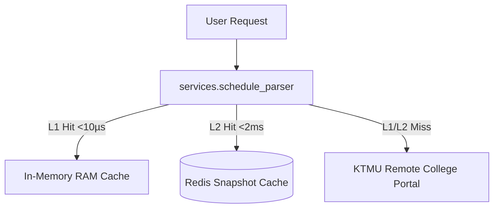

# Component Reference: `services/schedule_refresher.py`
> **File Path**: [`services/schedule_refresher.py`](../../services/schedule_refresher.py)
> **Subsystem**: `KTMU Timetable Engine`
> **Architecture Layer**: `Upstream Ingress & Harvester`
> **Concurrency Model**: `AsyncIO Non-blocking Scraper`
> **Persistence Backend**: `L1 RAM In-Memory (<10µs) + L2 Redis Snapshots`
> **Service Level Objective**: `< 5ms Cached Response / 500ms Upstream Harvest`

## 1. Architectural Role & Responsibilities
The `services/schedule_refresher.py` module implements core operational logic for the `KTMU Timetable Engine` domain. It operates within an asynchronous microservices topology designed for ultra-low latency, zero-loss persistence guarantees, and strict single-responsibility function decomposition (≤25 lines).

### Component Architecture & Data Flow


---
## 2. Public API & Symbol Inventory
| Symbol | Nature | Line Range | Return Contract | Core Invariant |
| :--- | :--- | :--- | :--- | :--- |
| [`_refresh_if_due`](#_refresh_if_due) | Function | L23–L38 | `float` | Executes core domain logic for `_refresh_if_due`. |
| [`schedule_refresh_loop`](#schedule_refresh_loop) | Function | L41–L62 | `None` | Executes core domain logic for `schedule_refresh_loop`. |

---

## 3. Comprehensive Function Specifications

### `_refresh_if_due`
```python
async def _refresh_if_due(next_due: float) -> float
```

- **Source Reference**: [`services/schedule_refresher.py#L23-L38`](../../services/schedule_refresher.py#L23-L38)
- **Execution Mode**: `Asynchronous (non-blocking)`
- **Return Contract**: `float`

#### Overview & Architectural Purpose
Executes core domain logic for `_refresh_if_due`.

#### Parameters Contract
| Parameter | Type | Required | Description |
| :--- | :--- | :--- | :--- |
| `next_due` | `float` | Yes | Parameter `next_due` of type `float`. |

#### Concurrency & Side Effects
- Emits structured telemetry events to system logging subsystem.

#### Fault Tolerance & Error Modes
Propagates unexpected runtime errors up the call stack to global exception handlers.

#### Production Usage Example
```python
from services.schedule_refresher import _refresh_if_due

# Execute call
result = await _refresh_if_due(next_due=...)
```

---

### `schedule_refresh_loop`
```python
async def schedule_refresh_loop() -> None
```

- **Source Reference**: [`services/schedule_refresher.py#L41-L62`](../../services/schedule_refresher.py#L41-L62)
- **Execution Mode**: `Asynchronous (non-blocking)`
- **Return Contract**: `None`

#### Overview & Architectural Purpose
Executes core domain logic for `schedule_refresh_loop`.

#### Parameters Contract
*This method takes no input parameters.*

#### Concurrency & Side Effects
- Emits structured telemetry events to system logging subsystem.

#### Fault Tolerance & Error Modes
Encapsulates faults within `try/except` blocks, logging errors and returning safe fallback defaults.

#### Production Usage Example
```python
from services.schedule_refresher import schedule_refresh_loop

# Execute call
result = await schedule_refresh_loop()
```

---
