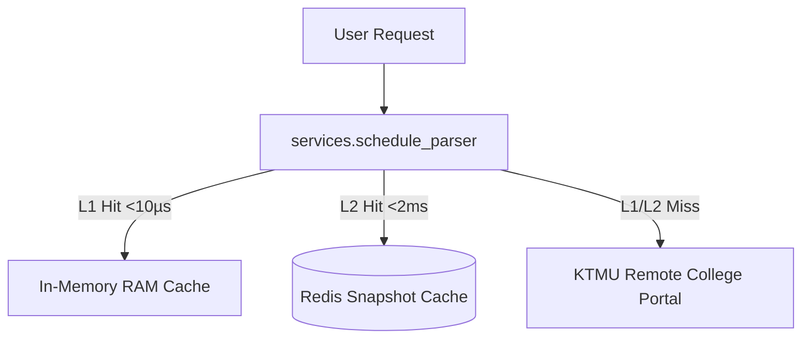

# Component Reference: `services/schedule_substitutions.py`
> **File Path**: [`services/schedule_substitutions.py`](../../services/schedule_substitutions.py)
> **Subsystem**: `KTMU Timetable Engine`
> **Architecture Layer**: `Upstream Ingress & Harvester`
> **Concurrency Model**: `AsyncIO Non-blocking Scraper`
> **Persistence Backend**: `L1 RAM In-Memory (<10µs) + L2 Redis Snapshots`
> **Service Level Objective**: `< 5ms Cached Response / 500ms Upstream Harvest`

## 1. Purpose
Применение замен (substitutions) API КТМУ к сетке расписания группы.

### Component Architecture & Data Flow


---
## 2. Public API & Symbol Inventory
| Symbol | Nature | Line Range | Return Contract | Summary |
| :--- | :--- | :--- | :--- | :--- |
| [`base_inst_id`](#base_inst_id) | Function | L26–L32 | `str` | Приводит instId инстанса к виду, в котором на него ссыл... |
| [`filter_group_substitutions`](#filter_group_substitutions) | Function | L35–L45 | `list[dict[str, Any]]` | Оставляет только замены, относящиеся к занятиям группы. |
| [`index_day_substitutions`](#index_day_substitutions) | Function | L48–L54 | `dict[str, dict[str, Any]]` | Индексирует замены, действующие в исходную дату, по ins... |
| [`moved_in_substitutions`](#moved_in_substitutions) | Function | L57–L63 | `list[dict[str, Any]]` | Отбирает переносы, у которых целевая дата совпадает с з... |
| [`is_cancelled_for_group`](#is_cancelled_for_group) | Function | L66–L79 | `bool` | Проверяет, снимает ли замена пару группы в исходную дат... |
| [`_patch_assignment`](#_patch_assignment) | Function | L82–L95 | `dict[str, Any]` | Накладывает новую пару и кабинет замены на копию назнач... |
| [`_patch_instance`](#_patch_instance) | Function | L98–L109 | `dict[str, Any]` | Накладывает нового преподавателя и формат замены на коп... |
| [`apply_substitution`](#apply_substitution) | Function | L112–L123 | `tuple[dict[str, Any], dict[str, Any]]` | Возвращает копии инстанса и назначения с изменениями из... |

---

## 3. Comprehensive Function Specifications

### `base_inst_id`
```python
def base_inst_id(inst_id: str) -> str
```

- **Source Reference**: [`services/schedule_substitutions.py#L26-L32`](../../services/schedule_substitutions.py#L26-L32)
- **Execution Mode**: `Synchronous`
- **Return Contract**: `str`

#### Overview & Architectural Purpose
Приводит instId инстанса к виду, в котором на него ссылаются замены.

#### Parameters Contract
| Parameter | Type | Required | Description |
| :--- | :--- | :--- | :--- |
| `inst_id` | `str` | Yes | Parameter `inst_id` of type `str`. |

#### Concurrency & Side Effects
- Stateless pure functional computation without external mutations.

#### Fault Tolerance & Error Modes
Propagates unexpected runtime errors up the call stack to global exception handlers.

#### Production Usage Example
```python
from services.schedule_substitutions import base_inst_id

# Execute call
result = base_inst_id(inst_id=...)
```

---

### `filter_group_substitutions`
```python
def filter_group_substitutions(subs: list[dict[str, Any]], group_insts: list[dict[str, Any]]) -> list[dict[str, Any]]
```

- **Source Reference**: [`services/schedule_substitutions.py#L35-L45`](../../services/schedule_substitutions.py#L35-L45)
- **Execution Mode**: `Synchronous`
- **Return Contract**: `list[dict[str, Any]]`

#### Overview & Architectural Purpose
Оставляет только замены, относящиеся к занятиям группы.

#### Parameters Contract
| Parameter | Type | Required | Description |
| :--- | :--- | :--- | :--- |
| `subs` | `list[dict[str, Any]]` | Yes | Parameter `subs` of type `list[dict[str, Any]]`. |
| `group_insts` | `list[dict[str, Any]]` | Yes | Parameter `group_insts` of type `list[dict[str, Any]]`. |

#### Concurrency & Side Effects
- Stateless pure functional computation without external mutations.

#### Fault Tolerance & Error Modes
Propagates unexpected runtime errors up the call stack to global exception handlers.

#### Production Usage Example
```python
from services.schedule_substitutions import filter_group_substitutions

# Execute call
result = filter_group_substitutions(subs=..., group_insts=...)
```

---

### `index_day_substitutions`
```python
def index_day_substitutions(subs: list[dict[str, Any]], iso_date: str) -> dict[str, dict[str, Any]]
```

- **Source Reference**: [`services/schedule_substitutions.py#L48-L54`](../../services/schedule_substitutions.py#L48-L54)
- **Execution Mode**: `Synchronous`
- **Return Contract**: `dict[str, dict[str, Any]]`

#### Overview & Architectural Purpose
Индексирует замены, действующие в исходную дату, по instId занятия.

#### Parameters Contract
| Parameter | Type | Required | Description |
| :--- | :--- | :--- | :--- |
| `subs` | `list[dict[str, Any]]` | Yes | Parameter `subs` of type `list[dict[str, Any]]`. |
| `iso_date` | `str` | Yes | Parameter `iso_date` of type `str`. |

#### Concurrency & Side Effects
- Stateless pure functional computation without external mutations.

#### Fault Tolerance & Error Modes
Propagates unexpected runtime errors up the call stack to global exception handlers.

#### Production Usage Example
```python
from services.schedule_substitutions import index_day_substitutions

# Execute call
result = index_day_substitutions(subs=..., iso_date=...)
```

---

### `moved_in_substitutions`
```python
def moved_in_substitutions(subs: list[dict[str, Any]], iso_date: str) -> list[dict[str, Any]]
```

- **Source Reference**: [`services/schedule_substitutions.py#L57-L63`](../../services/schedule_substitutions.py#L57-L63)
- **Execution Mode**: `Synchronous`
- **Return Contract**: `list[dict[str, Any]]`

#### Overview & Architectural Purpose
Отбирает переносы, у которых целевая дата совпадает с запрошенной.

#### Parameters Contract
| Parameter | Type | Required | Description |
| :--- | :--- | :--- | :--- |
| `subs` | `list[dict[str, Any]]` | Yes | Parameter `subs` of type `list[dict[str, Any]]`. |
| `iso_date` | `str` | Yes | Parameter `iso_date` of type `str`. |

#### Concurrency & Side Effects
- Stateless pure functional computation without external mutations.

#### Fault Tolerance & Error Modes
Propagates unexpected runtime errors up the call stack to global exception handlers.

#### Production Usage Example
```python
from services.schedule_substitutions import moved_in_substitutions

# Execute call
result = moved_in_substitutions(subs=..., iso_date=...)
```

---

### `is_cancelled_for_group`
```python
def is_cancelled_for_group(sub: dict[str, Any], group_id: str) -> bool
```

- **Source Reference**: [`services/schedule_substitutions.py#L66-L79`](../../services/schedule_substitutions.py#L66-L79)
- **Execution Mode**: `Synchronous`
- **Return Contract**: `bool`

#### Overview & Architectural Purpose
Проверяет, снимает ли замена пару группы в исходную дату.

#### Parameters Contract
| Parameter | Type | Required | Description |
| :--- | :--- | :--- | :--- |
| `sub` | `dict[str, Any]` | Yes | Parameter `sub` of type `dict[str, Any]`. |
| `group_id` | `str` | Yes | Parameter `group_id` of type `str`. |

#### Concurrency & Side Effects
- Stateless pure functional computation without external mutations.

#### Fault Tolerance & Error Modes
Propagates unexpected runtime errors up the call stack to global exception handlers.

#### Production Usage Example
```python
from services.schedule_substitutions import is_cancelled_for_group

# Execute call
result = is_cancelled_for_group(sub=..., group_id=...)
```

---

### `_patch_assignment`
```python
def _patch_assignment(asgn: dict[str, Any], sub: dict[str, Any], period_key: str) -> dict[str, Any]
```

- **Source Reference**: [`services/schedule_substitutions.py#L82-L95`](../../services/schedule_substitutions.py#L82-L95)
- **Execution Mode**: `Synchronous`
- **Return Contract**: `dict[str, Any]`

#### Overview & Architectural Purpose
Накладывает новую пару и кабинет замены на копию назначения.

#### Parameters Contract
| Parameter | Type | Required | Description |
| :--- | :--- | :--- | :--- |
| `asgn` | `dict[str, Any]` | Yes | Parameter `asgn` of type `dict[str, Any]`. |
| `sub` | `dict[str, Any]` | Yes | Parameter `sub` of type `dict[str, Any]`. |
| `period_key` | `str` | Yes | Parameter `period_key` of type `str`. |

#### Concurrency & Side Effects
- Stateless pure functional computation without external mutations.

#### Fault Tolerance & Error Modes
Propagates unexpected runtime errors up the call stack to global exception handlers.

#### Production Usage Example
```python
from services.schedule_substitutions import _patch_assignment

# Execute call
result = _patch_assignment(asgn=..., sub=..., period_key=...)
```

---

### `_patch_instance`
```python
def _patch_instance(inst: dict[str, Any], sub: dict[str, Any]) -> dict[str, Any]
```

- **Source Reference**: [`services/schedule_substitutions.py#L98-L109`](../../services/schedule_substitutions.py#L98-L109)
- **Execution Mode**: `Synchronous`
- **Return Contract**: `dict[str, Any]`

#### Overview & Architectural Purpose
Накладывает нового преподавателя и формат замены на копию инстанса.

#### Parameters Contract
| Parameter | Type | Required | Description |
| :--- | :--- | :--- | :--- |
| `inst` | `dict[str, Any]` | Yes | Parameter `inst` of type `dict[str, Any]`. |
| `sub` | `dict[str, Any]` | Yes | Parameter `sub` of type `dict[str, Any]`. |

#### Concurrency & Side Effects
- Stateless pure functional computation without external mutations.

#### Fault Tolerance & Error Modes
Propagates unexpected runtime errors up the call stack to global exception handlers.

#### Production Usage Example
```python
from services.schedule_substitutions import _patch_instance

# Execute call
result = _patch_instance(inst=..., sub=...)
```

---

### `apply_substitution`
```python
def apply_substitution( inst: dict[str, Any], asgn: dict[str, Any], sub: dict[str, Any], period_key: str = "newPeriod" ) -> tuple[dict[str, Any], dict[str, Any]]
```

- **Source Reference**: [`services/schedule_substitutions.py#L112-L123`](../../services/schedule_substitutions.py#L112-L123)
- **Execution Mode**: `Synchronous`
- **Return Contract**: `tuple[dict[str, Any], dict[str, Any]]`

#### Overview & Architectural Purpose
Возвращает копии инстанса и назначения с изменениями из замены.

#### Parameters Contract
| Parameter | Type | Required | Description |
| :--- | :--- | :--- | :--- |
| `inst` | `dict[str, Any]` | Yes | Parameter `inst` of type `dict[str, Any]`. |
| `asgn` | `dict[str, Any]` | Yes | Parameter `asgn` of type `dict[str, Any]`. |
| `sub` | `dict[str, Any]` | Yes | Parameter `sub` of type `dict[str, Any]`. |
| `period_key` | `str` | Yes | Parameter `period_key` of type `str`. |

#### Concurrency & Side Effects
- Stateless pure functional computation without external mutations.

#### Fault Tolerance & Error Modes
Propagates unexpected runtime errors up the call stack to global exception handlers.

#### Production Usage Example
```python
from services.schedule_substitutions import apply_substitution

# Execute call
result = apply_substitution(inst=..., asgn=..., sub=...)
```

---
