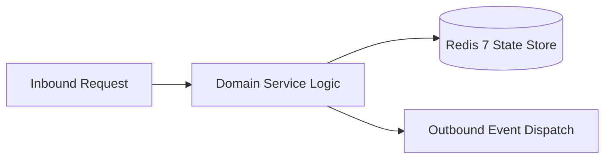

# Component Reference: `services/solver/payload_extractor.py`
> **File Path**: [`services/solver/payload_extractor.py`](../../services/solver/payload_extractor.py)
> **Subsystem**: `Solver Payload Ingestion`
> **Architecture Layer**: `Enterprise Microservice Subsystem`
> **Concurrency Model**: `AsyncIO Non-blocking Concurrency`
> **Persistence Backend**: `Redis 7 Persistent Store`
> **Service Level Objective**: `High-Availability Academic Telemetry`

## 1. Architectural Role & Responsibilities
The `services/solver/payload_extractor.py` module implements core operational logic for the `Solver Payload Ingestion` domain. It operates within an asynchronous microservices topology designed for ultra-low latency, zero-loss persistence guarantees, and strict single-responsibility function decomposition (≤25 lines).

### Component Architecture & Data Flow


---
## 2. Public API & Symbol Inventory
| Symbol | Nature | Line Range | Return Contract | Core Invariant |
| :--- | :--- | :--- | :--- | :--- |
| [`download_file_bytes`](#download_file_bytes) | Function | L21–L45 | `bytes | None` | Executes core domain logic for `download_file_bytes`. |
| [`_extract_docx_images`](#_extract_docx_images) | Function | L48–L64 | `list[bytes]` | Executes core domain logic for `_extract_docx_images`. |
| [`extract_docx_data`](#extract_docx_data) | Function | L67–L86 | `tuple[str, list[bytes]]` | Executes core domain logic for `extract_docx_data`. |
| [`extract_pdf_data`](#extract_pdf_data) | Function | L89–L106 | `str` | Executes core domain logic for `extract_pdf_data`. |
| [`_read_code_file_payload`](#_read_code_file_payload) | Function | L109–L122 | `str` | Executes core domain logic for `_read_code_file_payload... |
| [`parse_file_payload`](#parse_file_payload) | Function | L125–L150 | `tuple[bytes | None, str | None]` | Parses and extracts structured entities from `parse_fil... |
| [`resolve_task_payload`](#resolve_task_payload) | Function | L153–L175 | `tuple[bytes | None, str | None]` | Executes core domain logic for `resolve_task_payload`. |

---

## 3. Comprehensive Function Specifications

### `download_file_bytes`
```python
async def download_file_bytes(tg_bot: Bot, file_id: str, file_size: int) -> bytes | None
```

- **Source Reference**: [`services/solver/payload_extractor.py#L21-L45`](../../services/solver/payload_extractor.py#L21-L45)
- **Execution Mode**: `Asynchronous (non-blocking)`
- **Return Contract**: `bytes | None`

#### Overview & Architectural Purpose
Executes core domain logic for `download_file_bytes`.

#### Parameters Contract
| Parameter | Type | Required | Description |
| :--- | :--- | :--- | :--- |
| `tg_bot` | `Bot` | Yes | Parameter `tg_bot` of type `Bot`. |
| `file_id` | `str` | Yes | Parameter `file_id` of type `str`. |
| `file_size` | `int` | Yes | Size of the audio file in bytes. |

#### Concurrency & Side Effects
- Emits structured telemetry events to system logging subsystem.

#### Fault Tolerance & Error Modes
Encapsulates faults within `try/except` blocks, logging errors and returning safe fallback defaults.

#### Production Usage Example
```python
from services.solver.payload_extractor import download_file_bytes

# Execute call
result = await download_file_bytes(tg_bot=..., file_id=..., file_size=...)
```

---

### `_extract_docx_images`
```python
def _extract_docx_images(doc) -> list[bytes]
```

- **Source Reference**: [`services/solver/payload_extractor.py#L48-L64`](../../services/solver/payload_extractor.py#L48-L64)
- **Execution Mode**: `Synchronous`
- **Return Contract**: `list[bytes]`

#### Overview & Architectural Purpose
Executes core domain logic for `_extract_docx_images`.

#### Parameters Contract
| Parameter | Type | Required | Description |
| :--- | :--- | :--- | :--- |
| `doc` | `Any` | Yes | Parameter `doc` of type `Any`. |

#### Concurrency & Side Effects
- Stateless pure functional computation without external mutations.

#### Fault Tolerance & Error Modes
Propagates unexpected runtime errors up the call stack to global exception handlers.

#### Production Usage Example
```python
from services.solver.payload_extractor import _extract_docx_images

# Execute call
result = _extract_docx_images(doc=...)
```

---

### `extract_docx_data`
```python
def extract_docx_data(doc_bytes: bytes) -> tuple[str, list[bytes]]
```

- **Source Reference**: [`services/solver/payload_extractor.py#L67-L86`](../../services/solver/payload_extractor.py#L67-L86)
- **Execution Mode**: `Synchronous`
- **Return Contract**: `tuple[str, list[bytes]]`

#### Overview & Architectural Purpose
Executes core domain logic for `extract_docx_data`.

#### Parameters Contract
| Parameter | Type | Required | Description |
| :--- | :--- | :--- | :--- |
| `doc_bytes` | `bytes` | Yes | Parameter `doc_bytes` of type `bytes`. |

#### Concurrency & Side Effects
- Stateless pure functional computation without external mutations.

#### Fault Tolerance & Error Modes
Propagates unexpected runtime errors up the call stack to global exception handlers.

#### Production Usage Example
```python
from services.solver.payload_extractor import extract_docx_data

# Execute call
result = extract_docx_data(doc_bytes=...)
```

---

### `extract_pdf_data`
```python
def extract_pdf_data(doc_bytes: bytes) -> str
```

- **Source Reference**: [`services/solver/payload_extractor.py#L89-L106`](../../services/solver/payload_extractor.py#L89-L106)
- **Execution Mode**: `Synchronous`
- **Return Contract**: `str`

#### Overview & Architectural Purpose
Executes core domain logic for `extract_pdf_data`.

#### Parameters Contract
| Parameter | Type | Required | Description |
| :--- | :--- | :--- | :--- |
| `doc_bytes` | `bytes` | Yes | Parameter `doc_bytes` of type `bytes`. |

#### Concurrency & Side Effects
- Emits structured telemetry events to system logging subsystem.

#### Fault Tolerance & Error Modes
Encapsulates faults within `try/except` blocks, logging errors and returning safe fallback defaults.

#### Production Usage Example
```python
from services.solver.payload_extractor import extract_pdf_data

# Execute call
result = extract_pdf_data(doc_bytes=...)
```

---

### `_read_code_file_payload`
```python
def _read_code_file_payload(doc_bytes: bytes, file_name: str, prompt: str) -> str
```

- **Source Reference**: [`services/solver/payload_extractor.py#L109-L122`](../../services/solver/payload_extractor.py#L109-L122)
- **Execution Mode**: `Synchronous`
- **Return Contract**: `str`

#### Overview & Architectural Purpose
Executes core domain logic for `_read_code_file_payload`.

#### Parameters Contract
| Parameter | Type | Required | Description |
| :--- | :--- | :--- | :--- |
| `doc_bytes` | `bytes` | Yes | Parameter `doc_bytes` of type `bytes`. |
| `file_name` | `str` | Yes | Parameter `file_name` of type `str`. |
| `prompt` | `str` | Yes | Parameter `prompt` of type `str`. |

#### Concurrency & Side Effects
- Stateless pure functional computation without external mutations.

#### Fault Tolerance & Error Modes
Propagates unexpected runtime errors up the call stack to global exception handlers.

#### Production Usage Example
```python
from services.solver.payload_extractor import _read_code_file_payload

# Execute call
result = _read_code_file_payload(doc_bytes=..., file_name=..., prompt=...)
```

---

### `parse_file_payload`
```python
def parse_file_payload( doc_bytes: bytes, file_name: str, mime: str | None, prompt: str ) -> tuple[bytes | None, str | None]
```

- **Source Reference**: [`services/solver/payload_extractor.py#L125-L150`](../../services/solver/payload_extractor.py#L125-L150)
- **Execution Mode**: `Synchronous`
- **Return Contract**: `tuple[bytes | None, str | None]`

#### Overview & Architectural Purpose
Parses and extracts structured entities from `parse_file_payload`.

#### Parameters Contract
| Parameter | Type | Required | Description |
| :--- | :--- | :--- | :--- |
| `doc_bytes` | `bytes` | Yes | Parameter `doc_bytes` of type `bytes`. |
| `file_name` | `str` | Yes | Parameter `file_name` of type `str`. |
| `mime` | `str | None` | Yes | Parameter `mime` of type `str | None`. |
| `prompt` | `str` | Yes | Parameter `prompt` of type `str`. |

#### Concurrency & Side Effects
- Stateless pure functional computation without external mutations.

#### Fault Tolerance & Error Modes
Propagates unexpected runtime errors up the call stack to global exception handlers.

#### Production Usage Example
```python
from services.solver.payload_extractor import parse_file_payload

# Execute call
result = parse_file_payload(doc_bytes=..., file_name=..., mime=...)
```

---

### `resolve_task_payload`
```python
async def resolve_task_payload(tg_bot: Bot, task: dict) -> tuple[bytes | None, str | None]
```

- **Source Reference**: [`services/solver/payload_extractor.py#L153-L175`](../../services/solver/payload_extractor.py#L153-L175)
- **Execution Mode**: `Asynchronous (non-blocking)`
- **Return Contract**: `tuple[bytes | None, str | None]`

#### Overview & Architectural Purpose
Executes core domain logic for `resolve_task_payload`.

#### Parameters Contract
| Parameter | Type | Required | Description |
| :--- | :--- | :--- | :--- |
| `tg_bot` | `Bot` | Yes | Parameter `tg_bot` of type `Bot`. |
| `task` | `dict` | Yes | Parameter `task` of type `dict`. |

#### Concurrency & Side Effects
- Stateless pure functional computation without external mutations.

#### Fault Tolerance & Error Modes
Propagates unexpected runtime errors up the call stack to global exception handlers.

#### Production Usage Example
```python
from services.solver.payload_extractor import resolve_task_payload

# Execute call
result = await resolve_task_payload(tg_bot=..., task=...)
```

---
