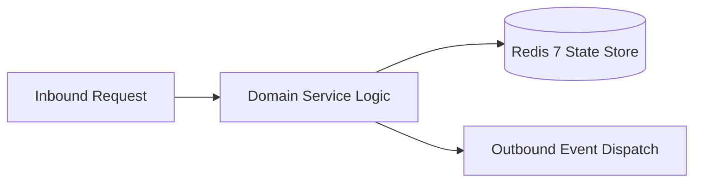

# Component Reference: `services/solver/task_processor.py`
> **File Path**: [`services/solver/task_processor.py`](../../services/solver/task_processor.py)
> **Subsystem**: `Solver Queue Processing`
> **Architecture Layer**: `Enterprise Microservice Subsystem`
> **Concurrency Model**: `AsyncIO Non-blocking Concurrency`
> **Persistence Backend**: `Redis 7 Persistent Store`
> **Service Level Objective**: `High-Availability Academic Telemetry`

## 1. Architectural Role & Responsibilities
The `services/solver/task_processor.py` module implements core operational logic for the `Solver Queue Processing` domain. It operates within an asynchronous microservices topology designed for ultra-low latency, zero-loss persistence guarantees, and strict single-responsibility function decomposition (≤25 lines).

### Component Architecture & Data Flow


---
## 2. Public API & Symbol Inventory
| Symbol | Nature | Line Range | Return Contract | Core Invariant |
| :--- | :--- | :--- | :--- | :--- |
| [`_build_temp_doc_path`](#_build_temp_doc_path) | Function | L28–L37 | `str` | Executes core domain logic for `_build_temp_doc_path`. |
| [`_cleanup_temp_file`](#_cleanup_temp_file) | Function | L40–L49 | `None` | Executes core domain logic for `_cleanup_temp_file`. |
| [`_handle_task_failure`](#_handle_task_failure) | Function | L52–L63 | `None` | Executes core domain logic for `_handle_task_failure`. |
| [`execute_single_task`](#execute_single_task) | Function | L66–L89 | `None` | Executes core domain logic for `execute_single_task`. |
| [`_guarded_execute_task`](#_guarded_execute_task) | Function | L92–L101 | `None` | Executes core domain logic for `_guarded_execute_task`. |
| [`_drain_active_tasks`](#_drain_active_tasks) | Function | L104–L114 | `None` | Executes core domain logic for `_drain_active_tasks`. |
| [`run_solver_loop`](#run_solver_loop) | Function | L117–L145 | `None` | Executes core domain logic for `run_solver_loop`. |

---

## 3. Comprehensive Function Specifications

### `_build_temp_doc_path`
```python
def _build_temp_doc_path(msg_id: int) -> str
```

- **Source Reference**: [`services/solver/task_processor.py#L28-L37`](../../services/solver/task_processor.py#L28-L37)
- **Execution Mode**: `Synchronous`
- **Return Contract**: `str`

#### Overview & Architectural Purpose
Executes core domain logic for `_build_temp_doc_path`.

#### Parameters Contract
| Parameter | Type | Required | Description |
| :--- | :--- | :--- | :--- |
| `msg_id` | `int` | Yes | Parameter `msg_id` of type `int`. |

#### Concurrency & Side Effects
- Stateless pure functional computation without external mutations.

#### Fault Tolerance & Error Modes
Propagates unexpected runtime errors up the call stack to global exception handlers.

#### Production Usage Example
```python
from services.solver.task_processor import _build_temp_doc_path

# Execute call
result = _build_temp_doc_path(msg_id=...)
```

---

### `_cleanup_temp_file`
```python
def _cleanup_temp_file(path: str) -> None
```

- **Source Reference**: [`services/solver/task_processor.py#L40-L49`](../../services/solver/task_processor.py#L40-L49)
- **Execution Mode**: `Synchronous`
- **Return Contract**: `None`

#### Overview & Architectural Purpose
Executes core domain logic for `_cleanup_temp_file`.

#### Parameters Contract
| Parameter | Type | Required | Description |
| :--- | :--- | :--- | :--- |
| `path` | `str` | Yes | Parameter `path` of type `str`. |

#### Concurrency & Side Effects
- Stateless pure functional computation without external mutations.

#### Fault Tolerance & Error Modes
Propagates unexpected runtime errors up the call stack to global exception handlers.

#### Production Usage Example
```python
from services.solver.task_processor import _cleanup_temp_file

# Execute call
result = _cleanup_temp_file(path=...)
```

---

### `_handle_task_failure`
```python
async def _handle_task_failure(tg_bot: Bot, task: dict, msg_id: int, error: Exception) -> None
```

- **Source Reference**: [`services/solver/task_processor.py#L52-L63`](../../services/solver/task_processor.py#L52-L63)
- **Execution Mode**: `Asynchronous (non-blocking)`
- **Return Contract**: `None`

#### Overview & Architectural Purpose
Executes core domain logic for `_handle_task_failure`.

#### Parameters Contract
| Parameter | Type | Required | Description |
| :--- | :--- | :--- | :--- |
| `tg_bot` | `Bot` | Yes | Parameter `tg_bot` of type `Bot`. |
| `task` | `dict` | Yes | Parameter `task` of type `dict`. |
| `msg_id` | `int` | Yes | Parameter `msg_id` of type `int`. |
| `error` | `Exception` | Yes | Parameter `error` of type `Exception`. |

#### Concurrency & Side Effects
- Emits structured telemetry events to system logging subsystem.

#### Fault Tolerance & Error Modes
Propagates unexpected runtime errors up the call stack to global exception handlers.

#### Production Usage Example
```python
from services.solver.task_processor import _handle_task_failure

# Execute call
result = await _handle_task_failure(tg_bot=..., task=..., msg_id=...)
```

---

### `execute_single_task`
```python
async def execute_single_task(tg_bot: Bot, task: dict) -> None
```

- **Source Reference**: [`services/solver/task_processor.py#L66-L89`](../../services/solver/task_processor.py#L66-L89)
- **Execution Mode**: `Asynchronous (non-blocking)`
- **Return Contract**: `None`

#### Overview & Architectural Purpose
Executes core domain logic for `execute_single_task`.

#### Parameters Contract
| Parameter | Type | Required | Description |
| :--- | :--- | :--- | :--- |
| `tg_bot` | `Bot` | Yes | Parameter `tg_bot` of type `Bot`. |
| `task` | `dict` | Yes | Parameter `task` of type `dict`. |

#### Concurrency & Side Effects
- Emits structured telemetry events to system logging subsystem.

#### Fault Tolerance & Error Modes
Encapsulates faults within `try/except` blocks, logging errors and returning safe fallback defaults.

#### Production Usage Example
```python
from services.solver.task_processor import execute_single_task

# Execute call
result = await execute_single_task(tg_bot=..., task=...)
```

---

### `_guarded_execute_task`
```python
async def _guarded_execute_task(tg_bot: Bot, task: dict, semaphore: asyncio.Semaphore) -> None
```

- **Source Reference**: [`services/solver/task_processor.py#L92-L101`](../../services/solver/task_processor.py#L92-L101)
- **Execution Mode**: `Asynchronous (non-blocking)`
- **Return Contract**: `None`

#### Overview & Architectural Purpose
Executes core domain logic for `_guarded_execute_task`.

#### Parameters Contract
| Parameter | Type | Required | Description |
| :--- | :--- | :--- | :--- |
| `tg_bot` | `Bot` | Yes | Parameter `tg_bot` of type `Bot`. |
| `task` | `dict` | Yes | Parameter `task` of type `dict`. |
| `semaphore` | `asyncio.Semaphore` | Yes | Parameter `semaphore` of type `asyncio.Semaphore`. |

#### Concurrency & Side Effects
- Stateless pure functional computation without external mutations.

#### Fault Tolerance & Error Modes
Propagates unexpected runtime errors up the call stack to global exception handlers.

#### Production Usage Example
```python
from services.solver.task_processor import _guarded_execute_task

# Execute call
result = await _guarded_execute_task(tg_bot=..., task=..., semaphore=...)
```

---

### `_drain_active_tasks`
```python
async def _drain_active_tasks(active_tasks: set[asyncio.Task]) -> None
```

- **Source Reference**: [`services/solver/task_processor.py#L104-L114`](../../services/solver/task_processor.py#L104-L114)
- **Execution Mode**: `Asynchronous (non-blocking)`
- **Return Contract**: `None`

#### Overview & Architectural Purpose
Executes core domain logic for `_drain_active_tasks`.

#### Parameters Contract
| Parameter | Type | Required | Description |
| :--- | :--- | :--- | :--- |
| `active_tasks` | `set[asyncio.Task]` | Yes | Parameter `active_tasks` of type `set[asyncio.Task]`. |

#### Concurrency & Side Effects
- Emits structured telemetry events to system logging subsystem.

#### Fault Tolerance & Error Modes
Propagates unexpected runtime errors up the call stack to global exception handlers.

#### Production Usage Example
```python
from services.solver.task_processor import _drain_active_tasks

# Execute call
result = await _drain_active_tasks(active_tasks=...)
```

---

### `run_solver_loop`
```python
async def run_solver_loop(tg_bot: Bot, semaphore: asyncio.Semaphore) -> None
```

- **Source Reference**: [`services/solver/task_processor.py#L117-L145`](../../services/solver/task_processor.py#L117-L145)
- **Execution Mode**: `Asynchronous (non-blocking)`
- **Return Contract**: `None`

#### Overview & Architectural Purpose
Executes core domain logic for `run_solver_loop`.

#### Parameters Contract
| Parameter | Type | Required | Description |
| :--- | :--- | :--- | :--- |
| `tg_bot` | `Bot` | Yes | Parameter `tg_bot` of type `Bot`. |
| `semaphore` | `asyncio.Semaphore` | Yes | Parameter `semaphore` of type `asyncio.Semaphore`. |

#### Concurrency & Side Effects
- Emits structured telemetry events to system logging subsystem.

#### Fault Tolerance & Error Modes
Encapsulates faults within `try/except` blocks, logging errors and returning safe fallback defaults.

#### Production Usage Example
```python
from services.solver.task_processor import run_solver_loop

# Execute call
result = await run_solver_loop(tg_bot=..., semaphore=...)
```

---
