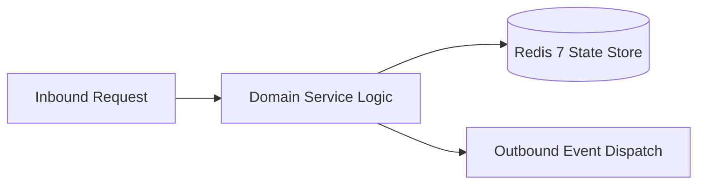

# Component Reference: `services/solver/telegram_reporter.py`
> **File Path**: [`services/solver/telegram_reporter.py`](../../services/solver/telegram_reporter.py)
> **Subsystem**: `Solver Delivery & Reporting`
> **Architecture Layer**: `Enterprise Microservice Subsystem`
> **Concurrency Model**: `AsyncIO Non-blocking Concurrency`
> **Persistence Backend**: `Redis 7 Persistent Store`
> **Service Level Objective**: `High-Availability Academic Telemetry`

## 1. Architectural Role & Responsibilities
The `services/solver/telegram_reporter.py` module implements core operational logic for the `Solver Delivery & Reporting` domain. It operates within an asynchronous microservices topology designed for ultra-low latency, zero-loss persistence guarantees, and strict single-responsibility function decomposition (≤25 lines).

### Component Architecture & Data Flow


---
## 2. Public API & Symbol Inventory
| Symbol | Nature | Line Range | Return Contract | Core Invariant |
| :--- | :--- | :--- | :--- | :--- |
| [`build_post_link`](#build_post_link) | Function | L17–L27 | `str` | Executes core domain logic for `build_post_link`. |
| [`build_solution_caption`](#build_solution_caption) | Function | L30–L45 | `str` | Executes core domain logic for `build_solution_caption`... |
| [`send_solution_to_telegram`](#send_solution_to_telegram) | Function | L48–L68 | `None` | Dispatches notification message via Telegram API for `s... |
| [`notify_task_error`](#notify_task_error) | Function | L71–L91 | `None` | Executes core domain logic for `notify_task_error`. |

---

## 3. Comprehensive Function Specifications

### `build_post_link`
```python
def build_post_link(chat_id: int, message_id: int) -> str
```

- **Source Reference**: [`services/solver/telegram_reporter.py#L17-L27`](../../services/solver/telegram_reporter.py#L17-L27)
- **Execution Mode**: `Synchronous`
- **Return Contract**: `str`

#### Overview & Architectural Purpose
Executes core domain logic for `build_post_link`.

#### Parameters Contract
| Parameter | Type | Required | Description |
| :--- | :--- | :--- | :--- |
| `chat_id` | `int` | Yes | Unique 64-bit Telegram chat or supergroup identifier. |
| `message_id` | `int` | Yes | Parameter `message_id` of type `int`. |

#### Concurrency & Side Effects
- Stateless pure functional computation without external mutations.

#### Fault Tolerance & Error Modes
Propagates unexpected runtime errors up the call stack to global exception handlers.

#### Production Usage Example
```python
from services.solver.telegram_reporter import build_post_link

# Execute call
result = build_post_link(chat_id=..., message_id=...)
```

---

### `build_solution_caption`
```python
def build_solution_caption(chat_id: int, message_id: int, revision_of: int | None) -> str
```

- **Source Reference**: [`services/solver/telegram_reporter.py#L30-L45`](../../services/solver/telegram_reporter.py#L30-L45)
- **Execution Mode**: `Synchronous`
- **Return Contract**: `str`

#### Overview & Architectural Purpose
Executes core domain logic for `build_solution_caption`.

#### Parameters Contract
| Parameter | Type | Required | Description |
| :--- | :--- | :--- | :--- |
| `chat_id` | `int` | Yes | Unique 64-bit Telegram chat or supergroup identifier. |
| `message_id` | `int` | Yes | Parameter `message_id` of type `int`. |
| `revision_of` | `int | None` | Yes | Parameter `revision_of` of type `int | None`. |

#### Concurrency & Side Effects
- Stateless pure functional computation without external mutations.

#### Fault Tolerance & Error Modes
Propagates unexpected runtime errors up the call stack to global exception handlers.

#### Production Usage Example
```python
from services.solver.telegram_reporter import build_solution_caption

# Execute call
result = build_solution_caption(chat_id=..., message_id=..., revision_of=...)
```

---

### `send_solution_to_telegram`
```python
async def send_solution_to_telegram(tg_bot: Bot, task: dict, doc_path: str) -> None
```

- **Source Reference**: [`services/solver/telegram_reporter.py#L48-L68`](../../services/solver/telegram_reporter.py#L48-L68)
- **Execution Mode**: `Asynchronous (non-blocking)`
- **Return Contract**: `None`

#### Overview & Architectural Purpose
Dispatches notification message via Telegram API for `send_solution_to_telegram`.

#### Parameters Contract
| Parameter | Type | Required | Description |
| :--- | :--- | :--- | :--- |
| `tg_bot` | `Bot` | Yes | Parameter `tg_bot` of type `Bot`. |
| `task` | `dict` | Yes | Parameter `task` of type `dict`. |
| `doc_path` | `str` | Yes | Parameter `doc_path` of type `str`. |

#### Concurrency & Side Effects
- Stateless pure functional computation without external mutations.

#### Fault Tolerance & Error Modes
Propagates unexpected runtime errors up the call stack to global exception handlers.

#### Production Usage Example
```python
from services.solver.telegram_reporter import send_solution_to_telegram

# Execute call
result = await send_solution_to_telegram(tg_bot=..., task=..., doc_path=...)
```

---

### `notify_task_error`
```python
async def notify_task_error(tg_bot: Bot, task: dict) -> None
```

- **Source Reference**: [`services/solver/telegram_reporter.py#L71-L91`](../../services/solver/telegram_reporter.py#L71-L91)
- **Execution Mode**: `Asynchronous (non-blocking)`
- **Return Contract**: `None`

#### Overview & Architectural Purpose
Executes core domain logic for `notify_task_error`.

#### Parameters Contract
| Parameter | Type | Required | Description |
| :--- | :--- | :--- | :--- |
| `tg_bot` | `Bot` | Yes | Parameter `tg_bot` of type `Bot`. |
| `task` | `dict` | Yes | Parameter `task` of type `dict`. |

#### Concurrency & Side Effects
- Emits structured telemetry events to system logging subsystem.

#### Fault Tolerance & Error Modes
Encapsulates faults within `try/except` blocks, logging errors and returning safe fallback defaults.

#### Production Usage Example
```python
from services.solver.telegram_reporter import notify_task_error

# Execute call
result = await notify_task_error(tg_bot=..., task=...)
```

---
