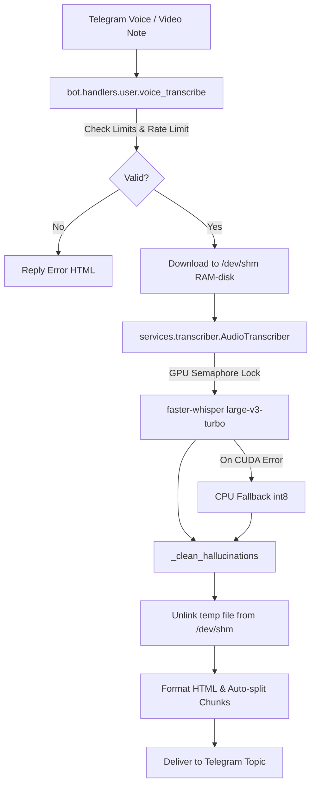

# Component Reference: `services/stt_queue.py`
> **File Path**: [`services/stt_queue.py`](../../services/stt_queue.py)
> **Subsystem**: `Speech-to-Text Whisper Engine`
> **Architecture Layer**: `Deep Learning Audio Ingress Service`
> **Concurrency Model**: `AsyncIO Event Loop + Non-blocking Thread Pool + GPU Semaphore(1)`
> **Persistence Backend**: `RAM-Disk (/dev/shm) Ephemeral Audio Buffer + Local Model Weights`
> **Service Level Objective**: `Sub-0.5s Large-v3-Turbo Inference / Zero-Disk Wear`

## 1. Purpose
Очередь распознавания речи между ботом и сервисом stt.

### Component Architecture & Data Flow


---
## 2. Public API & Symbol Inventory
| Symbol | Nature | Line Range | Return Contract | Summary |
| :--- | :--- | :--- | :--- | :--- |
| [`resolve_audio_dir`](#resolve_audio_dir) | Function | L36–L44 | `str` | Возвращает общий с сервисом stt каталог для аудио, созд... |
| [`_wait_result`](#_wait_result) | Function | L47–L57 | `dict` | Ждёт ответ stt короткими BLPOP до дедлайна. |
| [`transcribe_via_stt`](#transcribe_via_stt) | Function | L60–L75 | `str` | Отправляет файл на распознавание в сервис stt и ждёт те... |
| [`_process_job`](#_process_job) | Function | L78–L94 | `None` | Распознаёт одно задание и публикует результат (текст ил... |
| [`stt_worker_loop`](#stt_worker_loop) | Function | L97–L117 | `None` | Бесконечный цикл сервиса stt: забирает задания из очере... |

---

## 3. Comprehensive Function Specifications

## Class Model: `SttUnavailableError`

Сервис stt не ответил вовремя или вернул ошибку распознавания.

### `resolve_audio_dir`
```python
def resolve_audio_dir() -> str
```

- **Source Reference**: [`services/stt_queue.py#L36-L44`](../../services/stt_queue.py#L36-L44)
- **Execution Mode**: `Synchronous`
- **Return Contract**: `str`

#### Overview & Architectural Purpose
Возвращает общий с сервисом stt каталог для аудио, создавая его при необходимости.

#### Parameters Contract
*This method takes no input parameters.*

#### Concurrency & Side Effects
- Stateless pure functional computation without external mutations.

#### Fault Tolerance & Error Modes
Propagates unexpected runtime errors up the call stack to global exception handlers.

#### Production Usage Example
```python
from services.stt_queue import resolve_audio_dir

# Execute call
result = resolve_audio_dir()
```

---

### `_wait_result`
```python
async def _wait_result(redis, result_key: str, deadline: float) -> dict
```

- **Source Reference**: [`services/stt_queue.py#L47-L57`](../../services/stt_queue.py#L47-L57)
- **Execution Mode**: `Asynchronous (non-blocking)`
- **Return Contract**: `dict`

#### Overview & Architectural Purpose
Ждёт ответ stt короткими BLPOP до дедлайна.

#### Parameters Contract
| Parameter | Type | Required | Description |
| :--- | :--- | :--- | :--- |
| `redis` | `Any` | Yes | Parameter `redis` of type `Any`. |
| `result_key` | `str` | Yes | Parameter `result_key` of type `str`. |
| `deadline` | `float` | Yes | Parameter `deadline` of type `float`. |

#### Concurrency & Side Effects
- Stateless pure functional computation without external mutations.

#### Fault Tolerance & Error Modes
Explicitly raises domain exceptions (e.g., `PermissionError`, `ValueError`) upon invariant violation.

#### Production Usage Example
```python
from services.stt_queue import _wait_result

# Execute call
result = await _wait_result(redis=..., result_key=..., deadline=...)
```

---

### `transcribe_via_stt`
```python
async def transcribe_via_stt(audio_path: str) -> str
```

- **Source Reference**: [`services/stt_queue.py#L60-L75`](../../services/stt_queue.py#L60-L75)
- **Execution Mode**: `Asynchronous (non-blocking)`
- **Return Contract**: `str`

#### Overview & Architectural Purpose
Отправляет файл на распознавание в сервис stt и ждёт текст.

#### Parameters Contract
| Parameter | Type | Required | Description |
| :--- | :--- | :--- | :--- |
| `audio_path` | `str` | Yes | Absolute filesystem path to downloaded audio file on RAM-disk (/dev/shm). |

#### Concurrency & Side Effects
- Mutates or reads Redis L2 key space via asynchronous connection pool.
- Emits structured telemetry events to system logging subsystem.

#### Fault Tolerance & Error Modes
Explicitly raises domain exceptions (e.g., `PermissionError`, `ValueError`) upon invariant violation.

#### Production Usage Example
```python
from services.stt_queue import transcribe_via_stt

# Execute call
result = await transcribe_via_stt(audio_path=...)
```

---

### `_process_job`
```python
async def _process_job(redis, raw_job: str, transcribe) -> None
```

- **Source Reference**: [`services/stt_queue.py#L78-L94`](../../services/stt_queue.py#L78-L94)
- **Execution Mode**: `Asynchronous (non-blocking)`
- **Return Contract**: `None`

#### Overview & Architectural Purpose
Распознаёт одно задание и публикует результат (текст или ошибку) в ключ бота.

#### Parameters Contract
| Parameter | Type | Required | Description |
| :--- | :--- | :--- | :--- |
| `redis` | `Any` | Yes | Parameter `redis` of type `Any`. |
| `raw_job` | `str` | Yes | Parameter `raw_job` of type `str`. |
| `transcribe` | `Any` | Yes | Parameter `transcribe` of type `Any`. |

#### Concurrency & Side Effects
- Emits structured telemetry events to system logging subsystem.

#### Fault Tolerance & Error Modes
Encapsulates faults within `try/except` blocks, logging errors and returning safe fallback defaults.

#### Production Usage Example
```python
from services.stt_queue import _process_job

# Execute call
result = await _process_job(redis=..., raw_job=..., transcribe=...)
```

---

### `stt_worker_loop`
```python
async def stt_worker_loop(transcribe) -> None
```

- **Source Reference**: [`services/stt_queue.py#L97-L117`](../../services/stt_queue.py#L97-L117)
- **Execution Mode**: `Asynchronous (non-blocking)`
- **Return Contract**: `None`

#### Overview & Architectural Purpose
Бесконечный цикл сервиса stt: забирает задания из очереди и распознаёт по одному.

#### Parameters Contract
| Parameter | Type | Required | Description |
| :--- | :--- | :--- | :--- |
| `transcribe` | `Any` | Yes | Parameter `transcribe` of type `Any`. |

#### Concurrency & Side Effects
- Mutates or reads Redis L2 key space via asynchronous connection pool.
- Emits structured telemetry events to system logging subsystem.

#### Fault Tolerance & Error Modes
Encapsulates faults within `try/except` blocks, logging errors and returning safe fallback defaults.

#### Production Usage Example
```python
from services.stt_queue import stt_worker_loop

# Execute call
result = await stt_worker_loop(transcribe=...)
```

---
