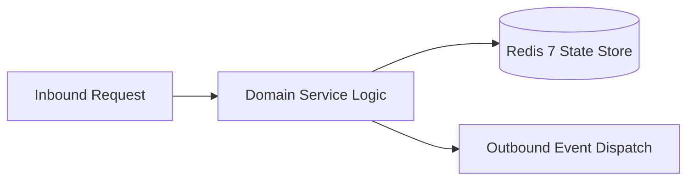

# Component Reference: `services/testers_manager.py`
> **File Path**: [`services/testers_manager.py`](../../services/testers_manager.py)  
> **Subsystem**: `Testing Whitelist`  
> **Architecture Layer**: `Enterprise Microservice Subsystem`  
> **Concurrency Model**: `AsyncIO Non-blocking Concurrency`  
> **Persistence Backend**: `Redis 7 Persistent Store`  
> **Service Level Objective**: `High-Availability Academic Telemetry`

## 1. Architectural Role & Responsibilities
The `services/testers_manager.py` module implements core operational logic for the `Testing Whitelist` domain. It operates within an asynchronous microservices topology designed for ultra-low latency, zero-loss persistence guarantees, and strict single-responsibility function decomposition (≤25 lines).

### Component Architecture & Data Flow


---
## 2. Public API & Symbol Inventory
| Symbol | Nature | Line Range | Return Contract | Core Invariant |
| :--- | :--- | :--- | :--- | :--- |
| [`generate_or_get_tester_key`](#generate_or_get_tester_key) | Function | L26–L47 | `str | None` | Executes core domain logic for `generate_or_get_tester_... |
| [`get_tester_by_key`](#get_tester_by_key) | Function | L50–L68 | `int | None` | Retrieves and resolves domain data for `get_tester_by_k... |
| [`add_tester`](#add_tester) | Function | L71–L86 | `bool` | Executes core domain logic for `add_tester`. |
| [`remove_tester`](#remove_tester) | Function | L89–L110 | `bool` | Executes core domain logic for `remove_tester`. |
| [`is_tester_allowed`](#is_tester_allowed) | Function | L113–L127 | `bool` | Executes core domain logic for `is_tester_allowed`. |
| [`get_all_testers`](#get_all_testers) | Function | L130–L146 | `list[int]` | Retrieves and resolves domain data for `get_all_testers... |

---

## 3. Comprehensive Function Specifications

### `generate_or_get_tester_key`
```python
async def generate_or_get_tester_key(user_id: int) -> str | None
```

- **Source Reference**: [`services/testers_manager.py#L26-L47`](../../services/testers_manager.py#L26-L47)
- **Execution Mode**: `Asynchronous (non-blocking)`
- **Return Contract**: `str | None`

#### Overview & Architectural Purpose
Executes core domain logic for `generate_or_get_tester_key`.

#### Parameters Contract
| Parameter | Type | Required | Description |
| :--- | :--- | :--- | :--- |
| `user_id` | `int` | Yes | Unique 64-bit Telegram user identifier. |

#### Concurrency & Side Effects
- Mutates or reads Redis L2 key space via asynchronous connection pool.
- Emits structured telemetry events to system logging subsystem.

#### Fault Tolerance & Error Modes
Propagates unexpected runtime errors up the call stack to global exception handlers.

#### Production Usage Example
```python
from services.testers_manager import generate_or_get_tester_key

# Execute call
result = await generate_or_get_tester_key(user_id=...)
```

---

### `get_tester_by_key`
```python
async def get_tester_by_key(api_key: str) -> int | None
```

- **Source Reference**: [`services/testers_manager.py#L50-L68`](../../services/testers_manager.py#L50-L68)
- **Execution Mode**: `Asynchronous (non-blocking)`
- **Return Contract**: `int | None`

#### Overview & Architectural Purpose
Retrieves and resolves domain data for `get_tester_by_key`.

#### Parameters Contract
| Parameter | Type | Required | Description |
| :--- | :--- | :--- | :--- |
| `api_key` | `str` | Yes | Parameter `api_key` of type `str`. |

#### Concurrency & Side Effects
- Mutates or reads Redis L2 key space via asynchronous connection pool.

#### Fault Tolerance & Error Modes
Propagates unexpected runtime errors up the call stack to global exception handlers.

#### Production Usage Example
```python
from services.testers_manager import get_tester_by_key

# Execute call
result = await get_tester_by_key(api_key=...)
```

---

### `add_tester`
```python
async def add_tester(user_id: int) -> bool
```

- **Source Reference**: [`services/testers_manager.py#L71-L86`](../../services/testers_manager.py#L71-L86)
- **Execution Mode**: `Asynchronous (non-blocking)`
- **Return Contract**: `bool`

#### Overview & Architectural Purpose
Executes core domain logic for `add_tester`.

#### Parameters Contract
| Parameter | Type | Required | Description |
| :--- | :--- | :--- | :--- |
| `user_id` | `int` | Yes | Unique 64-bit Telegram user identifier. |

#### Concurrency & Side Effects
- Mutates or reads Redis L2 key space via asynchronous connection pool.
- Emits structured telemetry events to system logging subsystem.

#### Fault Tolerance & Error Modes
Propagates unexpected runtime errors up the call stack to global exception handlers.

#### Production Usage Example
```python
from services.testers_manager import add_tester

# Execute call
result = await add_tester(user_id=...)
```

---

### `remove_tester`
```python
async def remove_tester(user_id: int) -> bool
```

- **Source Reference**: [`services/testers_manager.py#L89-L110`](../../services/testers_manager.py#L89-L110)
- **Execution Mode**: `Asynchronous (non-blocking)`
- **Return Contract**: `bool`

#### Overview & Architectural Purpose
Executes core domain logic for `remove_tester`.

#### Parameters Contract
| Parameter | Type | Required | Description |
| :--- | :--- | :--- | :--- |
| `user_id` | `int` | Yes | Unique 64-bit Telegram user identifier. |

#### Concurrency & Side Effects
- Mutates or reads Redis L2 key space via asynchronous connection pool.
- Emits structured telemetry events to system logging subsystem.

#### Fault Tolerance & Error Modes
Propagates unexpected runtime errors up the call stack to global exception handlers.

#### Production Usage Example
```python
from services.testers_manager import remove_tester

# Execute call
result = await remove_tester(user_id=...)
```

---

### `is_tester_allowed`
```python
async def is_tester_allowed(user_id: int) -> bool
```

- **Source Reference**: [`services/testers_manager.py#L113-L127`](../../services/testers_manager.py#L113-L127)
- **Execution Mode**: `Asynchronous (non-blocking)`
- **Return Contract**: `bool`

#### Overview & Architectural Purpose
Executes core domain logic for `is_tester_allowed`.

#### Parameters Contract
| Parameter | Type | Required | Description |
| :--- | :--- | :--- | :--- |
| `user_id` | `int` | Yes | Unique 64-bit Telegram user identifier. |

#### Concurrency & Side Effects
- Mutates or reads Redis L2 key space via asynchronous connection pool.

#### Fault Tolerance & Error Modes
Propagates unexpected runtime errors up the call stack to global exception handlers.

#### Production Usage Example
```python
from services.testers_manager import is_tester_allowed

# Execute call
result = await is_tester_allowed(user_id=...)
```

---

### `get_all_testers`
```python
async def get_all_testers() -> list[int]
```

- **Source Reference**: [`services/testers_manager.py#L130-L146`](../../services/testers_manager.py#L130-L146)
- **Execution Mode**: `Asynchronous (non-blocking)`
- **Return Contract**: `list[int]`

#### Overview & Architectural Purpose
Retrieves and resolves domain data for `get_all_testers`.

#### Parameters Contract
*This method takes no input parameters.*

#### Concurrency & Side Effects
- Mutates or reads Redis L2 key space via asynchronous connection pool.

#### Fault Tolerance & Error Modes
Propagates unexpected runtime errors up the call stack to global exception handlers.

#### Production Usage Example
```python
from services.testers_manager import get_all_testers

# Execute call
result = await get_all_testers()
```

---
