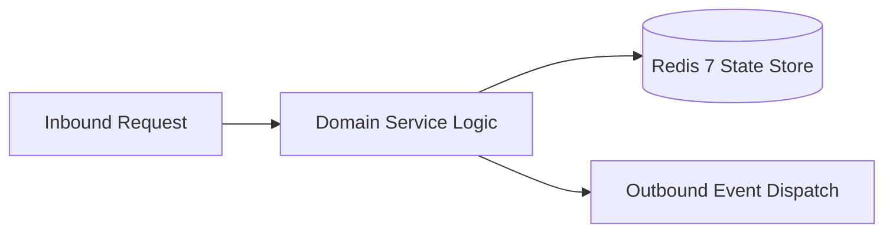

# Component Reference: `services/topic_updater.py`
> **File Path**: [`services/topic_updater.py`](../../services/topic_updater.py)  
> **Subsystem**: `Live Schedule Topic`  
> **Architecture Layer**: `Enterprise Microservice Subsystem`  
> **Concurrency Model**: `AsyncIO Non-blocking Concurrency`  
> **Persistence Backend**: `Redis 7 Persistent Store`  
> **Service Level Objective**: `High-Availability Academic Telemetry`

## 1. Architectural Role & Responsibilities
The `services/topic_updater.py` module implements core operational logic for the `Live Schedule Topic` domain. It operates within an asynchronous microservices topology designed for ultra-low latency, zero-loss persistence guarantees, and strict single-responsibility function decomposition (≤25 lines).

### Component Architecture & Data Flow


---
## 2. Public API & Symbol Inventory
| Symbol | Nature | Line Range | Return Contract | Core Invariant |
| :--- | :--- | :--- | :--- | :--- |
| [`load_topic_state`](#load_topic_state) | Function | L33–L43 | `int | None` | Executes core domain logic for `load_topic_state`. |
| [`save_topic_state`](#save_topic_state) | Function | L46–L61 | `None` | Saves serialized entity data to storage for `save_topic... |
| [`cleanup_expired_messages`](#cleanup_expired_messages) | Function | L64–L86 | `None` | Executes core domain logic for `cleanup_expired_message... |
| [`send_temp_topic_reminder`](#send_temp_topic_reminder) | Function | L89–L111 | `None` | Dispatches notification message via Telegram API for `s... |
| [`check_and_trigger_reminder`](#check_and_trigger_reminder) | Function | L114–L139 | `None` | Executes core domain logic for `check_and_trigger_remin... |
| [`get_next_working_day`](#get_next_working_day) | Function | L142–L154 | `date` | Retrieves and resolves domain data for `get_next_workin... |
| [`_should_switch_to_next_day`](#_should_switch_to_next_day) | Function | L157–L172 | `bool` | Executes core domain logic for `_should_switch_to_next_... |
| [`resolve_target_date`](#resolve_target_date) | Function | L175–L192 | `date | None` | Executes core domain logic for `resolve_target_date`. |
| [`is_too_early_to_publish`](#is_too_early_to_publish) | Function | L195–L212 | `bool` | Executes core domain logic for `is_too_early_to_publish... |
| [`_edit_topic_message`](#_edit_topic_message) | Function | L215–L228 | `bool` | Executes core domain logic for `_edit_topic_message`. |
| [`update_topic_message_payload`](#update_topic_message_payload) | Function | L231–L248 | `bool` | Synchronizes and updates domain state for `update_topic... |
| [`_send_new_topic_message`](#_send_new_topic_message) | Function | L251–L272 | `bool` | Executes core domain logic for `_send_new_topic_message... |
| [`_pin_silently`](#_pin_silently) | Function | L275–L290 | `None` | Executes core domain logic for `_pin_silently`. |
| [`_try_delete_old_topic_msg`](#_try_delete_old_topic_msg) | Function | L293–L308 | `None` | Executes core domain logic for `_try_delete_old_topic_m... |
| [`recreate_topic_message`](#recreate_topic_message) | Function | L311–L328 | `bool` | Executes core domain logic for `recreate_topic_message`... |
| [`_recreate_after_edit_failure`](#_recreate_after_edit_failure) | Function | L331–L342 | `bool` | Executes core domain logic for `_recreate_after_edit_fa... |
| [`_handle_edit_failure`](#_handle_edit_failure) | Function | L345–L367 | `bool` | Executes core domain logic for `_handle_edit_failure`. |
| [`should_skip_topic_update`](#should_skip_topic_update) | Function | L370–L387 | `bool` | Executes core domain logic for `should_skip_topic_updat... |
| [`process_today_reminders`](#process_today_reminders) | Function | L390–L400 | `None` | Executes core domain logic for `process_today_reminders... |
| [`_prepare_target_schedule`](#_prepare_target_schedule) | Function | L403–L422 | `tuple[date | None, list[Lesson] | None]` | Executes core domain logic for `_prepare_target_schedul... |
| [`_ensure_topic_main_msg_id`](#_ensure_topic_main_msg_id) | Function | L425–L434 | `None` | Executes core domain logic for `_ensure_topic_main_msg_... |
| [`sync_topic_main_message`](#sync_topic_main_message) | Function | L437–L459 | `bool` | Executes core domain logic for `sync_topic_main_message... |
| [`notify_admin_about_api_down`](#notify_admin_about_api_down) | Function | L466–L487 | `None` | Executes core domain logic for `notify_admin_about_api_... |
| [`_track_api_failure`](#_track_api_failure) | Function | L490–L501 | `None` | Executes core domain logic for `_track_api_failure`. |
| [`_reset_api_failure_tracker`](#_reset_api_failure_tracker) | Function | L504–L515 | `None` | Executes core domain logic for `_reset_api_failure_trac... |
| [`topic_sync_loop`](#topic_sync_loop) | Function | L518–L536 | `None` | Executes core domain logic for `topic_sync_loop`. |

---

## 3. Comprehensive Function Specifications

### `load_topic_state`
```python
def load_topic_state() -> int | None
```

- **Source Reference**: [`services/topic_updater.py#L33-L43`](../../services/topic_updater.py#L33-L43)
- **Execution Mode**: `Synchronous`
- **Return Contract**: `int | None`

#### Overview & Architectural Purpose
Executes core domain logic for `load_topic_state`.

#### Parameters Contract
*This method takes no input parameters.*

#### Concurrency & Side Effects
- Stateless pure functional computation without external mutations.

#### Fault Tolerance & Error Modes
Propagates unexpected runtime errors up the call stack to global exception handlers.

#### Production Usage Example
```python
from services.topic_updater import load_topic_state

# Execute call
result = load_topic_state()
```

---

### `save_topic_state`
```python
def save_topic_state(msg_id: int | None) -> None
```

- **Source Reference**: [`services/topic_updater.py#L46-L61`](../../services/topic_updater.py#L46-L61)
- **Execution Mode**: `Synchronous`
- **Return Contract**: `None`

#### Overview & Architectural Purpose
Saves serialized entity data to storage for `save_topic_state`.

#### Parameters Contract
| Parameter | Type | Required | Description |
| :--- | :--- | :--- | :--- |
| `msg_id` | `int | None` | Yes | Parameter `msg_id` of type `int | None`. |

#### Concurrency & Side Effects
- Stateless pure functional computation without external mutations.

#### Fault Tolerance & Error Modes
Propagates unexpected runtime errors up the call stack to global exception handlers.

#### Production Usage Example
```python
from services.topic_updater import save_topic_state

# Execute call
result = save_topic_state(msg_id=...)
```

---

### `cleanup_expired_messages`
```python
async def cleanup_expired_messages() -> None
```

- **Source Reference**: [`services/topic_updater.py#L64-L86`](../../services/topic_updater.py#L64-L86)
- **Execution Mode**: `Asynchronous (non-blocking)`
- **Return Contract**: `None`

#### Overview & Architectural Purpose
Executes core domain logic for `cleanup_expired_messages`.

#### Parameters Contract
*This method takes no input parameters.*

#### Concurrency & Side Effects
- Emits structured telemetry events to system logging subsystem.

#### Fault Tolerance & Error Modes
Encapsulates faults within `try/except` blocks, logging errors and returning safe fallback defaults.

#### Production Usage Example
```python
from services.topic_updater import cleanup_expired_messages

# Execute call
result = await cleanup_expired_messages()
```

---

### `send_temp_topic_reminder`
```python
async def send_temp_topic_reminder(lesson: Lesson) -> None
```

- **Source Reference**: [`services/topic_updater.py#L89-L111`](../../services/topic_updater.py#L89-L111)
- **Execution Mode**: `Asynchronous (non-blocking)`
- **Return Contract**: `None`

#### Overview & Architectural Purpose
Dispatches notification message via Telegram API for `send_temp_topic_reminder`.

#### Parameters Contract
| Parameter | Type | Required | Description |
| :--- | :--- | :--- | :--- |
| `lesson` | `Lesson` | Yes | Parameter `lesson` of type `Lesson`. |

#### Concurrency & Side Effects
- Emits structured telemetry events to system logging subsystem.

#### Fault Tolerance & Error Modes
Encapsulates faults within `try/except` blocks, logging errors and returning safe fallback defaults.

#### Production Usage Example
```python
from services.topic_updater import send_temp_topic_reminder

# Execute call
result = await send_temp_topic_reminder(lesson=...)
```

---

### `check_and_trigger_reminder`
```python
async def check_and_trigger_reminder(lesson: Lesson, now_dt: datetime, today: date) -> None
```

- **Source Reference**: [`services/topic_updater.py#L114-L139`](../../services/topic_updater.py#L114-L139)
- **Execution Mode**: `Asynchronous (non-blocking)`
- **Return Contract**: `None`

#### Overview & Architectural Purpose
Executes core domain logic for `check_and_trigger_reminder`.

#### Parameters Contract
| Parameter | Type | Required | Description |
| :--- | :--- | :--- | :--- |
| `lesson` | `Lesson` | Yes | Parameter `lesson` of type `Lesson`. |
| `now_dt` | `datetime` | Yes | Current reference datetime anchored to Europe/Moscow timezone. |
| `today` | `date` | Yes | Parameter `today` of type `date`. |

#### Concurrency & Side Effects
- Stateless pure functional computation without external mutations.

#### Fault Tolerance & Error Modes
Propagates unexpected runtime errors up the call stack to global exception handlers.

#### Production Usage Example
```python
from services.topic_updater import check_and_trigger_reminder

# Execute call
result = await check_and_trigger_reminder(lesson=..., now_dt=..., today=...)
```

---

### `get_next_working_day`
```python
def get_next_working_day(target_date: date) -> date
```

- **Source Reference**: [`services/topic_updater.py#L142-L154`](../../services/topic_updater.py#L142-L154)
- **Execution Mode**: `Synchronous`
- **Return Contract**: `date`

#### Overview & Architectural Purpose
Retrieves and resolves domain data for `get_next_working_day`.

#### Parameters Contract
| Parameter | Type | Required | Description |
| :--- | :--- | :--- | :--- |
| `target_date` | `date` | Yes | Target calendar date for schedule or attendance resolution (ISO-8601). |

#### Concurrency & Side Effects
- Stateless pure functional computation without external mutations.

#### Fault Tolerance & Error Modes
Propagates unexpected runtime errors up the call stack to global exception handlers.

#### Production Usage Example
```python
from services.topic_updater import get_next_working_day

# Execute call
result = get_next_working_day(target_date=...)
```

---

### `_should_switch_to_next_day`
```python
def _should_switch_to_next_day(today_lessons: list[Lesson], today: date, now_dt: datetime) -> bool
```

- **Source Reference**: [`services/topic_updater.py#L157-L172`](../../services/topic_updater.py#L157-L172)
- **Execution Mode**: `Synchronous`
- **Return Contract**: `bool`

#### Overview & Architectural Purpose
Executes core domain logic for `_should_switch_to_next_day`.

#### Parameters Contract
| Parameter | Type | Required | Description |
| :--- | :--- | :--- | :--- |
| `today_lessons` | `list[Lesson]` | Yes | Parameter `today_lessons` of type `list[Lesson]`. |
| `today` | `date` | Yes | Parameter `today` of type `date`. |
| `now_dt` | `datetime` | Yes | Current reference datetime anchored to Europe/Moscow timezone. |

#### Concurrency & Side Effects
- Stateless pure functional computation without external mutations.

#### Fault Tolerance & Error Modes
Propagates unexpected runtime errors up the call stack to global exception handlers.

#### Production Usage Example
```python
from services.topic_updater import _should_switch_to_next_day

# Execute call
result = _should_switch_to_next_day(today_lessons=..., today=..., now_dt=...)
```

---

### `resolve_target_date`
```python
async def resolve_target_date(now_dt: datetime, ignore_restriction: bool) -> date | None
```

- **Source Reference**: [`services/topic_updater.py#L175-L192`](../../services/topic_updater.py#L175-L192)
- **Execution Mode**: `Asynchronous (non-blocking)`
- **Return Contract**: `date | None`

#### Overview & Architectural Purpose
Executes core domain logic for `resolve_target_date`.

#### Parameters Contract
| Parameter | Type | Required | Description |
| :--- | :--- | :--- | :--- |
| `now_dt` | `datetime` | Yes | Current reference datetime anchored to Europe/Moscow timezone. |
| `ignore_restriction` | `bool` | Yes | Parameter `ignore_restriction` of type `bool`. |

#### Concurrency & Side Effects
- Stateless pure functional computation without external mutations.

#### Fault Tolerance & Error Modes
Propagates unexpected runtime errors up the call stack to global exception handlers.

#### Production Usage Example
```python
from services.topic_updater import resolve_target_date

# Execute call
result = await resolve_target_date(now_dt=..., ignore_restriction=...)
```

---

### `is_too_early_to_publish`
```python
def is_too_early_to_publish(lessons: list[Lesson], now_dt: datetime, today: date, ignore_restriction: bool) -> bool
```

- **Source Reference**: [`services/topic_updater.py#L195-L212`](../../services/topic_updater.py#L195-L212)
- **Execution Mode**: `Synchronous`
- **Return Contract**: `bool`

#### Overview & Architectural Purpose
Executes core domain logic for `is_too_early_to_publish`.

#### Parameters Contract
| Parameter | Type | Required | Description |
| :--- | :--- | :--- | :--- |
| `lessons` | `list[Lesson]` | Yes | Parameter `lessons` of type `list[Lesson]`. |
| `now_dt` | `datetime` | Yes | Current reference datetime anchored to Europe/Moscow timezone. |
| `today` | `date` | Yes | Parameter `today` of type `date`. |
| `ignore_restriction` | `bool` | Yes | Parameter `ignore_restriction` of type `bool`. |

#### Concurrency & Side Effects
- Stateless pure functional computation without external mutations.

#### Fault Tolerance & Error Modes
Propagates unexpected runtime errors up the call stack to global exception handlers.

#### Production Usage Example
```python
from services.topic_updater import is_too_early_to_publish

# Execute call
result = is_too_early_to_publish(lessons=..., now_dt=..., today=...)
```

---

### `_edit_topic_message`
```python
async def _edit_topic_message(text: str, kb: Any) -> bool
```

- **Source Reference**: [`services/topic_updater.py#L215-L228`](../../services/topic_updater.py#L215-L228)
- **Execution Mode**: `Asynchronous (non-blocking)`
- **Return Contract**: `bool`

#### Overview & Architectural Purpose
Executes core domain logic for `_edit_topic_message`.

#### Parameters Contract
| Parameter | Type | Required | Description |
| :--- | :--- | :--- | :--- |
| `text` | `str` | Yes | Parameter `text` of type `str`. |
| `kb` | `Any` | Yes | Parameter `kb` of type `Any`. |

#### Concurrency & Side Effects
- Emits structured telemetry events to system logging subsystem.

#### Fault Tolerance & Error Modes
Propagates unexpected runtime errors up the call stack to global exception handlers.

#### Production Usage Example
```python
from services.topic_updater import _edit_topic_message

# Execute call
result = await _edit_topic_message(text=..., kb=...)
```

---

### `update_topic_message_payload`
```python
async def update_topic_message_payload(text: str, kb: Any, _retry: bool = False) -> bool
```

- **Source Reference**: [`services/topic_updater.py#L231-L248`](../../services/topic_updater.py#L231-L248)
- **Execution Mode**: `Asynchronous (non-blocking)`
- **Return Contract**: `bool`

#### Overview & Architectural Purpose
Synchronizes and updates domain state for `update_topic_message_payload`.

#### Parameters Contract
| Parameter | Type | Required | Description |
| :--- | :--- | :--- | :--- |
| `text` | `str` | Yes | Parameter `text` of type `str`. |
| `kb` | `Any` | Yes | Parameter `kb` of type `Any`. |
| `_retry` | `bool` | Yes | Parameter `_retry` of type `bool`. |

#### Concurrency & Side Effects
- Emits structured telemetry events to system logging subsystem.

#### Fault Tolerance & Error Modes
Encapsulates faults within `try/except` blocks, logging errors and returning safe fallback defaults.

#### Production Usage Example
```python
from services.topic_updater import update_topic_message_payload

# Execute call
result = await update_topic_message_payload(text=..., kb=..., _retry=...)
```

---

### `_send_new_topic_message`
```python
async def _send_new_topic_message(text: str, kb: Any) -> bool
```

- **Source Reference**: [`services/topic_updater.py#L251-L272`](../../services/topic_updater.py#L251-L272)
- **Execution Mode**: `Asynchronous (non-blocking)`
- **Return Contract**: `bool`

#### Overview & Architectural Purpose
Executes core domain logic for `_send_new_topic_message`.

#### Parameters Contract
| Parameter | Type | Required | Description |
| :--- | :--- | :--- | :--- |
| `text` | `str` | Yes | Parameter `text` of type `str`. |
| `kb` | `Any` | Yes | Parameter `kb` of type `Any`. |

#### Concurrency & Side Effects
- Emits structured telemetry events to system logging subsystem.

#### Fault Tolerance & Error Modes
Propagates unexpected runtime errors up the call stack to global exception handlers.

#### Production Usage Example
```python
from services.topic_updater import _send_new_topic_message

# Execute call
result = await _send_new_topic_message(text=..., kb=...)
```

---

### `_pin_silently`
```python
async def _pin_silently(chat_id: int, message_id: int) -> None
```

- **Source Reference**: [`services/topic_updater.py#L275-L290`](../../services/topic_updater.py#L275-L290)
- **Execution Mode**: `Asynchronous (non-blocking)`
- **Return Contract**: `None`

#### Overview & Architectural Purpose
Executes core domain logic for `_pin_silently`.

#### Parameters Contract
| Parameter | Type | Required | Description |
| :--- | :--- | :--- | :--- |
| `chat_id` | `int` | Yes | Unique 64-bit Telegram chat or supergroup identifier. |
| `message_id` | `int` | Yes | Parameter `message_id` of type `int`. |

#### Concurrency & Side Effects
- Emits structured telemetry events to system logging subsystem.

#### Fault Tolerance & Error Modes
Encapsulates faults within `try/except` blocks, logging errors and returning safe fallback defaults.

#### Production Usage Example
```python
from services.topic_updater import _pin_silently

# Execute call
result = await _pin_silently(chat_id=..., message_id=...)
```

---

### `_try_delete_old_topic_msg`
```python
async def _try_delete_old_topic_msg(old_id: int | None) -> None
```

- **Source Reference**: [`services/topic_updater.py#L293-L308`](../../services/topic_updater.py#L293-L308)
- **Execution Mode**: `Asynchronous (non-blocking)`
- **Return Contract**: `None`

#### Overview & Architectural Purpose
Executes core domain logic for `_try_delete_old_topic_msg`.

#### Parameters Contract
| Parameter | Type | Required | Description |
| :--- | :--- | :--- | :--- |
| `old_id` | `int | None` | Yes | Parameter `old_id` of type `int | None`. |

#### Concurrency & Side Effects
- Emits structured telemetry events to system logging subsystem.

#### Fault Tolerance & Error Modes
Encapsulates faults within `try/except` blocks, logging errors and returning safe fallback defaults.

#### Production Usage Example
```python
from services.topic_updater import _try_delete_old_topic_msg

# Execute call
result = await _try_delete_old_topic_msg(old_id=...)
```

---

### `recreate_topic_message`
```python
async def recreate_topic_message() -> bool
```

- **Source Reference**: [`services/topic_updater.py#L311-L328`](../../services/topic_updater.py#L311-L328)
- **Execution Mode**: `Asynchronous (non-blocking)`
- **Return Contract**: `bool`

#### Overview & Architectural Purpose
Executes core domain logic for `recreate_topic_message`.

#### Parameters Contract
*This method takes no input parameters.*

#### Concurrency & Side Effects
- Emits structured telemetry events to system logging subsystem.

#### Fault Tolerance & Error Modes
Propagates unexpected runtime errors up the call stack to global exception handlers.

#### Production Usage Example
```python
from services.topic_updater import recreate_topic_message

# Execute call
result = await recreate_topic_message()
```

---

### `_recreate_after_edit_failure`
```python
async def _recreate_after_edit_failure(text: str, kb: Any) -> bool
```

- **Source Reference**: [`services/topic_updater.py#L331-L342`](../../services/topic_updater.py#L331-L342)
- **Execution Mode**: `Asynchronous (non-blocking)`
- **Return Contract**: `bool`

#### Overview & Architectural Purpose
Executes core domain logic for `_recreate_after_edit_failure`.

#### Parameters Contract
| Parameter | Type | Required | Description |
| :--- | :--- | :--- | :--- |
| `text` | `str` | Yes | Parameter `text` of type `str`. |
| `kb` | `Any` | Yes | Parameter `kb` of type `Any`. |

#### Concurrency & Side Effects
- Stateless pure functional computation without external mutations.

#### Fault Tolerance & Error Modes
Propagates unexpected runtime errors up the call stack to global exception handlers.

#### Production Usage Example
```python
from services.topic_updater import _recreate_after_edit_failure

# Execute call
result = await _recreate_after_edit_failure(text=..., kb=...)
```

---

### `_handle_edit_failure`
```python
async def _handle_edit_failure( e: TelegramBadRequest, text: str, kb: Any, is_retry: bool, ) -> bool
```

- **Source Reference**: [`services/topic_updater.py#L345-L367`](../../services/topic_updater.py#L345-L367)
- **Execution Mode**: `Asynchronous (non-blocking)`
- **Return Contract**: `bool`

#### Overview & Architectural Purpose
Executes core domain logic for `_handle_edit_failure`.

#### Parameters Contract
| Parameter | Type | Required | Description |
| :--- | :--- | :--- | :--- |
| `e` | `TelegramBadRequest` | Yes | Parameter `e` of type `TelegramBadRequest`. |
| `text` | `str` | Yes | Parameter `text` of type `str`. |
| `kb` | `Any` | Yes | Parameter `kb` of type `Any`. |
| `is_retry` | `bool` | Yes | Parameter `is_retry` of type `bool`. |

#### Concurrency & Side Effects
- Emits structured telemetry events to system logging subsystem.

#### Fault Tolerance & Error Modes
Propagates unexpected runtime errors up the call stack to global exception handlers.

#### Production Usage Example
```python
from services.topic_updater import _handle_edit_failure

# Execute call
result = await _handle_edit_failure(e=..., text=..., kb=...)
```

---

### `should_skip_topic_update`
```python
def should_skip_topic_update( lessons: list[Lesson], now_dt: datetime, target_date: date, ignore_time_restriction: bool, ) -> bool
```

- **Source Reference**: [`services/topic_updater.py#L370-L387`](../../services/topic_updater.py#L370-L387)
- **Execution Mode**: `Synchronous`
- **Return Contract**: `bool`

#### Overview & Architectural Purpose
Executes core domain logic for `should_skip_topic_update`.

#### Parameters Contract
| Parameter | Type | Required | Description |
| :--- | :--- | :--- | :--- |
| `lessons` | `list[Lesson]` | Yes | Parameter `lessons` of type `list[Lesson]`. |
| `now_dt` | `datetime` | Yes | Current reference datetime anchored to Europe/Moscow timezone. |
| `target_date` | `date` | Yes | Target calendar date for schedule or attendance resolution (ISO-8601). |
| `ignore_time_restriction` | `bool` | Yes | Parameter `ignore_time_restriction` of type `bool`. |

#### Concurrency & Side Effects
- Emits structured telemetry events to system logging subsystem.

#### Fault Tolerance & Error Modes
Propagates unexpected runtime errors up the call stack to global exception handlers.

#### Production Usage Example
```python
from services.topic_updater import should_skip_topic_update

# Execute call
result = should_skip_topic_update(lessons=..., now_dt=..., target_date=...)
```

---

### `process_today_reminders`
```python
async def process_today_reminders(lessons: list[Lesson], now_dt: datetime, target_date: date) -> None
```

- **Source Reference**: [`services/topic_updater.py#L390-L400`](../../services/topic_updater.py#L390-L400)
- **Execution Mode**: `Asynchronous (non-blocking)`
- **Return Contract**: `None`

#### Overview & Architectural Purpose
Executes core domain logic for `process_today_reminders`.

#### Parameters Contract
| Parameter | Type | Required | Description |
| :--- | :--- | :--- | :--- |
| `lessons` | `list[Lesson]` | Yes | Parameter `lessons` of type `list[Lesson]`. |
| `now_dt` | `datetime` | Yes | Current reference datetime anchored to Europe/Moscow timezone. |
| `target_date` | `date` | Yes | Target calendar date for schedule or attendance resolution (ISO-8601). |

#### Concurrency & Side Effects
- Stateless pure functional computation without external mutations.

#### Fault Tolerance & Error Modes
Propagates unexpected runtime errors up the call stack to global exception handlers.

#### Production Usage Example
```python
from services.topic_updater import process_today_reminders

# Execute call
result = await process_today_reminders(lessons=..., now_dt=..., target_date=...)
```

---

### `_prepare_target_schedule`
```python
async def _prepare_target_schedule( ignore_restriction: bool, ) -> tuple[date | None, list[Lesson] | None]
```

- **Source Reference**: [`services/topic_updater.py#L403-L422`](../../services/topic_updater.py#L403-L422)
- **Execution Mode**: `Asynchronous (non-blocking)`
- **Return Contract**: `tuple[date | None, list[Lesson] | None]`

#### Overview & Architectural Purpose
Executes core domain logic for `_prepare_target_schedule`.

#### Parameters Contract
| Parameter | Type | Required | Description |
| :--- | :--- | :--- | :--- |
| `ignore_restriction` | `bool` | Yes | Parameter `ignore_restriction` of type `bool`. |

#### Concurrency & Side Effects
- Emits structured telemetry events to system logging subsystem.

#### Fault Tolerance & Error Modes
Propagates unexpected runtime errors up the call stack to global exception handlers.

#### Production Usage Example
```python
from services.topic_updater import _prepare_target_schedule

# Execute call
result = await _prepare_target_schedule(ignore_restriction=...)
```

---

### `_ensure_topic_main_msg_id`
```python
def _ensure_topic_main_msg_id() -> None
```

- **Source Reference**: [`services/topic_updater.py#L425-L434`](../../services/topic_updater.py#L425-L434)
- **Execution Mode**: `Synchronous`
- **Return Contract**: `None`

#### Overview & Architectural Purpose
Executes core domain logic for `_ensure_topic_main_msg_id`.

#### Parameters Contract
*This method takes no input parameters.*

#### Concurrency & Side Effects
- Stateless pure functional computation without external mutations.

#### Fault Tolerance & Error Modes
Propagates unexpected runtime errors up the call stack to global exception handlers.

#### Production Usage Example
```python
from services.topic_updater import _ensure_topic_main_msg_id

# Execute call
result = _ensure_topic_main_msg_id()
```

---

### `sync_topic_main_message`
```python
async def sync_topic_main_message(ignore_time_restriction: bool = False) -> bool
```

- **Source Reference**: [`services/topic_updater.py#L437-L459`](../../services/topic_updater.py#L437-L459)
- **Execution Mode**: `Asynchronous (non-blocking)`
- **Return Contract**: `bool`

#### Overview & Architectural Purpose
Executes core domain logic for `sync_topic_main_message`.

#### Parameters Contract
| Parameter | Type | Required | Description |
| :--- | :--- | :--- | :--- |
| `ignore_time_restriction` | `bool` | Yes | Parameter `ignore_time_restriction` of type `bool`. |

#### Concurrency & Side Effects
- Stateless pure functional computation without external mutations.

#### Fault Tolerance & Error Modes
Propagates unexpected runtime errors up the call stack to global exception handlers.

#### Production Usage Example
```python
from services.topic_updater import sync_topic_main_message

# Execute call
result = await sync_topic_main_message(ignore_time_restriction=...)
```

---

### `notify_admin_about_api_down`
```python
async def notify_admin_about_api_down() -> None
```

- **Source Reference**: [`services/topic_updater.py#L466-L487`](../../services/topic_updater.py#L466-L487)
- **Execution Mode**: `Asynchronous (non-blocking)`
- **Return Contract**: `None`

#### Overview & Architectural Purpose
Executes core domain logic for `notify_admin_about_api_down`.

#### Parameters Contract
*This method takes no input parameters.*

#### Concurrency & Side Effects
- Emits structured telemetry events to system logging subsystem.

#### Fault Tolerance & Error Modes
Encapsulates faults within `try/except` blocks, logging errors and returning safe fallback defaults.

#### Production Usage Example
```python
from services.topic_updater import notify_admin_about_api_down

# Execute call
result = await notify_admin_about_api_down()
```

---

### `_track_api_failure`
```python
async def _track_api_failure(now: datetime) -> None
```

- **Source Reference**: [`services/topic_updater.py#L490-L501`](../../services/topic_updater.py#L490-L501)
- **Execution Mode**: `Asynchronous (non-blocking)`
- **Return Contract**: `None`

#### Overview & Architectural Purpose
Executes core domain logic for `_track_api_failure`.

#### Parameters Contract
| Parameter | Type | Required | Description |
| :--- | :--- | :--- | :--- |
| `now` | `datetime` | Yes | Parameter `now` of type `datetime`. |

#### Concurrency & Side Effects
- Stateless pure functional computation without external mutations.

#### Fault Tolerance & Error Modes
Propagates unexpected runtime errors up the call stack to global exception handlers.

#### Production Usage Example
```python
from services.topic_updater import _track_api_failure

# Execute call
result = await _track_api_failure(now=...)
```

---

### `_reset_api_failure_tracker`
```python
def _reset_api_failure_tracker() -> None
```

- **Source Reference**: [`services/topic_updater.py#L504-L515`](../../services/topic_updater.py#L504-L515)
- **Execution Mode**: `Synchronous`
- **Return Contract**: `None`

#### Overview & Architectural Purpose
Executes core domain logic for `_reset_api_failure_tracker`.

#### Parameters Contract
*This method takes no input parameters.*

#### Concurrency & Side Effects
- Emits structured telemetry events to system logging subsystem.

#### Fault Tolerance & Error Modes
Propagates unexpected runtime errors up the call stack to global exception handlers.

#### Production Usage Example
```python
from services.topic_updater import _reset_api_failure_tracker

# Execute call
result = _reset_api_failure_tracker()
```

---

### `topic_sync_loop`
```python
async def topic_sync_loop() -> None
```

- **Source Reference**: [`services/topic_updater.py#L518-L536`](../../services/topic_updater.py#L518-L536)
- **Execution Mode**: `Asynchronous (non-blocking)`
- **Return Contract**: `None`

#### Overview & Architectural Purpose
Executes core domain logic for `topic_sync_loop`.

#### Parameters Contract
*This method takes no input parameters.*

#### Concurrency & Side Effects
- Emits structured telemetry events to system logging subsystem.

#### Fault Tolerance & Error Modes
Encapsulates faults within `try/except` blocks, logging errors and returning safe fallback defaults.

#### Production Usage Example
```python
from services.topic_updater import topic_sync_loop

# Execute call
result = await topic_sync_loop()
```

---
