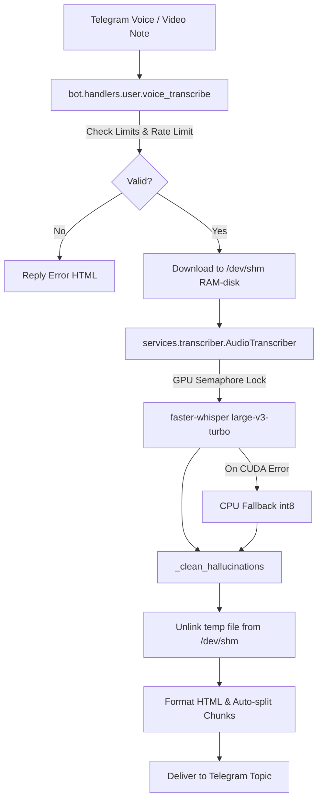

# Component Reference: `services/transcriber.py`
> **File Path**: [`services/transcriber.py`](../../services/transcriber.py)
> **Subsystem**: `Speech-to-Text Whisper Engine`
> **Architecture Layer**: `Deep Learning Audio Ingress Service`
> **Concurrency Model**: `AsyncIO Event Loop + Non-blocking Thread Pool + GPU Semaphore(1)`
> **Persistence Backend**: `RAM-Disk (/dev/shm) Ephemeral Audio Buffer + Local Model Weights`
> **Service Level Objective**: `Sub-0.5s Large-v3-Turbo Inference / Zero-Disk Wear`

## 1. Architectural Role & Responsibilities
The `services/transcriber.py` module implements core operational logic for the `Speech-to-Text Whisper Engine` domain. It operates within an asynchronous microservices topology designed for ultra-low latency, zero-loss persistence guarantees, and strict single-responsibility function decomposition (≤25 lines).

### Component Architecture & Data Flow


---
## 2. Public API & Symbol Inventory
| Symbol | Nature | Line Range | Return Contract | Core Invariant |
| :--- | :--- | :--- | :--- | :--- |
| [`AudioTranscriber.__init__`](#audiotranscriber__init__) | Method | L30–L54 | `Any` | Executes core domain logic for `__init__`. |
| [`AudioTranscriber.queue_size`](#audiotranscriberqueue_size) | Method | L57–L66 | `int` | Executes core domain logic for `queue_size`. |
| [`AudioTranscriber._init_whisper_engine`](#audiotranscriber_init_whisper_engine) | Method | L68–L98 | `Any` | Instantiates WhisperModel on GPU with automatic CPU fal... |
| [`AudioTranscriber.get_model`](#audiotranscriberget_model) | Method | L100–L116 | `Any` | Lazily instantiates and caches the primary WhisperModel... |
| [`AudioTranscriber._get_cpu_model`](#audiotranscriber_get_cpu_model) | Method | L118–L130 | `Any` | Executes core domain logic for `_get_cpu_model`. |
| [`AudioTranscriber.warmup`](#audiotranscriberwarmup) | Method | L132–L141 | `None` | Pre-loads model weights into GPU VRAM to eliminate cold... |
| [`AudioTranscriber._clean_hallucinations`](#audiotranscriber_clean_hallucinations) | Method | L144–L164 | `str` | Sanitizes silent and repetitive Whisper hallucination a... |
| [`AudioTranscriber._sync_transcribe`](#audiotranscriber_sync_transcribe) | Method | L166–L185 | `str` | Executes synchronous whisper inference in non-blocking ... |
| [`AudioTranscriber._infer_with_fallback`](#audiotranscriber_infer_with_fallback) | Method | L187–L204 | `str` | Executes speech recognition on GPU with automatic CPU i... |
| [`AudioTranscriber._log_transcribe_stats`](#audiotranscriber_log_transcribe_stats) | Method | L206–L217 | `None` | Executes core domain logic for `_log_transcribe_stats`. |
| [`AudioTranscriber.transcribe_file`](#audiotranscribertranscribe_file) | Method | L219–L243 | `str` | Transcribes audio file to text using faster-whisper und... |
| [`split_text_to_chunks`](#split_text_to_chunks) | Function | L246–L270 | `list[str]` | Decomposes lengthy transcription text across paragraph ... |

---

## 3. Comprehensive Function Specifications

## Class Model: `AudioTranscriber`

Encapsulates domain entities and data transfer logic for `AudioTranscriber`.

### `AudioTranscriber.__init__`
```python
def __init__( self, model_name: str | None = None, device: str | None = None, compute_type: str | None = None, download_root: str | None = None, language: str | None = None, beam_size: int | None = None,
```

- **Source Reference**: [`services/transcriber.py#L30-L54`](../../services/transcriber.py#L30-L54)
- **Execution Mode**: `Synchronous`
- **Return Contract**: `Any`

#### Overview & Architectural Purpose
Executes core domain logic for `__init__`.

#### Parameters Contract
| Parameter | Type | Required | Description |
| :--- | :--- | :--- | :--- |
| `model_name` | `str | None` | Yes | HuggingFace/CTranslate2 Whisper model identifier (e.g., 'large-v3-turbo'). |
| `device` | `str | None` | Yes | Target compute device ('cuda' for GPU or 'cpu' for CPU fallback). |
| `compute_type` | `str | None` | Yes | Quantization precision for inference ('float16' for CUDA, 'int8' for CPU). |
| `download_root` | `str | None` | Yes | Local directory path storing pre-downloaded Whisper weights. |
| `language` | `str | None` | Yes | ISO 639-1 language code (e.g. 'ru' for Russian) or auto-detect if None. |
| `beam_size` | `int | None` | Yes | Beam search width for transcription accuracy (1 for greedy, 5 for beam). |

#### Concurrency & Side Effects
- Stateless pure functional computation without external mutations.

#### Fault Tolerance & Error Modes
Propagates unexpected runtime errors up the call stack to global exception handlers.

#### Production Usage Example
```python
from services.transcriber import __init__

# Execute call
result = __init__(model_name=..., device=..., compute_type=...)
```

---

### `AudioTranscriber.queue_size`
```python
def queue_size(self) -> int
```

- **Source Reference**: [`services/transcriber.py#L57-L66`](../../services/transcriber.py#L57-L66)
- **Execution Mode**: `Synchronous`
- **Return Contract**: `int`

#### Overview & Architectural Purpose
Executes core domain logic for `queue_size`.

#### Parameters Contract
*This method takes no input parameters.*

#### Concurrency & Side Effects
- Stateless pure functional computation without external mutations.

#### Fault Tolerance & Error Modes
Propagates unexpected runtime errors up the call stack to global exception handlers.

#### Production Usage Example
```python
from services.transcriber import queue_size

# Execute call
result = queue_size()
```

---

### `AudioTranscriber._init_whisper_engine`
```python
def _init_whisper_engine(self, device: str | None = None, compute_type: str | None = None)
```

- **Source Reference**: [`services/transcriber.py#L68-L98`](../../services/transcriber.py#L68-L98)
- **Execution Mode**: `Synchronous`
- **Return Contract**: `Any`

#### Overview & Architectural Purpose
Instantiates WhisperModel on GPU with automatic CPU fallback.

#### Parameters Contract
| Parameter | Type | Required | Description |
| :--- | :--- | :--- | :--- |
| `device` | `str | None` | Yes | Target compute device ('cuda' for GPU or 'cpu' for CPU fallback). |
| `compute_type` | `str | None` | Yes | Quantization precision for inference ('float16' for CUDA, 'int8' for CPU). |

#### Concurrency & Side Effects
- Emits structured telemetry events to system logging subsystem.

#### Fault Tolerance & Error Modes
Encapsulates faults within `try/except` blocks, logging errors and returning safe fallback defaults.

#### Production Usage Example
```python
from services.transcriber import _init_whisper_engine

# Execute call
result = _init_whisper_engine(device=..., compute_type=...)
```

---

### `AudioTranscriber.get_model`
```python
async def get_model(self)
```

- **Source Reference**: [`services/transcriber.py#L100-L116`](../../services/transcriber.py#L100-L116)
- **Execution Mode**: `Asynchronous (non-blocking)`
- **Return Contract**: `Any`

#### Overview & Architectural Purpose
Lazily instantiates and caches the primary WhisperModel instance.

#### Parameters Contract
*This method takes no input parameters.*

#### Concurrency & Side Effects
- Stateless pure functional computation without external mutations.

#### Fault Tolerance & Error Modes
Propagates unexpected runtime errors up the call stack to global exception handlers.

#### Production Usage Example
```python
from services.transcriber import get_model

# Execute call
result = await get_model()
```

---

### `AudioTranscriber._get_cpu_model`
```python
async def _get_cpu_model(self)
```

- **Source Reference**: [`services/transcriber.py#L118-L130`](../../services/transcriber.py#L118-L130)
- **Execution Mode**: `Asynchronous (non-blocking)`
- **Return Contract**: `Any`

#### Overview & Architectural Purpose
Executes core domain logic for `_get_cpu_model`.

#### Parameters Contract
*This method takes no input parameters.*

#### Concurrency & Side Effects
- Stateless pure functional computation without external mutations.

#### Fault Tolerance & Error Modes
Propagates unexpected runtime errors up the call stack to global exception handlers.

#### Production Usage Example
```python
from services.transcriber import _get_cpu_model

# Execute call
result = await _get_cpu_model()
```

---

### `AudioTranscriber.warmup`
```python
async def warmup(self) -> None
```

- **Source Reference**: [`services/transcriber.py#L132-L141`](../../services/transcriber.py#L132-L141)
- **Execution Mode**: `Asynchronous (non-blocking)`
- **Return Contract**: `None`

#### Overview & Architectural Purpose
Pre-loads model weights into GPU VRAM to eliminate cold-start latency.

#### Parameters Contract
*This method takes no input parameters.*

#### Concurrency & Side Effects
- Stateless pure functional computation without external mutations.

#### Fault Tolerance & Error Modes
Propagates unexpected runtime errors up the call stack to global exception handlers.

#### Production Usage Example
```python
from services.transcriber import warmup

# Execute call
result = await warmup()
```

---

### `AudioTranscriber._clean_hallucinations`
```python
def _clean_hallucinations(text: str) -> str
```

- **Source Reference**: [`services/transcriber.py#L144-L164`](../../services/transcriber.py#L144-L164)
- **Execution Mode**: `Synchronous`
- **Return Contract**: `str`

#### Overview & Architectural Purpose
Sanitizes silent and repetitive Whisper hallucination artifacts.

#### Parameters Contract
| Parameter | Type | Required | Description |
| :--- | :--- | :--- | :--- |
| `text` | `str` | Yes | Parameter `text` of type `str`. |

#### Concurrency & Side Effects
- Stateless pure functional computation without external mutations.

#### Fault Tolerance & Error Modes
Propagates unexpected runtime errors up the call stack to global exception handlers.

#### Production Usage Example
```python
from services.transcriber import _clean_hallucinations

# Execute call
result = _clean_hallucinations(text=...)
```

---

### `AudioTranscriber._sync_transcribe`
```python
def _sync_transcribe(self, model, audio_path: str, language: str | None = None) -> str
```

- **Source Reference**: [`services/transcriber.py#L166-L185`](../../services/transcriber.py#L166-L185)
- **Execution Mode**: `Synchronous`
- **Return Contract**: `str`

#### Overview & Architectural Purpose
Executes synchronous whisper inference in non-blocking thread pool.

#### Parameters Contract
| Parameter | Type | Required | Description |
| :--- | :--- | :--- | :--- |
| `model` | `Any` | Yes | Parameter `model` of type `Any`. |
| `audio_path` | `str` | Yes | Absolute filesystem path to downloaded audio file on RAM-disk (/dev/shm). |
| `language` | `str | None` | Yes | ISO 639-1 language code (e.g. 'ru' for Russian) or auto-detect if None. |

#### Concurrency & Side Effects
- Stateless pure functional computation without external mutations.

#### Fault Tolerance & Error Modes
Propagates unexpected runtime errors up the call stack to global exception handlers.

#### Production Usage Example
```python
from services.transcriber import _sync_transcribe

# Execute call
result = _sync_transcribe(model=..., audio_path=..., language=...)
```

---

### `AudioTranscriber._infer_with_fallback`
```python
async def _infer_with_fallback(self, audio_path: str, language: str | None) -> str
```

- **Source Reference**: [`services/transcriber.py#L187-L204`](../../services/transcriber.py#L187-L204)
- **Execution Mode**: `Asynchronous (non-blocking)`
- **Return Contract**: `str`

#### Overview & Architectural Purpose
Executes speech recognition on GPU with automatic CPU int8 fallback.

#### Parameters Contract
| Parameter | Type | Required | Description |
| :--- | :--- | :--- | :--- |
| `audio_path` | `str` | Yes | Absolute filesystem path to downloaded audio file on RAM-disk (/dev/shm). |
| `language` | `str | None` | Yes | ISO 639-1 language code (e.g. 'ru' for Russian) or auto-detect if None. |

#### Concurrency & Side Effects
- Emits structured telemetry events to system logging subsystem.

#### Fault Tolerance & Error Modes
Encapsulates faults within `try/except` blocks, logging errors and returning safe fallback defaults.

#### Production Usage Example
```python
from services.transcriber import _infer_with_fallback

# Execute call
result = await _infer_with_fallback(audio_path=..., language=...)
```

---

### `AudioTranscriber._log_transcribe_stats`
```python
def _log_transcribe_stats(self, fname: str, infer_start: float, start_time: float, text: str) -> None
```

- **Source Reference**: [`services/transcriber.py#L206-L217`](../../services/transcriber.py#L206-L217)
- **Execution Mode**: `Synchronous`
- **Return Contract**: `None`

#### Overview & Architectural Purpose
Executes core domain logic for `_log_transcribe_stats`.

#### Parameters Contract
| Parameter | Type | Required | Description |
| :--- | :--- | :--- | :--- |
| `fname` | `str` | Yes | Parameter `fname` of type `str`. |
| `infer_start` | `float` | Yes | Parameter `infer_start` of type `float`. |
| `start_time` | `float` | Yes | Parameter `start_time` of type `float`. |
| `text` | `str` | Yes | Parameter `text` of type `str`. |

#### Concurrency & Side Effects
- Emits structured telemetry events to system logging subsystem.

#### Fault Tolerance & Error Modes
Propagates unexpected runtime errors up the call stack to global exception handlers.

#### Production Usage Example
```python
from services.transcriber import _log_transcribe_stats

# Execute call
result = _log_transcribe_stats(fname=..., infer_start=..., start_time=...)
```

---

### `AudioTranscriber.transcribe_file`
```python
async def transcribe_file(self, audio_path: str, language: str | None = None) -> str
```

- **Source Reference**: [`services/transcriber.py#L219-L243`](../../services/transcriber.py#L219-L243)
- **Execution Mode**: `Asynchronous (non-blocking)`
- **Return Contract**: `str`

#### Overview & Architectural Purpose
Transcribes audio file to text using faster-whisper under concurrency semaphore.

#### Parameters Contract
| Parameter | Type | Required | Description |
| :--- | :--- | :--- | :--- |
| `audio_path` | `str` | Yes | Absolute filesystem path to downloaded audio file on RAM-disk (/dev/shm). |
| `language` | `str | None` | Yes | ISO 639-1 language code (e.g. 'ru' for Russian) or auto-detect if None. |

#### Concurrency & Side Effects
- Emits structured telemetry events to system logging subsystem.

#### Fault Tolerance & Error Modes
Encapsulates faults within `try/except` blocks, logging errors and returning safe fallback defaults.

#### Production Usage Example
```python
from services.transcriber import transcribe_file

# Execute call
result = await transcribe_file(audio_path=..., language=...)
```

---

### `split_text_to_chunks`
```python
def split_text_to_chunks(text: str, max_chunk_len: int = 4000) -> list[str]
```

- **Source Reference**: [`services/transcriber.py#L246-L270`](../../services/transcriber.py#L246-L270)
- **Execution Mode**: `Synchronous`
- **Return Contract**: `list[str]`

#### Overview & Architectural Purpose
Decomposes lengthy transcription text across paragraph boundaries.

#### Parameters Contract
| Parameter | Type | Required | Description |
| :--- | :--- | :--- | :--- |
| `text` | `str` | Yes | Parameter `text` of type `str`. |
| `max_chunk_len` | `int` | Yes | Maximum character length per Telegram message slice. |

#### Concurrency & Side Effects
- Stateless pure functional computation without external mutations.

#### Fault Tolerance & Error Modes
Propagates unexpected runtime errors up the call stack to global exception handlers.

#### Production Usage Example
```python
from services.transcriber import split_text_to_chunks

# Execute call
result = split_text_to_chunks(text=..., max_chunk_len=...)
```

---
