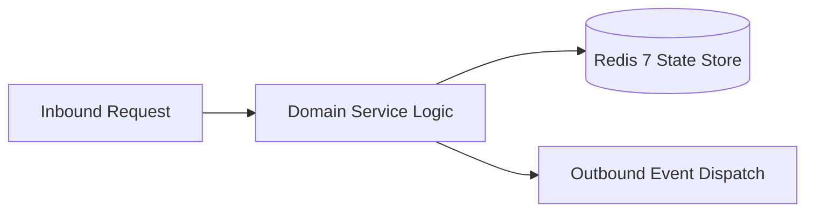

# Component Reference: `services/user_cache.py`
> **File Path**: [`services/user_cache.py`](../../services/user_cache.py)  
> **Subsystem**: `Student Identity Cache`  
> **Architecture Layer**: `Enterprise Microservice Subsystem`  
> **Concurrency Model**: `AsyncIO Non-blocking Concurrency`  
> **Persistence Backend**: `Redis 7 Persistent Store`  
> **Service Level Objective**: `High-Availability Academic Telemetry`

## 1. Architectural Role & Responsibilities
The `services/user_cache.py` module implements core operational logic for the `Student Identity Cache` domain. It operates within an asynchronous microservices topology designed for ultra-low latency, zero-loss persistence guarantees, and strict single-responsibility function decomposition (≤25 lines).

### Component Architecture & Data Flow


---
## 2. Public API & Symbol Inventory
| Symbol | Nature | Line Range | Return Contract | Core Invariant |
| :--- | :--- | :--- | :--- | :--- |
| [`clear_user_cache_memory`](#clear_user_cache_memory) | Function | L21–L33 | `None` | Flushes and resets state for `clear_user_cache_memory`. |
| [`load_user_cache`](#load_user_cache) | Function | L36–L55 | `dict[str, int]` | Executes core domain logic for `load_user_cache`. |
| [`save_user_cache`](#save_user_cache) | Function | L58–L74 | `None` | Saves serialized entity data to storage for `save_user_... |
| [`get_cached_user_id`](#get_cached_user_id) | Function | L77–L87 | `int | None` | Retrieves and resolves domain data for `get_cached_user... |
| [`add_user_to_cache`](#add_user_to_cache) | Function | L90–L106 | `None` | Executes core domain logic for `add_user_to_cache`. |

---

## 3. Comprehensive Function Specifications

### `clear_user_cache_memory`
```python
def clear_user_cache_memory() -> None
```

- **Source Reference**: [`services/user_cache.py#L21-L33`](../../services/user_cache.py#L21-L33)
- **Execution Mode**: `Synchronous`
- **Return Contract**: `None`

#### Overview & Architectural Purpose
Flushes and resets state for `clear_user_cache_memory`.

#### Parameters Contract
*This method takes no input parameters.*

#### Concurrency & Side Effects
- Stateless pure functional computation without external mutations.

#### Fault Tolerance & Error Modes
Propagates unexpected runtime errors up the call stack to global exception handlers.

#### Production Usage Example
```python
from services.user_cache import clear_user_cache_memory

# Execute call
result = clear_user_cache_memory()
```

---

### `load_user_cache`
```python
def load_user_cache() -> dict[str, int]
```

- **Source Reference**: [`services/user_cache.py#L36-L55`](../../services/user_cache.py#L36-L55)
- **Execution Mode**: `Synchronous`
- **Return Contract**: `dict[str, int]`

#### Overview & Architectural Purpose
Executes core domain logic for `load_user_cache`.

#### Parameters Contract
*This method takes no input parameters.*

#### Concurrency & Side Effects
- Stateless pure functional computation without external mutations.

#### Fault Tolerance & Error Modes
Encapsulates faults within `try/except` blocks, logging errors and returning safe fallback defaults.

#### Production Usage Example
```python
from services.user_cache import load_user_cache

# Execute call
result = load_user_cache()
```

---

### `save_user_cache`
```python
def save_user_cache(cache: dict[str, int]) -> None
```

- **Source Reference**: [`services/user_cache.py#L58-L74`](../../services/user_cache.py#L58-L74)
- **Execution Mode**: `Synchronous`
- **Return Contract**: `None`

#### Overview & Architectural Purpose
Saves serialized entity data to storage for `save_user_cache`.

#### Parameters Contract
| Parameter | Type | Required | Description |
| :--- | :--- | :--- | :--- |
| `cache` | `dict[str, int]` | Yes | Parameter `cache` of type `dict[str, int]`. |

#### Concurrency & Side Effects
- Stateless pure functional computation without external mutations.

#### Fault Tolerance & Error Modes
Encapsulates faults within `try/except` blocks, logging errors and returning safe fallback defaults.

#### Production Usage Example
```python
from services.user_cache import save_user_cache

# Execute call
result = save_user_cache(cache=...)
```

---

### `get_cached_user_id`
```python
def get_cached_user_id(username: str) -> int | None
```

- **Source Reference**: [`services/user_cache.py#L77-L87`](../../services/user_cache.py#L77-L87)
- **Execution Mode**: `Synchronous`
- **Return Contract**: `int | None`

#### Overview & Architectural Purpose
Retrieves and resolves domain data for `get_cached_user_id`.

#### Parameters Contract
| Parameter | Type | Required | Description |
| :--- | :--- | :--- | :--- |
| `username` | `str` | Yes | Parameter `username` of type `str`. |

#### Concurrency & Side Effects
- Stateless pure functional computation without external mutations.

#### Fault Tolerance & Error Modes
Propagates unexpected runtime errors up the call stack to global exception handlers.

#### Production Usage Example
```python
from services.user_cache import get_cached_user_id

# Execute call
result = get_cached_user_id(username=...)
```

---

### `add_user_to_cache`
```python
def add_user_to_cache(username: str, user_id: int) -> None
```

- **Source Reference**: [`services/user_cache.py#L90-L106`](../../services/user_cache.py#L90-L106)
- **Execution Mode**: `Synchronous`
- **Return Contract**: `None`

#### Overview & Architectural Purpose
Executes core domain logic for `add_user_to_cache`.

#### Parameters Contract
| Parameter | Type | Required | Description |
| :--- | :--- | :--- | :--- |
| `username` | `str` | Yes | Parameter `username` of type `str`. |
| `user_id` | `int` | Yes | Unique 64-bit Telegram user identifier. |

#### Concurrency & Side Effects
- Emits structured telemetry events to system logging subsystem.

#### Fault Tolerance & Error Modes
Propagates unexpected runtime errors up the call stack to global exception handlers.

#### Production Usage Example
```python
from services.user_cache import add_user_to_cache

# Execute call
result = add_user_to_cache(username=..., user_id=...)
```

---
