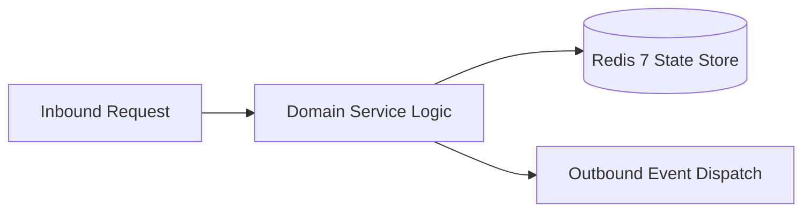

# Component Reference: `utils/doc_generator.py`
> **File Path**: [`utils/doc_generator.py`](../../utils/doc_generator.py)  
> **Subsystem**: `GOST Document Generator`  
> **Architecture Layer**: `Enterprise Microservice Subsystem`  
> **Concurrency Model**: `AsyncIO Non-blocking Concurrency`  
> **Persistence Backend**: `Redis 7 Persistent Store`  
> **Service Level Objective**: `High-Availability Academic Telemetry`

## 1. Architectural Role & Responsibilities
The `utils/doc_generator.py` module implements core operational logic for the `GOST Document Generator` domain. It operates within an asynchronous microservices topology designed for ultra-low latency, zero-loss persistence guarantees, and strict single-responsibility function decomposition (≤25 lines).

### Component Architecture & Data Flow


---
## 2. Public API & Symbol Inventory
| Symbol | Nature | Line Range | Return Contract | Core Invariant |
| :--- | :--- | :--- | :--- | :--- |
| [`setup_gost_margins`](#setup_gost_margins) | Function | L29–L42 | `None` | Executes core domain logic for `setup_gost_margins`. |
| [`setup_page_numbering`](#setup_page_numbering) | Function | L45–L60 | `None` | Executes core domain logic for `setup_page_numbering`. |
| [`setup_gost_styles`](#setup_gost_styles) | Function | L63–L76 | `None` | Executes core domain logic for `setup_gost_styles`. |
| [`format_table_row_cells`](#format_table_row_cells) | Function | L79–L94 | `None` | Formats message payload and presentation markup for `fo... |
| [`add_title_signature_table`](#add_title_signature_table) | Function | L97–L121 | `None` | Executes core domain logic for `add_title_signature_tab... |
| [`add_title_header`](#add_title_header) | Function | L124–L139 | `None` | Executes core domain logic for `add_title_header`. |
| [`create_title_page`](#create_title_page) | Function | L142–L167 | `None` | Initializes and constructs a new instance of `create_ti... |
| [`clean_math_text`](#clean_math_text) | Function | L170–L183 | `str` | Executes core domain logic for `clean_math_text`. |
| [`format_gost_paragraph`](#format_gost_paragraph) | Function | L186–L199 | `None` | Formats message payload and presentation markup for `fo... |
| [`add_bookmark_to_paragraph`](#add_bookmark_to_paragraph) | Function | L202–L214 | `None` | Executes core domain logic for `add_bookmark_to_paragra... |
| [`add_toc_hyperlink`](#add_toc_hyperlink) | Function | L217–L238 | `None` | Executes core domain logic for `add_toc_hyperlink`. |
| [`extract_headings_from_text`](#extract_headings_from_text) | Function | L241–L261 | `list[tuple[str, str, int, int]]` | Executes core domain logic for `extract_headings_from_t... |
| [`build_table_of_contents`](#build_table_of_contents) | Function | L264–L278 | `None` | Executes core domain logic for `build_table_of_contents... |
| [`_apply_heading_formatting`](#_apply_heading_formatting) | Function | L282–L301 | `None` | Executes core domain logic for `_apply_heading_formatti... |
| [`add_gost_heading`](#add_gost_heading) | Function | L304–L316 | `None` | Executes core domain logic for `add_gost_heading`. |
| [`add_gost_heading_with_bookmark`](#add_gost_heading_with_bookmark) | Function | L319–L332 | `None` | Executes core domain logic for `add_gost_heading_with_b... |
| [`parse_markdown_table_rows`](#parse_markdown_table_rows) | Function | L335–L351 | `list[list[str]]` | Parses and extracts structured entities from `parse_mar... |
| [`_append_cell_run`](#_append_cell_run) | Function | L354–L367 | `None` | Executes core domain logic for `_append_cell_run`. |
| [`fill_table_cell`](#fill_table_cell) | Function | L370–L388 | `None` | Executes core domain logic for `fill_table_cell`. |
| [`add_docx_table_from_markdown`](#add_docx_table_from_markdown) | Function | L391–L409 | `None` | Executes core domain logic for `add_docx_table_from_mar... |
| [`_consume_markdown_table`](#_consume_markdown_table) | Function | L412–L426 | `tuple[list[str], int]` | Executes core domain logic for `_consume_markdown_table... |
| [`process_document_content_lines`](#process_document_content_lines) | Function | L429–L450 | `None` | Executes core domain logic for `process_document_conten... |
| [`add_formatted_paragraph`](#add_formatted_paragraph) | Function | L453–L471 | `None` | Executes core domain logic for `add_formatted_paragraph... |
| [`init_gost_document`](#init_gost_document) | Function | L474–L487 | `Document` | Executes core domain logic for `init_gost_document`. |
| [`create_solution_docx`](#create_solution_docx) | Function | L490–L516 | `str` | Initializes and constructs a new instance of `create_so... |

---

## 3. Comprehensive Function Specifications

### `setup_gost_margins`
```python
def setup_gost_margins(doc: Document) -> None
```

- **Source Reference**: [`utils/doc_generator.py#L29-L42`](../../utils/doc_generator.py#L29-L42)
- **Execution Mode**: `Synchronous`
- **Return Contract**: `None`

#### Overview & Architectural Purpose
Executes core domain logic for `setup_gost_margins`.

#### Parameters Contract
| Parameter | Type | Required | Description |
| :--- | :--- | :--- | :--- |
| `doc` | `Document` | Yes | Parameter `doc` of type `Document`. |

#### Concurrency & Side Effects
- Stateless pure functional computation without external mutations.

#### Fault Tolerance & Error Modes
Propagates unexpected runtime errors up the call stack to global exception handlers.

#### Production Usage Example
```python
from utils.doc_generator import setup_gost_margins

# Execute call
result = setup_gost_margins(doc=...)
```

---

### `setup_page_numbering`
```python
def setup_page_numbering(doc: Document) -> None
```

- **Source Reference**: [`utils/doc_generator.py#L45-L60`](../../utils/doc_generator.py#L45-L60)
- **Execution Mode**: `Synchronous`
- **Return Contract**: `None`

#### Overview & Architectural Purpose
Executes core domain logic for `setup_page_numbering`.

#### Parameters Contract
| Parameter | Type | Required | Description |
| :--- | :--- | :--- | :--- |
| `doc` | `Document` | Yes | Parameter `doc` of type `Document`. |

#### Concurrency & Side Effects
- Stateless pure functional computation without external mutations.

#### Fault Tolerance & Error Modes
Propagates unexpected runtime errors up the call stack to global exception handlers.

#### Production Usage Example
```python
from utils.doc_generator import setup_page_numbering

# Execute call
result = setup_page_numbering(doc=...)
```

---

### `setup_gost_styles`
```python
def setup_gost_styles(doc: Document) -> None
```

- **Source Reference**: [`utils/doc_generator.py#L63-L76`](../../utils/doc_generator.py#L63-L76)
- **Execution Mode**: `Synchronous`
- **Return Contract**: `None`

#### Overview & Architectural Purpose
Executes core domain logic for `setup_gost_styles`.

#### Parameters Contract
| Parameter | Type | Required | Description |
| :--- | :--- | :--- | :--- |
| `doc` | `Document` | Yes | Parameter `doc` of type `Document`. |

#### Concurrency & Side Effects
- Stateless pure functional computation without external mutations.

#### Fault Tolerance & Error Modes
Propagates unexpected runtime errors up the call stack to global exception handlers.

#### Production Usage Example
```python
from utils.doc_generator import setup_gost_styles

# Execute call
result = setup_gost_styles(doc=...)
```

---

### `format_table_row_cells`
```python
def format_table_row_cells(row, left_txt: str, right_txt: str) -> None
```

- **Source Reference**: [`utils/doc_generator.py#L79-L94`](../../utils/doc_generator.py#L79-L94)
- **Execution Mode**: `Synchronous`
- **Return Contract**: `None`

#### Overview & Architectural Purpose
Formats message payload and presentation markup for `format_table_row_cells`.

#### Parameters Contract
| Parameter | Type | Required | Description |
| :--- | :--- | :--- | :--- |
| `row` | `Any` | Yes | Parameter `row` of type `Any`. |
| `left_txt` | `str` | Yes | Parameter `left_txt` of type `str`. |
| `right_txt` | `str` | Yes | Parameter `right_txt` of type `str`. |

#### Concurrency & Side Effects
- Stateless pure functional computation without external mutations.

#### Fault Tolerance & Error Modes
Propagates unexpected runtime errors up the call stack to global exception handlers.

#### Production Usage Example
```python
from utils.doc_generator import format_table_row_cells

# Execute call
result = format_table_row_cells(row=..., left_txt=..., right_txt=...)
```

---

### `add_title_signature_table`
```python
def add_title_signature_table( doc: Document, student_name: str = "Student", teacher_name: str = "Instructor", year: int | None = None, group_name: str | None = None, ) -> None
```

- **Source Reference**: [`utils/doc_generator.py#L97-L121`](../../utils/doc_generator.py#L97-L121)
- **Execution Mode**: `Synchronous`
- **Return Contract**: `None`

#### Overview & Architectural Purpose
Executes core domain logic for `add_title_signature_table`.

#### Parameters Contract
| Parameter | Type | Required | Description |
| :--- | :--- | :--- | :--- |
| `doc` | `Document` | Yes | Parameter `doc` of type `Document`. |
| `student_name` | `str` | Yes | Full name of the student recorded in the academic roster. |
| `teacher_name` | `str` | Yes | Parameter `teacher_name` of type `str`. |
| `year` | `int | None` | Yes | Parameter `year` of type `int | None`. |
| `group_name` | `str | None` | Yes | Academic group identifier (e.g., '1-KPD-3'). |

#### Concurrency & Side Effects
- Stateless pure functional computation without external mutations.

#### Fault Tolerance & Error Modes
Propagates unexpected runtime errors up the call stack to global exception handlers.

#### Production Usage Example
```python
from utils.doc_generator import add_title_signature_table

# Execute call
result = add_title_signature_table(doc=..., student_name=..., teacher_name=...)
```

---

### `add_title_header`
```python
def add_title_header(doc: Document) -> None
```

- **Source Reference**: [`utils/doc_generator.py#L124-L139`](../../utils/doc_generator.py#L124-L139)
- **Execution Mode**: `Synchronous`
- **Return Contract**: `None`

#### Overview & Architectural Purpose
Executes core domain logic for `add_title_header`.

#### Parameters Contract
| Parameter | Type | Required | Description |
| :--- | :--- | :--- | :--- |
| `doc` | `Document` | Yes | Parameter `doc` of type `Document`. |

#### Concurrency & Side Effects
- Stateless pure functional computation without external mutations.

#### Fault Tolerance & Error Modes
Propagates unexpected runtime errors up the call stack to global exception handlers.

#### Production Usage Example
```python
from utils.doc_generator import add_title_header

# Execute call
result = add_title_header(doc=...)
```

---

### `create_title_page`
```python
def create_title_page( doc: Document, student_name: str = "Student", teacher_name: str = "Instructor", year: int | None = None, group_name: str | None = None, ) -> None
```

- **Source Reference**: [`utils/doc_generator.py#L142-L167`](../../utils/doc_generator.py#L142-L167)
- **Execution Mode**: `Synchronous`
- **Return Contract**: `None`

#### Overview & Architectural Purpose
Initializes and constructs a new instance of `create_title_page`.

#### Parameters Contract
| Parameter | Type | Required | Description |
| :--- | :--- | :--- | :--- |
| `doc` | `Document` | Yes | Parameter `doc` of type `Document`. |
| `student_name` | `str` | Yes | Full name of the student recorded in the academic roster. |
| `teacher_name` | `str` | Yes | Parameter `teacher_name` of type `str`. |
| `year` | `int | None` | Yes | Parameter `year` of type `int | None`. |
| `group_name` | `str | None` | Yes | Academic group identifier (e.g., '1-KPD-3'). |

#### Concurrency & Side Effects
- Stateless pure functional computation without external mutations.

#### Fault Tolerance & Error Modes
Propagates unexpected runtime errors up the call stack to global exception handlers.

#### Production Usage Example
```python
from utils.doc_generator import create_title_page

# Execute call
result = create_title_page(doc=..., student_name=..., teacher_name=...)
```

---

### `clean_math_text`
```python
def clean_math_text(text: str) -> str
```

- **Source Reference**: [`utils/doc_generator.py#L170-L183`](../../utils/doc_generator.py#L170-L183)
- **Execution Mode**: `Synchronous`
- **Return Contract**: `str`

#### Overview & Architectural Purpose
Executes core domain logic for `clean_math_text`.

#### Parameters Contract
| Parameter | Type | Required | Description |
| :--- | :--- | :--- | :--- |
| `text` | `str` | Yes | Parameter `text` of type `str`. |

#### Concurrency & Side Effects
- Stateless pure functional computation without external mutations.

#### Fault Tolerance & Error Modes
Propagates unexpected runtime errors up the call stack to global exception handlers.

#### Production Usage Example
```python
from utils.doc_generator import clean_math_text

# Execute call
result = clean_math_text(text=...)
```

---

### `format_gost_paragraph`
```python
def format_gost_paragraph(p) -> None
```

- **Source Reference**: [`utils/doc_generator.py#L186-L199`](../../utils/doc_generator.py#L186-L199)
- **Execution Mode**: `Synchronous`
- **Return Contract**: `None`

#### Overview & Architectural Purpose
Formats message payload and presentation markup for `format_gost_paragraph`.

#### Parameters Contract
| Parameter | Type | Required | Description |
| :--- | :--- | :--- | :--- |
| `p` | `Any` | Yes | Parameter `p` of type `Any`. |

#### Concurrency & Side Effects
- Stateless pure functional computation without external mutations.

#### Fault Tolerance & Error Modes
Propagates unexpected runtime errors up the call stack to global exception handlers.

#### Production Usage Example
```python
from utils.doc_generator import format_gost_paragraph

# Execute call
result = format_gost_paragraph(p=...)
```

---

### `add_bookmark_to_paragraph`
```python
def add_bookmark_to_paragraph(p, bookmark_name: str, bookmark_id: int) -> None
```

- **Source Reference**: [`utils/doc_generator.py#L202-L214`](../../utils/doc_generator.py#L202-L214)
- **Execution Mode**: `Synchronous`
- **Return Contract**: `None`

#### Overview & Architectural Purpose
Executes core domain logic for `add_bookmark_to_paragraph`.

#### Parameters Contract
| Parameter | Type | Required | Description |
| :--- | :--- | :--- | :--- |
| `p` | `Any` | Yes | Parameter `p` of type `Any`. |
| `bookmark_name` | `str` | Yes | Parameter `bookmark_name` of type `str`. |
| `bookmark_id` | `int` | Yes | Parameter `bookmark_id` of type `int`. |

#### Concurrency & Side Effects
- Stateless pure functional computation without external mutations.

#### Fault Tolerance & Error Modes
Propagates unexpected runtime errors up the call stack to global exception handlers.

#### Production Usage Example
```python
from utils.doc_generator import add_bookmark_to_paragraph

# Execute call
result = add_bookmark_to_paragraph(p=..., bookmark_name=..., bookmark_id=...)
```

---

### `add_toc_hyperlink`
```python
def add_toc_hyperlink(doc: Document, text: str, bookmark_name: str) -> None
```

- **Source Reference**: [`utils/doc_generator.py#L217-L238`](../../utils/doc_generator.py#L217-L238)
- **Execution Mode**: `Synchronous`
- **Return Contract**: `None`

#### Overview & Architectural Purpose
Executes core domain logic for `add_toc_hyperlink`.

#### Parameters Contract
| Parameter | Type | Required | Description |
| :--- | :--- | :--- | :--- |
| `doc` | `Document` | Yes | Parameter `doc` of type `Document`. |
| `text` | `str` | Yes | Parameter `text` of type `str`. |
| `bookmark_name` | `str` | Yes | Parameter `bookmark_name` of type `str`. |

#### Concurrency & Side Effects
- Stateless pure functional computation without external mutations.

#### Fault Tolerance & Error Modes
Propagates unexpected runtime errors up the call stack to global exception handlers.

#### Production Usage Example
```python
from utils.doc_generator import add_toc_hyperlink

# Execute call
result = add_toc_hyperlink(doc=..., text=..., bookmark_name=...)
```

---

### `extract_headings_from_text`
```python
def extract_headings_from_text(solution_text: str) -> list[tuple[str, str, int, int]]
```

- **Source Reference**: [`utils/doc_generator.py#L241-L261`](../../utils/doc_generator.py#L241-L261)
- **Execution Mode**: `Synchronous`
- **Return Contract**: `list[tuple[str, str, int, int]]`

#### Overview & Architectural Purpose
Executes core domain logic for `extract_headings_from_text`.

#### Parameters Contract
| Parameter | Type | Required | Description |
| :--- | :--- | :--- | :--- |
| `solution_text` | `str` | Yes | Parameter `solution_text` of type `str`. |

#### Concurrency & Side Effects
- Stateless pure functional computation without external mutations.

#### Fault Tolerance & Error Modes
Propagates unexpected runtime errors up the call stack to global exception handlers.

#### Production Usage Example
```python
from utils.doc_generator import extract_headings_from_text

# Execute call
result = extract_headings_from_text(solution_text=...)
```

---

### `build_table_of_contents`
```python
def build_table_of_contents(doc: Document, headings: list[tuple[str, str, int, int]]) -> None
```

- **Source Reference**: [`utils/doc_generator.py#L264-L278`](../../utils/doc_generator.py#L264-L278)
- **Execution Mode**: `Synchronous`
- **Return Contract**: `None`

#### Overview & Architectural Purpose
Executes core domain logic for `build_table_of_contents`.

#### Parameters Contract
| Parameter | Type | Required | Description |
| :--- | :--- | :--- | :--- |
| `doc` | `Document` | Yes | Parameter `doc` of type `Document`. |
| `headings` | `list[tuple[str, str, int, int]]` | Yes | Parameter `headings` of type `list[tuple[str, str, int, int]]`. |

#### Concurrency & Side Effects
- Stateless pure functional computation without external mutations.

#### Fault Tolerance & Error Modes
Propagates unexpected runtime errors up the call stack to global exception handlers.

#### Production Usage Example
```python
from utils.doc_generator import build_table_of_contents

# Execute call
result = build_table_of_contents(doc=..., headings=...)
```

---

### `_apply_heading_formatting`
```python
def _apply_heading_formatting(p, title: str, level: int) -> None
```

- **Source Reference**: [`utils/doc_generator.py#L282-L301`](../../utils/doc_generator.py#L282-L301)
- **Execution Mode**: `Synchronous`
- **Return Contract**: `None`

#### Overview & Architectural Purpose
Executes core domain logic for `_apply_heading_formatting`.

#### Parameters Contract
| Parameter | Type | Required | Description |
| :--- | :--- | :--- | :--- |
| `p` | `Any` | Yes | Parameter `p` of type `Any`. |
| `title` | `str` | Yes | Parameter `title` of type `str`. |
| `level` | `int` | Yes | Parameter `level` of type `int`. |

#### Concurrency & Side Effects
- Stateless pure functional computation without external mutations.

#### Fault Tolerance & Error Modes
Propagates unexpected runtime errors up the call stack to global exception handlers.

#### Production Usage Example
```python
from utils.doc_generator import _apply_heading_formatting

# Execute call
result = _apply_heading_formatting(p=..., title=..., level=...)
```

---

### `add_gost_heading`
```python
def add_gost_heading(doc: Document, title: str, level: int, page_break: bool = False) -> None
```

- **Source Reference**: [`utils/doc_generator.py#L304-L316`](../../utils/doc_generator.py#L304-L316)
- **Execution Mode**: `Synchronous`
- **Return Contract**: `None`

#### Overview & Architectural Purpose
Executes core domain logic for `add_gost_heading`.

#### Parameters Contract
| Parameter | Type | Required | Description |
| :--- | :--- | :--- | :--- |
| `doc` | `Document` | Yes | Parameter `doc` of type `Document`. |
| `title` | `str` | Yes | Parameter `title` of type `str`. |
| `level` | `int` | Yes | Parameter `level` of type `int`. |
| `page_break` | `bool` | Yes | Parameter `page_break` of type `bool`. |

#### Concurrency & Side Effects
- Stateless pure functional computation without external mutations.

#### Fault Tolerance & Error Modes
Propagates unexpected runtime errors up the call stack to global exception handlers.

#### Production Usage Example
```python
from utils.doc_generator import add_gost_heading

# Execute call
result = add_gost_heading(doc=..., title=..., level=...)
```

---

### `add_gost_heading_with_bookmark`
```python
def add_gost_heading_with_bookmark(doc: Document, title: str, level: int, bm_id: int) -> None
```

- **Source Reference**: [`utils/doc_generator.py#L319-L332`](../../utils/doc_generator.py#L319-L332)
- **Execution Mode**: `Synchronous`
- **Return Contract**: `None`

#### Overview & Architectural Purpose
Executes core domain logic for `add_gost_heading_with_bookmark`.

#### Parameters Contract
| Parameter | Type | Required | Description |
| :--- | :--- | :--- | :--- |
| `doc` | `Document` | Yes | Parameter `doc` of type `Document`. |
| `title` | `str` | Yes | Parameter `title` of type `str`. |
| `level` | `int` | Yes | Parameter `level` of type `int`. |
| `bm_id` | `int` | Yes | Parameter `bm_id` of type `int`. |

#### Concurrency & Side Effects
- Stateless pure functional computation without external mutations.

#### Fault Tolerance & Error Modes
Propagates unexpected runtime errors up the call stack to global exception handlers.

#### Production Usage Example
```python
from utils.doc_generator import add_gost_heading_with_bookmark

# Execute call
result = add_gost_heading_with_bookmark(doc=..., title=..., level=...)
```

---

### `parse_markdown_table_rows`
```python
def parse_markdown_table_rows(table_lines: list[str]) -> list[list[str]]
```

- **Source Reference**: [`utils/doc_generator.py#L335-L351`](../../utils/doc_generator.py#L335-L351)
- **Execution Mode**: `Synchronous`
- **Return Contract**: `list[list[str]]`

#### Overview & Architectural Purpose
Parses and extracts structured entities from `parse_markdown_table_rows`.

#### Parameters Contract
| Parameter | Type | Required | Description |
| :--- | :--- | :--- | :--- |
| `table_lines` | `list[str]` | Yes | Parameter `table_lines` of type `list[str]`. |

#### Concurrency & Side Effects
- Stateless pure functional computation without external mutations.

#### Fault Tolerance & Error Modes
Propagates unexpected runtime errors up the call stack to global exception handlers.

#### Production Usage Example
```python
from utils.doc_generator import parse_markdown_table_rows

# Execute call
result = parse_markdown_table_rows(table_lines=...)
```

---

### `_append_cell_run`
```python
def _append_cell_run(p, text_part: str, is_header: bool, is_bold: bool) -> None
```

- **Source Reference**: [`utils/doc_generator.py#L354-L367`](../../utils/doc_generator.py#L354-L367)
- **Execution Mode**: `Synchronous`
- **Return Contract**: `None`

#### Overview & Architectural Purpose
Executes core domain logic for `_append_cell_run`.

#### Parameters Contract
| Parameter | Type | Required | Description |
| :--- | :--- | :--- | :--- |
| `p` | `Any` | Yes | Parameter `p` of type `Any`. |
| `text_part` | `str` | Yes | Parameter `text_part` of type `str`. |
| `is_header` | `bool` | Yes | Parameter `is_header` of type `bool`. |
| `is_bold` | `bool` | Yes | Parameter `is_bold` of type `bool`. |

#### Concurrency & Side Effects
- Stateless pure functional computation without external mutations.

#### Fault Tolerance & Error Modes
Propagates unexpected runtime errors up the call stack to global exception handlers.

#### Production Usage Example
```python
from utils.doc_generator import _append_cell_run

# Execute call
result = _append_cell_run(p=..., text_part=..., is_header=...)
```

---

### `fill_table_cell`
```python
def fill_table_cell(cell, cell_text: str, is_header: bool) -> None
```

- **Source Reference**: [`utils/doc_generator.py#L370-L388`](../../utils/doc_generator.py#L370-L388)
- **Execution Mode**: `Synchronous`
- **Return Contract**: `None`

#### Overview & Architectural Purpose
Executes core domain logic for `fill_table_cell`.

#### Parameters Contract
| Parameter | Type | Required | Description |
| :--- | :--- | :--- | :--- |
| `cell` | `Any` | Yes | Parameter `cell` of type `Any`. |
| `cell_text` | `str` | Yes | Parameter `cell_text` of type `str`. |
| `is_header` | `bool` | Yes | Parameter `is_header` of type `bool`. |

#### Concurrency & Side Effects
- Stateless pure functional computation without external mutations.

#### Fault Tolerance & Error Modes
Propagates unexpected runtime errors up the call stack to global exception handlers.

#### Production Usage Example
```python
from utils.doc_generator import fill_table_cell

# Execute call
result = fill_table_cell(cell=..., cell_text=..., is_header=...)
```

---

### `add_docx_table_from_markdown`
```python
def add_docx_table_from_markdown(doc: Document, table_lines: list[str]) -> None
```

- **Source Reference**: [`utils/doc_generator.py#L391-L409`](../../utils/doc_generator.py#L391-L409)
- **Execution Mode**: `Synchronous`
- **Return Contract**: `None`

#### Overview & Architectural Purpose
Executes core domain logic for `add_docx_table_from_markdown`.

#### Parameters Contract
| Parameter | Type | Required | Description |
| :--- | :--- | :--- | :--- |
| `doc` | `Document` | Yes | Parameter `doc` of type `Document`. |
| `table_lines` | `list[str]` | Yes | Parameter `table_lines` of type `list[str]`. |

#### Concurrency & Side Effects
- Stateless pure functional computation without external mutations.

#### Fault Tolerance & Error Modes
Propagates unexpected runtime errors up the call stack to global exception handlers.

#### Production Usage Example
```python
from utils.doc_generator import add_docx_table_from_markdown

# Execute call
result = add_docx_table_from_markdown(doc=..., table_lines=...)
```

---

### `_consume_markdown_table`
```python
def _consume_markdown_table(lines: list[str], start_idx: int) -> tuple[list[str], int]
```

- **Source Reference**: [`utils/doc_generator.py#L412-L426`](../../utils/doc_generator.py#L412-L426)
- **Execution Mode**: `Synchronous`
- **Return Contract**: `tuple[list[str], int]`

#### Overview & Architectural Purpose
Executes core domain logic for `_consume_markdown_table`.

#### Parameters Contract
| Parameter | Type | Required | Description |
| :--- | :--- | :--- | :--- |
| `lines` | `list[str]` | Yes | Parameter `lines` of type `list[str]`. |
| `start_idx` | `int` | Yes | Parameter `start_idx` of type `int`. |

#### Concurrency & Side Effects
- Stateless pure functional computation without external mutations.

#### Fault Tolerance & Error Modes
Propagates unexpected runtime errors up the call stack to global exception handlers.

#### Production Usage Example
```python
from utils.doc_generator import _consume_markdown_table

# Execute call
result = _consume_markdown_table(lines=..., start_idx=...)
```

---

### `process_document_content_lines`
```python
def process_document_content_lines(doc: Document, lines: list[str], heading_map: dict) -> None
```

- **Source Reference**: [`utils/doc_generator.py#L429-L450`](../../utils/doc_generator.py#L429-L450)
- **Execution Mode**: `Synchronous`
- **Return Contract**: `None`

#### Overview & Architectural Purpose
Executes core domain logic for `process_document_content_lines`.

#### Parameters Contract
| Parameter | Type | Required | Description |
| :--- | :--- | :--- | :--- |
| `doc` | `Document` | Yes | Parameter `doc` of type `Document`. |
| `lines` | `list[str]` | Yes | Parameter `lines` of type `list[str]`. |
| `heading_map` | `dict` | Yes | Parameter `heading_map` of type `dict`. |

#### Concurrency & Side Effects
- Stateless pure functional computation without external mutations.

#### Fault Tolerance & Error Modes
Propagates unexpected runtime errors up the call stack to global exception handlers.

#### Production Usage Example
```python
from utils.doc_generator import process_document_content_lines

# Execute call
result = process_document_content_lines(doc=..., lines=..., heading_map=...)
```

---

### `add_formatted_paragraph`
```python
def add_formatted_paragraph(doc: Document, line: str) -> None
```

- **Source Reference**: [`utils/doc_generator.py#L453-L471`](../../utils/doc_generator.py#L453-L471)
- **Execution Mode**: `Synchronous`
- **Return Contract**: `None`

#### Overview & Architectural Purpose
Executes core domain logic for `add_formatted_paragraph`.

#### Parameters Contract
| Parameter | Type | Required | Description |
| :--- | :--- | :--- | :--- |
| `doc` | `Document` | Yes | Parameter `doc` of type `Document`. |
| `line` | `str` | Yes | Parameter `line` of type `str`. |

#### Concurrency & Side Effects
- Stateless pure functional computation without external mutations.

#### Fault Tolerance & Error Modes
Propagates unexpected runtime errors up the call stack to global exception handlers.

#### Production Usage Example
```python
from utils.doc_generator import add_formatted_paragraph

# Execute call
result = add_formatted_paragraph(doc=..., line=...)
```

---

### `init_gost_document`
```python
def init_gost_document() -> Document
```

- **Source Reference**: [`utils/doc_generator.py#L474-L487`](../../utils/doc_generator.py#L474-L487)
- **Execution Mode**: `Synchronous`
- **Return Contract**: `Document`

#### Overview & Architectural Purpose
Executes core domain logic for `init_gost_document`.

#### Parameters Contract
*This method takes no input parameters.*

#### Concurrency & Side Effects
- Stateless pure functional computation without external mutations.

#### Fault Tolerance & Error Modes
Propagates unexpected runtime errors up the call stack to global exception handlers.

#### Production Usage Example
```python
from utils.doc_generator import init_gost_document

# Execute call
result = init_gost_document()
```

---

### `create_solution_docx`
```python
def create_solution_docx( solution_text: str, output_path: str | None = None, student_name: str = "Student", teacher_name: str = "Instructor", year: int | None = None, group_name: str | None = None, ) -> str
```

- **Source Reference**: [`utils/doc_generator.py#L490-L516`](../../utils/doc_generator.py#L490-L516)
- **Execution Mode**: `Synchronous`
- **Return Contract**: `str`

#### Overview & Architectural Purpose
Initializes and constructs a new instance of `create_solution_docx`.

#### Parameters Contract
| Parameter | Type | Required | Description |
| :--- | :--- | :--- | :--- |
| `solution_text` | `str` | Yes | Parameter `solution_text` of type `str`. |
| `output_path` | `str | None` | Yes | Parameter `output_path` of type `str | None`. |
| `student_name` | `str` | Yes | Full name of the student recorded in the academic roster. |
| `teacher_name` | `str` | Yes | Parameter `teacher_name` of type `str`. |
| `year` | `int | None` | Yes | Parameter `year` of type `int | None`. |
| `group_name` | `str | None` | Yes | Academic group identifier (e.g., '1-KPD-3'). |

#### Concurrency & Side Effects
- Emits structured telemetry events to system logging subsystem.

#### Fault Tolerance & Error Modes
Propagates unexpected runtime errors up the call stack to global exception handlers.

#### Production Usage Example
```python
from utils.doc_generator import create_solution_docx

# Execute call
result = create_solution_docx(solution_text=..., output_path=..., student_name=...)
```

---
