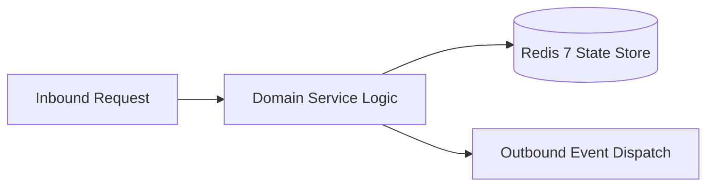

# Component Reference: `utils/miniapp_auth.py`
> **File Path**: [`utils/miniapp_auth.py`](../../utils/miniapp_auth.py)  
> **Subsystem**: `HMAC-SHA256 Auth`  
> **Architecture Layer**: `Enterprise Microservice Subsystem`  
> **Concurrency Model**: `AsyncIO Non-blocking Concurrency`  
> **Persistence Backend**: `Redis 7 Persistent Store`  
> **Service Level Objective**: `High-Availability Academic Telemetry`

## 1. Architectural Role & Responsibilities
The `utils/miniapp_auth.py` module implements core operational logic for the `HMAC-SHA256 Auth` domain. It operates within an asynchronous microservices topology designed for ultra-low latency, zero-loss persistence guarantees, and strict single-responsibility function decomposition (≤25 lines).

### Component Architecture & Data Flow


---
## 2. Public API & Symbol Inventory
| Symbol | Nature | Line Range | Return Contract | Core Invariant |
| :--- | :--- | :--- | :--- | :--- |
| [`_build_data_check_string`](#_build_data_check_string) | Function | L22–L32 | `str` | Executes core domain logic for `_build_data_check_strin... |
| [`_compute_init_data_hash`](#_compute_init_data_hash) | Function | L35–L45 | `str` | Executes core domain logic for `_compute_init_data_hash... |
| [`_is_auth_date_valid`](#_is_auth_date_valid) | Function | L48–L62 | `bool` | Executes core domain logic for `_is_auth_date_valid`. |
| [`_extract_user_payload`](#_extract_user_payload) | Function | L65–L78 | `dict[str, Any] | None` | Executes core domain logic for `_extract_user_payload`. |
| [`validate_telegram_init_data`](#validate_telegram_init_data) | Function | L81–L100 | `dict[str, Any] | None` | Validates architectural invariants and constraints for ... |
| [`generate_tester_session`](#generate_tester_session) | Function | L103–L115 | `str` | Executes core domain logic for `generate_tester_session... |
| [`verify_tester_session`](#verify_tester_session) | Function | L118–L139 | `int | None` | Executes core domain logic for `verify_tester_session`. |

---

## 3. Comprehensive Function Specifications

### `_build_data_check_string`
```python
def _build_data_check_string(parsed_data: dict[str, str]) -> str
```

- **Source Reference**: [`utils/miniapp_auth.py#L22-L32`](../../utils/miniapp_auth.py#L22-L32)
- **Execution Mode**: `Synchronous`
- **Return Contract**: `str`

#### Overview & Architectural Purpose
Executes core domain logic for `_build_data_check_string`.

#### Parameters Contract
| Parameter | Type | Required | Description |
| :--- | :--- | :--- | :--- |
| `parsed_data` | `dict[str, str]` | Yes | Parameter `parsed_data` of type `dict[str, str]`. |

#### Concurrency & Side Effects
- Stateless pure functional computation without external mutations.

#### Fault Tolerance & Error Modes
Propagates unexpected runtime errors up the call stack to global exception handlers.

#### Production Usage Example
```python
from utils.miniapp_auth import _build_data_check_string

# Execute call
result = _build_data_check_string(parsed_data=...)
```

---

### `_compute_init_data_hash`
```python
def _compute_init_data_hash(data_check_str: str) -> str
```

- **Source Reference**: [`utils/miniapp_auth.py#L35-L45`](../../utils/miniapp_auth.py#L35-L45)
- **Execution Mode**: `Synchronous`
- **Return Contract**: `str`

#### Overview & Architectural Purpose
Executes core domain logic for `_compute_init_data_hash`.

#### Parameters Contract
| Parameter | Type | Required | Description |
| :--- | :--- | :--- | :--- |
| `data_check_str` | `str` | Yes | Parameter `data_check_str` of type `str`. |

#### Concurrency & Side Effects
- Stateless pure functional computation without external mutations.

#### Fault Tolerance & Error Modes
Propagates unexpected runtime errors up the call stack to global exception handlers.

#### Production Usage Example
```python
from utils.miniapp_auth import _compute_init_data_hash

# Execute call
result = _compute_init_data_hash(data_check_str=...)
```

---

### `_is_auth_date_valid`
```python
def _is_auth_date_valid(auth_date_str: str, max_age: int = SESSION_MAX_AGE_SECONDS) -> bool
```

- **Source Reference**: [`utils/miniapp_auth.py#L48-L62`](../../utils/miniapp_auth.py#L48-L62)
- **Execution Mode**: `Synchronous`
- **Return Contract**: `bool`

#### Overview & Architectural Purpose
Executes core domain logic for `_is_auth_date_valid`.

#### Parameters Contract
| Parameter | Type | Required | Description |
| :--- | :--- | :--- | :--- |
| `auth_date_str` | `str` | Yes | Parameter `auth_date_str` of type `str`. |
| `max_age` | `int` | Yes | Parameter `max_age` of type `int`. |

#### Concurrency & Side Effects
- Stateless pure functional computation without external mutations.

#### Fault Tolerance & Error Modes
Encapsulates faults within `try/except` blocks, logging errors and returning safe fallback defaults.

#### Production Usage Example
```python
from utils.miniapp_auth import _is_auth_date_valid

# Execute call
result = _is_auth_date_valid(auth_date_str=..., max_age=...)
```

---

### `_extract_user_payload`
```python
def _extract_user_payload(raw_json: str) -> dict[str, Any] | None
```

- **Source Reference**: [`utils/miniapp_auth.py#L65-L78`](../../utils/miniapp_auth.py#L65-L78)
- **Execution Mode**: `Synchronous`
- **Return Contract**: `dict[str, Any] | None`

#### Overview & Architectural Purpose
Executes core domain logic for `_extract_user_payload`.

#### Parameters Contract
| Parameter | Type | Required | Description |
| :--- | :--- | :--- | :--- |
| `raw_json` | `str` | Yes | Parameter `raw_json` of type `str`. |

#### Concurrency & Side Effects
- Stateless pure functional computation without external mutations.

#### Fault Tolerance & Error Modes
Encapsulates faults within `try/except` blocks, logging errors and returning safe fallback defaults.

#### Production Usage Example
```python
from utils.miniapp_auth import _extract_user_payload

# Execute call
result = _extract_user_payload(raw_json=...)
```

---

### `validate_telegram_init_data`
```python
def validate_telegram_init_data(init_data: str) -> dict[str, Any] | None
```

- **Source Reference**: [`utils/miniapp_auth.py#L81-L100`](../../utils/miniapp_auth.py#L81-L100)
- **Execution Mode**: `Synchronous`
- **Return Contract**: `dict[str, Any] | None`

#### Overview & Architectural Purpose
Validates architectural invariants and constraints for `validate_telegram_init_data`.

#### Parameters Contract
| Parameter | Type | Required | Description |
| :--- | :--- | :--- | :--- |
| `init_data` | `str` | Yes | Parameter `init_data` of type `str`. |

#### Concurrency & Side Effects
- Emits structured telemetry events to system logging subsystem.

#### Fault Tolerance & Error Modes
Propagates unexpected runtime errors up the call stack to global exception handlers.

#### Production Usage Example
```python
from utils.miniapp_auth import validate_telegram_init_data

# Execute call
result = validate_telegram_init_data(init_data=...)
```

---

### `generate_tester_session`
```python
def generate_tester_session(user_id: int) -> str
```

- **Source Reference**: [`utils/miniapp_auth.py#L103-L115`](../../utils/miniapp_auth.py#L103-L115)
- **Execution Mode**: `Synchronous`
- **Return Contract**: `str`

#### Overview & Architectural Purpose
Executes core domain logic for `generate_tester_session`.

#### Parameters Contract
| Parameter | Type | Required | Description |
| :--- | :--- | :--- | :--- |
| `user_id` | `int` | Yes | Unique 64-bit Telegram user identifier. |

#### Concurrency & Side Effects
- Stateless pure functional computation without external mutations.

#### Fault Tolerance & Error Modes
Propagates unexpected runtime errors up the call stack to global exception handlers.

#### Production Usage Example
```python
from utils.miniapp_auth import generate_tester_session

# Execute call
result = generate_tester_session(user_id=...)
```

---

### `verify_tester_session`
```python
def verify_tester_session(token: str, max_age: int = SESSION_MAX_AGE_SECONDS) -> int | None
```

- **Source Reference**: [`utils/miniapp_auth.py#L118-L139`](../../utils/miniapp_auth.py#L118-L139)
- **Execution Mode**: `Synchronous`
- **Return Contract**: `int | None`

#### Overview & Architectural Purpose
Executes core domain logic for `verify_tester_session`.

#### Parameters Contract
| Parameter | Type | Required | Description |
| :--- | :--- | :--- | :--- |
| `token` | `str` | Yes | Parameter `token` of type `str`. |
| `max_age` | `int` | Yes | Parameter `max_age` of type `int`. |

#### Concurrency & Side Effects
- Stateless pure functional computation without external mutations.

#### Fault Tolerance & Error Modes
Encapsulates faults within `try/except` blocks, logging errors and returning safe fallback defaults.

#### Production Usage Example
```python
from utils.miniapp_auth import verify_tester_session

# Execute call
result = verify_tester_session(token=..., max_age=...)
```

---
