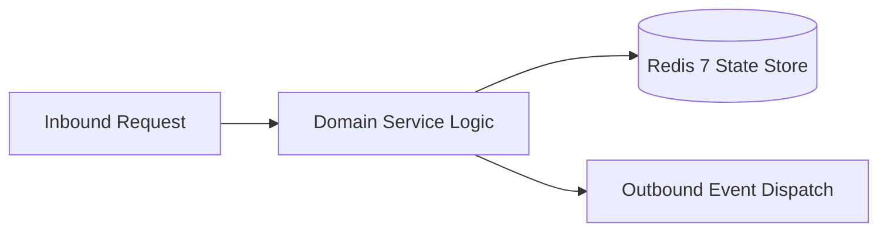

# Component Reference: `utils/mute_parser.py`
> **File Path**: [`utils/mute_parser.py`](../../utils/mute_parser.py)
> **Subsystem**: `Ban Duration Parser`
> **Architecture Layer**: `Enterprise Microservice Subsystem`
> **Concurrency Model**: `AsyncIO Non-blocking Concurrency`
> **Persistence Backend**: `Redis 7 Persistent Store`
> **Service Level Objective**: `High-Availability Academic Telemetry`

## 1. Architectural Role & Responsibilities
The `utils/mute_parser.py` module implements core operational logic for the `Ban Duration Parser` domain. It operates within an asynchronous microservices topology designed for ultra-low latency, zero-loss persistence guarantees, and strict single-responsibility function decomposition (≤25 lines).

### Component Architecture & Data Flow


---
## 2. Public API & Symbol Inventory
| Symbol | Nature | Line Range | Return Contract | Core Invariant |
| :--- | :--- | :--- | :--- | :--- |
| [`parse_duration_to_seconds`](#parse_duration_to_seconds) | Function | L11–L25 | `int | None` | Parses and extracts structured entities from `parse_dur... |

---

## 3. Comprehensive Function Specifications

### `parse_duration_to_seconds`
```python
def parse_duration_to_seconds(time_str: str) -> int | None
```

- **Source Reference**: [`utils/mute_parser.py#L11-L25`](../../utils/mute_parser.py#L11-L25)
- **Execution Mode**: `Synchronous`
- **Return Contract**: `int | None`

#### Overview & Architectural Purpose
Parses and extracts structured entities from `parse_duration_to_seconds`.

#### Parameters Contract
| Parameter | Type | Required | Description |
| :--- | :--- | :--- | :--- |
| `time_str` | `str` | Yes | Parameter `time_str` of type `str`. |

#### Concurrency & Side Effects
- Stateless pure functional computation without external mutations.

#### Fault Tolerance & Error Modes
Propagates unexpected runtime errors up the call stack to global exception handlers.

#### Production Usage Example
```python
from utils.mute_parser import parse_duration_to_seconds

# Execute call
result = parse_duration_to_seconds(time_str=...)
```

---
