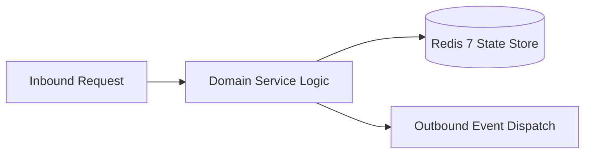

# Component Reference: `utils/storage.py`
> **File Path**: [`utils/storage.py`](../../utils/storage.py)  
> **Subsystem**: `Atomic Storage Engine`  
> **Architecture Layer**: `Enterprise Microservice Subsystem`  
> **Concurrency Model**: `AsyncIO Non-blocking Concurrency`  
> **Persistence Backend**: `Redis 7 Persistent Store`  
> **Service Level Objective**: `High-Availability Academic Telemetry`

## 1. Architectural Role & Responsibilities
The `utils/storage.py` module implements core operational logic for the `Atomic Storage Engine` domain. It operates within an asynchronous microservices topology designed for ultra-low latency, zero-loss persistence guarantees, and strict single-responsibility function decomposition (≤25 lines).

### Component Architecture & Data Flow


---
## 2. Public API & Symbol Inventory
| Symbol | Nature | Line Range | Return Contract | Core Invariant |
| :--- | :--- | :--- | :--- | :--- |
| [`sync_load_json`](#sync_load_json) | Function | L20–L35 | `Any` | Executes core domain logic for `sync_load_json`. |
| [`_write_temp_and_replace`](#_write_temp_and_replace) | Function | L38–L55 | `bool` | Executes core domain logic for `_write_temp_and_replace... |
| [`sync_atomic_save_json`](#sync_atomic_save_json) | Function | L58–L66 | `bool` | Executes core domain logic for `sync_atomic_save_json`. |
| [`load_json`](#load_json) | Function | L69–L77 | `Any` | Executes core domain logic for `load_json`. |
| [`save_json`](#save_json) | Function | L80–L88 | `bool` | Saves serialized entity data to storage for `save_json`... |

---

## 3. Comprehensive Function Specifications

### `sync_load_json`
```python
def sync_load_json(file_path: str, default: Any = None) -> Any
```

- **Source Reference**: [`utils/storage.py#L20-L35`](../../utils/storage.py#L20-L35)
- **Execution Mode**: `Synchronous`
- **Return Contract**: `Any`

#### Overview & Architectural Purpose
Executes core domain logic for `sync_load_json`.

#### Parameters Contract
| Parameter | Type | Required | Description |
| :--- | :--- | :--- | :--- |
| `file_path` | `str` | Yes | Parameter `file_path` of type `str`. |
| `default` | `Any` | Yes | Parameter `default` of type `Any`. |

#### Concurrency & Side Effects
- Emits structured telemetry events to system logging subsystem.

#### Fault Tolerance & Error Modes
Encapsulates faults within `try/except` blocks, logging errors and returning safe fallback defaults.

#### Production Usage Example
```python
from utils.storage import sync_load_json

# Execute call
result = sync_load_json(file_path=..., default=...)
```

---

### `_write_temp_and_replace`
```python
def _write_temp_and_replace(file_path: str, data: Any) -> bool
```

- **Source Reference**: [`utils/storage.py#L38-L55`](../../utils/storage.py#L38-L55)
- **Execution Mode**: `Synchronous`
- **Return Contract**: `bool`

#### Overview & Architectural Purpose
Executes core domain logic for `_write_temp_and_replace`.

#### Parameters Contract
| Parameter | Type | Required | Description |
| :--- | :--- | :--- | :--- |
| `file_path` | `str` | Yes | Parameter `file_path` of type `str`. |
| `data` | `Any` | Yes | Parameter `data` of type `Any`. |

#### Concurrency & Side Effects
- Emits structured telemetry events to system logging subsystem.

#### Fault Tolerance & Error Modes
Encapsulates faults within `try/except` blocks, logging errors and returning safe fallback defaults.

#### Production Usage Example
```python
from utils.storage import _write_temp_and_replace

# Execute call
result = _write_temp_and_replace(file_path=..., data=...)
```

---

### `sync_atomic_save_json`
```python
def sync_atomic_save_json(file_path: str, data: Any) -> bool
```

- **Source Reference**: [`utils/storage.py#L58-L66`](../../utils/storage.py#L58-L66)
- **Execution Mode**: `Synchronous`
- **Return Contract**: `bool`

#### Overview & Architectural Purpose
Executes core domain logic for `sync_atomic_save_json`.

#### Parameters Contract
| Parameter | Type | Required | Description |
| :--- | :--- | :--- | :--- |
| `file_path` | `str` | Yes | Parameter `file_path` of type `str`. |
| `data` | `Any` | Yes | Parameter `data` of type `Any`. |

#### Concurrency & Side Effects
- Stateless pure functional computation without external mutations.

#### Fault Tolerance & Error Modes
Propagates unexpected runtime errors up the call stack to global exception handlers.

#### Production Usage Example
```python
from utils.storage import sync_atomic_save_json

# Execute call
result = sync_atomic_save_json(file_path=..., data=...)
```

---

### `load_json`
```python
async def load_json(file_path: str, default: Any = None) -> Any
```

- **Source Reference**: [`utils/storage.py#L69-L77`](../../utils/storage.py#L69-L77)
- **Execution Mode**: `Asynchronous (non-blocking)`
- **Return Contract**: `Any`

#### Overview & Architectural Purpose
Executes core domain logic for `load_json`.

#### Parameters Contract
| Parameter | Type | Required | Description |
| :--- | :--- | :--- | :--- |
| `file_path` | `str` | Yes | Parameter `file_path` of type `str`. |
| `default` | `Any` | Yes | Parameter `default` of type `Any`. |

#### Concurrency & Side Effects
- Stateless pure functional computation without external mutations.

#### Fault Tolerance & Error Modes
Propagates unexpected runtime errors up the call stack to global exception handlers.

#### Production Usage Example
```python
from utils.storage import load_json

# Execute call
result = await load_json(file_path=..., default=...)
```

---

### `save_json`
```python
async def save_json(file_path: str, data: Any) -> bool
```

- **Source Reference**: [`utils/storage.py#L80-L88`](../../utils/storage.py#L80-L88)
- **Execution Mode**: `Asynchronous (non-blocking)`
- **Return Contract**: `bool`

#### Overview & Architectural Purpose
Saves serialized entity data to storage for `save_json`.

#### Parameters Contract
| Parameter | Type | Required | Description |
| :--- | :--- | :--- | :--- |
| `file_path` | `str` | Yes | Parameter `file_path` of type `str`. |
| `data` | `Any` | Yes | Parameter `data` of type `Any`. |

#### Concurrency & Side Effects
- Stateless pure functional computation without external mutations.

#### Fault Tolerance & Error Modes
Propagates unexpected runtime errors up the call stack to global exception handlers.

#### Production Usage Example
```python
from utils.storage import save_json

# Execute call
result = await save_json(file_path=..., data=...)
```

---
